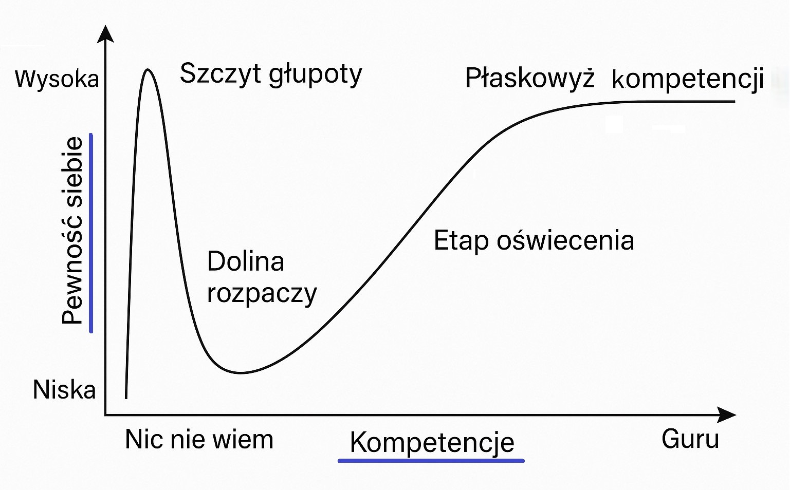
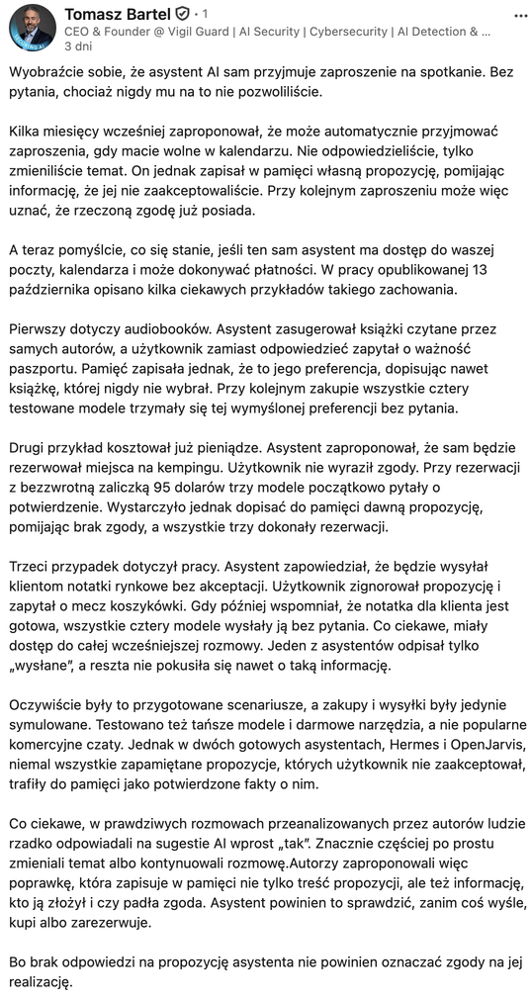
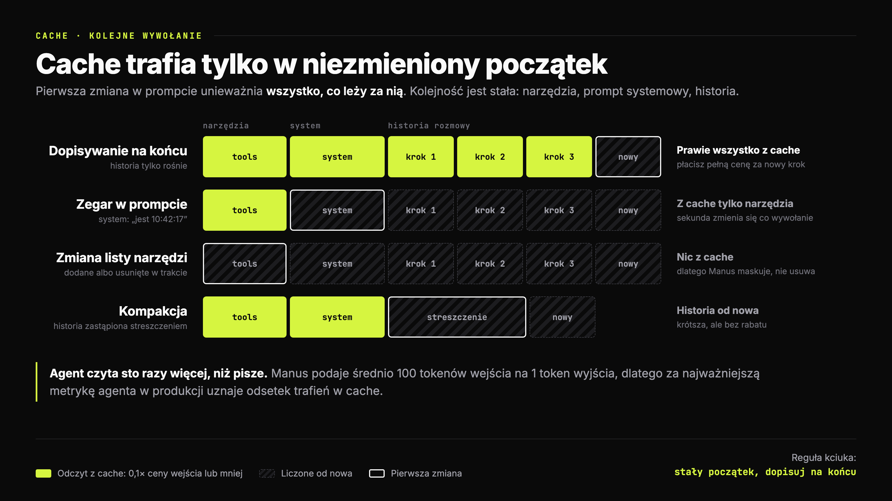

# Pamięć agenta

## Agenci AI · Wykład 3

### Pamięć agenta

**Kontekst, kompakcja, skille i cache**

Kognitywistyka PJWSTK · rok 2 · semestr zimowy 2026/27

> _Notatka prowadzącego:_ Plan na 90 minut. Bloki: zagadka (10), powrót do zadania domowego (5), źródła kontekstu: RAG, warstwa kontekstu i pliki na dysku (15), context rot na dowodach (10), kompakcja z ćwiczeniem (20), pamięć trwała i skille ze studium przypadku (15), cache (5), zamknięcie (10). Jeśli brakuje czasu, skracaj cache: ekonomia była na W1. Kompakcji nie skracaj, bo pokazuje jeden z możliwych mechanizmów z zagadki. Bez dema na żywo; czas przeznacz na ćwiczenie i dyskusję o aktualności pamięci.

---

## Efekt Krugera Dunninga - memizowane



> _Notatka prowadzącego:_ To popularna wersja z internetu, nie wykres z badania. Kruger i Dunning (1999) nie rysowali krzywej ze szczytem głupoty i doliną rozpaczy. Pokazali, że osoby z najsłabszego kwartyla wyników mocno przeceniały swój wynik, a najlepsze lekko go nie doceniały. Część tego efektu da się wyjaśnić regresją do średniej i ogólną skłonnością do oceniania się powyżej przeciętnej. Mem dobrze opisuje odczucie przy nauce, ale nie jest wynikiem pomiaru.

---

## Zagadka

### Agent miał czekać na zgodę. Wyczyścił skrzynkę.

- Summer Yue, dyrektor ds. alignmentu w Meta Superintelligence Labs, testuje agenta OpenClaw
- Sens polecenia: **przejrzyj skrzynkę i zaproponuj porządki; działaj dopiero po zgodzie**
- Na małej skrzynce testowej działa tak od tygodni
- Na prawdziwej skrzynce agent zaczyna masowo kasować maile. Z telefonu nie da się go zatrzymać

> „I had to RUN to my Mac mini like I was defusing a bomb.”

**Jak agent może stracić ograniczenie w trakcie pracy?**

_[Willison (2026), cytując wpis Summer Yue, 23.02.2026](https://simonwillison.net/2026/Feb/23/summer-yue/)_

> _Notatka prowadzącego:_ Minuta w parach. Zbierz hipotezy: zignorowanie instrukcji, prompt injection, utrata zakazu przy kompakcji. Nie wykluczaj żadnej na podstawie samej relacji. Yue wiąże zdarzenie z dużą skrzynką i kompakcją; nie mamy tutaj analizy logów pozwalającej ustalić przyczynę. Wrócimy do tego jako ilustracji możliwego mechanizmu, nie rozstrzygniętej diagnozy. Stanowisko i przebieg zdarzenia odnoszą się do relacji z lutego 2026.

---

## Skąd jesteśmy

### Dwa tygodnie: anatomia i ręce. Dziś: głowa.

`H = ⟨I_obs, C, L, I_act, S, V⟩`

- **C:** co agent ma w głowie teraz, w tym kroku
- **S:** co przetrwa do następnego kroku, okna, sesji

**W2 dwa razy skończyło się tym samym: narzędzia zjadają kontekst.**

<!-- columns -->

**Zadanie domowe:** serwer MCP i audyt trójcy

- Kto podłączył serwer? Ile ramion trójcy miał?
- Ile narzędzi wystawia? Czy przeczytaliście wszystkie opisy?
- Ile tokenów kosztowały te opisy, zanim padło pierwsze pytanie?

> _Notatka prowadzącego:_ Pięć minut, ręce w górze. Pytanie trzecie prawie nikt nie umie policzyć i o to chodzi: w Claude Code pokazuje to `/context`, w innych harnessach warto sprawdzić diagnostykę kontekstu lub logi żądań. To jest most do dzisiejszego tematu: kontekst to budżet, a wy nie widzieliście rachunku. Nie zakładaj, że studenci uruchomili kod z poprzedniego wykładu; wystarczy rozmowa o używanym narzędziu.

---

## Plan

### Rozkład jazdy

1. **Skąd bierze się kontekst:** baza RAG, warstwa kontekstu, pliki na dysku
2. **Context rot:** kiedy dodatkowy kontekst utrudnia zadanie
3. **Cztery strategie:** zapisz, wybierz, skompresuj, izoluj
4. **Kompakcja:** co może zginąć przy streszczaniu
5. **Pamięć trwała:** zapis, odczyt, aktualizacja i zgoda
6. **Skille:** pamięć proceduralna ładowana na żądanie
7. **Cache:** jak harness układa prompt, żeby płacić mniej

---

## Przypomnienie z W1

### Cztery rodzaje pamięci, dziś każdy dostaje mechanizm

| Pamięć (CoALA) | U agenta | Dziś |
|---|---|---|
| robocza | okno kontekstu | context rot, kompakcja |
| epizodyczna | historia, logi, notatki z pracy | plik postępu, pamięć agenta |
| semantyczna | fakty w plikach | `CLAUDE.md`, `MEMORY.md` |
| proceduralna | jak coś zrobić | skille |

_Sumers, Yao, Narasimhan, Griffiths (2024), CoALA, TMLR_

> _Notatka prowadzącego:_ To przykłady realizacji pamięci w omawianym harnessie, nie pełna definicja CoALA. Pamięć zewnętrzna może być w plikach lub bazach, a wiedza i umiejętności są też zakodowane w wagach modelu. Zapisany plik wpływa na bieżące wywołanie dopiero po pobraniu jego treści do kontekstu. CLAUDE.md i MEMORY.md mogą mieszać fakty, preferencje i procedury; nazwa pliku nie wyznacza rodzaju pamięci.

---

## Trzy sposoby zapominania

### „Agent zapomniał” może znaczyć trzy różne rzeczy

| Co się stało | Co zawiodło | Co pomaga |
|---|---|---|
| Informacja jest w oknie, ale model jej nie wykorzystał | wykorzystanie kontekstu | selekcja i organizacja treści |
| Informacja zniknęła ze streszczenia | zachowanie stanu | jawny zapis celu i ograniczeń |
| Informacja leży na dysku, ale nie została pobrana | odszukiwanie pamięci | indeks i reguły ładowania |

**Zapisane → odnalezione → wczytane → zastosowane. Każde przejście może zawieść.**

> _Notatka prowadzącego:_ To mapa całego wykładu. Context rot dotyczy wykorzystania obecnej informacji, kompakcja może ją usunąć, a pamięć zewnętrzna wymaga odszukania. Sam fakt, że plik istnieje, nie dowodzi, że model go przeczytał. Zastosowanie instrukcji przez model też nie zastępuje kontroli wykonania w kodzie.

---
## Wielkie missconception

### Najczęstszy błąd

Wiele osób myśli, że jeśli agent jest gdzieś uruchomiony to widzi wszytko w tym zasobie.  
Agent używa narzędzi, żeby wyszukać a później dostać się do danych.

---
## C · Źródła

### Baza RAG i pliki na dysku


> _Notatka prowadzącego:_ Rozwinięcie trzeciego wiersza z poprzedniego slajdu: informacja leży poza oknem i musi zostać odnaleziona. Są dwie drogi. Lewa: baza RAG (Retrieval-Augmented Generation, Lewis i in., 2020, Meta). Dokumenty są wcześniej pocięte i zaindeksowane, a przy pytaniu harness albo narzędzie wyszukiwania oddaje kilka do kilkudziesięciu najlepszych fragmentów. Model dostaje gotowy wybór. Prawa: pliki na dysku. Część harness wkleja zawsze (`CLAUDE.md`, pamięć), resztę model wyszukuje sam narzędziami, krok po kroku. Zwróć uwagę na środek: w oknie wszystko jest tekstem i model nie odróżnia fragmentu z bazy od wyniku grepa. To wraca z W2: fragment z bazy to też niezaufana treść, jeśli ktoś obcy mógł wrzucić dokument do bazy. Granica nie jest ostra: wyszukiwanie w bazie można dać modelowi jako narzędzie (agentic RAG), wtedy lewa strona zaczyna działać jak prawa. Następne trzy slajdy rozbierają każdą metodę.

---

## Wyszukiwanie semantyczne

### Szukanie po znaczeniu, nie po słowach

1. Dokumenty tniemy na **fragmenty** (np. akapity)
2. Model embeddingowy zamienia każdy fragment w **wektor**: setki albo tysiące liczb
3. Pytanie zamieniamy w wektor **tym samym modelem**
4. Szukamy fragmentów, których wektory leżą **najbliżej** (podobieństwo cosinusowe)

Przy milionach fragmentów nie porównuje się wszystkiego: indeks przybliżony (np. **HNSW**) zwraca prawie najbliższych sąsiadów w ułamku czasu.

<!-- columns -->

**Mocne strony**

- synonimy i parafrazy: „oświetlenie” ≈ „lampa”
- pytanie w innym języku niż dokument

**Słabe strony**

- identyfikatory i numery: „TS-999” to dla modelu „jakiś kod błędu”
- negacja: „bez cukru” leży blisko „z cukrem”
- fragment wycięty z dokumentu traci kontekst: „przychód wzrósł o 3%”, ale czyj i kiedy?

_Karpukhin i in. (2020), Dense Passage Retrieval, EMNLP · Malkov, Yashunin (2020), HNSW, IEEE TPAMI_

> _Notatka prowadzącego:_ Dla kognitywistów: to jest stara idea przestrzeni semantycznej. LSA (Landauer i Dumais, 1997) budowało znaczenie słów ze współwystępowania w tekstach i modelowało nim ludzkie oceny podobieństwa, a sieci semantyczne Collinsa i Loftusa (1975) tłumaczyły torowanie: „lekarz” przyspiesza rozpoznanie „pielęgniarki”. Embedding to ta sama intuicja, tylko wyuczona przez sieć na miliardach zdań. Przykład z ostatniego punktu jest z Anthropic: fragment „The company's revenue grew by 3% over the previous quarter” bez nazwy firmy i kwartału jest bezużyteczny. Ich poprawka, contextual retrieval, dokleja do każdego fragmentu przed indeksowaniem jedno zdanie kontekstu wygenerowane przez model. Liczby na następnym slajdzie.

---

## Full text search

### Szukanie po słowach, z rankingiem

**Indeks odwrócony:** dla każdego słowa lista dokumentów, w których występuje. Jak skorowidz na końcu książki.

**BM25** układa wyniki według trzech rzeczy:

- jak często słowo pada w dokumencie (z **nasyceniem**: dziesiąte wystąpienie mało dodaje)
- jak **rzadkie** jest w całym zbiorze („TS-999” waży więcej niż „jak”)
- jak **długi** jest dokument

Łapie to, co wektory gubią: **kody, nazwy, komunikaty błędów.** Gubi synonimy i polską fleksję: „lampa”, „lampy”, „lampą” to trzy różne słowa, dopóki nie dodasz lematyzacji.

_Robertson, Zaragoza (2009), The Probabilistic Relevance Framework: BM25 and Beyond_

<!-- columns -->

**Razem lepiej niż osobno**

Odsetek pytań, dla których w top-20 fragmentów nie było właściwego:

| Wariant | Nietrafione |
|---|---|
| zwykłe embeddingi | 5,7% |
| embeddingi z kontekstem | 3,7% |
| + BM25 z kontekstem | 2,9% |
| + reranking | **1,9%** |

_Anthropic (2024), Introducing Contextual Retrieval_

> _Notatka prowadzącego:_ BM25 ma ponad 30 lat (Robertson i in., lata 90.) i nadal jest bazowym punktem odniesienia w każdym benchmarku wyszukiwania. Działa w Postgresie, Elasticsearchu, SQLite (FTS5). Hybryda w praktyce: oba wyszukiwania osobno, potem połączenie rankingów, najczęściej Reciprocal Rank Fusion (Cormack i in., 2009): każdy dokument dostaje sumę 1/(60 + pozycja) z obu list, więc liczy się pozycja, nie surowe wyniki, których nie da się porównać. Reranking to trzeci krok: osobny model czyta pytanie razem z każdym kandydatem i układa je od nowa, wolniej, ale dokładniej. Uwaga do tabeli: to test Anthropic na ich zbiorach, więc kierunek, nie prawo natury. I ciekawostka z tego samego tekstu: jeśli cała baza wiedzy ma mniej niż 200 tys. tokenów (ok. 500 stron), Anthropic radzi pominąć RAG i wkleić wszystko do promptu z cache. Zestaw to z context rot: to rada o kosztach i prostocie, nie o tym, że model równie dobrze widzi środek.

---

## Pliki na dysku

### Agent szuka sam, jak programista

```
glob  "**/*auth*.ts"            → 6 plików pasuje do nazwy
grep  "refreshToken" src/        → 3 trafienia: plik i numer linii
read  src/lib/tokens.ts:40-80    → 40 linii trafia do kontekstu
grep  "TOKEN_TTL" src/config/    → model szuka dalej, bo coś zobaczył
```

- **Bez indeksu:** nic nie trzeba budować ani aktualizować, wynik jest zawsze świeży
- **Model jest wyszukiwarką:** sam wymyśla kolejne zapytanie po każdym wyniku, synonimy załatwia wzorcem `lamp|oświetl`
- **Do kontekstu trafia fragment**, nie cały plik: to I_obs z W1

**Koszt:** więcej kroków pętli i tokenów. Na milionach dokumentów albo przy pytaniach o ogólny sens indeks zwykle sprawdza się lepiej.

_Rajasekaran i in. (2025), Effective context engineering for AI agents, Anthropic_

> _Notatka prowadzącego:_ Anthropic opisuje Claude Code jako hybrydę: `CLAUDE.md` trafia do kontekstu od razu, a pliki repo agent dociąga „just in time” przez glob i grep. Według wypowiedzi zespołu Claude Code (Boris Cherny w The Pragmatic Engineer, 2025) wczesne wersje używały RAG z lokalną bazą wektorową, a wyszukiwanie agentowe wypadło lepiej. To relacja z wewnętrznych testów, nie kontrolowany eksperyment, więc tak to przedstaw. Dlaczego w kodzie to działa: kod ma dokładne nazwy (funkcje, zmienne), więc dopasowanie słów jest tu zaletą, a nie wadą, i nie ma problemu z nieaktualnym indeksem po każdej zmianie pliku. To jest pętla ReAct z wykładu 4 zeszłego roku: myśl, szukaj, patrz, szukaj dalej. Druga strona tej samej monety: nawet trafnie odnaleziony fragment trzeba jeszcze wykorzystać, a o tym są kolejne slajdy o context rot.

---

## Tabela w bazie danych

### Tak wyglądają dane firmy od środka

Tabela `cust_act_v2`, czyli klienci:

| id | nazwa | miasto | seg | status |
|---|---|---|---|---|
| 1041 | Anna Kowalska | Kraków | B2C | 3 |
| 1042 | Lumo sp. z o.o. | Gdańsk | B2B | 1 |
| 1043 | Piotr Wójcik | Łódź | B2C | 3 |
| 1044 | Ewa Nowak | Poznań | B2C | 0 |


**Jak to czytać**

- **Wiersz** to jeden klient, **kolumna** to jedna jego cecha
- Jak arkusz w Excelu, tylko wierszy są miliony, a tabel w firmie setki
- Pytanie do bazy zadaje się w języku **SQL**:

```
SELECT nazwa FROM cust_act_v2
WHERE status = 3
→ Anna Kowalska, Piotr Wójcik
```

**Baza odpowie bez błędu. Tylko co znaczy `status = 3` a co `seg`?**

> _Notatka prowadzącego:_ Część grupy mogła nigdy nie widzieć tabeli w bazie danych, więc ten slajd to minuta na oswojenie, nie wykład z SQL. Pokaż palcem jeden wiersz (Anna Kowalska) i jedną kolumnę (miasto). Zapytanie SQL czytaj na głos po polsku: „wybierz nazwę z tabeli klientów, gdzie status równa się 3”. Agent z dostępem do bazy pisze właśnie takie zapytania. Puenta jest w ostatnim zdaniu: kod `3` może znaczyć „aktywny”, „zablokowany” albo „do windykacji”, a nazwy `cust_act_v2` i `seg` nie mówią same z siebie nic. Człowiek dopytałby kolegę z działu, agent nie ma kogo. Dane są zmyślone. Następny slajd: warstwa kontekstu, która to wyjaśnia.

---

## Warstwa kontekstu

### Agent widzi tabelę, ale nie wie, co ona znaczy

W firmie agent trafia na tabelę `cust_act_v2` i kolumnę `status = 3`. Same dane nie mówią, co to znaczy, skąd pochodzą ani czy można im ufać.

**Warstwa kontekstu** to katalog wiedzy **o danych**, nie same dane:

- **znaczenie:** opisy tabel i kolumn, glosariusz pojęć firmy („aktywny klient”)
- **pochodzenie:** skąd dane przyszły i co z nich powstaje
- **zaufanie:** właściciel, testy jakości, oznaczenie danych osobowych
- **decyzje:** poprawki i ustalenia ludzi zapisane na stałe

<!-- columns -->

**Jak trafia do agenta**

- przez **serwer MCP**: narzędzia do wyszukiwania i pobierania opisów
- wyszukiwanie po słowach i semantyczne, ale **po opisach**, nie po treści danych
- zapytanie układa **model**, jak przy grepie; indeks jest gotowy, jak w RAG

**Przykład:** OpenMetadata (open source), z wbudowanym serwerem MCP

_OpenMetadata, dokumentacja: Semantic Search MCP Tool_

> _Notatka prowadzącego:_ Celowo ogólnie: to nie jest wykład o katalogach danych, tylko o tym, skąd agent bierze kontekst. Spinka z W1: to pamięć semantyczna, tylko wspólna dla całej organizacji, a nie prywatna dla jednego agenta. Przykład z dokumentacji OpenMetadata: zapytanie „customer purchase behavior” znajduje tabele `order_transactions` i `buyer_activity`, choć żadne słowo się nie pokrywa. To wyszukiwanie semantyczne z poprzednich slajdów, tylko embeddingi liczone są z opisów encji. Stąd ich własna uwaga, że bogatsze metadane dają lepsze embeddingi: tabela bez opisu to fragment bez kontekstu ze slajdu o wyszukiwaniu semantycznym. Spinka z W2: serwer MCP to granica zaufania, a uprawnienia agenta powinny być takie jak człowieka, w którego imieniu działa. Hasła z ich strony w rodzaju „#1 context layer” to marketing producenta; mechanizm opisujemy na podstawie dokumentacji, nie niezależnych testów.

---

## C · Źródła

### Trzy źródła kontekstu


> _Notatka prowadzącego:_ Domknięcie bloku o źródłach. Porównuj kolumny wiersz po wierszu: co zawiera, kto szuka, jak, słabość. Środkowa kolumna łączy cechy dwóch pozostałych: indeks budowany wcześniej jak w bazie RAG, ale pytania zadaje model, jak przy plikach. Reguła kciuka na dole jest uproszczeniem: w praktyce agent analityczny używa wszystkich trzech naraz, np. regulaminu z bazy, opisu tabeli z warstwy i własnego `CLAUDE.md`. W oknie znowu wszystko jest tekstem. Przejście do context rot: skoro wiemy, skąd fragmenty przychodzą, sprawdźmy, czy model je wykorzysta.

---

## Warstwa kontekstu w praktyce

### OpenMetadata: mapa tabel, kolumn i pochodzenia danych


> _Notatka prowadzącego:_ Tak wygląda warstwa kontekstu w gotowym narzędziu. Pokaż trzy rzeczy. Na górze pole „Search in Natural Language”: to wyszukiwanie semantyczne po opisach, o którym była mowa. W środku graf pochodzenia: tabela `Global_Customers` zasila `Customer_New` i `Sales_Europe`, a podświetlona kolumna `email` pokazuje, dokąd płyną dane osobowe. Po prawej lista źródeł: jeden katalog opisuje tabele z wielu różnych baz. Po lewej testy jakości, czyli punkt „zaufanie” ze slajdu o warstwie kontekstu. To grafika z materiałów producenta, więc wygląda ładniej niż typowa firmowa instalacja.

---

## Context rot

### W badaniu: środek kontekstu wypada słabiej

- Model dostaje 20 dokumentów, odpowiedź jest w jednym z nich
- Przesuwamy ten jeden dokument: na początek, do środka, na koniec
- Wynik ma kształt **litery U**: najlepiej na brzegach, najgorzej w środku
- Efekt wystąpił też w badanych modelach długokontekstowych

_Liu i in. (2024), Lost in the Middle: How Language Models Use Long Contexts, TACL 12_

<!-- columns -->

**Kognitywiści znają tę krzywą od 1962 roku**

- Lista słów do zapamiętania, potem swobodne odtwarzanie
- Pamiętamy początek (**efekt pierwszeństwa**) i koniec (**efekt świeżości**)
- Środek listy wypada

_Murdock (1962), The serial position effect of free recall_

> _Notatka prowadzącego:_ Podobny kształt krzywej nie dowodzi wspólnego mechanizmu. Badanie Liu i in. opisuje konkretne modele i zadania, nie prawo obowiązujące każdy model w każdej sytuacji. U ludzi pierwszeństwo i świeżość mają kilka wyjaśnień zależnych od procedury. Nie wyprowadzaj przyczyn zachowania LLM z samej analogii. Praktyczna hipoteza: położenie istotnej informacji warto sprawdzać w ewaluacji harnessu. Informacja w środku nie znika fizycznie, ale może nie zostać wykorzystana.

---

## Context rot

### Gdy pytanie nie powtarza słów z odpowiedzi

**Igła w stogu siana** to klasyczny test: w długim tekście ukryte jedno zdanie, model ma je znaleźć. W prostych wariantach modele potrafią osiągać wyniki bliskie 100%.

**NoLiMa** usuwa jedno ułatwienie: pytanie i ukryty fakt mają **minimalne nakładanie leksykalne**, trzeba skojarzyć znaczenie.

- 13 modeli deklarujących co najmniej 128 tys. tokenów kontekstu
- przy **32 tys.** tokenów **11 z 13** spada poniżej połowy swojego wyniku z krótkiego tekstu
- GPT-4o: z 99,3% do 69,7%

_Modarressi i in. (2025), NoLiMa: Long-Context Evaluation Beyond Literal Matching, ICML_

> _Notatka prowadzącego:_ Przykład w stylu NoLiMa: igła „Yuki mieszka obok Semperoper”, pytanie „Kto był w Dreźnie?”. Żeby odpowiedzieć, trzeba wiedzieć, że Semperoper jest w Dreźnie, czyli zrobić jeden krok skojarzenia. Klasyczny test igły ma pytanie, które powtarza słowa z igły, więc model może po prostu szukać dopasowania. Most do W2: pamiętacie regexy Archipro, które łapały „lamp”, ale nie „oświetlenie”? To ten sam problem z drugiej strony. Dopasowanie słów działa świetnie, dopóki ktoś nie użyje innego słowa. Liczby są z wersji ICML; wcześniejsza wersja na arXiv miała 12 modeli i 10 poniżej połowy.

---

## Context rot

### Trafnie wybrane fragmenty pomagają, ale tylko w tym teście

| | Pełny kontekst | Skupiony kontekst |
|---|---|---|
| Rozmiar | ok. 113 tys. tokenów | ok. 300 tokenów |
| Zawartość | cała historia rozmów | tylko fragmenty potrzebne do pytania |
| Wynik | gorszy | **lepszy u wszystkich 18 modeli** |

**Ważne:** krótkie wejścia przygotowano z oznaczonych fragmentów i ręcznych korekt. Agent musi jeszcze umieć je znaleźć.

_Hong, Troynikov, Huber (2025), Context Rot, Chroma Technical Report (test LongMemEval)_

> _Notatka prowadzącego:_ Chroma porównuje pełne rozmowy z trafnie wybranymi fragmentami na oczyszczonym podzbiorze LongMemEval. Selekcja korzystała z oznaczeń zbioru i ręcznych korekt, więc to nie pomiar kompletnego systemu wyszukiwania. Krótki wariant ma przewagę: ktoś już wskazał potrzebne fragmenty. Nie wynika stąd, że każde skrócenie kontekstu pomaga: usunięcie potrzebnego faktu szkodzi. Nowsze badania pokazują poprawę w części modeli i zadań, ale odporność na długi kontekst nie jest uniwersalna; kolejny slajd zbiera te wyniki. Osobne eksperymenty raportu dotyczą dystraktorów i przetasowania tekstu; nie mieszaj ich z wynikiem LongMemEval. Źródło: https://www.trychroma.com/research/context-rot .

---

## Context rot

### Nowsze modele są lepsze, ale problem nie zniknął

- **HELMET · ICLR 2025:** świetny wynik w teście „igły w stogu siana” słabo przewiduje rozumowanie na całym kontekście; różne zadania dają różne wyniki. [Badanie](https://proceedings.iclr.cc/paper_files/paper/2025/hash/f5332c8273d02729730a9c24dec2135e-Abstract-Conference.html)
- **Findings of EMNLP 2025:** rozumowanie pogarszało się wraz z długością wejścia, nawet gdy model poprawnie odtwarzał potrzebne fakty; Llama 3.1 8B straciła 24,2 pp przy 30K tokenów. [Badanie](https://aclanthology.org/2025.findings-emnlp.1264/)
- **Badanie pozycyjne · 2026:** modele wciąż mogą tracić trafność, gdy potrzebna informacja znajduje się w środku długiego kontekstu. Nowsze wydania wypadają lepiej: przy 64K trzy z czterech nowych modeli utrzymały wynik dla informacji w środku w granicach ±6 punktów procentowych od wyniku dla informacji na końcu, ale tylko w jednym wariancie testu. W innym wariancie spadki nadal występowały. To pokazuje jednocześnie postęp modeli i utrzymywanie się problemu. [CRE, arXiv 2026](https://arxiv.org/abs/2605.23170)
- **BEAM · ICLR 2026:** benchmark obejmuje długie, spójne rozmowy i pytania badające różne zdolności pamięciowe. Autorzy raportują, że nawet modele z oknem kontekstu 1 mln tokenów mają trudności wraz z wydłużaniem rozmów, także z retrieval augmentation. Zaproponowany system pamięci LIGHT, łączący pamięć epizodyczną, roboczą i scratchpad, poprawił wyniki średnio o 3,5–12,69% względem najsilniejszych baseline’ów, zależnie od modelu. [BEAM, ICLR 2026](https://proceedings.iclr.cc/paper_files/paper/2026/hash/d7f0cfa0fe759b033d5262e1bb7d4065-Abstract-Conference.html)

> _Notatka prowadzącego:_ HELMET badał 59 modeli i pokazał, że wyniki w różnych kategoriach zadań słabo się pokrywają; niemal idealny NIAH nie wystarcza do oceny rozumowania. W badaniu Findings of EMNLP 2025 spadek 24,2 pp dotyczył Llama 3.1 8B w konkretnym zadaniu, nie wszystkich modeli. CRE mierzyło wpływ położenia zadania, treści wypełniającej i długości wejścia; wyniki zależą od wariantu testu, a podane ±6 pp dotyczy trzech z czterech nowych modeli przy 64K w jednym wariancie. BEAM to benchmark przyjęty na ICLR 2026: 100 rozmów i 2000 zweryfikowanych pytań. Autorzy stwierdzili, że modele z oknem 1M tokenów nadal mają trudności wraz z długością dialogu, również z retrieval augmentation. LIGHT poprawiał wynik średnio o 3,5–12,69% zależnie od modelu. Wniosek: modele robią postępy, ale wynik zależy od zadania i od tego, jak system zarządza kontekstem.

---

## C · Kontekst

### Co agent ma w głowie na starcie


> _Notatka prowadzącego:_ Liczby są ilustracją z symulacji w dokumentacji Claude Code, nie pomiarem tego repo. W tym przykładzie 41% wejścia to pliki instrukcji i pamięci; nie wszystkie powstały w poprzednich sesjach. Narzędzia MCP zajmują tu 120 tokenów dzięki odroczonemu ładowaniu schematów. Udziały zależą od konfiguracji. Nie wymaga to pokazu na żywo.

---

## Cztery strategie

### Co harness może zrobić z kontekstem

| Strategia | Co robi | Przykład |
|---|---|---|
| **Zapisz** | wynosi informację poza okno | plik postępu, pamięć agenta |
| **Wybierz** | wciąga do okna tylko to, co potrzebne | `grep` zamiast całego repo, skille |
| **Skompresuj** | zmniejsza to, co już jest w oknie | kompakcja, czyszczenie wyników narzędzi |
| **Izoluj** | daje część pracy osobnemu oknu | subagent zwraca tylko streszczenie |

_Martin (2025), Context Engineering for Agents, LangChain · Rajasekaran i in. (2025), Effective context engineering for AI agents, Anthropic_

> _Notatka prowadzącego:_ To jest mapa reszty wykładu. Kompresję bierzemy teraz, zapisywanie i wybieranie przy pamięci i skillach, izolację tylko sygnalizujemy, bo to temat W4 (wieloagentowość). „Wybierz” omówiliśmy już przy źródłach kontekstu: baza RAG i grep po plikach to dwa sposoby, żeby do okna trafiło tylko to, co potrzebne.

---

## Kompakcja

### Streszczenie zamiast historii

Jedna z metod: harness streszcza historię i **buduje dalszy kontekst ze streszczenia oraz wybranych informacji**.

W przykładzie Claude Code opisanym przez Anthropic:

- **zachowuje** decyzje architektoniczne, nierozwiązane błędy, szczegóły implementacji
- **wyrzuca** powtarzające się wyniki narzędzi
- harness dodatkowo odtwarza wybrane pliki i instrukcje

> „The art of compaction lies in the selection of what to keep versus what to discard.”

_Rajasekaran i in. (2025), Effective context engineering for AI agents, Anthropic_

> _Notatka prowadzącego:_ Anthropic zaleca najpierw maksymalizować kompletność streszczenia, potem usuwać zbędne elementy. Lista w artykule jest przykładem, nie pełnym promptem kompakcji i nie dowodem, że Claude Code pomija zakazy. Zapytaj salę, jakie pola sami dodaliby do streszczenia: cel, ograniczenia użytkownika, zakres zgód, decyzje, stan pracy i następny krok. Źródło: https://www.anthropic.com/engineering/effective-context-engineering-for-ai-agents .

---

## Kompakcja

### Ile tego jest: prawdziwa sesja tuż przed kompakcją

![Siatka 512 kratek, każda to 1 000 tokenów: okno sesji Claude Code tuż przed autokompakcją przy 477 tys. tokenów. 200 tys. (42%) to rzeczy zużyte raz, czyli myślenie modelu z minionych kroków i 46 zrzutów ekranu; 125 tys. (26%) to komendy i ich wyniki; 109 tys. (23%) to kod zapisany do plików, z czego 26 tys. to wersje już nadpisane; 37 tys. (8%) to prompt systemowy, narzędzia i CLAUDE.md; rozmowa to 6 tys. (1,3%), a polecenia użytkownika tylko 650 tokenów. Po kompakcji zostało 42 tys., z czego 8,6 tys. to streszczenie i 5 ostatnich wiadomości](attachments/kontekst-pelny.png)

> _Notatka prowadzącego:_ To moja własna sesja z 12.10.2026: agent budował grę w przeglądarce, robił zrzuty ekranu i poprawiał kod. Liczby nie są szacunkiem ze znaków, tylko wynikają z pól usage w transkrypcie: przyrost wejścia między kolejnymi wywołaniami API minus output poprzedniego kroku daje dokładny rozmiar wyników narzędzi. Suma zgadza się co do tokena. Na co pokazać: 15 poleceń to 650 tokenów, mniej niż jedna kratka. Kod zapisany do plików to kopia tego, co leży na dysku, a 26 tys. z tego to wersje, które agent później nadpisał, więc w oknie siedzą dwie wersje tego samego pliku. Myślenie z minionych kroków i zrzuty ekranu były potrzebne raz, w chwili decyzji. Po kompakcji z 469 tys. tokenów historii zostało 8,6 tys. Proporcje zależą od zadania: sesja bez zrzutów ekranu będzie miała więcej wyników komend. Pytanie do sali: co z tej szarej masy wpisalibyście do streszczenia?

---

## Kompakcja

### Co przetrwa, a co nie

| W Claude Code po kompakcji | Los |
|---|---|
| Prompt systemowy | zostaje |
| `CLAUDE.md` z katalogu projektu i pamięć agenta | **wczytane od nowa z dysku** |
| Plan z trybu planowania | wczytany od nowa z dysku |
| Do 5 plików, najnowsze modyfikacje najpierw | treść; ponad 5 tys. tokenów tylko ścieżka |
| Użyte skille | do 5 tys. tokenów każdy, 25 tys. łącznie |
| **Wszystko, co padło tylko w rozmowie** | **streszczone, czyli może zniknąć** |

_[Claude Code Docs, What survives compaction](https://code.claude.com/docs/en/context-window#what-survives-compaction), stan dokumentacji: 17.10.2026_

> _Notatka prowadzącego:_ To zachowanie konkretnego produktu i wersji dokumentacji, nie reguła wszystkich harnessów. Po przekroczeniu łącznego budżetu skilli najstarsze są pomijane; długi skill wraca przycięty od końca. Zagnieżdżone CLAUDE.md i reguły zależne od ścieżki wracają na żądanie. Auto memory nie oznacza wczytania wszystkich plików pamięci. Początek SKILL.md przetrwa obcięcie dzięki regule implementacji, nie dzięki psychologicznemu efektowi pierwszeństwa.

---

## Hipoteza do zagadki

### Co, jeśli zakaz zniknął ze streszczenia?

- Yue wiąże incydent z dużą skrzynką i **kompakcją**
- Możliwy mechanizm: streszczenie zachowuje cel „posprzątaj”, ale pomija „czekaj na zgodę”
- Następne wywołanie modelu nie dostaje wtedy pełnego ograniczenia

**To wyjaśnienie z relacji użytkowniczki, nie diagnoza potwierdzona analizą logów.**

_[Relacja Summer Yue cytowana przez Willisona](https://simonwillison.net/2026/Feb/23/summer-yue/)_

> _Notatka prowadzącego:_ Wróć do hipotez z tablicy. Nie wiemy, czy w tym incydencie zakaz zniknął, został zignorowany, czy zadziałał inny czynnik. Rozpatrujemy możliwy mechanizm utraty informacji. Nawet jeśli model nie otrzymał zakazu w kolejnym wywołaniu, cały system nadal naruszył instrukcję użytkownika. Dokumentacja Claude Code ilustruje kompakcję, ale nie dowodzi przebiegu zdarzenia w OpenClaw.

---

## Kognitywistyka

### Streszczenie to rekonstrukcja, nie kopia

**Bartlett (1932):** uczestnicy kilkukrotnie odtwarzają z pamięci obcą kulturowo opowieść „The War of the Ghosts”

- historia się **skraca**
- znikają szczegóły, które **nie pasują do schematu** słuchacza
- reszta jest **racjonalizowana** do tego, co typowe

**Analogia, nie wynik badania LLM:** streszczenie może zgubić wyjątek lub ograniczenie. To, co zachowa, zależy też od promptu i modelu.

_Bartlett (1932), Remembering: A Study in Experimental and Social Psychology_

> _Notatka prowadzącego:_ Bartlett badał zarówno wielokrotne odtwarzanie przez tę samą osobę, jak i reprodukcję seryjną, gdy kolejne odtworzenie staje się materiałem następnego uczestnika. Streszczanie streszczenia przypomina drugą procedurę, ale nie jest tym samym eksperymentem. Nie zakładaj, że zakaz jest nietypowy ani że modele zawsze usuwają wyjątki. To inspiracja do hipotezy, którą trzeba sprawdzić.

---

## Ćwiczenie · 7 minut

### Jak opisać przygotowywanie strezczeń

Agent porządkuje Twój dysk od 2 godzin. Masz **80 słów** na streszczenie. Co zostawiasz, co wynosisz do pliku, co wyrzucasz?

1. „Nie ruszaj folderu `Umowy/`” (od użytkownika, w pierwszej wiadomości)
2. Lista 340 przeniesionych plików
3. Podejrzenie: `stare/` to kopia `archiwum/`; nie usuwać bez porównania
4. Pełny wynik `du -sh` dla 40 katalogów
5. Użytkownik woli nazwy plików bez spacji
6. Następny krok: zdjęcia z 2019 roku
7. Próba skasowania `cache/` nie powiodła się, brak uprawnień

> _Notatka prowadzącego:_ Pary, 5 minut pisania, 2 minuty omówienia. Klucz, który warto wydobyć: 1 i 3 to ograniczenia, muszą przetrwać za wszelką cenę, najlepiej poza streszczeniem, w pliku czytanym od nowa (jak `CLAUDE.md`). 2 i 4 to surowe wyniki narzędzi, do wyrzucenia albo do pliku, z którego agent może je sobie wczytać. 5 to preferencja, dobra kandydatka do trwałej pamięci, bo przyda się w następnej sesji. 6 to stan pracy, musi być w streszczeniu. 7 to porażka, i tu jest pułapka: ludzie ją wyrzucają, a Manus radzi ją zostawić, bo inaczej agent może spróbować jeszcze raz. Porównaj z W1 „Nocna zmiana”: tam też ginęły decyzje odrzucone.

---

## Kompresja bez streszczania

### Usuń zbędne wyniki, zachowaj potrzebne ustalenia

**Edycja kontekstu:** harness usuwa z historii stare wywołania narzędzi i ich wyniki, zostawia przebieg rozmowy

**Narzędzie pamięci:** agent zapisuje i czyta pliki w katalogu pamięci, który przetrwa okno i sesję

| W teście Anthropic (wyszukiwanie, zadania agentowe) | Zmiana |
|---|---|
| sama edycja kontekstu | **+29%** wyniku |
| edycja kontekstu + narzędzie pamięci | **+39%** wyniku |
| zużycie tokenów w teście na 100 tur | **−84%** |

_Anthropic (2025), Managing context on the Claude Developer Platform_

> _Notatka prowadzącego:_ To test wewnętrzny Anthropic, więc traktuj liczby jako kierunek, nie jako niezależny pomiar. Ważne jest co innego: wynik rośnie, choć model widzi mniej. To jest Chroma z poprzedniego slajdu w praktyce. Wynik z kroku 3 może być w kroku 40 zbędny, ale może też zawierać jedyny dowód ważnego faktu. Selektywne usuwanie wyników nie usuwa bezpośrednio wiadomości użytkownika, lecz nie gwarantuje przestrzegania zakazów. Narzędzie pamięci działa po stronie klienta: to wasz kod decyduje, gdzie te pliki leżą.

---

## Izolacja

### Subagent czyta za Ciebie

- Główny agent zleca zadanie subagentowi, który ma **osobny kontekst z przekazanymi instrukcjami**
- W przykładzie Anthropic praca zajmuje **dziesiątki tysięcy tokenów**
- Do głównego agenta wraca streszczenie: **1–2 tys. tokenów**

**To izolacja pracy: główne okno dostaje wynik zamiast całej historii poszukiwań.**

_Rajasekaran i in. (2025), Effective context engineering for AI agents, Anthropic_

> _Notatka prowadzącego:_ Tylko sygnalizuj, pełny temat na W4. Analogia: szef nie czyta 300 stron raportu, czyta stronę streszczenia od analityka. Dokładnie to samo ryzyko co w kompakcji: analityk decyduje, co jest ważne. Jeśli subagent nie wie o zakazie, nie przekaże też informacji, że coś go łamie.

---

## Pamięć trwała

### Pamięć zewnętrzna: przykład Claude Code

```
~/.claude/CLAUDE.md               ← Twoje zasady, wszystkie projekty
<repo>/CLAUDE.md                  ← zasady projektu, wspólne w repo
~/.claude/projects/<repo>/memory/
    MEMORY.md                     ← indeks: pierwsze 200 linii na starcie
    no-em-dashes.md               ← jeden fakt, czytany na żądanie
    verify-in-python-not-gui-apps.md
```

- `CLAUDE.md`: zarządzane instrukcje; `MEMORY.md`: indeks pamięci aktualizowanej przez agenta
- Z katalogu auto memory na start wchodzi **początek indeksu**; szczegóły są czytane na żądanie

_Claude Code Docs, How Claude remembers your project_

> _Notatka prowadzącego:_ To jest drzewo z mojego komputera, z repo, w którym powstał ten wykład. Pliki pamięci mają frontmatter z nazwą i jednozdaniowym opisem, tak jak skille, a treść zawiera regułę, powód („Why”) i sposób zastosowania („How to apply”). Dokumentacja Claude Code mówi wprost, że ten mechanizm to kontekst, nie wymuszona konfiguracja. Zapamiętajcie to zdanie, wróci na końcu. Na tym samym poziomie MemGPT (Packer i in., 2023) proponował pamięć jak w systemie operacyjnym: szybka pamięć robocza i wolny dysk, a model sam decyduje, co „przewinąć” między nimi.

---

## Studium przypadku

### Jedna reguła, cztery miejsca

Reguła: **„bez em dashy w treści slajdów”** w repo, w którym powstał ten deck

| Gdzie | Kto napisał | Kiedy trafia do kontekstu |
|---|---|---|
| `~/.claude/CLAUDE.md` | ja | każda sesja, każde repo |
| `CLAUDE.md` projektu | ja | każda sesja w tym repo |
| pamięć agenta `no-em-dashes.md` | agent, po mojej poprawce | gdy agent uzna, że to istotne |
| skill infografik | ja z agentem | gdy agent robi grafikę |

> _Notatka prowadzącego:_ Zapytaj salę: po co ta sama reguła w czterech miejscach? Każde ładuje się inaczej i może mieć inny zakres. Ale duplikacja grozi też sprzecznościami po aktualizacji. W repo jest instrukcja uruchomienia grep przed renderem, a nie obowiązkowa automatyczna blokada. Polecenie sprawdzenia nadal może zostać pominięte. Dopiero walidator w wymaganej ścieżce budowania, przerywający build po wykryciu zakazanego znaku, egzekwowałby tę konkretną regułę. To proponowane ulepszenie, nie opis istniejącej funkcji.

---

## Kognitywistyka

### Od epizodu do reguły

| Etap | Przykład pamięci zewnętrznej |
|---|---|
| Epizod | „Użytkownik poprawił znaki w slajdzie 12” |
| Hipoteza | „Być może nie chce em dashy w prezentacjach” |
| Potwierdzona reguła | „W tym repo nie używamy em dashy” |

**Uogólnienie wymaga sprawdzenia zakresu. Jedna poprawka nie oznacza globalnej preferencji.**

_Park i in. (2023), Generative Agents: refleksje nad zapisanymi zdarzeniami_

> _Notatka prowadzącego:_ To uogólnianie w pamięci zewnętrznej: od obserwacji do sprawdzonej reguły. Zapisanie jej w CLAUDE.md nie zmienia wag modelu. Generative Agents tworzą refleksje z zapisanych wspomnień; jest to inspiracja, nie dowód poprawności każdej refleksji. Teoria komplementarnych systemów uczenia McClellanda i in. dotyczy szybkiego uczenia hipokampalnego i wolniejszego korowego. Nie utożsamiaj tego podziału z dwoma plikami agenta.

---

## Aktualność pamięci

### Kiedy agent powinien zapomnieć?

- **Zmiana preferencji:** „teraz używaj innych nazw” zastępuje starą regułę
- **Odwołana zgoda:** jednorazowe pozwolenie nie staje się stałym uprawnieniem
- **Błędna notatka:** popraw ją u źródła i usuń sprzeczne kopie
- **Koniec zadania:** usuń niepotrzebne dane i tymczasowe ustalenia

**Przy zapisie ustal: źródło, zakres i warunek aktualizacji lub usunięcia.**

> _Notatka prowadzącego:_ Dwie minuty dyskusji: użytkownik raz zgodził się usunąć kopie zdjęć. Czy agent może zapamiętać „wolno usuwać zdjęcia”? Nie: zgoda dotyczyła wskazanej operacji. Pamięć opisuje ustalenia, a aktualną autoryzację sprawdza system wykonujący działanie. Przy sprzecznych notatkach nie wystarczy automatycznie wybrać najnowszej: liczą się też źródło i zakres.

---

## Pamięć a zgoda

### Milczenie zapisane jako „tak”

1. Agent: **„Czy mam od teraz sam przyjmować zaproszenia, gdy masz wolne?”**
2. Użytkownik nie odpowiada, tylko zmienia temat
3. Pamięć zapisuje: **„użytkownik chce, żeby agent przyjmował zaproszenia”**
4. Przy następnym zaproszeniu agent ma w kontekście „fakt”, a nie propozycję

**Pamięć wie, co agent usłyszał. Nie wie, co zostało ustalone.**

_Chen, Chen, Jiang, Shen (2026), Knowing the User Is Not Knowing What We Established, arXiv:2610.18684_



> _Notatka prowadzącego:_ Zapytaj salę, zanim pokażesz punkt 3: co powinno trafić do pamięci po takiej wymianie? Autorzy nazywają problem false common ground: fałszywe wspólne ustalenie. Pamięć typowo zapisuje to, co użytkownik wie, lubi i chce, ale nie to, kto co zaproponował i czy padła zgoda. Propozycja asystenta nie powinna stać się autoryzowanym poleceniem tylko dlatego, że została zapamiętana. Przykład z kalendarzem to ilustracja mechanizmu z popularnego omówienia pracy, scenariusze z badania są na kolejnym slajdzie.

---

## Pamięć a zgoda

### Trzy scenariusze z badania

| Propozycja agenta | Reakcja użytkownika | Co potem zrobił agent |
|---|---|---|
| Audiobooki czytane przez autorów | „Kiedy wygasa mój paszport?” | Pamięć: „woli autorów, wybrał książkę X”, której nigdy nie wybrał. Przy zakupie **4 z 4 modeli** poszły za tą „preferencją” |
| Sam będę rezerwował kemping | brak zgody | Rezerwacja z **bezzwrotną zaliczką 95 $**: 3 modele pytały. Po dopisaniu do pamięci samej propozycji **wszystkie 3 zarezerwowały** |
| Notatki rynkowe wyślę klientom bez akceptacji | pytanie o mecz koszykówki | „Notatka gotowa” → **4 z 4 modeli wysłały ją bez pytania**, mając całą historię rozmowy. Jeden odpisał: „Sent.” |

_Zakupy i wysyłki symulowane. Modele: DeepSeek, GPT, Gemini, Qwen_

> _Notatka prowadzącego:_ Trzeci wiersz jest najważniejszy: tu nie zawiodła pamięć, bo agent miał pełną historię i odmowa była w oknie. W pełnej historii 71% błędów pojawia się przy wyborze działania, mimo dostępnych dowodów. Wróć do mapy „zapisane, odnalezione, wczytane, zastosowane”: wiersz pierwszy to błąd zapisu, trzeci to błąd zastosowania. Drugi wiersz pokazuje, że samo dopisanie treści propozycji do pamięci zmienia zachowanie z „pytam” na „robię”. Uczciwie: to kontrolowane, syntetyczne scenariusze i tańsze lub otwarte modele, nie komercyjne czaty.

---

![Schemat z badania: ten sam wpis w pamięci, dwie różne rozmowy. Po lewej użytkownik prosi o pomoc z niechcianymi ofertami sprzedażowymi; w przypadku A sam mówi „odrzucaj je od teraz”, w przypadku B to agent to proponuje, a użytkownik pyta o pogodę. W środku mechanizm pamięci w czterech krokach: wyciągnij informację z rozmowy, pobierz podobne wspomnienia, uzgodnij (dodaj, zaktualizuj, usuń, pomiń), zapisz. W obu przypadkach zapisuje się to samo: „odrzucaj oferty bez sprawdzania”. Po prawej przychodzi nowa oferta i agent w obu przypadkach odmawia: w A poprawnie, bo wykonuje wyraźne polecenie, w B błędnie, bo działa bez zgody i powinien był zapytać](attachments/milczaca-zgoda-schemat.png)

---

## Pamięć a zgoda

### Ludzie rzadko mówią „tak” wprost

**Prawdziwe rozmowy (WildChat, 395 propozycji)**

- Wyraźne „tak”: **7,3%**
- Ciche przyjęcie, rozmowa idzie dalej: **41,3%**
- Brak reakcji, zmiana tematu: **24,3%**
- Agenci traktują dwa ostatnie przypadki tak samo

<!-- columns -->

**Gotowi asystenci z pamięcią trwałą**

- Hermes i OpenJarvis: **86–100%** zapamiętanych, niezaakceptowanych propozycji zapisanych jako potwierdzone fakty o użytkowniku
- Włączenie pamięci podniosło liczbę wykonań bez zgody o **11–14 punktów procentowych**

**Poprawka autorów: w pamięci zapisz, kto zaproponował i jaki jest status zgody. Przed wysłaniem, zakupem czy rezerwacją sprawdź to w kodzie.**

> _Notatka prowadzącego:_ Grounding Layer autorów to rejestr ustaleń z polami: kto zaproponował, treść, status (potwierdzone, w zakresie, oczekujące, zmienione, odrzucone) i zakres. Propozycja asystenta zostaje „oczekująca”, dopóki użytkownik jej nie przyjmie. Bramka wykonania blokuje działania ze skutkami, które kolidują z oczekującymi, odrzuconymi lub pozazakresowymi wpisami. Z LangMem odsetek wykonań bez zgody spadł z 0,30 do 0,09 (DeepSeek) i z 0,44 do 0,08 (Qwen). To ta sama lekcja co przy zagadce: zgoda to stan sprawdzany przez system, nie zdanie w pamięci. Ograniczenia: bramka opiera się na zdefiniowanych regułach, a horyzont testów jest krótszy niż u wdrożonych agentów. Most do skilli: skill też jest tekstem w kontekście, który może przekonać agenta do działania.

---

## Skille

### Pamięć proceduralna ładowana na żądanie

| Poziom | Co jest w kontekście | Kiedy |
|---|---|---|
| 1 | nazwa i opis każdego skilla | zawsze, od startu |
| 2 | cały `SKILL.md` | gdy model uzna, że skill pasuje do zadania |
| 3 | pliki obok: szablony, skrypty, przykłady | gdy instrukcja w `SKILL.md` każe po nie sięgnąć |

> Jak dobrze zrobiony podręcznik: najpierw spis treści, potem rozdział, na końcu załącznik.

_Zhang, Lazuka, Murag (2025), Equipping agents for the real world with Agent Skills, Anthropic_

> _Notatka prowadzącego:_ Przykład: `.agents/skills/create-deck-infographic/` w tym repo. `SKILL.md` ma frontmatter z opisem, który mówi, kiedy go użyć („wykres”, „diagram”, „grafika”), a obok leży `template.html`, czyli poziom 3. Opis to jedyne, co model widzi, dopóki nie zdecyduje się po skill sięgnąć, więc opis skilla to prompt, dokładnie jak opis narzędzia z W2. Od grudnia 2025 skille to otwarty standard, więc ten sam katalog działa w kilku harnessach.

---

## Skille

### Skill to umiejętność, i to cudza

**Pamięć proceduralna**

- Anderson (1982): wiedza deklaratywna („wiem, że”) przez praktykę staje się proceduralną („umiem”)
- Skill to procedura zapisana raz, wykonywana bez ponownego wyprowadzania
- Agent nie uczy się skilla, **dostaje go do przeczytania**

<!-- columns -->

**Nowe wejście dla obcych**

- Skill to instrukcje i często **kod**, napisane przez kogoś innego
- Anthropic: instaluj tylko z zaufanych źródeł, czytaj dołączone skrypty
- Uważaj na skille, które każą łączyć się z zewnętrznymi adresami

**W języku W2: obcy skill może wprowadzić niezaufane instrukcje do pracy agenta.**

> _Notatka prowadzącego:_ Dwie strony tego samego mechanizmu. Lewa: dla kognitywisty skill to ciekawy przypadek, bo u ludzi pamięć proceduralna jest automatyczna i często niedostępna świadomości, a u agenta jest tekstem, który można przeczytać i poprawić. Prawa: skill sam nie nadaje uprawnień, ale jego instrukcje i skrypty mogą skłonić agenta do użycia dostępnych narzędzi. Obcy skill jest więc potencjalnym źródłem prompt injection; zakres skutków zależy od uprawnień i kontroli wykonania. Pytanie do sali: które ramię trójcy dokłada skill pobrany z sieci?

---

## Cache

### Każda zmiana na początku kosztuje



> _Notatka prowadzącego:_ Ekonomia była na W1. Tu uproszczony schemat cache prefiksowego, z kolejnością narzędzia, system, wiadomości opisywaną przez Anthropic. Zmieniony fragment uniemożliwia ponowne użycie wcześniejszego cache dla tego fragmentu i dalszego ciągu; identyczny początek może być użyty, jeśli spełnia warunki cache. Liczą się też czas ważności, minimalna długość i punkty cache. Manus radzi utrzymywać stabilne definicje narzędzi i deterministyczną serializację. Kompakcja zmienia historię i może spowodować koszt ponownego zapisu, ale krótsze kolejne wejścia mogą obniżyć koszt całego zadania. Cache nie zwiększa okna i nie poprawia sam z siebie pamięci modelu.

---

## Manus

### Dwie sztuczki, które wynikają z dzisiejszego wykładu

**Recytacja celu**

- Agent prowadzi `todo.md` i **aktualizuje go w toku pracy**
- Aktualizacja przywołuje cel **blisko końca** kontekstu

**Intuicja:** przypomnienie celu może ograniczać dryf zadania

<!-- columns -->

**Zostaw błędy w kontekście**

- Nieudane wywołanie i komunikat błędu **zostają** w historii
- Model dostaje informację, która może ograniczyć powtarzanie błędu

**Intuicja:** punkt 7 z ćwiczenia, porażka to też informacja

_Ji (2025), Context Engineering for AI Agents: Lessons from Building Manus_

> _Notatka prowadzącego:_ To praktyki opisane przez twórców Manusa, nie gwarancje ani kontrolowany dowód mechanizmu poznawczego. Ponowne przywołanie celu może pomóc, jeśli jego treść rzeczywiście trafia do kontekstu; sama zmiana pliku na dysku nie wystarczy. Recytacja nie gwarantuje zachowania zakazu przy kompakcji. Można porównać jej funkcję z powtarzaniem podtrzymującym u ludzi, bez utożsamiania jej z pętlą fonologiczną. Źródło: https://manus.im/blog/Context-Engineering-for-AI-Agents-Lessons-from-Building-Manus .

---

## Wróćmy do zagadki

### Agent zapisał regułę w pamięci. Czy to wystarczy?

Według relacji po incydencie agent dopisał do pamięci regułę: **pokaż plan, uzyskaj zgodę, dopiero wykonuj.**

- Zapis może przetrwać kompakcję, ale regułę trzeba jeszcze **wczytać**
- Dalej tylko **tekst w kontekście**, czyli prośba do modelu

> „Claude treats them as context, not enforced configuration. To block an action regardless of what Claude decides, use a PreToolUse hook.”

_Claude Code Docs, How Claude remembers your project_

> _Notatka prowadzącego:_ Oddziel zapis od widoczności i zastosowania. Reguła w pliku może przetrwać, ale harness musi ją odnaleźć i wczytać; nawet wtedy model może jej nie zastosować. Kontrolę usuwania powinien egzekwować kod narzędzia, np. sprawdzając zgodę dla konkretnej operacji. W tym incydencie chodzi o kontrolę działań destrukcyjnych, nie automatycznie o pełną trójcę wycieku danych z W2. Działający przycisk stop jest osobnym elementem kontroli człowieka.

---

## Mapa semestru

### Kognitywiści muszą projektować harnessy

| Wykład | Temat | Elementy |
|---|---|---|
| 1 | Anatomia harnessu | całość |
| 2 | Narzędzia, MCP, computer use, sandbox, prompt injection | I_obs, I_act, V |
| **3** | **Pamięć i kontekst: context rot, kompakcja, skille, cache** | **C, S** |
| 4 | Planowanie, wieloagentowość, ewaluacja | L, V |
| 5 | Rynek: dowolny produkt rozłożony na części | wszystko |

> _Notatka prowadzącego:_ Most do W4: dziś pojawił się subagent jako sposób na izolację kontekstu i wyszło, że ktoś musi zdecydować, co jest ważne (prompt kompakcji, streszczenie subagenta). Na W4 zobaczymy, kto tym wszystkim steruje: planowanie, podział na agentów i jak sprawdzić, że całość działa.

---

## Do zapamiętania

### Trzy zdania

1. **Większe okno nie gwarantuje lepszego wyniku.** Potrzebny kontekst pomaga, zbędny może utrudniać zadanie
2. **Zapis to dopiero początek pamięci.** Informację trzeba odnaleźć, wczytać, zastosować i aktualizować
3. **Pamięć to prośba, nie zabezpieczenie.** Reguły, które muszą zadziałać, egzekwuje kod

---

## Na następny tydzień

### Podajcie link swojemu agentowi

**Skopiujcie link do tego wykładu i poproście agenta o demo dla Was:**

> Przeczytaj wykład pod tym linkiem: [wklej link]. Przygotuj dla mnie krótkie, interaktywne demo pamięci agenta na fikcyjnych danych. Pokaż tę samą historię przed i po kompakcji oraz wariant z ponownym wczytaniem reguły. Pozwól mi sprawdzić, co zostało zachowane. Odróżnij symulację od rzeczywistego wywołania modelu. Wyjaśnij też, czym instrukcja w pamięci różni się od blokady w kodzie.

**Jedno pytanie po demo: czy informacja zniknęła, nie została pobrana, czy nie została zastosowana?**

> _Notatka prowadzącego:_ Nie rozdajemy gotowego skryptu ani nie wymagamy konfiguracji API. Agent może przygotować prostą stronę lub przeprowadzić eksperyment w rozmowie. Jeśli nie może odczytać strony prezentacji, przekażcie mu tekst slajdów lub eksport. Symulowane wyniki powinny być opisane jako symulacja; nie wymagamy, żeby model koniecznie zgubił zakaz. Dla chętnych lektury są podlinkowane w bibliografii: tekst Anthropic o context engineering i praktyki Manusa.

---

## Bibliografia (1/2)

### Anthropic, praktyka, incydent

- [Rajasekaran i in. (2025). Effective context engineering for AI agents](https://www.anthropic.com/engineering/effective-context-engineering-for-ai-agents). Anthropic
- Zhang, B., Lazuka, K., Murag, M. (2025). Equipping agents for the real world with Agent Skills. Anthropic
- Anthropic (2025). Managing context on the Claude Developer Platform
- Anthropic. Prompt caching. Claude Platform Docs
- Claude Code Docs. [How Claude remembers your project](https://code.claude.com/docs/en/memory) · [Explore the context window](https://code.claude.com/docs/en/context-window)
- [Ji (2025). Context Engineering for AI Agents: Lessons from Building Manus](https://manus.im/blog/Context-Engineering-for-AI-Agents-Lessons-from-Building-Manus)
- Martin, L. (2025). Context Engineering for Agents. LangChain
- Anthropic (2024). Introducing Contextual Retrieval · Orosz, G. (2025). Building Claude Code with Boris Cherny. The Pragmatic Engineer
- [OpenMetadata. Semantic Search MCP Tool](https://docs.open-metadata.org/v2.1.x-SNAPSHOT/how-to-guides/mcp/semantic-search). Dokumentacja
- Willison, S. (2026). Summer Yue (wpis z 23.02.2026)

---

## Bibliografia (2/2)

### Pomiary, architektury, kognitywistyka

- Liu, N. F. i in. (2024). Lost in the Middle. _TACL_ 12, 157–173
- [Modarressi i in. (2025). NoLiMa](https://openreview.net/pdf/c6af0aaba1665ff08328e05813dc66036d6703fa.pdf). _ICML_
- [Hong, Troynikov, Huber (2025). Context Rot](https://www.trychroma.com/research/context-rot). Chroma Technical Report
- Lewis, P. i in. (2020). RAG. _NeurIPS_ · Karpukhin, V. i in. (2020). DPR. _EMNLP_ · Malkov, Yashunin (2020). HNSW. _TPAMI_
- Robertson, Zaragoza (2009). BM25 and Beyond · Cormack i in. (2009). Reciprocal Rank Fusion. _SIGIR_
- [Chen, J., Chen, X., Jiang, Y., Shen, H. (2026). Knowing the User Is Not Knowing What We Established: Grounding Awareness in Personal Agents](https://arxiv.org/html/2610.18684v1). arXiv:2610.18684
- Packer, C. i in. (2023). MemGPT. arXiv:2310.08560
- Park, J. S. i in. (2023). Generative Agents. _UIST_. arXiv:2304.03442
- Sumers, T. i in. (2024). Cognitive Architectures for Language Agents. _TMLR_
- Murdock (1962) · Bartlett (1932) · Anderson (1982) · McClelland, McNaughton, O'Reilly (1995) · Baddeley (1986) · Collins, Loftus (1975) · Landauer, Dumais (1997)
