# Introduction to machine learning for processing text collections, part 2

## Artificial Intelligence and Data Science 1, Lecture

### Introduction to machine learning for processing text collections, part 2

Jakub Zboina, MSc Eng.

Rafał Masłyk, MSc Eng.

---

## Where we are

### Previous lecture

- Prompt, conversation history, RAG and finetuning
- Rankings and types of models
- Quantization: a first look
- Attention: words influence each other

<!-- columns -->

### Today

- How does text turn into numbers?
- Where do the weight values come from?
- How much does it weigh and what do we run it on?
- What changed over the last year?

**Don't be put off, you don't have to remember the details.**

---

## Lecture map

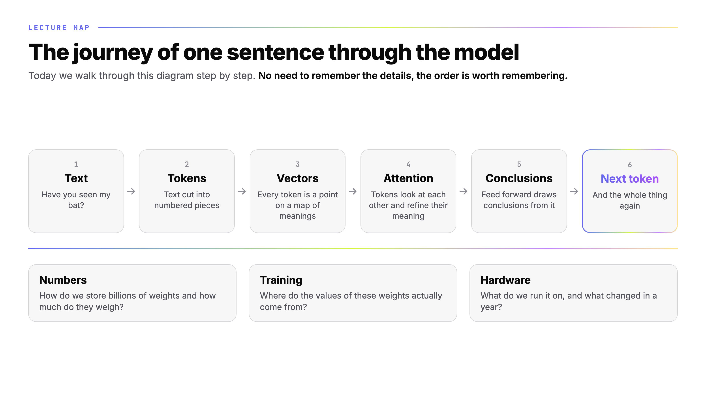

> _Notatka prowadzącego:_ This is the one diagram worth remembering from today. Come back to it at every transition: "we are at step 3". Next semester the same diagram returns as "an LLM is a function: text to text".

---

## Recap: the attention mechanism

### Bat

Have you seen my bat? I left it with my baseball glove and helmet.

**The attention mechanism lets the model understand meaning depending on context.**

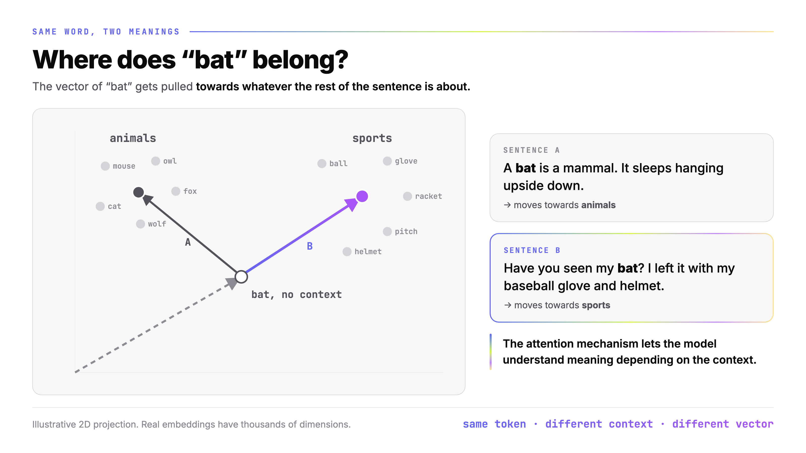

---

## Recap: the attention mechanism

### Attention is all you need

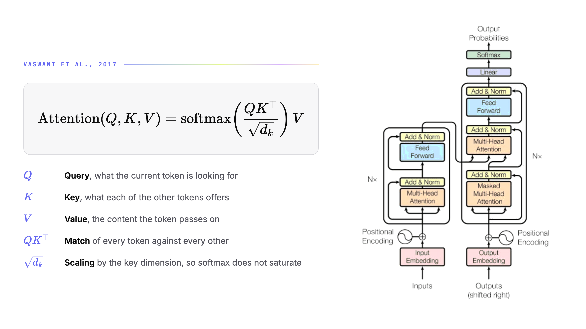

> _Notatka prowadzącego:_ Nobody needs to know the formula. We show it because today we will point at its pieces: Q, K, V and softmax.

---

## Recap: number of parameters

### ~AI is matrix multiplication~

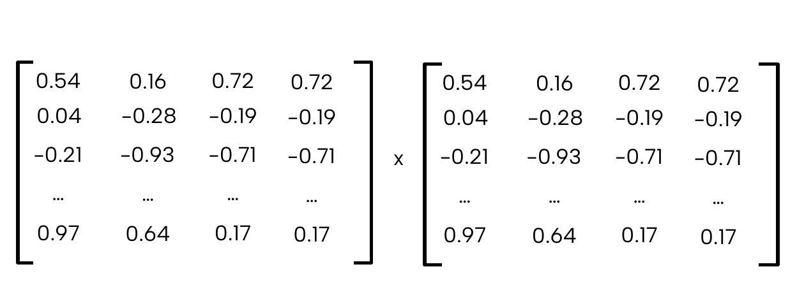

---

## Recap: number of parameters

### Matrices + activations

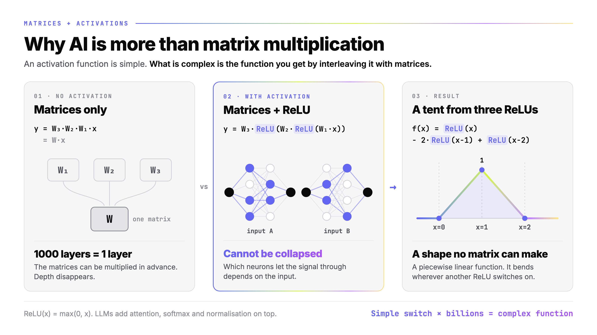

> _Notatka prowadzącego:_ Recap: without activations W3·W2·W1 can be multiplied in advance and a thousand layers give a single matrix. We will come back to activation functions in a moment.

---

## Numbers: why fewer bits?

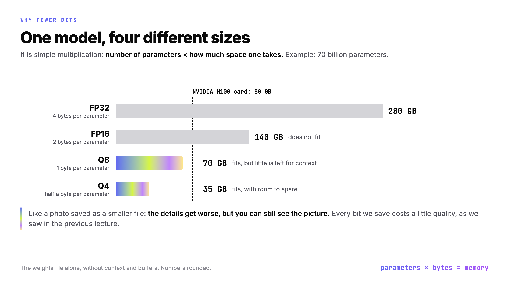

> _Notatka prowadzącego:_ This answers "why all this quantization" before we get into bits. The calculation is deliberately simple: 70 billion times the number of bytes. Remember these 70 GB, because exactly this number comes back on the GPU memory slide.

---

## Precision?

### 19.95758694 ≈ 20

32 bits vs 5 bits

Like a price in a shop: 19.96 is almost 20, and it is much shorter to write.

> _Notatka prowadzącego:_ Question for the room: how much do we lose by storing a weight in 5 bits instead of 32? The next slides show where the number 5 comes from.

---

## Precision

### Every bit doubles the number of values

| Number of bits | 1 | 2 | 3 | 4 | 5 |
|---|---|---|---|---|---|
| How many different values | 2 | 4 | 8 | 16 | **32** |
| Largest number | 1 | 3 | 7 | 15 | **31** |

The largest number is 1 less, because we start counting from 0.

**We want to store 20:** it does not fit in 4 bits (max 15), but it fits in 5 bits (max 31).

> _Notatka prowadzącego:_ For those who want it, the same calculation as a formula: the largest number is 2^N - 1, so N ≥ log2(M + 1). For M = 20 that gives about 4.39, rounded up to 5. Nobody needs to know this, the intuition from the table is enough.

---

## Precision

### 10100 = 20

| bit (16) | bit (8) | bit (4) | bit (2) | bit (1) |
|---|---|---|---|---|
| 1 | 0 | 1 | 0 | 0 |

16 + 4 = 20

---

## Quantization

| Quantization | Values (binary) | Values (decimal) | Range (signed) | Range (unsigned) |
|---|---|---|---|---|
| FP16 | 2^16 | 65536 | finite numbers | finite numbers |
| INT8 | 2^8 | 256 | -128 to 127 | 0 to 255 |
| INT5 | 2^5 | 32 | -16 to 15 | 0 to 31 |
| INT4 | 2^4 | 16 | -8 to 7 | 0 to 15 |

<!-- columns -->

| INT5 | INT4 |
|---|---|
| 0 = 00000 | 0 = 0000 |
| 0.5 = 00001 | 1 = 0001 |
| 1 = 00010 | 2 = 0010 |
| 1.5 = 00011 | 3 = 0011 |
| 2 = 00100 | 4 = 0100 |
| ... | ... |
| 14.5 = 11101 | 14 = 1110 |
| 15 = 11110 | 15 = 1111 |

> _Notatka prowadzącego:_ The right-hand table is the core: the fewer bits, the coarser the steps. INT5 can tell 14.5 from 15, while INT4 only has 14 and 15.

---

## FP16: number representation

### [numeral-systems.com/ieee-754-converter](https://numeral-systems.com/ieee-754-converter/)

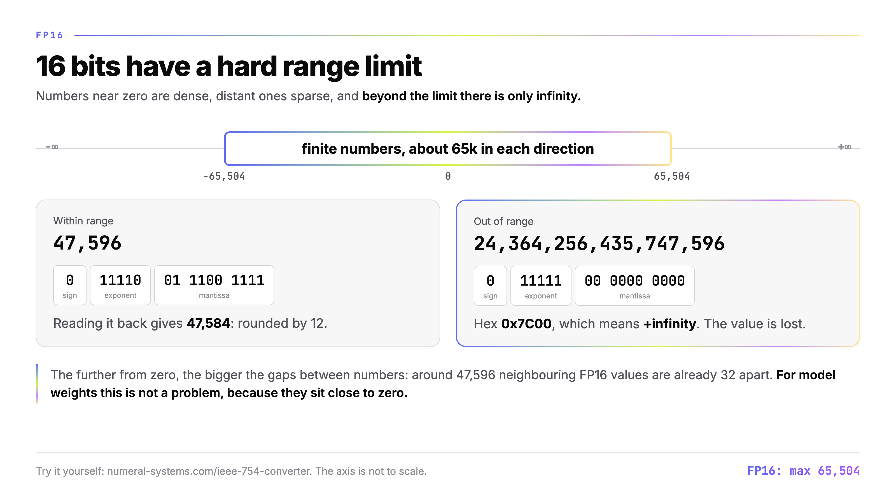

> _Notatka prowadzącego:_ Worth showing the converter live. The bit pattern for 47,596 is 0x79CF, which reads back as 47,584. The second number gives an exponent of all ones and a zero mantissa, i.e. 0x7C00, which in IEEE-754 means infinity.

---

## Step 2: tokens

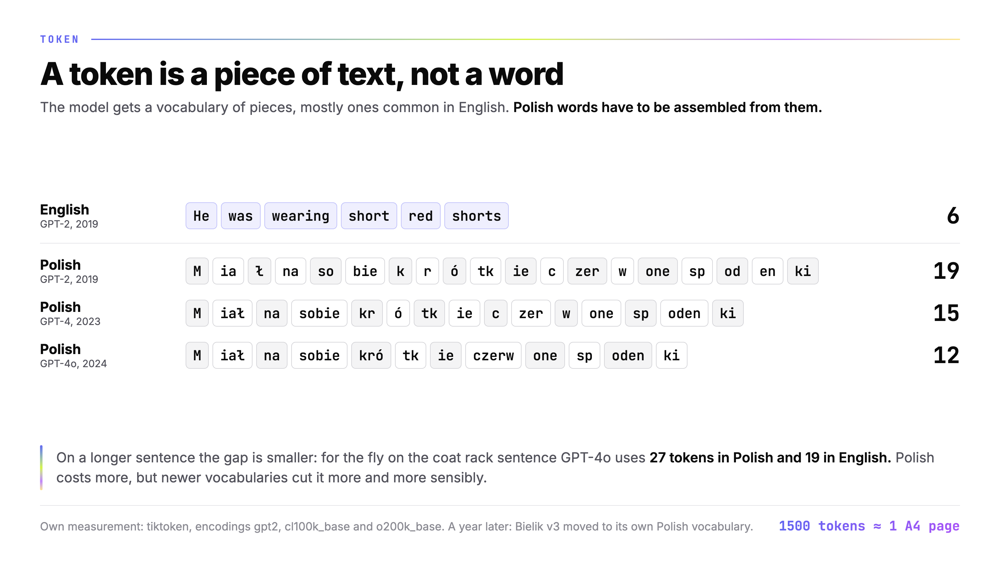

> _Notatka prowadzącego:_ Own measurement, it can be repeated with the tiktoken library. Why it matters: you pay for tokens and they fill the context window, so Polish text costs more than English. The gap depends on the sentence, the first one is extreme. This is not a flaw of Polish, it comes from a vocabulary built mostly on English data. The same applies to any language less represented in training data. That is why Bielik v3 moved from the Mistral vocabulary to its own, optimised for Polish (arXiv 2604.10799).

---

## Step 2: tokens in code

```python
input_texts = ['Have you seen my baseball bat?',
               "Bat is a mammal"]

batch_dict = tokenizer(input_texts, max_length=512, padding=True,
                       truncation=True, return_tensors='pt',
                       return_token_type_ids=True)

print(tokenizer.convert_ids_to_tokens(batch_dict[0].ids))
print(batch_dict[0].ids)
['<s>', '_Have', '_you', '_seen', '_my', '_baseball', '_bat', '?', '</s>']
[0, 31901, 398, 51592, 759, 178663, 1777, 32, 2]

print(tokenizer.convert_ids_to_tokens(batch_dict[1].ids))
print(batch_dict[1].ids)
['<s>', '_Bat', '_is', '_a', '_mamma', 'l', '</s>', '<pad>', '<pad>']
[0, 21947, 83, 10, 21968, 141, 2, 1, 1]
```

> _Notatka prowadzącego:_ Nobody needs to read the code, the last two pairs of lines are enough. Letter case matters: `_bat` is 1777 and `_Bat` is 21947. "mammal" splits into two tokens, `<pad>` evens out the lengths in the batch.

---

## Step 2: tokens in code

### No information about position or meaning, just a number

```text
'Have you seen my baseball bat?'
['<s>', '_Have', '_you', '_seen', '_my', '_baseball', '_bat', '?', '</s>']
[0, 31901, 398, 51592, 759, 178663, 1777, 32, 2]

'bat is a mammal'
['<s>', '_bat', '_is', '_a', '_mamma', 'l', '</s>', '<pad>', '<pad>']
[0, 1777, 83, 10, 21968, 141, 2, 1, 1]
```

> _Notatka prowadzącego:_ `_bat` has ID 1777 in both sentences, even though it is sixth in one and first in the other, and once it is a baseball bat and once an animal. The tokenizer knows nothing about position or meaning. A number is just a number: 1777 is not "closer" in meaning to 1778. That is why we need the next step.

---

## Step 3: vectors

### An embedding is an address on a map of meanings

- Every token gets coordinates
- **Close on the map = similar meaning**
- The map in the picture has 2 dimensions, GPT-3 had 12,288
- Nobody drew it: the model learned it from text


> _Notatka prowadzącego:_ Thousands of dimensions cannot be imagined, and they don't need to be. The intuition from a two-dimensional map is enough. The same idea returns in semester 3 as search by meaning: we turn the question and the documents into points and look for the nearest ones. That is how "lighting" finds "lamp".

---

## Step 3: how an LLM sees text

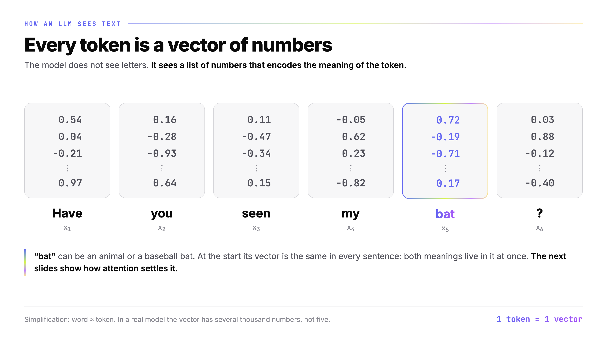

---

## Step 3: vectors in code

### From tokens to a vector

- Fixed vector length: GPT-3 has 12,288 dimensions
- The vector values depend on the trained vectorizer
- Embedding models are trained just like pre-trained models

<!-- columns -->

```python
batch_dict = tokenizer(string, max_length=512, padding=True,
                       truncation=True, return_tensors='pt')

outputs = model(**batch_dict)
embeddings = average_pool(outputs.last_hidden_state,
                          batch_dict['attention_mask'])

tensor_array = embeddings[0].detach().numpy()
```

`print_vector_for_string("bat")`

```text
[ 1.2955025, 0.670285, -0.73130226, -1.1073681, ...,
  0.9683652, 0.61739254, 0.033798084, 0.49025163 ]
```

---

## Word2vec: a popular (misleading) example

### [Source: Analytics Vidhya](https://medium.com/analytics-vidhya/word-embeddings-in-nlp-word2vec-glove-fasttext-24d4d4286a73)

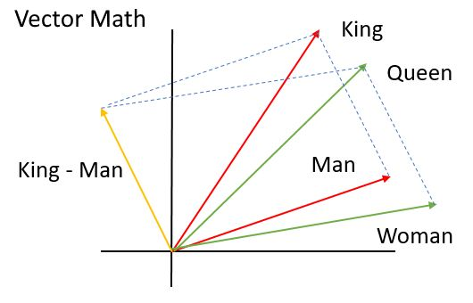

> _Notatka prowadzącego:_ The example is misleading, because in practice the result of king - man + woman lies closest to "king" itself. "Queen" only comes out once we exclude the input words. The idea stands: directions in embedding space carry meaning.

---

## Step 3: adding positions

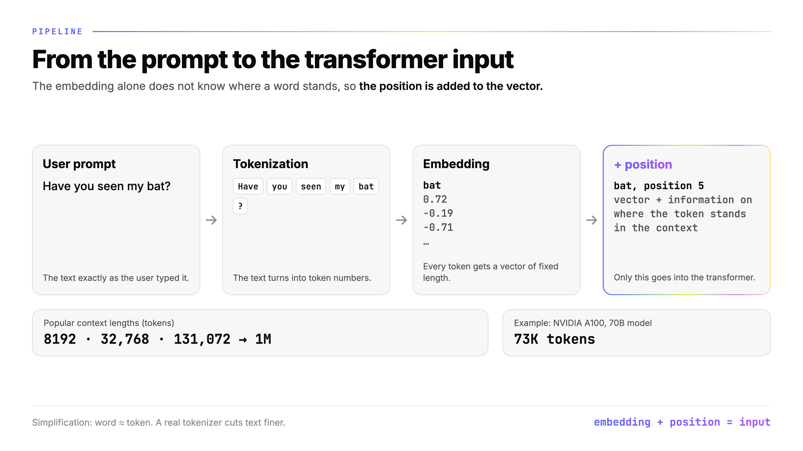

> _Notatka prowadzącego:_ Information about where a word sits in the context is added to the vector. Without it "dog bites man" and "man bites dog" would look the same to the model. Popular context lengths are 8192, 32,768, 131,072, and today even a million tokens.

---

## Step 4: attention

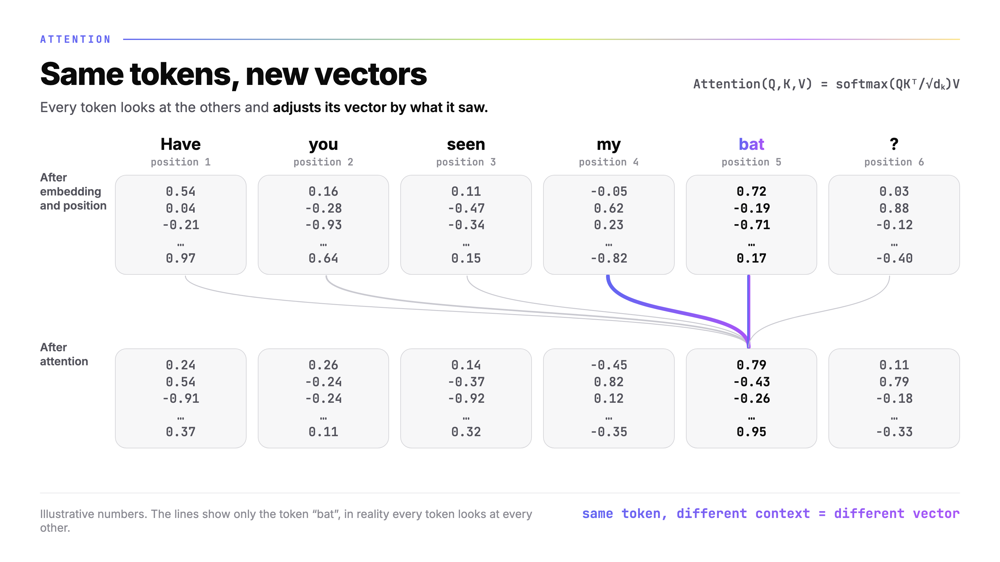

> _Notatka prowadzącego:_ The order: first the vector, then the position, then attention. Compare the top row with the bottom one: every number has changed. The numbers are illustrative.

---

## Step 4: Query, Key, Value

### Like searching the Internet

| | What it is | In a search engine | For the word "shorts" |
|---|---|---|---|
| **Query** | What am I looking for? | the typed phrase | "what am I like?" |
| **Key** | What do I offer? | the page title | "short": I describe length |
| **Value** | What do I pass on? | the page content | how much to change the vector |

> _Notatka prowadzącego:_ The same analogy as in the previous lecture. The question and the title match, so we read that page's content. The word "shorts" asks, and "short" and "red" answer most strongly. These are teaching names: the model has no sentence "what am I like?" inside, only learned numbers.

---

## Step 4: Query, Key, Value

### He was wearing short red shorts

- Query and key say **which word influences which**: "short" and "red" match "shorts"
- Value says **how much and in which direction** to move the vector

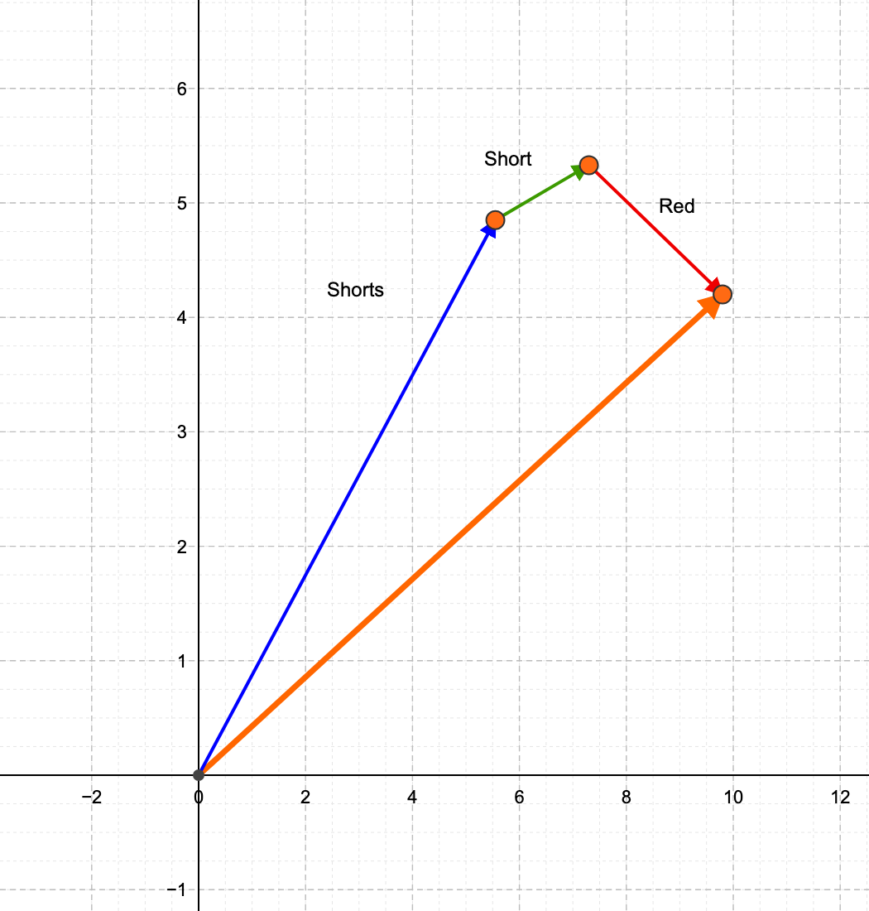

> _Notatka prowadzącego:_ The blue vector is "shorts" before attention. The green and red ones are the corrections from "short" and "red". The orange one is the result: the same shorts, but now short and red. A high dot product between Q and K means a good match.

---

## Step 4: multi-head attention

### Several heads, meaning several questions at once

- One head asks "what kind?", another "who?", another "where?"
- GPT-3 has 175 billion parameters and 96 multi-attention blocks
- Feed forward is 2/3 of the network's parameters: that is where conclusions are drawn

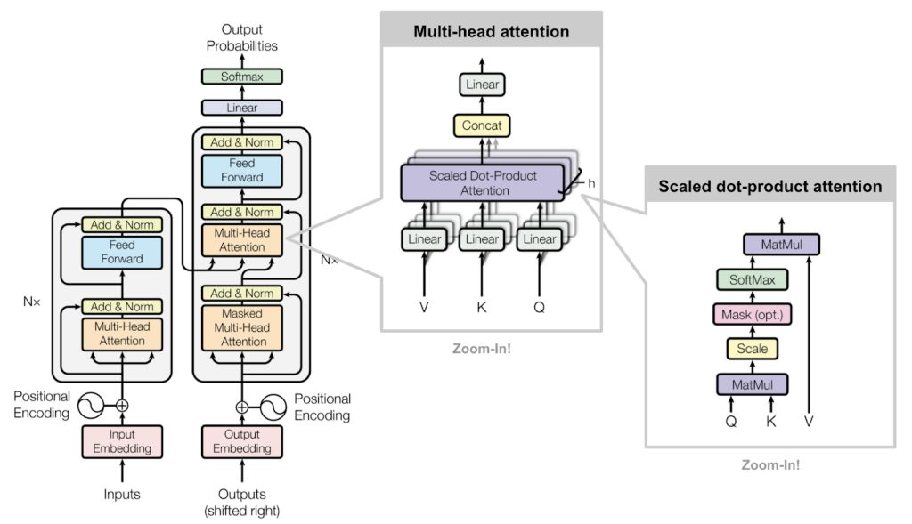

> _Notatka prowadzącego:_ "What kind, who, where" is a simplification: the heads learn on their own what to look at, nobody assigns it. Attention gathers information, feed forward processes it.

---

## Step 5: from attention to conclusions

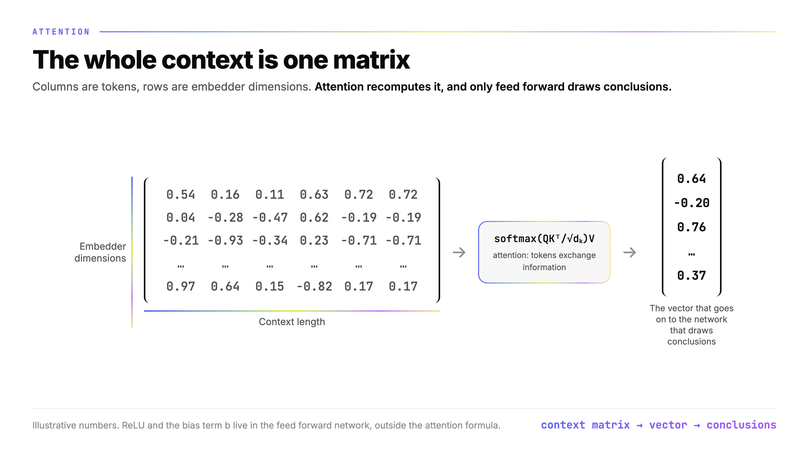

---

## Let's see it live

### [poloclub.github.io/transformer-explainer](https://poloclub.github.io/transformer-explainer/)

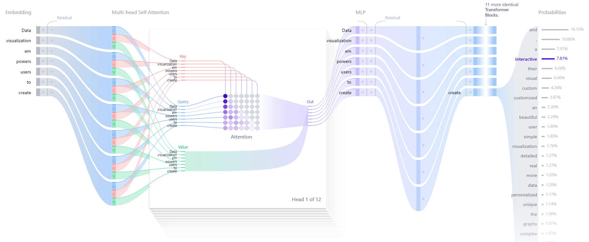

> _Notatka prowadzącego:_ Best opened live. It runs in the browser on the GPT-2 model. Walk through the lecture map: tokens, embedding, attention, MLP, next token.

---

## Embedder: Polish vs English

### "Miał na sobie krótkie czerwone spodenki" (He was wearing short red shorts)

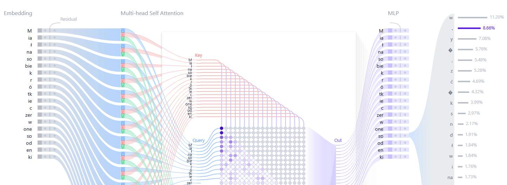

> _Notatka prowadzącego:_ These are the same 19 pieces as on the tokens slide. GPT-2 learned mostly on English, so the next-token suggestions on the right are noise. A good moment to say why language-specific models such as the Polish Bielik exist.

---

## Step 5: activation functions

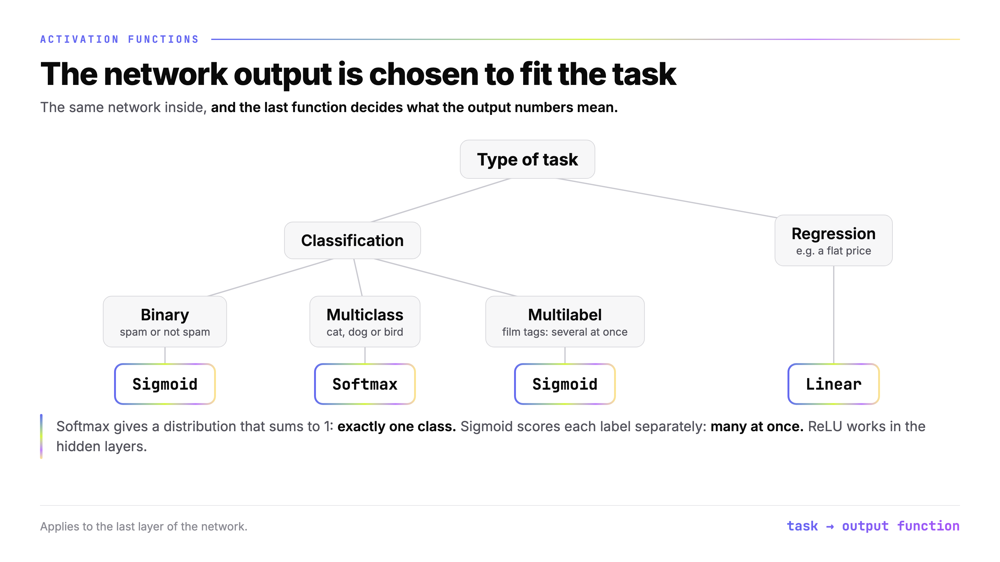

---

## Step 5: activation functions

### [encord.com/blog/activation-functions-neural-networks](https://encord.com/blog/activation-functions-neural-networks/)

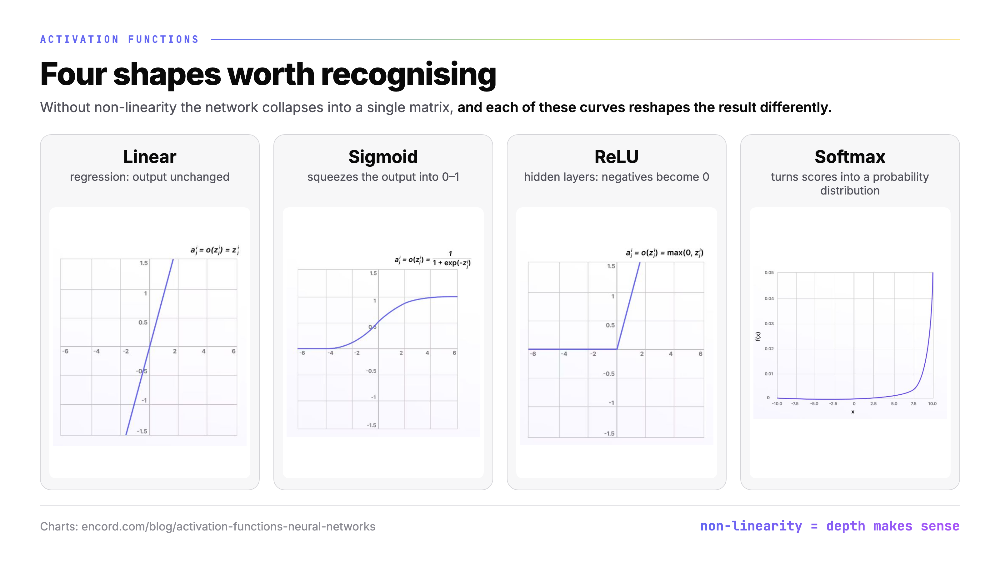

> _Notatka prowadzącego:_ Recognising the shapes is enough. ReLU is the switch from the previous lecture. Softmax will be useful in a moment: it is what turns the model's output into percentages for the next token.

---

## Step 6: next token

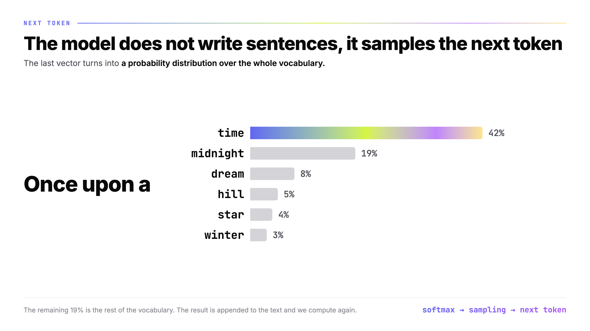

> _Notatka prowadzącego:_ Here we close the map. Softmax gives a distribution, and the model samples a token from it. This explains the slide from the previous lecture where 2+2= once gave 5. It returns in later semesters: function calling is still next-token prediction, only the tokens add up to a tool name. The percentages are illustrative.

---

## Training: where do the weights come from?

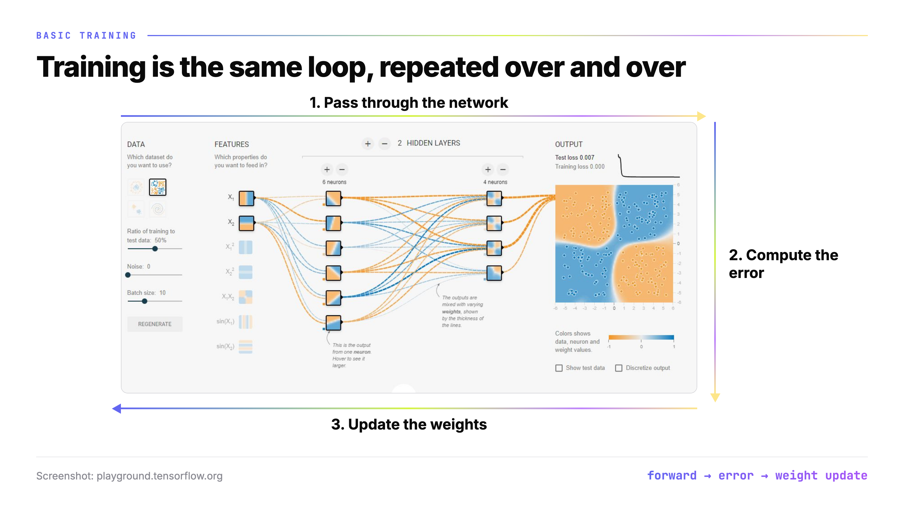

> _Notatka prowadzącego:_ Like learning to shoot hoops: I shoot, I see how far I missed, I adjust my hand. One shot teaches nothing, thousands of them do.

---

## Training: what it means for an LLM

### The model learns by guessing the next token

1. We take a text: "Once upon a ___"
2. The model gives its percentages for every token
3. We check what the text really said: "time"
4. We nudge the weights so that "time" gets more
5. We repeat on an enormous amount of text

**Nobody has to label anything:** the correct answer is already in the text.

> _Notatka prowadzącego:_ This is "language learning is unsupervised" from the previous lecture. It also shows why the model picks up biases from its data and why it learns Polish worse when there is less text. This returns in semester 2 when we discuss bias.

---

## Finetuning

### Finetuning

- We don't have to update all the parameters
- We can add another matrix: LoRA
- The process is less resource-hungry
- We can swap LoRAs as needed, using the same base model
- We don't make the model forget older information


---

## Finetuning: what LoRA is

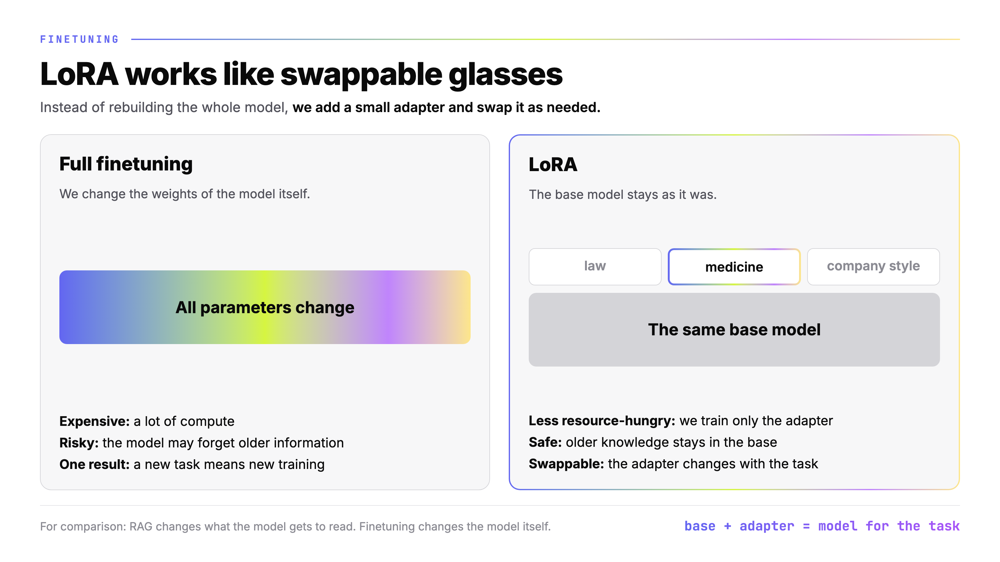

> _Notatka prowadzącego:_ A year later finetuning has not disappeared, but it is less often the first choice. For a model to know a company's data, it is usually enough to give it that data in the context: RAG, files, tools. Finetuning makes sense when behaviour or style has to change. Delivering context is covered in depth in semester 3.

---

## Hardware: what do we need to run a model locally?

### Example: OpenAI GPT-OSS 120B MXFP4_MOE

- 2 CPUs
- 64 GiB of disk space
- 24 GiB of RAM
- **80 GiB of VRAM**

<!-- columns -->

### What sits in VRAM

**Parameters, the bookshelf:** "long-term memory", the result of training. They take a fixed amount of space.

**Context, the desk:** "short-term memory". It grows with the conversation, because for every token the model keeps its K and V.

**Buffers, the scratch pad:** intermediate results of computation.

> _Notatka prowadzącego:_ VRAM is the fast memory right next to the GPU, everything the model computes has to end up there. The keys and values from attention are the KV Cache, which we come back to in semester 2. MOE in the model name stands for Mixture of Experts, also semester 2, and MXFP4 is a kind of quantization, i.e. the number of bits again.

---

## Context window

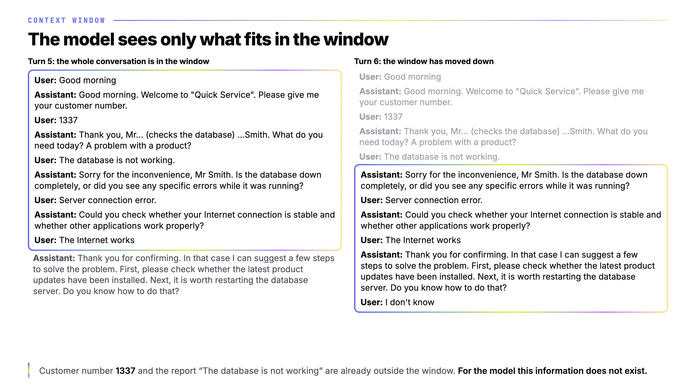

> _Notatka prowadzącego:_ The model remembers nothing by itself: with every message it receives the whole history again. The window is simply how much text can be sent to it.

---

## Context window: a year later

### Then: the oldest messages fell out

- Popular window lengths: 8192, 32,768, 131,072 tokens
- Whatever fell out was lost

<!-- columns -->

### Now: a bigger window, and the old part gets summarised

- Among the top open models: **1 million tokens**, about 660 A4 pages
- Instead of throwing it away, the system **summarises** the older part (compaction)
- **A million tokens in the window ≠ a million tokens the model will use**

> _Notatka prowadzącego:_ A million tokens according to the Artificial Analysis open weight list shown in the previous lecture, pages counted with the rule of 1500 tokens per A4 page. A bigger window does not fully solve the problem: a summary can lose something important, and the longer the context, the worse the model recalls details. That is a whole lecture in semester 3 (compaction, context rot).

---

## GPU memory

### NVIDIA H100 (80 GiB), 1500 tokens is about 1 A4 page

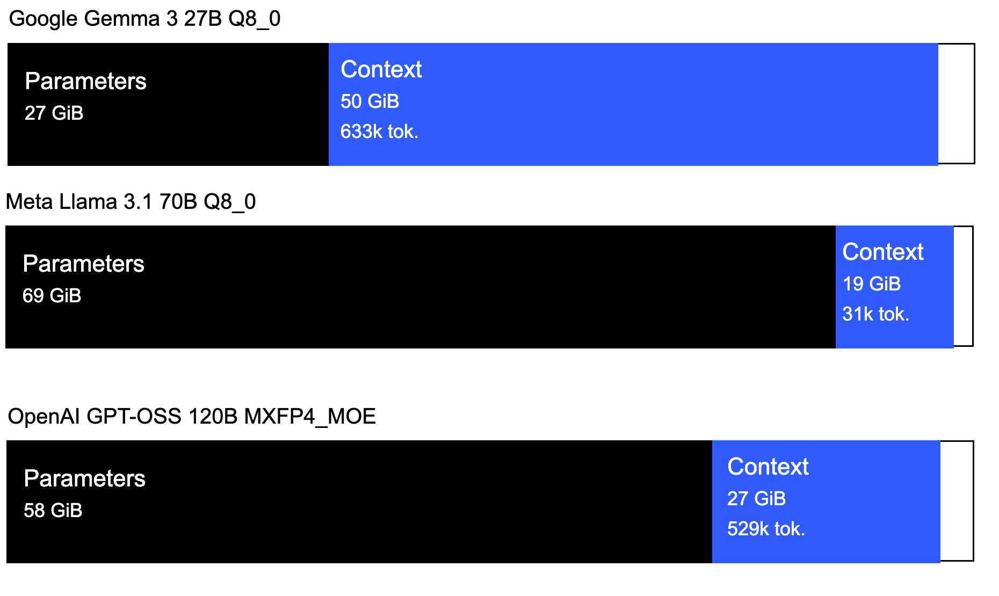

> _Notatka prowadzącego:_ The calculation from the beginning comes back here: Gemma 27B in Q8 is 27 GiB, Llama 70B in Q8 is 69 GiB. The bigger the bookshelf, the smaller the desk. To verify before the lecture: 69 + 19 and 58 + 27 exceed 80 GiB, yet in the picture both bars fit in the card. The rest of the bar on the right is buffers.

---

## Generation speed

### How fast will a chat generate 1 paragraph of text (300 tok.)? Measured in 2025

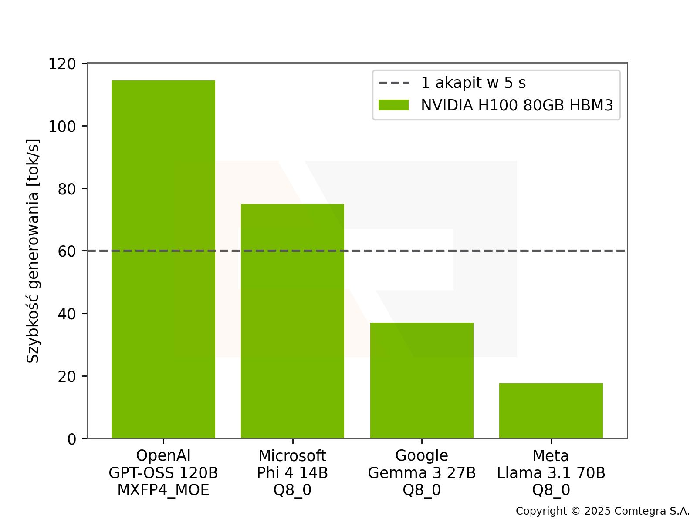

> _Notatka prowadzącego:_ The chart labels are in Polish: the vertical axis is generation speed in tokens per second, the dashed line "1 akapit w 5 s" is one paragraph in 5 seconds. How to read it: higher means faster, the dashed line is 60 tok/s. Puzzle: why is the biggest model the fastest? Because GPT-OSS is a Mixture of Experts: it has 117 billion parameters, but only about 5.1 billion are active at a time (model card on Hugging Face). The size in the name does not tell the whole story.

---

## Time to first token

### How many seconds will users wait for the first word? Measured in 2025

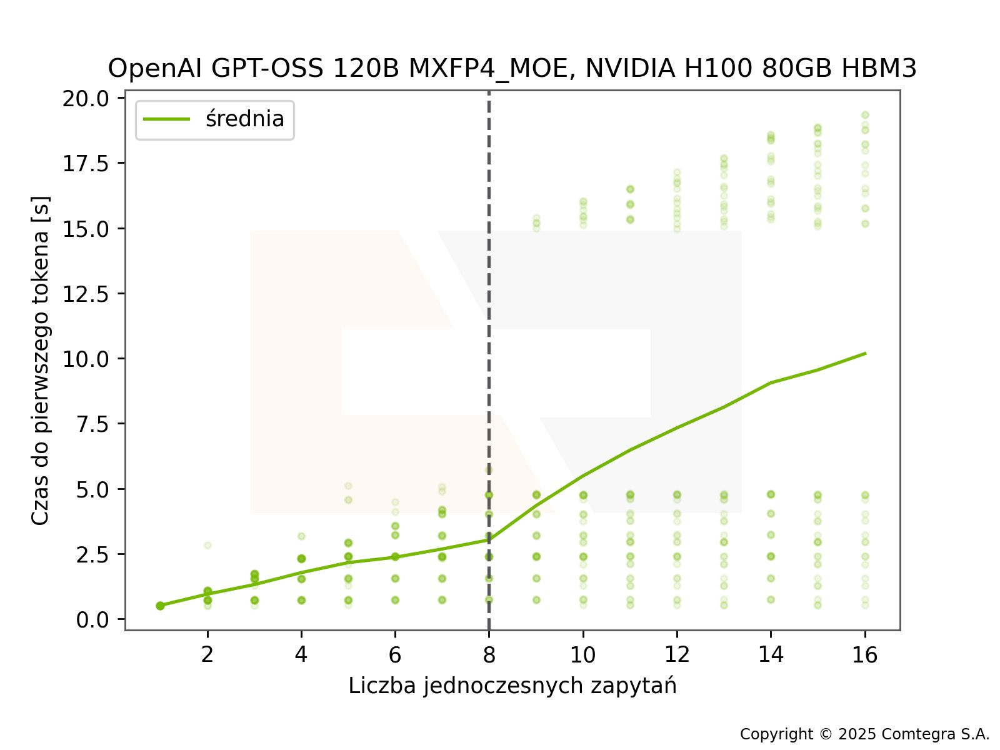

> _Notatka prowadzącego:_ The chart labels are in Polish: the horizontal axis is the number of concurrent requests, the vertical one the time to first token. How to read it: further right means more people at once, higher means a longer wait. Up to 8 concurrent requests the average stays around 3 seconds, then a queue builds up, and the upper group of points reaches 15-20 seconds. Like in a shop: as long as there are free checkouts, nobody waits.

---

## Choosing hardware

### What hardware for a chat for 20 people, with knowledge from 30 A4 pages? Measured in 2025

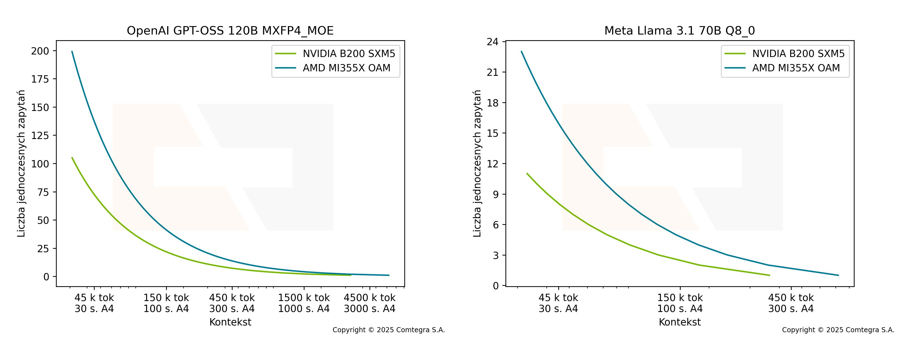

> _Notatka prowadzącego:_ The chart labels are in Polish: the vertical axis "Liczba jednoczesnych zapytań" is the number of concurrent requests, the horizontal axis "Kontekst" is the context, and "s. A4" means A4 pages. How to read it: further right means a longer context, higher means more people at once. 30 A4 pages is 45k tokens, the first labelled point on the axis. Approximate reading: GPT-OSS handles about 70 requests there on B200 and about 135 on MI355X, Llama 3.1 about 9 and about 15. So with Llama, 20 simultaneous users need more than one card. The key point: the bigger the desk for each person, the fewer people fit.

---

## AMD MI350 GPU series

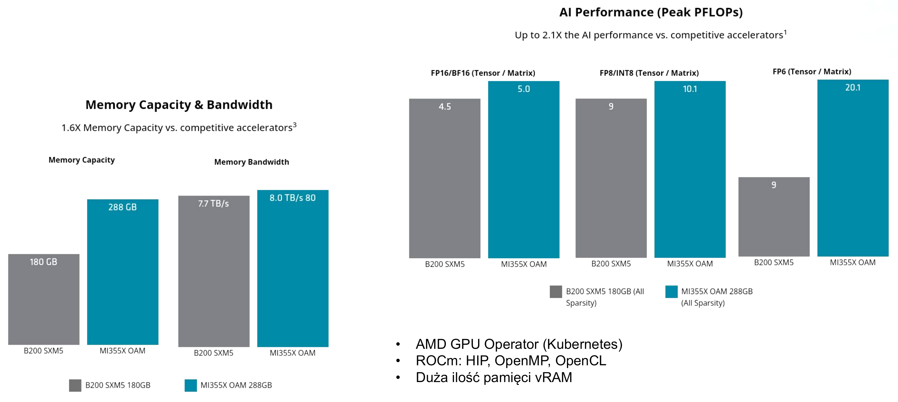

> _Notatka prowadzącego:_ AMD charts, i.e. vendor material: "up to" and selected comparisons. What matters for us is the first bar on the left, memory capacity, because we already know what fits in it.

---

## A year later: what changed

| | November 2025 (in this lecture) | November 2026 |
|---|---|---|
| **Open models** | GPT-OSS, Gemma 3, Llama 3.1 | DeepSeek V4.1, GLM-5.3, Gemma 4, Muse Spark Open |
| **Context** | Gemma 3: 128k tokens | Gemma 4: 256k, top models: 1M |
| **Largest card here** | MI355X: 288 GB | MI455X: 432 GB |
| **Polish in the tokenizer** | Bielik on the Mistral vocabulary | Bielik v3 on its own Polish vocabulary |
| **Long conversation** | the oldest messages fall out | the system summarises |

> _Notatka prowadzącego:_ We showed the state of the market in the previous lecture (Artificial Analysis, November 2026), the list of open models comes from there. Gemma 4: April 2026, variants E2B, E4B, 26B MoE, 31B. Bielik: arXiv 2604.10799. The performance charts in this lecture were measured in 2025, the numbers will differ for new models.

---

## A year later: card memory

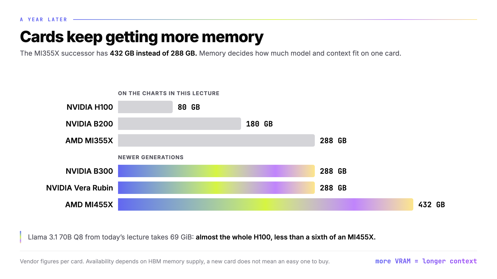

> _Notatka prowadzącego:_ NVIDIA Vera Rubin: 288 GB of HBM4 per GPU, the same capacity as the B300, but clearly higher bandwidth. Capacity is not everything, but it is what decides the calculation from this lecture. Check the figures before the lecture, this part of the market changes the fastest.

---

## Multimodality

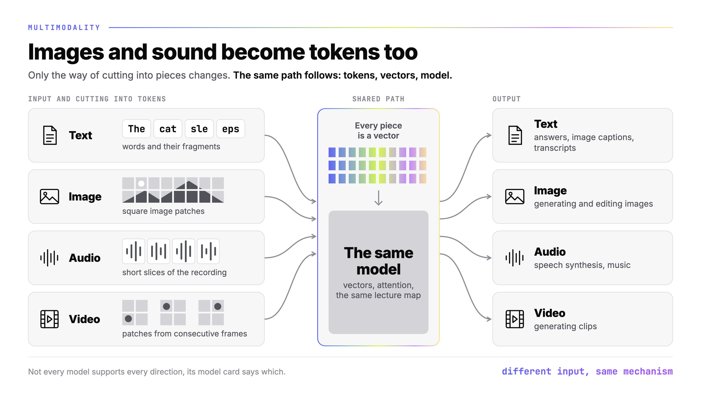

> _Notatka prowadzącego:_ The mechanism is the same: images and audio are also turned into tokens and vectors, and the same lecture map still applies. Today this is an ordinary feature of models, open ones included, not a separate category. Not every model supports every direction, we check that in its model card. The input and output diagram is based on an Ultralytics graphic.

---

## A year later: what did NOT change

### Numbers age, the mechanism stays

- Text still turns into **tokens and vectors**
- **Attention** still decides what influences what
- The model still guesses the **next token**
- Training is still **guess, check, correct**
- The calculation is still the same: **parameters + context must fit in memory**

> _Notatka prowadzącego:_ This is the most important slide of this part. Model names will be different in a year, which is why we don't memorise them. Whoever understands this diagram can read any new model card and any new release.

---

## 3Blue1Brown

### Worth watching: 3Blue1Brown on YouTube

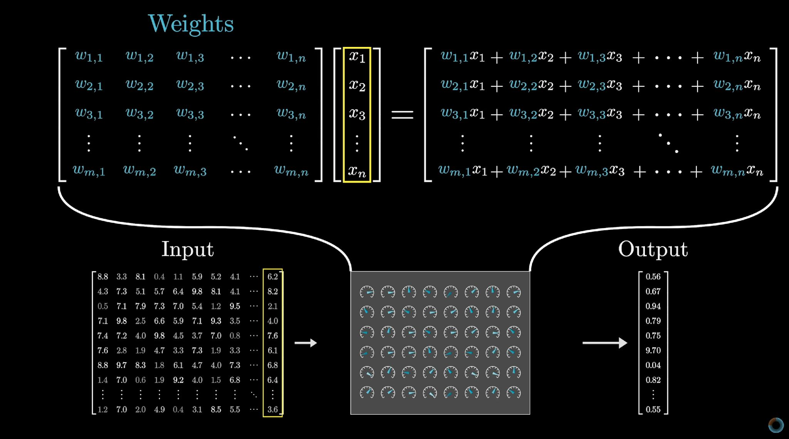

---

## Summary

### What we saw today

- **The path of a sentence:** text, tokens, vectors, attention, conclusions, next token
- **Numbers:** parameters × bytes is memory, and quantization shrinks the bill at the cost of quality
- **Training:** guess the next token, check, correct the weights; LoRA is a swappable adapter
- **Hardware:** parameters and context share one memory, more context means fewer people at once
- **A year later:** bigger windows and cards, the same mechanism

---

## What's next

### Today's concepts will come back

| Today | Where it returns | As what |
|---|---|---|
| Next token | Semester 2, L4 | Function calling is still token prediction |
| K, V, experts | Semester 2, L5 | KV Cache and Mixture of Experts |
| Context window | Semester 3, L1 and L3 | The agent's working memory and compaction |
| Tokens and their price | Semester 3, L1 | Every agent step pays for the whole history |
| Embedding | Semester 3, L3 | Search by meaning |

> _Notatka prowadzącego:_ The model is only the beginning. In semester 2 the model gets tools and becomes an agent, in semester 3 we take apart the machine that drives that agent.

---

## Thank you

### Questions?

Jakub Zboina, MSc Eng.

Rafał Masłyk, MSc Eng.
