# Wstęp do uczenia maszynowego w kontekście przetwarzania zbiorów tekstów cz. 2

## Sztuczna Inteligencja i Data Science 1 - Wykład

### Wstęp do uczenia maszynowego w kontekście przetwarzania zbiorów tekstów cz. 2

mgr inż. Jakub Zboina

mgr inż. Rafał Masłyk

---

## Skąd jesteśmy

### Poprzedni wykład

- Prompt, historia rozmowy, RAG i finetuning
- Rankingi i rodzaje modeli
- Kwantyzacja: pierwsze spotkanie
- Atencja: słowa wpływają na siebie nawzajem

<!-- columns -->

### Dziś

- Jak tekst zamienia się w liczby?
- Skąd biorą się wartości wag?
- Ile to waży i na czym to uruchomić?
- Co zmieniło się przez ostatni rok?

**Nie zrażajcie się, nie musicie pamiętać szczegółów.**

---

## Mapa wykładu

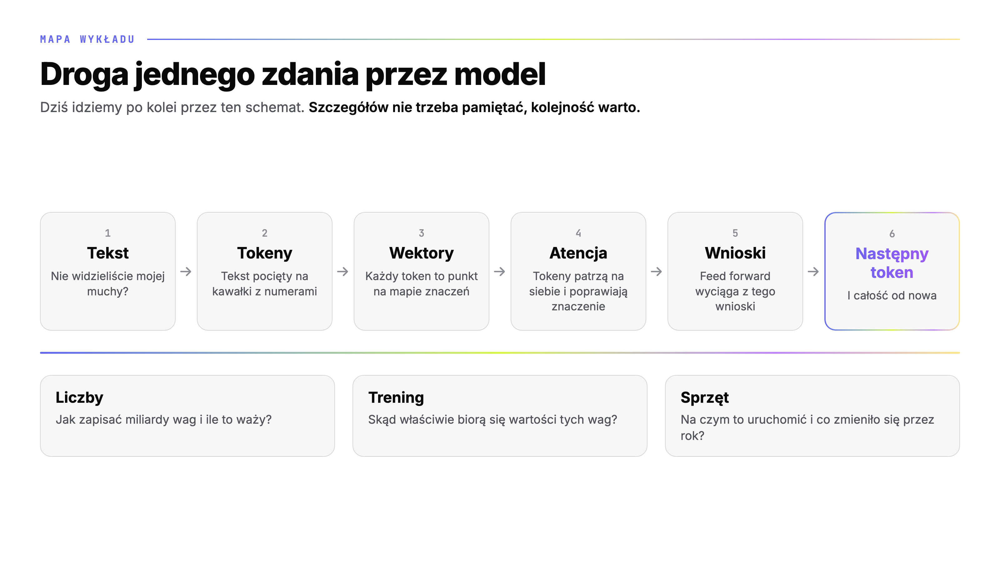

> _Notatka prowadzącego:_ To jest jedyny schemat, który warto zapamiętać z dzisiejszego dnia. Wracaj do niego przy przejściach: "jesteśmy na kroku 3". Na następnym semestrze ten sam schemat wróci jako "LLM to funkcja: tekst na tekst".

---

## Powtórka: mechanizm atencji

### Mucha

Nie widzieliście może mojej muchy? Ostatnio wisiała na wieszaku obok krawatów.

**Mechanizm atencji pozwala zrozumieć znaczenie w zależności od kontekstu.**

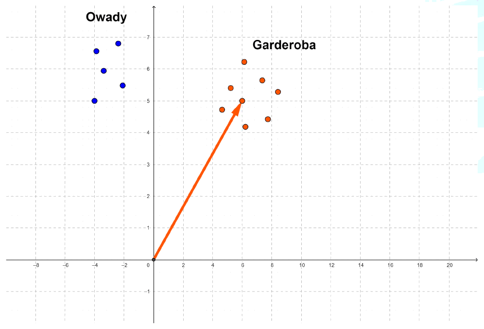

---

## Powtórka: mechanizm uwagi/atencji

### Attention is all you need

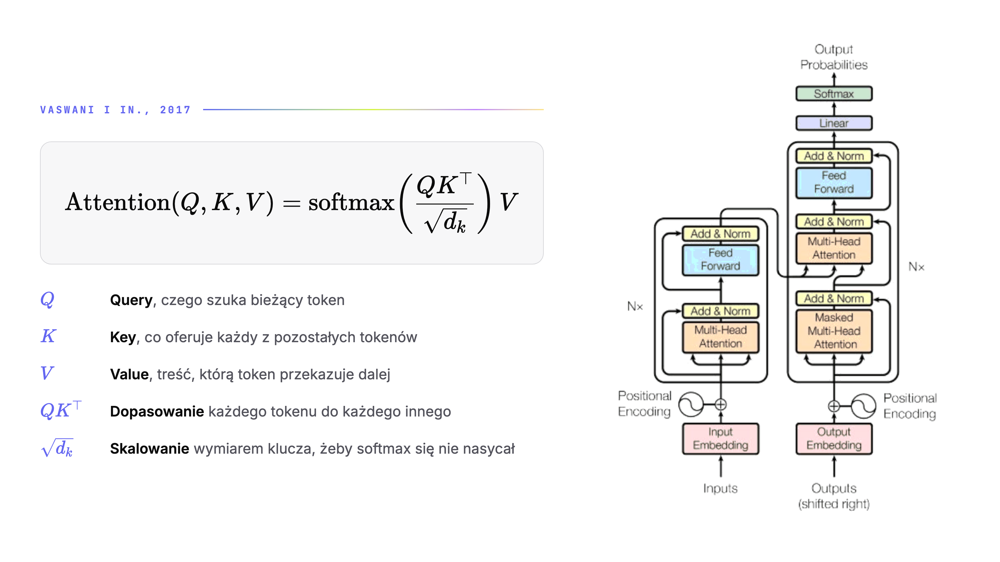

> _Notatka prowadzącego:_ Wzoru nie trzeba umieć. Pokazujemy go, bo będziemy dziś wskazywać palcem jego kawałki: Q, K, V i softmax.

---

## Powtórka: liczba parametrów

### ~AI to mnożenie macierzy~

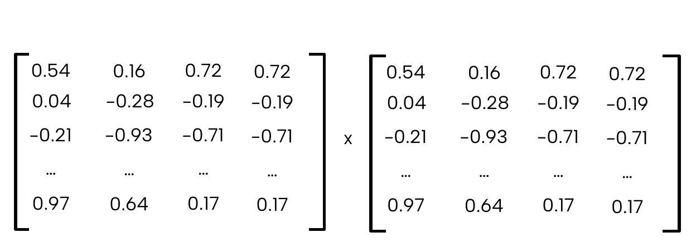

---

## Powtórka: liczba parametrów

### Macierze + aktywacje

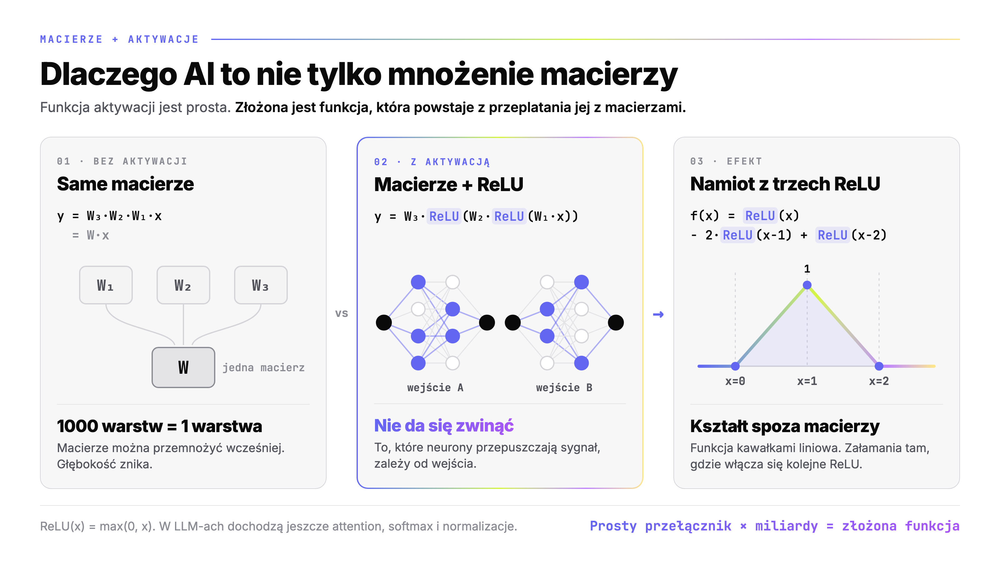

> _Notatka prowadzącego:_ Powtórka: bez aktywacji W3·W2·W1 można przemnożyć wcześniej i tysiąc warstw daje jedną macierz. Do funkcji aktywacji wrócimy za chwilę.

---

## Liczby: po co nam mniej bitów?

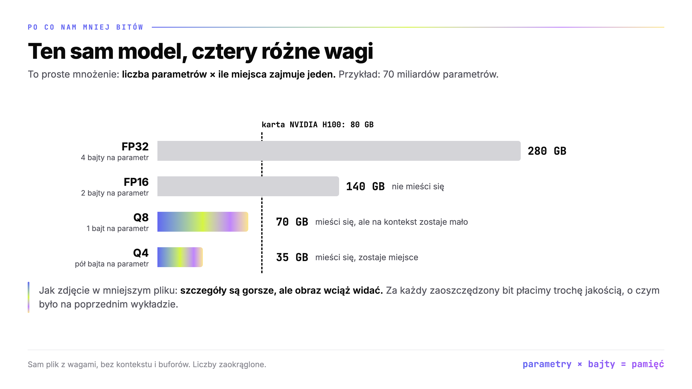

> _Notatka prowadzącego:_ To odpowiedź na "po co ta cała kwantyzacja", zanim wejdziemy w bity. Rachunek jest celowo szkolny: 70 miliardów razy liczba bajtów. Zapamiętaj te 70 GB, bo dokładnie ta liczba wróci na slajdzie z pamięcią GPU.

---

## Precyzja?

### 19,95758694 ≈ 20

32 bity vs 5 bitów

Jak cena w sklepie: 19,96 zł to prawie 20 zł, a zapis jest dużo krótszy.

> _Notatka prowadzącego:_ Pytanie do sali: ile tracimy, zapisując wagę na 5 bitach zamiast na 32? Następne slajdy pokazują, skąd bierze się liczba 5.

---

## Precyzja

### Każdy bit podwaja liczbę wartości

| Liczba bitów | 1 | 2 | 3 | 4 | 5 |
|---|---|---|---|---|---|
| Ile różnych wartości | 2 | 4 | 8 | 16 | **32** |
| Największa liczba | 1 | 3 | 7 | 15 | **31** |

Największa liczba jest o 1 mniejsza, bo liczenie zaczynamy od 0.

**Chcemy zapisać 20:** na 4 bitach się nie mieści (maks. 15), na 5 bitach już tak (maks. 31).

> _Notatka prowadzącego:_ Dla chętnych ten sam rachunek jako wzór: największa liczba to 2^N - 1, więc N ≥ log2(M + 1). Dla M = 20 wychodzi około 4,39, po zaokrągleniu w górę 5. Nie trzeba tego umieć, wystarczy intuicja z tabeli.

---

## Precyzja

### 10100 = 20

| bit (16) | bit (8) | bit (4) | bit (2) | bit (1) |
|---|---|---|---|---|
| 1 | 0 | 1 | 0 | 0 |

16 + 4 = 20

---

## Kwantyzacja

| Kwantyzacja | Wartości (binarnie) | Wartości (dziesiętnie) | Zakres (signed) | Zakres (unsigned) |
|---|---|---|---|---|
| FP16 | 2^16 | 65536 | liczby skończone | liczby skończone |
| INT8 | 2^8 | 256 | -128 do 127 | 0 do 255 |
| INT5 | 2^5 | 32 | -16 do 15 | 0 do 31 |
| INT4 | 2^4 | 16 | -8 do 7 | 0 do 15 |

<!-- columns -->

| INT5 | INT4 |
|---|---|
| 0 = 00000 | 0 = 0000 |
| 0.5 = 00001 | 1 = 0001 |
| 1 = 00010 | 2 = 0010 |
| 1.5 = 00011 | 3 = 0011 |
| 2 = 00100 | 4 = 0100 |
| ... | ... |
| 14.5 = 11101 | 14 = 1110 |
| 15 = 11110 | 15 = 1111 |

> _Notatka prowadzącego:_ Prawa tabela to sedno: im mniej bitów, tym grubsze schodki. INT5 rozróżnia 14,5 i 15, a INT4 ma już tylko 14 i 15.

---

## FP16: reprezentacja liczb

### [numeral-systems.com/ieee-754-converter](https://numeral-systems.com/ieee-754-converter/)

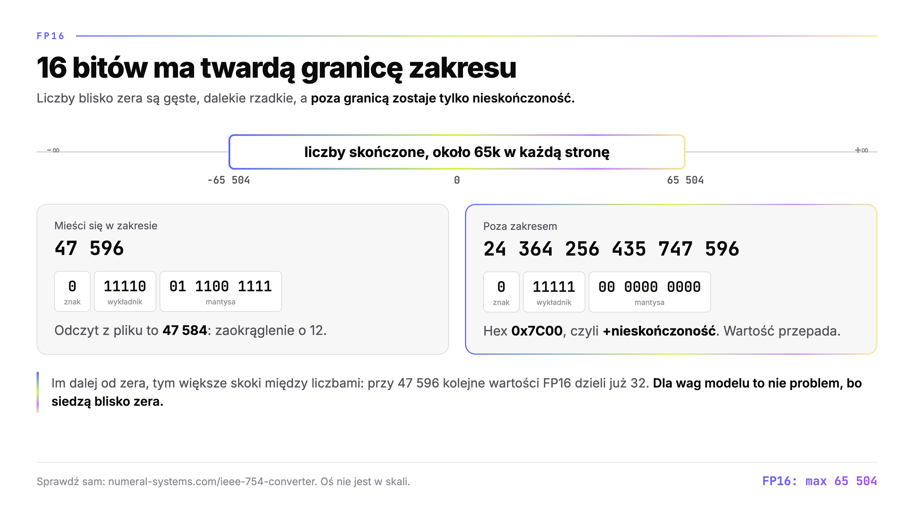

> _Notatka prowadzącego:_ Warto pokazać konwerter na żywo. Wzór bitowy dla 47 596 to 0x79CF, po odczytaniu daje 47 584. Druga liczba daje wykładnik z samych jedynek i zerową mantysę, czyli 0x7C00, a to w IEEE-754 oznacza nieskończoność.

---

## Krok 2: tokeny

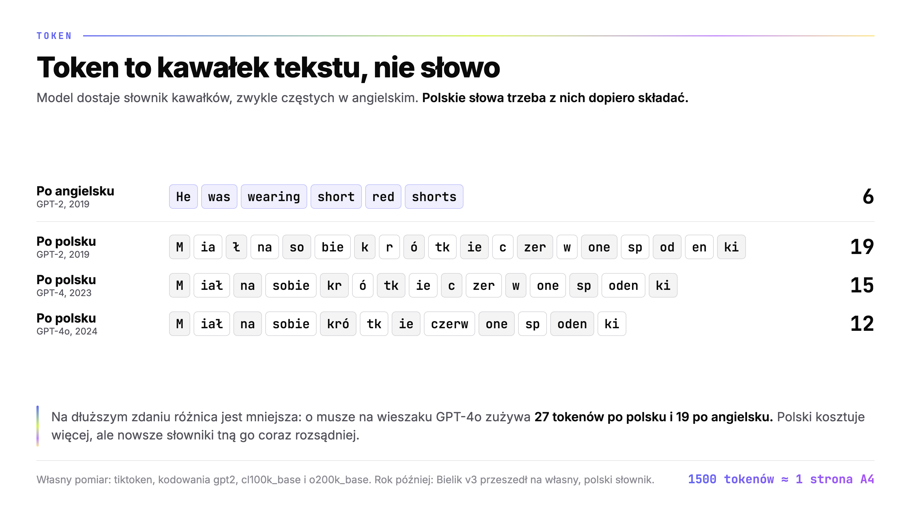

> _Notatka prowadzącego:_ Pomiar własny, można powtórzyć bibliotekę tiktoken. Dlaczego to ma znaczenie: za tokeny się płaci i to one wypełniają okno kontekstu, więc polski tekst kosztuje więcej niż angielski. Różnica zależy od zdania, pierwsze jest skrajne. To nie jest wada polskiego, tylko słownika budowanego na danych głównie angielskich. Dlatego Bielik v3 przeszedł ze słownika mistralowego na własny, zoptymalizowany pod polski (arXiv 2604.10799).

---

## Krok 2: tokeny w kodzie

```python
input_texts = ['Have you seen my baseball bat?',
               "Bat is a mammal"]

batch_dict = tokenizer(input_texts, max_length=512, padding=True,
                       truncation=True, return_tensors='pt',
                       return_token_type_ids=True)

print(tokenizer.convert_ids_to_tokens(batch_dict[0].ids))
print(batch_dict[0].ids)
['<s>', '_Have', '_you', '_seen', '_my', '_baseball', '_bat', '?', '</s>']
[0, 31901, 398, 51592, 759, 178663, 1777, 32, 2]

print(tokenizer.convert_ids_to_tokens(batch_dict[1].ids))
print(batch_dict[1].ids)
['<s>', '_Bat', '_is', '_a', '_mamma', 'l', '</s>', '<pad>', '<pad>']
[0, 21947, 83, 10, 21968, 141, 2, 1, 1]
```

> _Notatka prowadzącego:_ Kodu nie trzeba czytać, wystarczy ostatnie dwie pary linii. Wielkość litery ma znaczenie: `_bat` to 1777, a `_Bat` to 21947. "mammal" dzieli się na dwa tokeny, `<pad>` wyrównuje długość w batchu.

---

## Krok 2: tokeny w kodzie

### Brak informacji o pozycji i znaczeniu, po prostu numer

```text
'Have you seen my baseball bat?'
['<s>', '_Have', '_you', '_seen', '_my', '_baseball', '_bat', '?', '</s>']
[0, 31901, 398, 51592, 759, 178663, 1777, 32, 2]

'bat is a mammal'
['<s>', '_bat', '_is', '_a', '_mamma', 'l', '</s>', '<pad>', '<pad>']
[0, 1777, 83, 10, 21968, 141, 2, 1, 1]
```

> _Notatka prowadzącego:_ `_bat` ma ID 1777 w obu zdaniach, choć raz stoi na szóstym, a raz na pierwszym miejscu i raz jest kijem, a raz nietoperzem. Tokenizer nie wie nic ani o pozycji, ani o znaczeniu. Numer to tylko numer: 1777 nie jest "bliżej" 1778 pod względem znaczenia. Dlatego potrzebujemy następnego kroku.

---

## Krok 3: wektory

### Embedding to adres na mapie znaczeń

- Każdy token dostaje współrzędne
- **Blisko na mapie = podobne znaczenie**
- Mapa z rysunku ma 2 wymiary, a GPT-3 miał ich 12 288
- Nikt jej nie rysował: model nauczył się jej z tekstów


> _Notatka prowadzącego:_ Tysięcy wymiarów nie da się sobie wyobrazić i nie trzeba. Intuicja z dwuwymiarowej mapy wystarczy. To samo wróci na semestrze 3 jako wyszukiwanie po znaczeniu: pytanie i dokument zamieniamy w punkty i szukamy najbliższych. Stąd "oświetlenie" znajduje "lampę".

---

## Krok 3: jak LLM widzi tekst

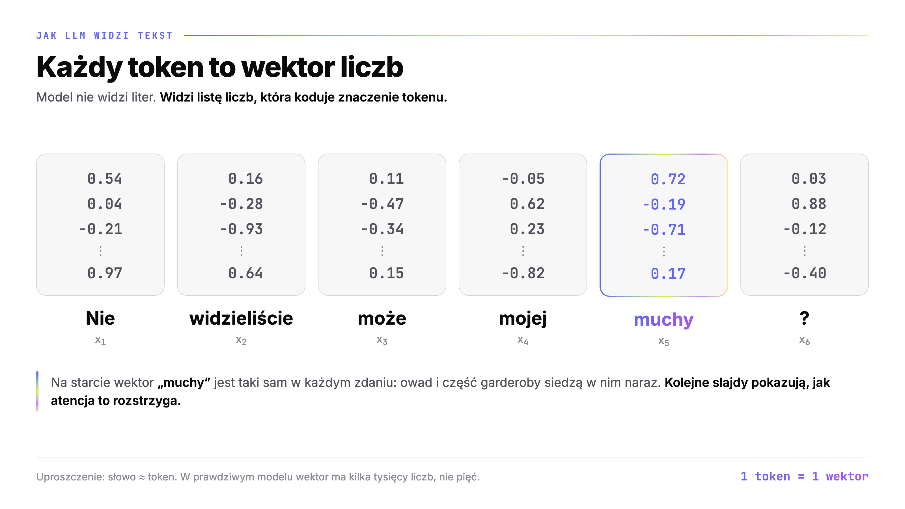

---

## Krok 3: wektory w kodzie

### Z tokenów w wektor

- Stała długość wektora: GPT-3 ma 12 288 wymiarów
- Wartości wektora zależą od wytrenowanego wektoryzera
- Modele embeddingowe są trenowane tak jak modele pre-trained

<!-- columns -->

```python
batch_dict = tokenizer(string, max_length=512, padding=True,
                       truncation=True, return_tensors='pt')

outputs = model(**batch_dict)
embeddings = average_pool(outputs.last_hidden_state,
                          batch_dict['attention_mask'])

tensor_array = embeddings[0].detach().numpy()
```

`print_vector_for_string("bat")`

```text
[ 1.2955025, 0.670285, -0.73130226, -1.1073681, ...,
  0.9683652, 0.61739254, 0.033798084, 0.49025163 ]
```

---

## Word2vec: popularny (przekłamany) przykład

### [Źródło: Analytics Vidhya](https://medium.com/analytics-vidhya/word-embeddings-in-nlp-word2vec-glove-fasttext-24d4d4286a73)

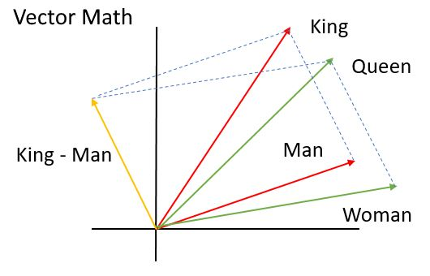

> _Notatka prowadzącego:_ Przykład jest przekłamany, bo w praktyce wynik działania king - man + woman leży najbliżej samego "king". "Queen" wychodzi dopiero wtedy, gdy wykluczymy słowa wejściowe. Idea zostaje: kierunki w przestrzeni embeddingów niosą znaczenie.

---

## Krok 3: wzbogacenie o pozycje

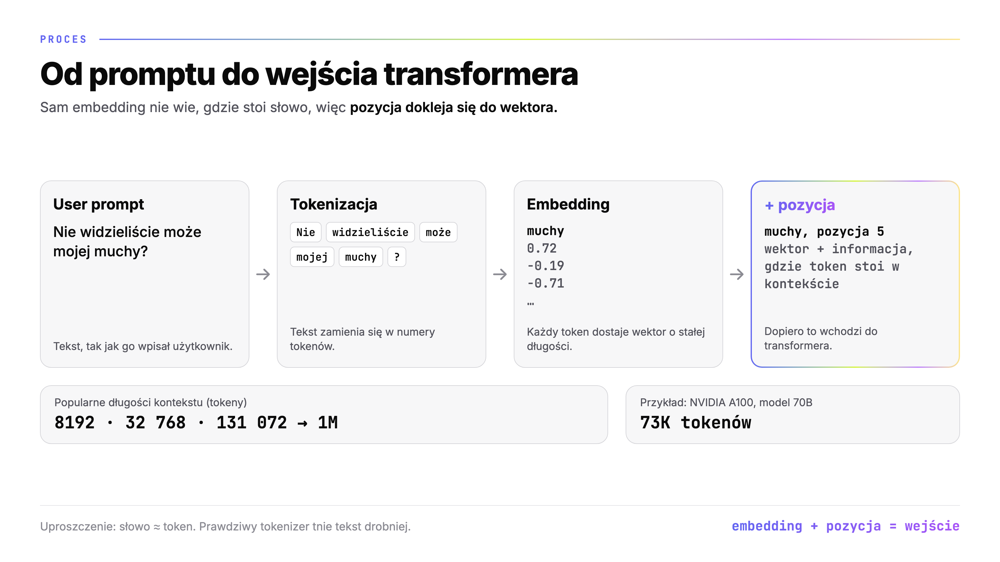

> _Notatka prowadzącego:_ Informacja o tym, gdzie słowo znajduje się w kontekście, jest dodawana do wektora. Bez tego "pies gryzie człowieka" i "człowiek gryzie psa" wyglądałyby dla modelu tak samo. Popularne długości kontekstu to 8192, 32 768, 131 072, a dziś nawet milion tokenów.

---

## Krok 4: atencja

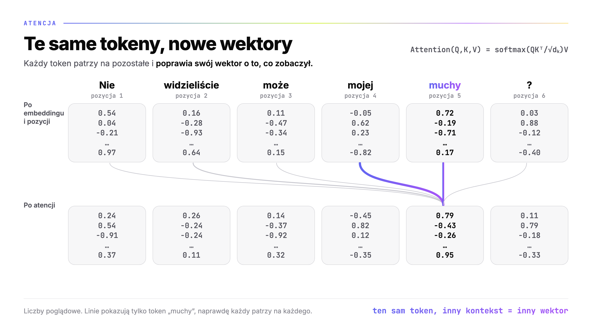

> _Notatka prowadzącego:_ Kolejność: najpierw wektor, potem pozycja, potem atencja. Porównaj wiersz górny z dolnym: każda liczba się zmieniła. Liczby są poglądowe.

---

## Krok 4: Query, Key, Value

### Jak szukanie w internecie

| | Co to jest | W wyszukiwarce | Dla słowa „spodenki” |
|---|---|---|---|
| **Query** | Czego szukam? | wpisana fraza | „jakie jestem?” |
| **Key** | Co oferuję? | tytuł strony | „krótkie”: opisuję długość |
| **Value** | Co przekazuję? | treść strony | ile zmienić w wektorze |

> _Notatka prowadzącego:_ Ta sama analogia co na poprzednim wykładzie. Pytanie i tytuł pasują do siebie, więc czytamy treść tej strony. Słowo "spodenki" pyta, a "krótkie" i "czerwone" odpowiadają najmocniej. To nazwy dydaktyczne: model nie ma w środku zdania "jakie jestem?", tylko wyuczone liczby.

---

## Krok 4: Query, Key, Value

### Miał na sobie krótkie czerwone spodenki

- Query i key mówią, **które słowo wpływa na które**: „krótkie” i „czerwone” pasują do „spodenek”
- Value mówi, **jak mocno i w którą stronę** przesunąć wektor

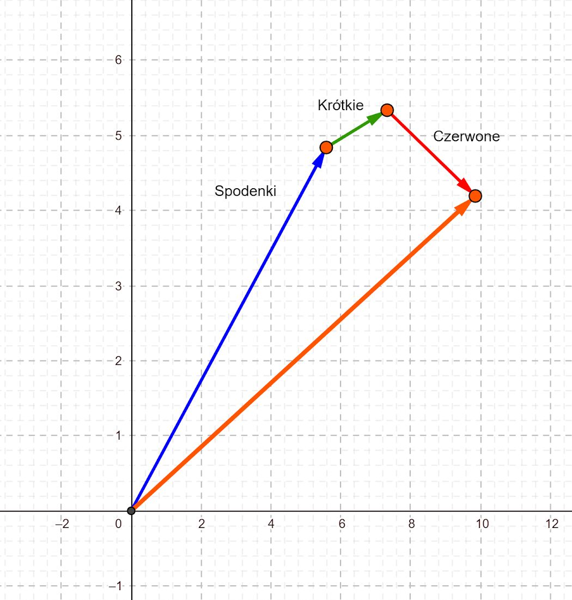

> _Notatka prowadzącego:_ Niebieski wektor to "spodenki" przed atencją. Zielony i czerwony to poprawki od "krótkie" i "czerwone". Pomarańczowy to wynik: te same spodenki, ale już krótkie i czerwone. Wysoki dot product między Q i K oznacza dobre dopasowanie.

---

## Krok 4: multi-head attention

### Kilka głów, czyli kilka pytań naraz

- Jedna głowa pyta „jakie?”, inna „kto?”, inna „gdzie?”
- GPT-3 ma 175 miliardów parametrów i 96 bloków multi-atencji
- Feed forward to 2/3 parametrów sieci: tam wyciągane są wnioski

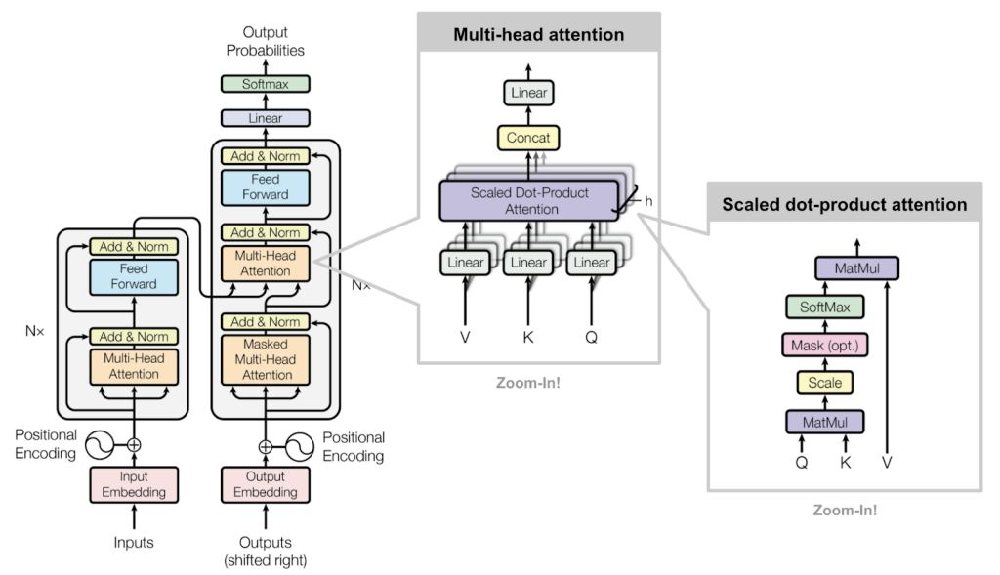

> _Notatka prowadzącego:_ "Jakie, kto, gdzie" to uproszczenie: głowy same uczą się, na co patrzeć, nikt im tego nie przydziela. Atencja zbiera informacje, feed forward je przetwarza.

---

## Krok 5: od atencji do wniosków

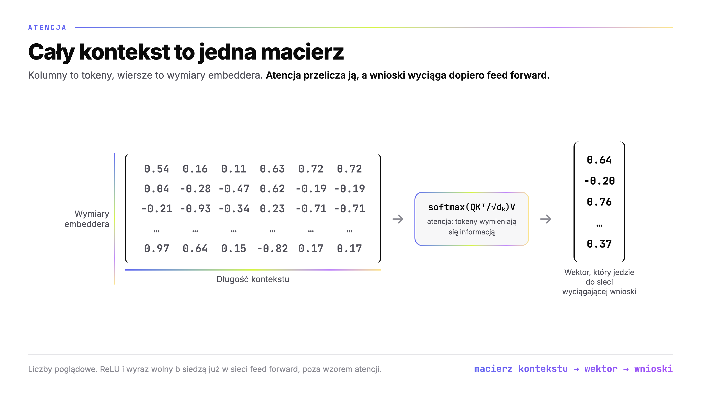

---

## Zobaczmy to na żywo

### [poloclub.github.io/transformer-explainer](https://poloclub.github.io/transformer-explainer/)

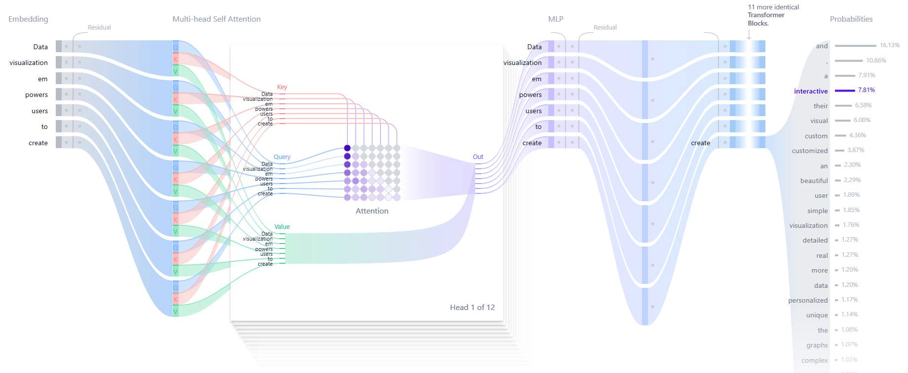

> _Notatka prowadzącego:_ Najlepiej otworzyć na żywo. Działa w przeglądarce, na modelu GPT-2. Przejdź palcem po mapie wykładu: tokeny, embedding, atencja, MLP, następny token.

---

## Embedder: polski vs angielski

### Miał na sobie krótkie czerwone spodenki

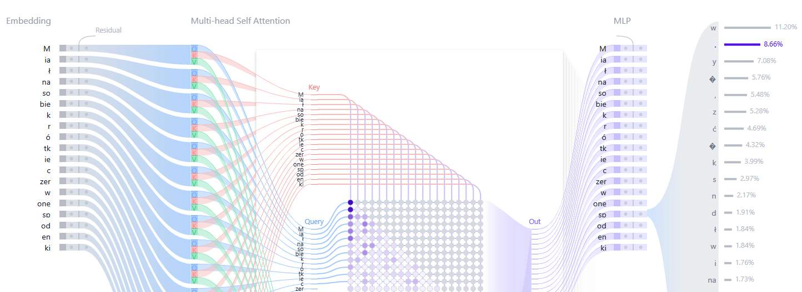

> _Notatka prowadzącego:_ To te same 19 kawałków co na slajdzie o tokenach. GPT-2 uczył się głównie na angielskim, więc propozycje następnego tokenu po prawej to szum. Dobra okazja, żeby powiedzieć, po co są polskie modele.

---

## Krok 5: funkcje aktywacji

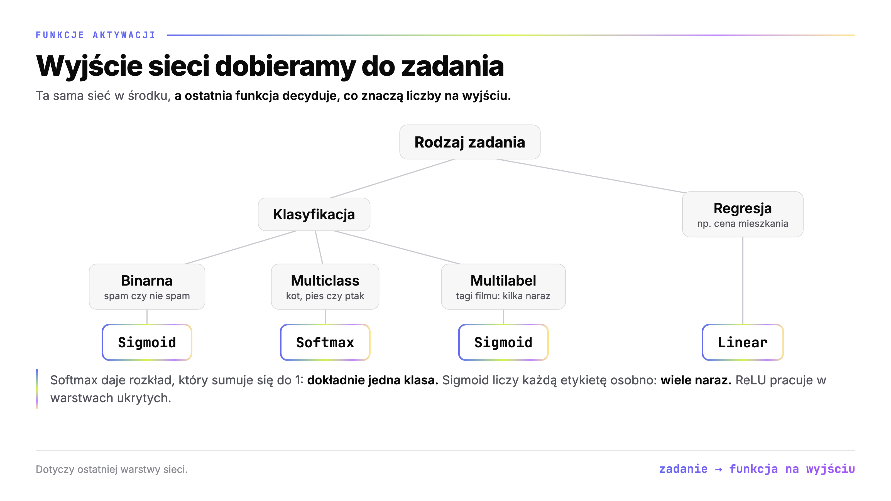

---

## Krok 5: funkcje aktywacji

### [encord.com/blog/activation-functions-neural-networks](https://encord.com/blog/activation-functions-neural-networks/)

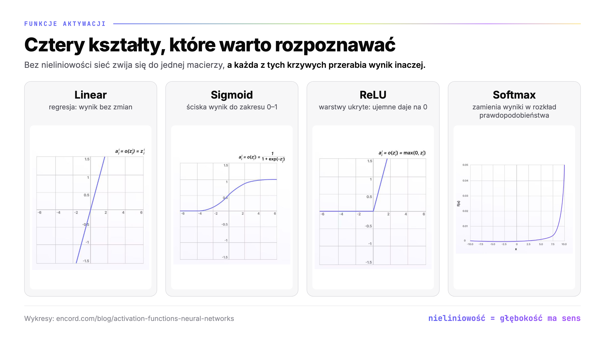

> _Notatka prowadzącego:_ Wystarczy rozpoznać kształty. ReLU to przełącznik z poprzedniego wykładu. Softmax przyda się za chwilę: to on zamienia wynik modelu w procenty przy następnym tokenie.

---

## Krok 6: następny token

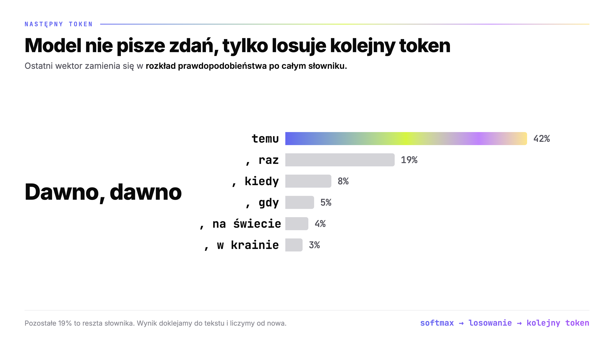

> _Notatka prowadzącego:_ Tu domykamy mapę. Softmax daje rozkład, a model losuje z niego token. To wyjaśnia slajd z poprzedniego wykładu, gdzie 2+2= dało raz 5. Wraca to na kolejnych semestrach: function calling to dalej predykcja tokenów, tylko że tokeny układają się w nazwę narzędzia.

---

## Trening: skąd biorą się wagi?

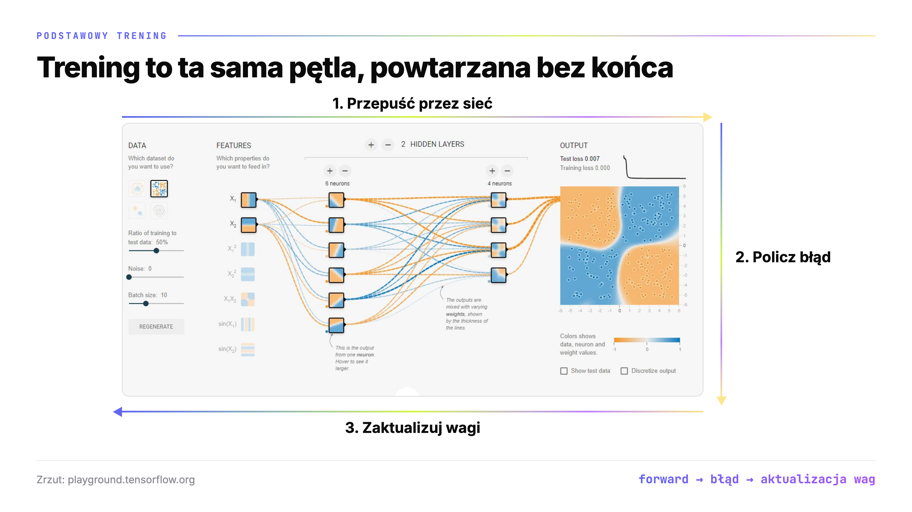

> _Notatka prowadzącego:_ Jak nauka rzutów do kosza: rzut, widzę, o ile chybiłem, poprawiam rękę. Jeden rzut niczego nie uczy, uczy ich tysiące.

---

## Trening: co to znaczy dla LLM-a

### Model uczy się, zgadując następny token

1. Bierzemy tekst: „Dawno, dawno ___”
2. Model podaje swoje procenty dla każdego tokenu
3. Sprawdzamy, co było w tekście naprawdę: „temu”
4. Lekko poprawiamy wagi, żeby „temu” dostało więcej
5. Powtarzamy na ogromnej liczbie tekstów

**Nikt nie musi tego oznaczać:** poprawna odpowiedź jest już w tekście.

> _Notatka prowadzącego:_ To jest "nauka języka odbywa się w sposób nienadzorowany" z poprzedniego wykładu. Tu widać też, dlaczego model przejmuje uprzedzenia z danych i dlaczego polskiego uczy się gorzej, gdy tekstów jest mniej. Na semestrze 2 wraca to przy biasie.

---

## Finetuning

### Finetuning

- Nie musimy aktualizować wszystkich parametrów
- Można dostawić kolejną macierz: LoRA
- Proces mniej „zasobożerny”
- Możemy zmieniać LoRA w zależności od potrzeby, używając tego samego modelu bazowego
- Nie prowadzimy do zapomnienia starszych informacji


---

## Finetuning: czym jest LoRA

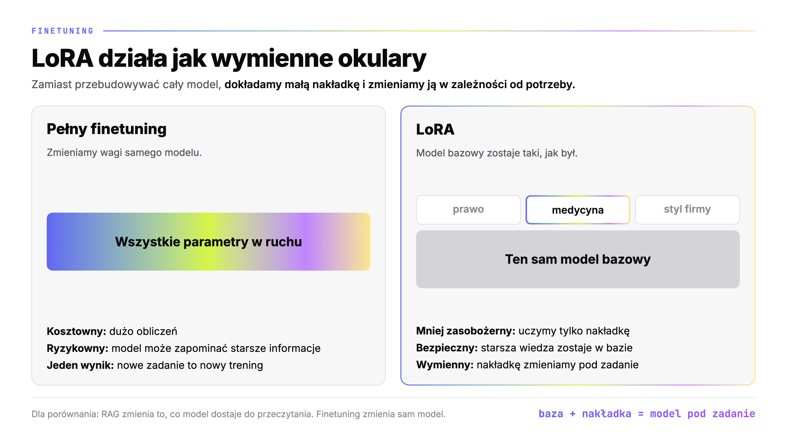

> _Notatka prowadzącego:_ Rok później finetuning nie zniknął, ale rzadziej jest pierwszym wyborem. Żeby model znał dane firmy, zwykle wystarczy dać mu je w kontekście: RAG, pliki, narzędzia. Finetuning ma sens, gdy trzeba zmienić zachowanie albo styl. O dostarczaniu kontekstu będzie szeroko na semestrze 3.

---

## Sprzęt: czego potrzebujemy, żeby uruchomić model lokalnie?

### Przykład: OpenAI GPT-OSS 120B MXFP4_MOE

- 2 CPU
- 64 GiB przestrzeni dyskowej
- 24 GiB RAM
- **80 GiB VRAM**

<!-- columns -->

### Co siedzi w VRAM

**Parametry, czyli półka z książkami:** „pamięć długotrwała”, wynik uczenia. Zajmują stałe miejsce.

**Kontekst, czyli biurko:** „pamięć krótkotrwała”. Rośnie z rozmową, bo przy każdym tokenie model trzyma jego K i V.

**Bufory, czyli brudnopis:** wyniki pośrednich obliczeń.

> _Notatka prowadzącego:_ VRAM to szybka pamięć przy samym GPU, tam musi wylądować wszystko, co model liczy. Klucze i wartości z atencji to jest KV Cache, do którego wracamy na semestrze 2. MOE w nazwie modelu to Mixture of Experts, też semestr 2, a MXFP4 to rodzaj kwantyzacji, czyli znowu liczba bitów.

---

## Okno kontekstowe

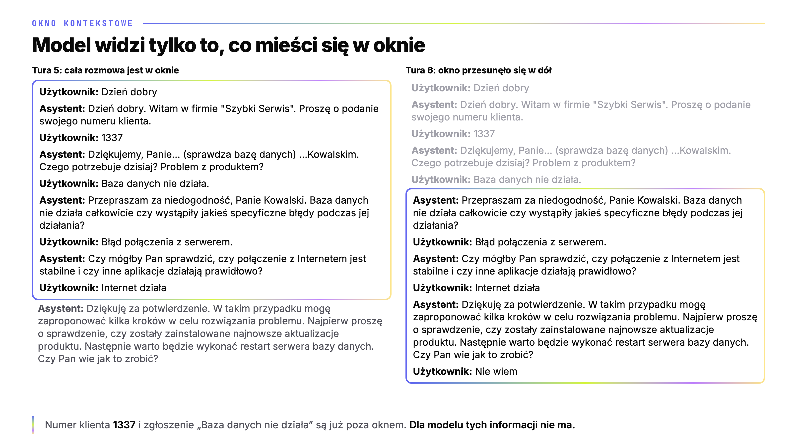

> _Notatka prowadzącego:_ Model sam niczego nie pamięta: przy każdej wiadomości dostaje całą historię od nowa. Okno to po prostu tyle tekstu, ile da się mu wysłać.

---

## Okno kontekstowe: rok później

### Wtedy: najstarsze wiadomości wypadały

- Popularne długości okna: 8192, 32 768, 131 072 tokeny
- To, co wypadło, przepadało

<!-- columns -->

### Dziś: okno większe, a stare się streszcza

- W czołówce otwartych modeli: **1 milion tokenów**, czyli około 660 stron A4
- Zamiast wyrzucać, system robi **streszczenie** starszej części (kompakcja)
- **Milion tokenów w oknie ≠ milion tokenów, które model wykorzysta**

> _Notatka prowadzącego:_ Milion tokenów wg listy open weight z Artificial Analysis pokazywanej na poprzednim wykładzie, strony liczone regułą 1500 tokenów na A4. Większe okno nie rozwiązuje problemu do końca: streszczenie może zgubić ważną rzecz, a im dłuższy kontekst, tym gorzej model przypomina sobie szczegóły. To cały jeden wykład semestru 3 (kompakcja, context rot).

---

## Pamięć GPU

### NVIDIA H100 (80 GiB), 1500 tokenów to ok. 1 strona A4

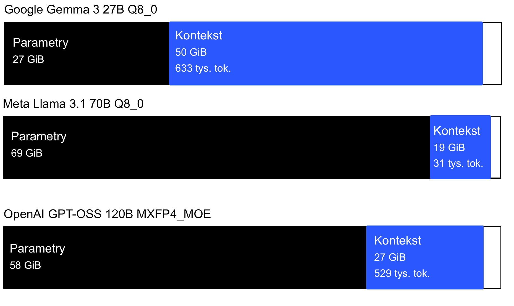

> _Notatka prowadzącego:_ Tu wraca rachunek z początku: Gemma 27B w Q8 to 27 GiB, Llama 70B w Q8 to 69 GiB. Im większa półka, tym mniejsze biurko. Do weryfikacji przed wykładem: 69 + 19 i 58 + 27 przekraczają 80 GiB, a na rysunku oba paski mieszczą się w karcie. Reszta paska po prawej to bufory.

---

## Szybkość generowania

### Jak szybko czat wygeneruje 1 akapit tekstu (300 tok.)? Pomiar z 2025

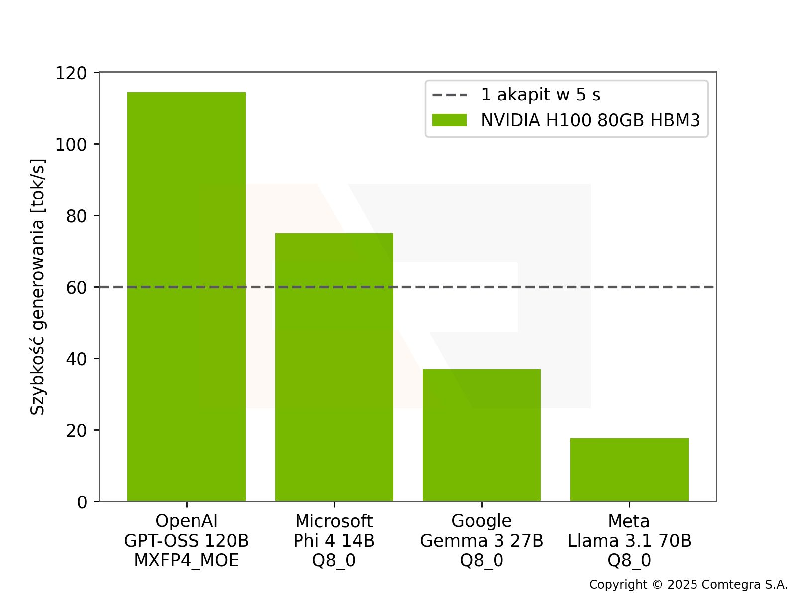

> _Notatka prowadzącego:_ Jak czytać: wyżej znaczy szybciej, linia przerywana to 60 tok/s, czyli akapit w 5 sekund. Zagadka: dlaczego największy model jest najszybszy? Bo GPT-OSS to Mixture of Experts: ma 117 miliardów parametrów, ale przy pracy aktywnych jest około 5,1 miliarda (karta modelu na Hugging Face). Sam rozmiar w nazwie nie mówi wszystkiego.

---

## Czas do pierwszego tokena

### Ile sekund użytkownicy będą czekać na pierwsze słowo? Pomiar z 2025

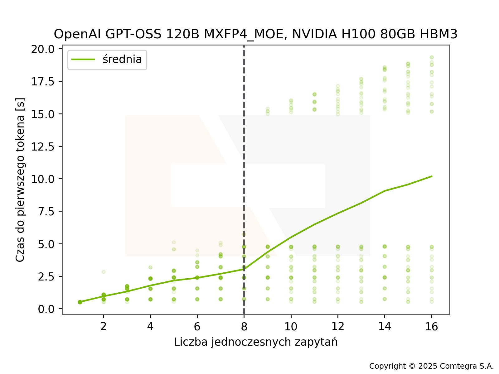

> _Notatka prowadzącego:_ Jak czytać: w prawo więcej osób naraz, w górę dłuższe czekanie. Do 8 jednoczesnych zapytań średnia trzyma się około 3 sekund, potem zaczyna się kolejka, a górna grupa punktów dochodzi do 15-20 sekund. Jak w sklepie: dopóki są wolne kasy, nikt nie czeka.

---

## Dobór sprzętu

### Jaki sprzęt na czat dla 20 osób, z wiedzą z 30 stron A4? Pomiar z 2025

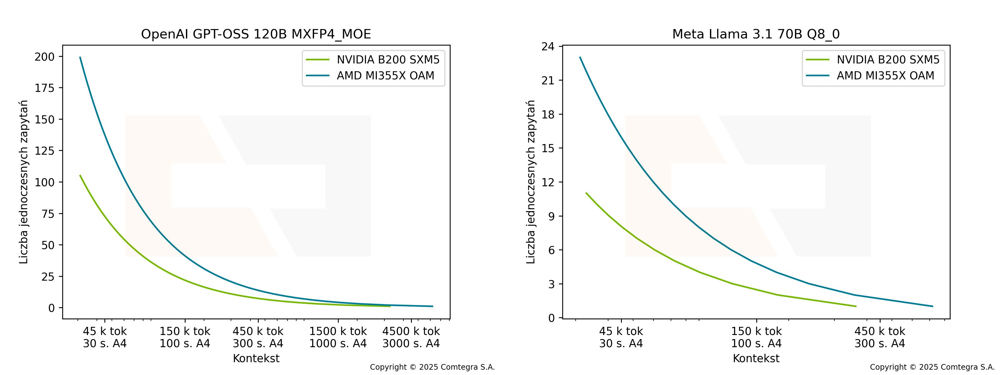

> _Notatka prowadzącego:_ Jak czytać: w prawo dłuższy kontekst, w górę więcej osób naraz. 30 stron A4 to 45 tys. tokenów, pierwszy podpisany punkt osi. Odczyt przybliżony: GPT-OSS obsługuje tam ok. 70 zapytań na B200 i ok. 135 na MI355X, Llama 3.1 ok. 9 i ok. 15. Czyli przy Llamie 20 użytkowników równocześnie wymaga więcej niż jednej karty. Sedno: im większe biurko dla każdego, tym mniej osób się mieści.

---

## Seria GPU AMD MI350

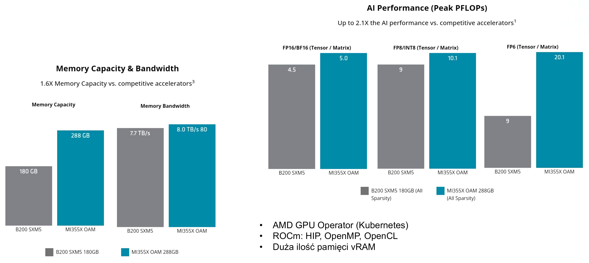

> _Notatka prowadzącego:_ Wykresy AMD, czyli materiały producenta: "up to" i wybrane porównania. Dla nas liczy się pierwszy słupek po lewej, pojemność pamięci, bo już wiemy, co się w niej mieści.

---

## Rok później: co się zmieniło

| | Listopad 2025 (w tym wykładzie) | Listopad 2026 |
|---|---|---|
| **Otwarte modele** | GPT-OSS, Gemma 3, Llama 3.1 | DeepSeek V4.1, GLM-5.3, Gemma 4, Muse Spark Open |
| **Kontekst** | Gemma 3: 128 tys. tokenów | Gemma 4: 256 tys., czołówka: 1 mln |
| **Największa karta tutaj** | MI355X: 288 GB | MI455X: 432 GB |
| **Polski w tokenizerze** | Bielik na słowniku z Mistrala | Bielik v3 na własnym polskim słowniku |
| **Długa rozmowa** | najstarsze wypadają | system streszcza |

> _Notatka prowadzącego:_ Stan rynku pokazywaliśmy na poprzednim wykładzie (Artificial Analysis, listopad 2026), lista otwartych modeli pochodzi stamtąd. Gemma 4: kwiecień 2026, warianty E2B, E4B, 26B MoE, 31B. Bielik: arXiv 2604.10799. Wykresy wydajności w tym wykładzie to pomiary z 2025, na nowych modelach liczby będą inne.

---

## Rok później: pamięć kart

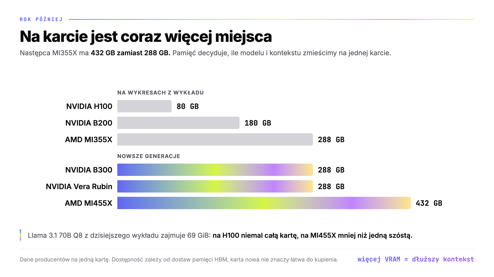

> _Notatka prowadzącego:_ NVIDIA Vera Rubin: 288 GB HBM4 na GPU, ta sama pojemność co B300, ale wyraźnie większa przepustowość. Pojemność to nie wszystko, ale to ona decyduje o rachunku z tego wykładu. Dane sprawdź przed wykładem, ta część rynku zmienia się najszybciej.

---

## Wielomodalność

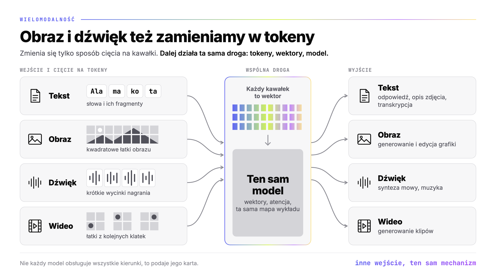

> _Notatka prowadzącego:_ Mechanizm jest ten sam: obraz i dźwięk też zamieniamy w tokeny i wektory, dalej działa ta sama mapa wykładu. Dziś to już zwykła cecha modeli, także otwartych, a nie osobna kategoria. Nie każdy model obsługuje każdy kierunek, to sprawdzamy w jego karcie. Schemat wejść i wyjść na podstawie grafiki Ultralytics.

---

## Rok później: co się NIE zmieniło

### Liczby się starzeją, mechanizm zostaje

- Tekst nadal zamienia się w **tokeny i wektory**
- **Atencja** nadal decyduje, co na co wpływa
- Model nadal zgaduje **następny token**
- Trening to nadal **zgadnij, sprawdź, popraw**
- Rachunek nadal jest ten sam: **parametry + kontekst muszą zmieścić się w pamięci**

> _Notatka prowadzącego:_ To najważniejszy slajd tej części. Nazwy modeli za rok będą inne, dlatego nie uczymy ich na pamięć. Kto rozumie ten schemat, przeczyta każdą nową kartę i każdą nową premierę.

---

## 3Blue1Brown

### Warto obejrzeć: 3Blue1Brown na YouTube

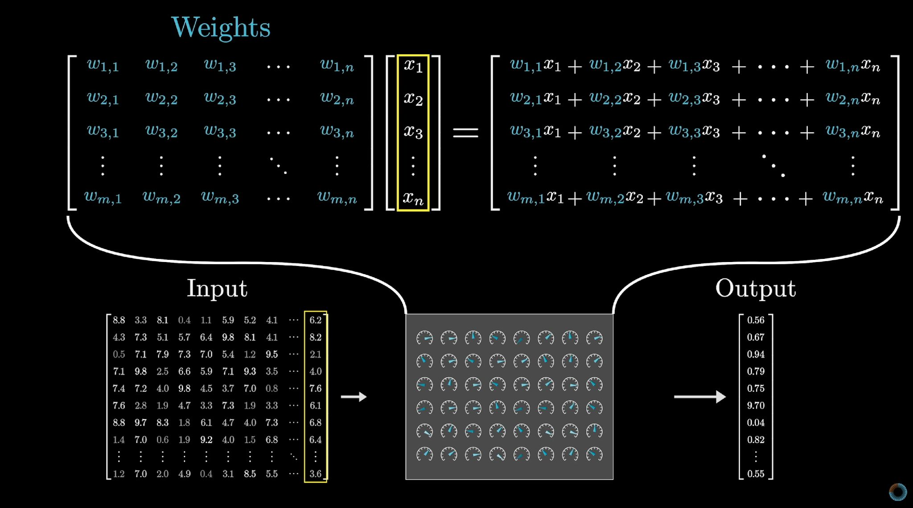

---

## Podsumowanie

### Co dziś zobaczyliśmy

- **Droga zdania:** tekst, tokeny, wektory, atencja, wnioski, następny token
- **Liczby:** parametry × bajty to pamięć, a kwantyzacja zmniejsza rachunek kosztem jakości
- **Trening:** zgadnij następny token, sprawdź, popraw wagi; LoRA to wymienna nakładka
- **Sprzęt:** parametry i kontekst dzielą jedną pamięć, więcej kontekstu to mniej osób naraz
- **Rok później:** większe okna i karty, ten sam mechanizm

---

## Co dalej

### Dzisiejsze pojęcia wrócą

| Dziś | Gdzie wróci | Jako co |
|---|---|---|
| Następny token | Semestr 2, W4 | Function calling to dalej predykcja tokenów |
| K, V, eksperci | Semestr 2, W5 | KV Cache i Mixture of Experts |
| Okno kontekstowe | Semestr 3, W1 i W3 | Pamięć robocza agenta i kompakcja |
| Tokeny i ich cena | Semestr 3, W1 | Każdy krok agenta płaci za całą historię |
| Embedding | Semestr 3, W3 | Wyszukiwanie po znaczeniu |

> _Notatka prowadzącego:_ Model to dopiero początek. Na semestrze 2 model dostaje narzędzia i staje się agentem, na semestrze 3 rozbieramy maszynę, która tym agentem steruje.

---

## Dziękuję

### Pytania?

mgr inż. Jakub Zboina

mgr inż. Rafał Masłyk
