# Introduction to machine learning for processing text collections, part 3

## Artificial Intelligence and Data Science 1, Lecture

### Introduction to machine learning for processing text collections, part 3

Jakub Zboina, MSc Eng.

Rafał Masłyk, MSc Eng.

---

## Where we are

### Previous lectures

- L8: prompt, conversation history, **RAG** as one block in the prompt
- L9: a sentence's path through the model, **embeddings**, the context window
- L9: the model samples the next token from a distribution

<!-- columns -->

### Today

- How do we build an assistant that knows **our** documents?
- Step by step: from a web page to an answer with a source
- How do we run it as a working application?

**Don't be put off, you don't have to remember the details. The order of the steps is worth remembering.**

---

## The problem

### The model does not know our data

- It only knows what was in its training data, and only up to a certain date
- It does not know company documents, university regulations or our recipe collection
- Asked about them, **it will answer anyway**: it guesses the most probable tokens

Question: *"How much flour is in our zucchini fritters recipe?"*

The model's answer without documents: **some number**, with no source and no guarantee.

> _Notatka prowadzącego:_ Link back to L9: the model is a machine for guessing the next token. If the recipe is not in the context, it will sample a typical amount of flour from the fritters it saw in training. This is not lying in the human sense, it is statistics. Question for the room: how do we make it answer from our recipe?

---

## Three ways

### How do we give the model our knowledge?

| | Everything in the prompt | Finetuning | RAG |
|---|---|---|---|
| **How** | paste the whole collection | train the weights further | paste only the matching fragments |
| **New recipe** | immediately | needs training | immediately after indexing |
| **Cost per question** | the whole collection in every question | low | a few fragments |
| **Source of the answer** | can be pointed to | cannot be | can be pointed to |
| **When** | small collection | change of style, behaviour | large, changing knowledge base |

> _Notatka prowadzącego:_ These three ways came up in L8 (RAG, finetuning) and L9 (context window, LoRA). Finetuning teaches a way of answering rather than facts, and facts baked into the weights are hard to update later and impossible to trace back to a source. That is why RAG is the usual choice for company knowledge.

---

## Why not paste everything?

### The numbers for 1000 recipes

- One recipe is about **600 tokens** (more in Polish than in English, L9)
- 1000 recipes is about **600k tokens** in every question
- Every question pays for the whole collection, and the answer comes later
- The longer the context, the **worse the model recalls the details**

**RAG: out of 1000 recipes we pick the 3 that match, about 2k tokens.**

> _Notatka prowadzącego:_ Rough numbers, the order of magnitude is what matters. In L9 we did the memory calculation: context takes VRAM, so 600k tokens per question also means fewer users at once. On top of that there is context rot, the drop in quality with long context, covered more in semester 3. A small collection (a few dozen pages) is sometimes simpler to paste in whole, and that is a fair option.

---

## What we are building today

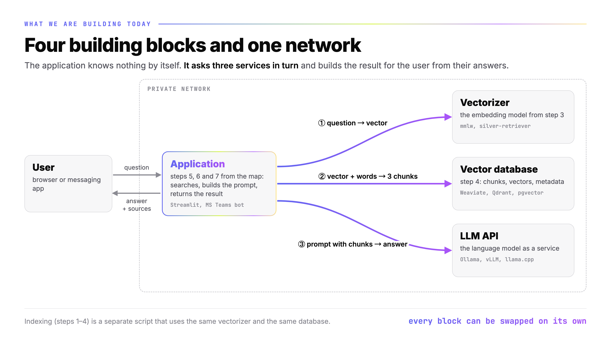

> _Notatka prowadzącego:_ This is the diagram from our training course, simplified. Four services, each in its own container, talk over APIs in a private network. The application (Streamlit here, it could also be an MS Teams bot) is the conductor: it has no knowledge of its own. We come back to this diagram at the end, when we run it.

---

## This is what it looks like at the end

### Example: a documentation assistant, [github.com/Comtegra/llm-search](https://github.com/Comtegra/llm-search)

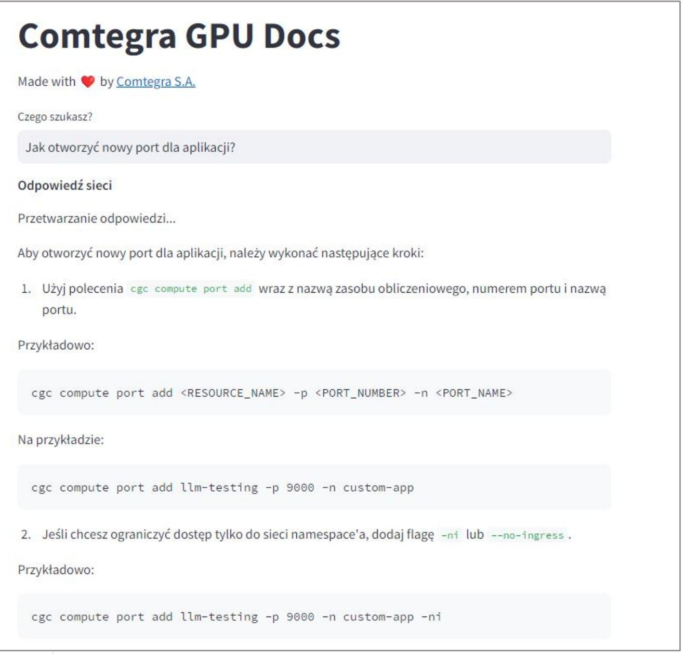

> _Notatka prowadzącego:_ The same architecture, only with product documentation instead of recipes. Below the answer the application shows the related documents it took fragments from. The code is open and can be browsed after the lecture. The commands in the answer were not made up by the model: they were copied from the documentation fragment that went into the prompt.

---

## Lecture map

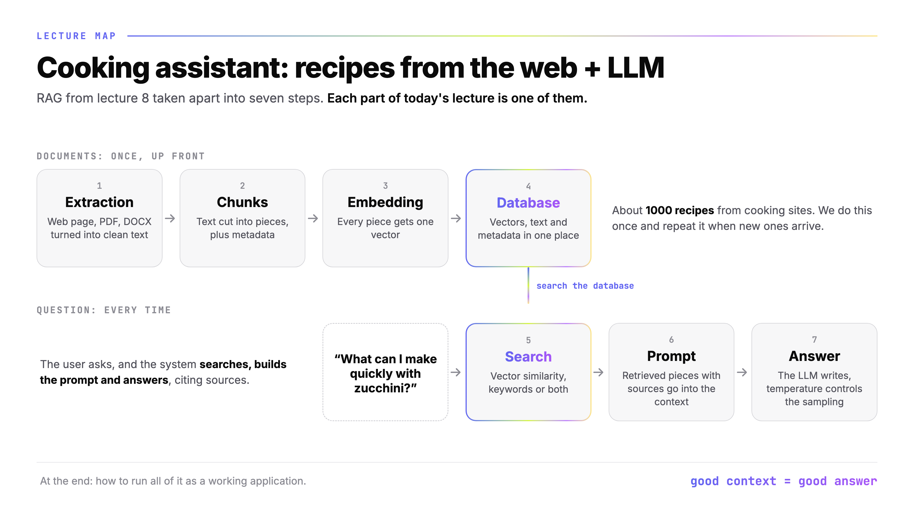

> _Notatka prowadzącego:_ The one diagram worth remembering from today. Come back to it at transitions: "we are at step 3". The top lane is done once and repeated when documents are added. The bottom lane runs for every question. Steps 3 and 5 must use the same embedding model, otherwise we compare points from two different maps.

---

## Recap: a sentence's path

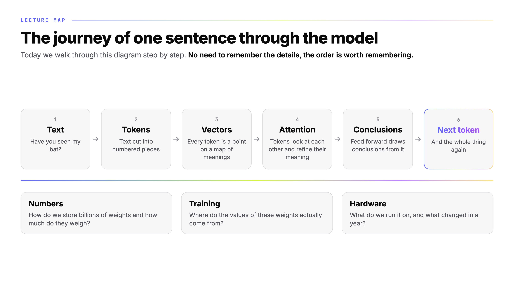

> _Notatka prowadzącego:_ One minute. Two steps from this diagram are useful today: step 3 (vectors), because we build the search engine from them, and step 6 (next token), because when answering we add temperature to it.

---

## Recap: the map of meanings

### An embedding is an address on the map of meanings

- Close on the map = **similar meaning**
- The map is learned from text, nobody drew it
- Today we turn **a whole fragment of text** into a point on the map, not a single word

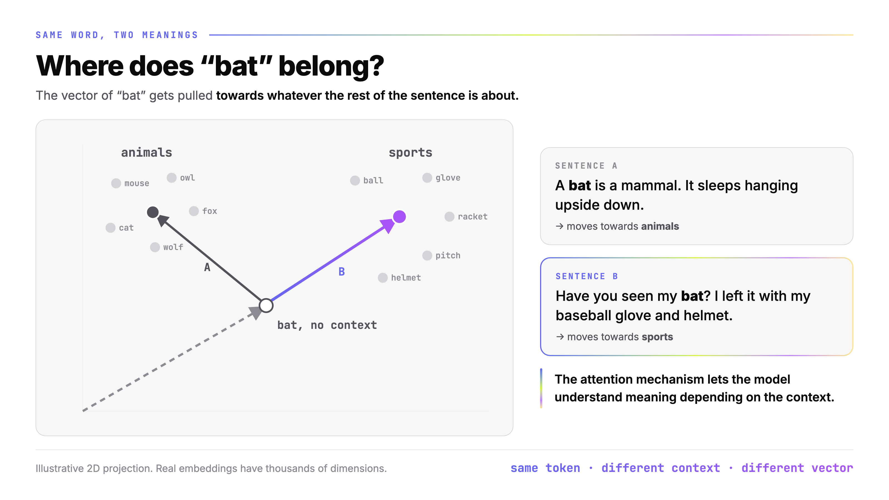

> _Notatka prowadzącego:_ The whole lecture today rests on one idea: if the question and the recipe land close on the map, the recipe answers the question. "Lighting" will find "lamp", and "quick zucchini dinner" will find "fritters", even though the words do not overlap.

---

## Where we are

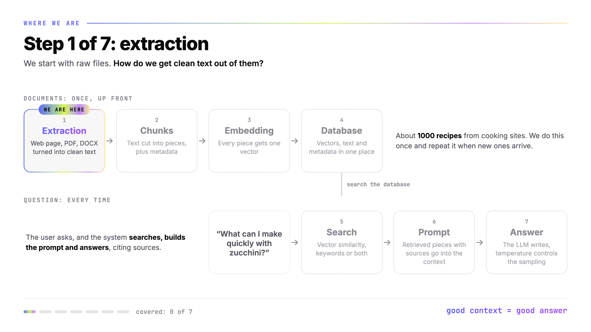

> _Notatka prowadzącego:_ A few seconds, no more. Point at what is behind us and what comes next.

---

## Step 1: extraction

### Where do documents come from?

- **Web pages:** content mixed with menus, ads, footers
- **DOCX:** has structure: headings, paragraphs, tables
- **PDF:** text scattered across the page, sometimes just an image (a scan)
- **Tables and charts:** numbers without a description lose their meaning

**Whatever we break here, the model will get as context.**

> _Notatka prowadzącego:_ Extraction is the least glamorous and most often neglected step. In practice most RAG quality problems start here, not in the choice of model.

---

## Step 1: what is inside the file?

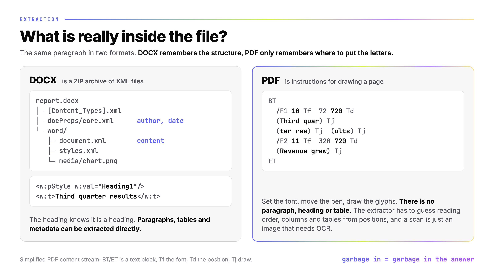

> _Notatka prowadzącego:_ You can rename a .docx to .zip live and unpack it. A line from our old slide describes PDF well: an unpacked PDF does not look like a sentence, it looks like instructions for a robot arm drawing on a sheet of paper.

---

## Step 1: what breaks a PDF?

| Problem | What comes out | What helps |
|---|---|---|
| Two columns | lines from both columns interleave | an extractor that recognises page layout |
| Table | a string of numbers without headers | separate table extraction, saved as Markdown |
| Header and footer | "Page 7 of 42" in the middle of a paragraph | removing repeated lines |
| Scan | empty text | OCR or a vision model |
| Hyphenation | "prepa- ration" | joining at a hyphen at the end of a line |

> _Notatka prowadzącego:_ You don't need to know the tools, it is enough to know the problem exists and that you need to look at the output. Good practice: take 10 random documents and read what came out of them before you build a database on it.

---

## Step 1: data loaders

### A web page is not just content

```python
from langchain_community.document_loaders import UnstructuredURLLoader

urls = ["https://aniagotuje.pl/przepis/blyskawiczne-buleczki-pszenne-z-sezamem",
        "https://www.wikihow.com/Ollie"]
loader = UnstructuredURLLoader(urls=urls)
data = loader.load()

data[1].page_content
```

```text
'Skip to Content\n\nQuizzes\n\nPRO\n\nCourses Hot Guides Tech Help Pro
Expert Videos About wikiHow Pro ArticleQuizzes\nRequest a New Article
Community Dashboard ...'
```

> _Notatka prowadzącego:_ The loader turned HTML into text, except the first thing it pulled out was the site menu. That junk will go into chunks, into vectors and into the prompt. By the way: instructions for an ollie on a skateboard have no business in a recipe database, yet they end up there if nobody checks the list of URLs. You will see it again on the search map.

---

## Step 1: an LLM as the extractor

### What's left of a recipe is a shopping list

```python
def get_shopping_list(text):
    response = client.chat.completions.create(
        model="llama3-8b",
        messages=[{"role": "user",
                   "content": f"From the recipe below, extract the list of products"
                              f"\n\n## Recipe\n\n{text}"}])
    return response.choices[0].message.content
```

```text
1. Yeast   2. Sugar   3. Water   4. Flour   5. Salt
6. Oil (unless it is marked as olive oil)   7. Olive oil   8. Sesame
```

> _Notatka prowadzącego:_ Instead of writing a parser for every recipe site, we ask a model which, as we know from L8, is great at extracting information from given text. Note item 6: the model added a comment nobody asked for. Output like that is hard to work with further in code. The next slide fixes it.

---

## Step 1: extraction into a structure

### We ask for JSON, not an essay

```python
prompt = """Extract data from the recipe. Reply with JSON only:
{"title": str, "ingredients": [str], "time_min": int,
 "category": "dinner" | "dessert" | "bread" | "other"}"""

# ask_llm: the same model call as on the previous slide
data = json.loads(ask_llm(prompt + "\n\n## Recipe\n\n" + text))
```
### JSON is an ordered structure and looks like this

```json
{"title": "Quick wheat rolls with sesame",
 "ingredients": ["yeast", "sugar", "water", "flour", "salt", "oil", "sesame"],
 "time_min": 45, "category": "bread"}
```
When it comes to exchanging data on the Internet, JSON is (probably) the most important structure.

> _Notatka prowadzącego:_ A list of allowed categories instead of free text: then the database won't have "Bread", "bread" and "Pieczywo" as three different values. Many model servers can enforce valid JSON (structured output), this comes back in semester 2. The numbers in the example are illustrative. In a moment these fields become chunk metadata.

---

## Step 1: categorisation

### When we ask without a format

```python
def categorize(text):
    response = client.chat.completions.create(
        model="llama3-8b",
        messages=[{"role": "user",
                   "content": "Categorize given text to one of categories from list:"
                              "\nPolitics\nSport\nProgramming\nCooking\nSkateboarding"
                              f"\n\nTEXT: {text}"}])
    return response.choices[0].message.content
```
Without a format the model has freedom, so it usually gives us more than we want
```text
The text can be categorized under the following category from the given list:
- Category: Cooking
```
We don't need an introduction or a description of what was produced. Especially if we then want to process this information further with a computer.


> _Notatka prowadzącego:_ An example from our old materials, deliberately without a format. We want just "Cooking" in the database, and we got a sentence. Note also that a Polish recipe got an English category, because the list was in English. These are not flaws of the model but of the prompt: the model does exactly what it was asked to do.

---

## Step 1: every model has its own template

### What we see as "roles", the model sees as special tokens

```text
<|begin_of_text|><|start_header_id|>system<|end_header_id|>

You are a cooking assistant.<|eot_id|><|start_header_id|>user<|end_header_id|>

Extract the list of products from the recipe: ...<|eot_id|><|start_header_id|>assistant<|end_header_id|>
```

- Llama 3 has this template, Mistral `[INST] ... [/INST]`, other models others again
- The model server (Ollama, vLLM) usually **applies the template itself**
- Wrong template: the model works, but **noticeably worse**, and nobody warns us

Everything that goes into the model is vectors, which come from tokens, which in turn come from a vocabulary. So the whole structure of the information passed to the model will also be vector/token/text.


> _Notatka prowadzącego:_ This is exactly the prompt structure from L8 (system, user, assistant), only written the way the model sees it. An instruct model was trained on text in this format, so a different format is a foreign language to it. The template is in the model card on Hugging Face. The same lesson comes back with embedding models: read the authors' notes.

---

## Where we are

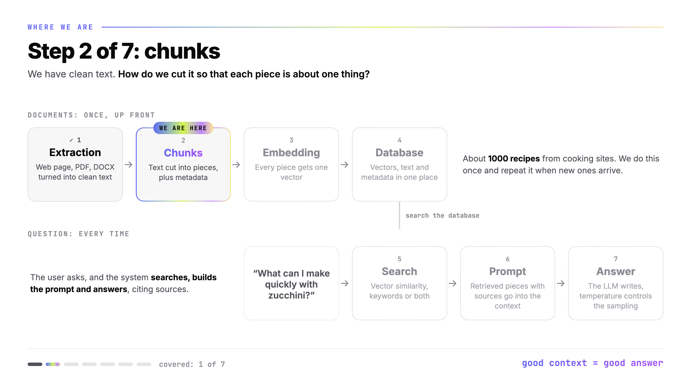

> _Notatka prowadzącego:_ A few seconds, no more. Point at what is behind us and what comes next.

---

## Step 2: chunks

### Why cut at all?

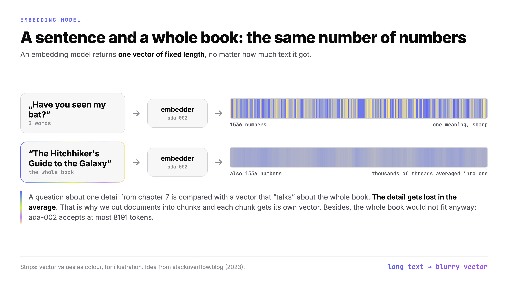

> _Notatka prowadzącego:_ A preview of step 3: an embedding model turns a whole text into one vector of fixed length, OpenAI text-embedding-ada-002 into 1536 numbers, and it accepts at most 8191 tokens. The vector of one paragraph is sharp, the vector of a book is the average of everything, so a question about a detail from chapter 7 won't hit it. Recipes are similar: if one piece holds five recipes, the vector "talks" about all of them at once. The comparison idea: stackoverflow.blog, "An intuitive introduction to text embeddings" (2023).

---

## Step 2: how to cut?

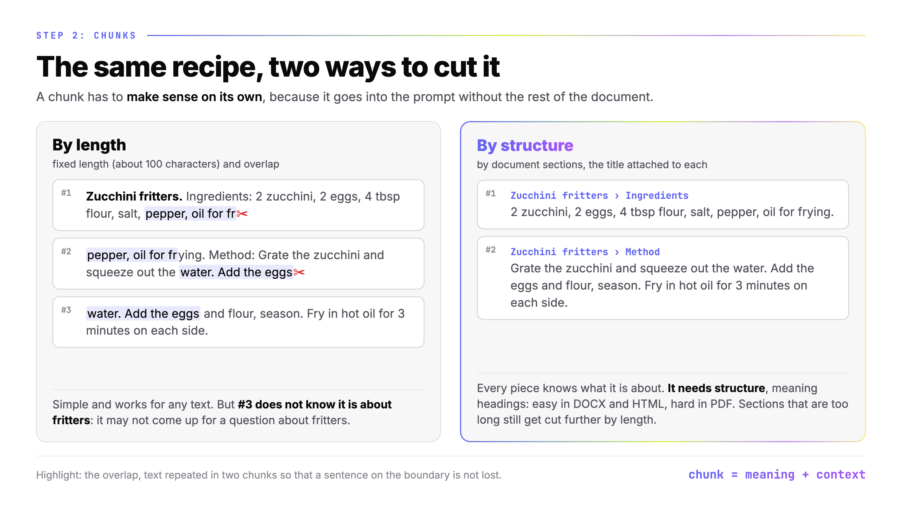

> _Notatka prowadzącego:_ This expands the "Documents and chunks" slide from L8. Cutting by length always works, but it cuts mid-sentence, hence the overlap. Cutting by structure gives sensible pieces but needs headings: DOCX and HTML win here, PDF from step 1 loses. Attaching the document title to every chunk is a simple trick that helps a lot.

---

## Step 2: what size?

### There is no single right answer

| Chunk too small | Chunk too large |
|---|---|
| loses context: "Fry for 3 minutes" doesn't know what to fry | blurs the vector: several topics at once |
| more chunks in the database | eats the context window at k = 5 |
| a hit the model can't build an answer from | a hit with a lot of unnecessary text |

- Starting point: **a few hundred tokens** with overlap, then tests on your own questions
- Upper limit: the embedding model's maximum number of tokens

> _Notatka prowadzącego:_ A recipe is a convenient case, because it usually fits in one or two chunks. Regulations or a contract are a hundred pages, and there chunk size starts to matter a lot. We show testing on the quality evaluation slide.

---

## Step 2: metadata

### Every chunk is text plus its description

```json
{"id": "zucchini-fritters#2",
 "text": "Zucchini fritters › Method: Grate the zucchini ...",
 "source": "recipes/zucchini-fritters",
 "category": "dinner",
 "time_min": 20,
 "date_added": "2025-11-20"}
```

- **Source:** the model will cite it in the answer
- **Category, time:** let us filter the results ("only dinners under 30 minutes")
- We get the metadata for free from the JSON extraction in step 1

> _Notatka prowadzącego:_ This is where steps 1 and 2 join. The vector is added in step 3, and the whole thing, text, vector and metadata, goes into the database in step 4. Filtering by metadata is often the cheapest improvement in search quality.

---

## Where we are

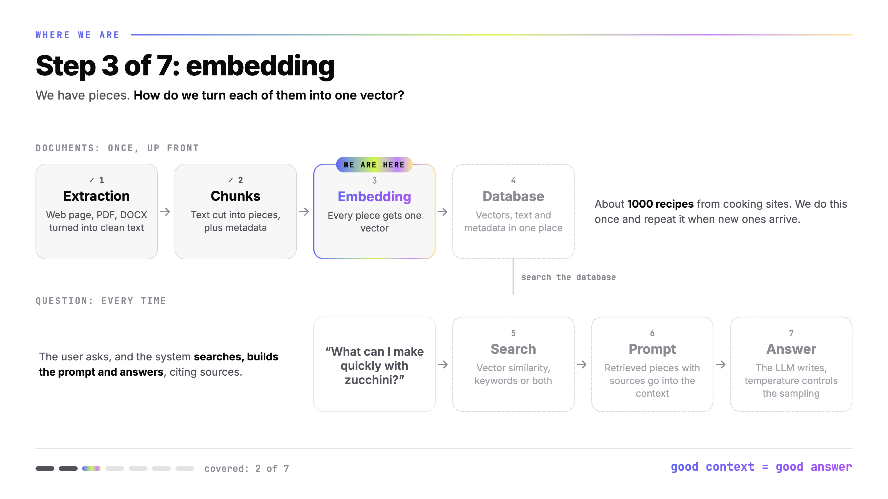

> _Notatka prowadzącego:_ A few seconds, no more. Point at what is behind us and what comes next.

---

## Step 3: embedding

### One chunk, one vector

- From L9: every token turns into a **vector**, an arrow on the map of meanings
- The chunk "Zucchini fritters › Method: ..." is about 150 tokens, so **150 arrows**
- The database needs **one arrow per chunk**, always the same length (e.g. 768 numbers)
- We will also turn the user's question into one arrow and compare it with the chunks

**This step comes down to two questions:** how a word becomes an arrow, and how to make one arrow out of 150.

> _Notatka prowadzącego:_ Step 3 on the map. This is the whole point of the step: the embedding model takes text of any length (up to the limit) and returns one vector of fixed length. First a short reminder of where a word's vector comes from, then the most important part: how to make one vector out of many words.

---

## Step 3: first, a single word

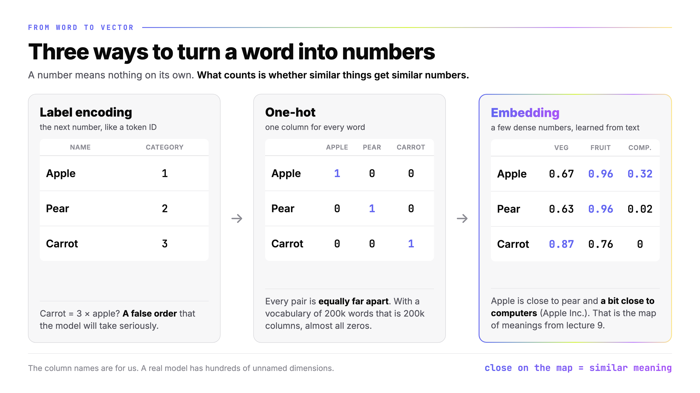

> _Notatka prowadzącego:_ A recap of L9 in one picture. Label encoding is exactly what the tokenizer does: `_bat` is 1777 and 1777 is not "closer" to 1778. One-hot fixes the false order, but every two words are equally far apart. Embedding is the map of meanings. The columns "Veg, Fruit, Computers" are for us: a real model has hundreds of dimensions and none of them has a name. From now on we think of a vector as an arrow: its direction is its meaning.

---

## Step 3: one vector from many words


> _Notatka prowadzącego:_ The most important slide of the step. Adding vectors as in physics: we place the arrows tip to tail, and the resultant goes from the start of the first to the end of the last. Word2vec does exactly this (or the average, the sum divided by the number of words: same direction, shorter arrow). Two flaws: a word always has the same vector, so a bat next to a glove is still an animal, and addition is commutative, so word order disappears. A transformer embedder first passes the tokens through attention, like the bat sentence in L9, and only then averages them (`average_pool` from the code in L9). That is why the result is no longer a sum of dictionary words. The bat example links back to L9.

---

## Step 3: long text, blurry vector

### The resultant of many arrows loses the details

- A short fragment about one thing: the arrows go in **a similar direction**, the resultant is sharp
- Five recipes in one chunk: the arrows go **in different directions** and cancel each other out
- The resultant lands "somewhere in the middle" and doesn't match **any** question well
- That is why we cut in step 2: **one topic, one chunk, one vector**

> _Notatka prowadzącego:_ We deliver on the promise from the "Hitchhiker's Guide to the Galaxy" slide in step 2. Now it is clear why one vector for the whole book is blurry: it is the resultant of thousands of arrows in different directions. Attention helps a little, because the words know about each other, but in the end everything still lands in one vector of fixed length.

---

## Step 3: an embedder for search

### Trained on pairs: a question and the fragment that answers it

| Question | Fragment | What training does |
|---|---|---|
| "What can I make quickly with zucchini?" | Zucchini fritters › Method ... | **pulls** the vectors together |
| "What can I make quickly with zucchini?" | No-bake cheesecake › Method ... | **pushes** the vectors apart |

- After millions of such pairs the question lands **close to the fragment with the answer**
- The question and the answer look completely different, so the model has to know **what it is getting**
- Hence prefixes: "query: ..." for the question, plain text for the fragment

> _Notatka prowadzącego:_ Plain word2vec learned which words occur next to each other. An embedder for search (a retriever) learns something else: the question has to hit the fragment that answers it. The question is short and asks, the fragment is long and describes, so literally they are not very similar. The prefix tells the model which side of the pair it is turning into a vector right now. This comes back in a moment with the model card.

---

## Step 3: which model to choose?

### [huggingface.co/spaces/mteb/leaderboard](https://huggingface.co/spaces/mteb/leaderboard), as of 2025

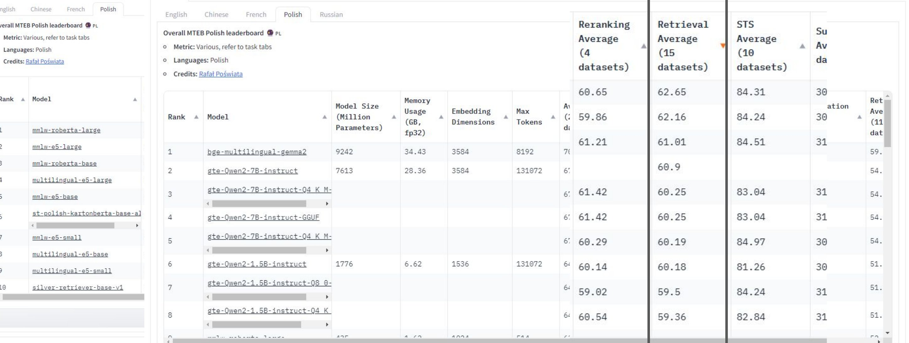

> _Notatka prowadzącego:_ MTEB is a benchmark for embedding models, with a separate tab for Polish (author: Rafał Poświata). For RAG we look at the Retrieval column, because that is exactly the task from the previous slide: the question has to find the fragment. Next to it are the costs: model size, memory, number of dimensions (more dimensions means a bigger database) and the maximum number of tokens (limits the chunk length from step 2). A small model is sometimes more sensible than a 7B one from the top of the ranking. Check the ranking live before the lecture.

---

## Step 3: why are big LLMs in the ranking?

### [anthropic.com/news/mapping-mind-language-model](https://www.anthropic.com/news/mapping-mind-language-model)

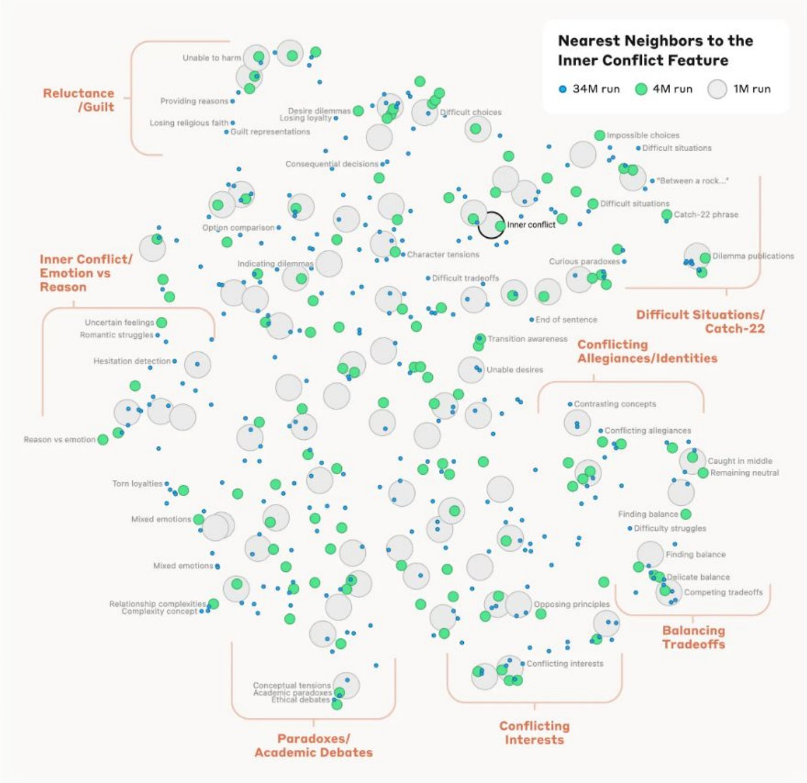

> _Notatka prowadzącego:_ At the top of MTEB there are models built from LLMs (e.g. gte-Qwen2, bge-multilingual-gemma2). Why does it work: inside a large model there is also a map of meanings, where similar concepts lie close to each other. Anthropic's 2024 study on Claude 3 Sonnet shows the nearest neighbours of the "inner conflict" feature. The same intuition as the bat map, only read from a real model. Such an LLM, further trained on question and fragment pairs, becomes an embedder: bigger and slower, but often better.

---

## Step 3: why Polish models?

### A question in Polish has to hit a recipe in Polish

- **Tokens:** Polish text breaks into more pieces (L9), so it is more expensive and worse
- **Embedder:** "cukinii", "cukinią", "cukinię" are one thing (zucchini), the model has to know that
- **Training pairs:** a model trained on English questions hits less well in Polish
- A Polish model is not just compute, it is above all **high-quality data**

> _Notatka prowadzącego:_ Polish embedders: mmlw (sdadas), silver-retriever (IPI PAN). Polish LLMs: Bielik (SpeakLeash), PLLuM. Multilingual models handle Polish better and better, so this is not an all-or-nothing choice: we compare on the Polish MTEB tab and on our own questions. The same applies to any language other than English.

---

## Step 3: how to compare two vectors?

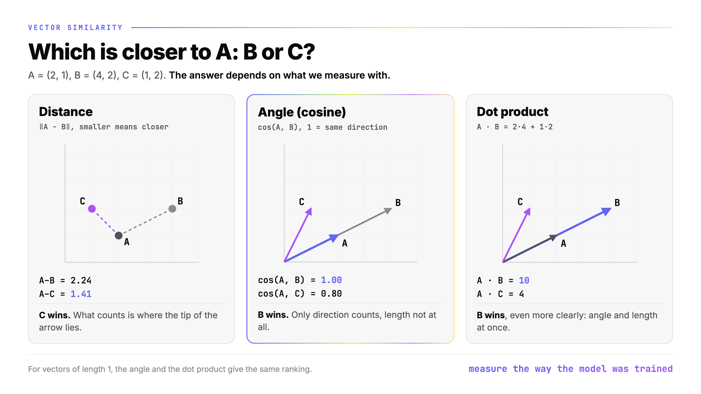

> _Notatka prowadzącego:_ Before we read a model card, we need to know three words that appear in it. A deliberately chosen example where the measures disagree. Euclidean distance looks at where the tips of the arrows lie. Cosine looks only at direction: B is A times 2, so the angle is zero. The dot product is angle and length at once. This is the same picture of arrows as with the resultant vector: two texts are similar when their arrows point in a similar direction. This slide comes back in step 5, with search.

---

## Step 3: how to choose the right metric?

### [huggingface.co/ipipan/silver-retriever-base-v1.1](https://huggingface.co/ipipan/silver-retriever-base-v1.1)

A good example is a model that was trained with the dot product but works better with cosine
- A Polish search model (IPI PAN), trained on **question and fragment** pairs
- Works best when it gets data **in the same format as in training**
- *"Although we used the dot product during training, the model usually works better with the cosine distance."*

<!-- columns -->

```python
# question: with the prefix, as in training
query = "Pytanie: What can I make quickly with zucchini?"

# fragment: title and content separated by </s>
passage = "Zucchini fritters</s>Grate the zucchini ..."
```

> _Notatka prowadzącego:_ This is where the training pairs slide pays off: the prefix "Pytanie: " ("Question: ") and the </s> separator are the format in which the model saw data during training. The same model with a different input format works noticeably worse, and the results will simply be weaker, with no error at all. The same lesson as with the prompt template in step 1. Each model has different prefixes: mmlw wants "zapytanie: ", silver-retriever "Pytanie: ", e5 models "query: " and "passage: ". Read the quote about the measure with the previous slide in mind: the model was trained with the dot product, and the authors recommend cosine, the direction of the arrow alone.

---

## Step 3: embedding in code

### Model chosen, card read, let's compute

```python
from sentence_transformers import SentenceTransformer, util

model = SentenceTransformer("sdadas/mmlw-roberta-base")

recipes = ["Zucchini fritters › Method: Grate the zucchini ...",
           "No-bake cheesecake › Method: Blend the quark with sugar ..."]
question = "zapytanie: What can I make quickly with zucchini?"

v_recipes = model.encode(recipes, normalize_embeddings=True)    # 2 vectors of 768 numbers
v_question = model.encode(question, normalize_embeddings=True)  # 1 vector, 768 numbers

print(util.cos_sim(v_question, v_recipes))   # higher score for the fritters
```

> _Notatka prowadzącego:_ All of step 3 in two `encode` calls: every chunk, whatever its length, comes back as one vector of 768 numbers, and the question gets the prefix from the model card (mmlw wants "zapytanie: ", Polish for "query: "). Illustrative code, no numeric results. `normalize_embeddings=True` gives vectors of length 1, which will simplify the similarity measures in step 5. We now store these vectors, together with the text and metadata, in the database.

---

## Where we are

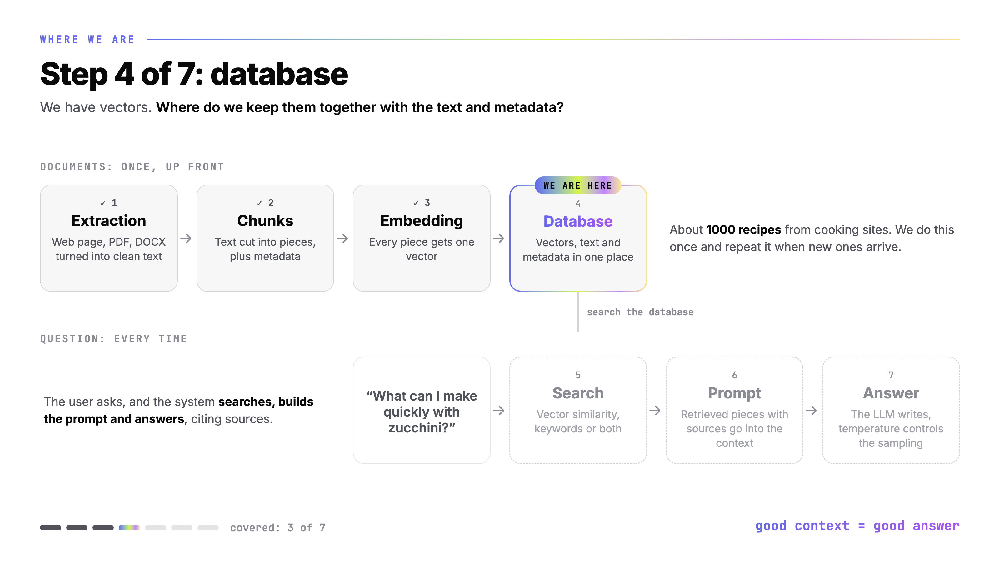

> _Notatka prowadzącego:_ A few seconds, no more. Point at what is behind us and what comes next.

---

## Step 4: database

### What exactly do we store?

| Field | Example | What for |
|---|---|---|
| id | `zucchini-fritters#2` | updating and deleting |
| text | "Zucchini fritters › Method: ..." | goes into the prompt |
| vector | `[0.021, -0.113, ..., 0.087]` (768 numbers) | semantic search |
| metadata | category: dinner, time: 20 min, source | filtering and citing |

**The database stores the text and the vector together.** We search by vector, the text goes into the prompt.

> _Notatka prowadzącego:_ A common misunderstanding: the language model never sees the vectors from the database. Vectors are only used to find the pieces, and their text goes into the prompt. 768 is the dimension of base-sized models, e.g. mmlw-roberta-base. The dimension depends on the model, and changing the model means recomputing the whole database, because vectors from two models are not comparable.

---

## Step 4: vector databases

### [Source: blog.det.life](https://blog.det.life/why-you-shouldnt-invest-in-vector-databases-c0cd3f59d23c)


> _Notatka prowadzącego:_ The right half is the point of the article's title: vector search has become a feature of ordinary databases, e.g. PostgreSQL with the pgvector extension. If a company already has Postgres or Elasticsearch, it often doesn't need a separate database. The market changes fast: Rockset was acquired by OpenAI in 2024 and no longer exists as a separate product.

---

## Step 4: what do we look for in a database?

### Vectors are not everything

- **Filtering:** "dinners only", "under 30 minutes only" (metadata from step 2)
- **Hybrid in one place:** vectors and keywords without gluing two systems together
- **Aggregations:** how many recipes per category, from which source
- **Scale:** more than one "computer" serves the database (clustering)
- **Updates:** a new recipe should be searchable immediately

> _Notatka prowadzącego:_ Questions to ask when choosing a database. Clustering in the database sense, meaning several machines, not clustering the data. In our training course we used Weaviate: native support for vectors and hybrid search, convenient embedder plug-ins, a good SDK. It is not the only good choice.

---

## Where we are

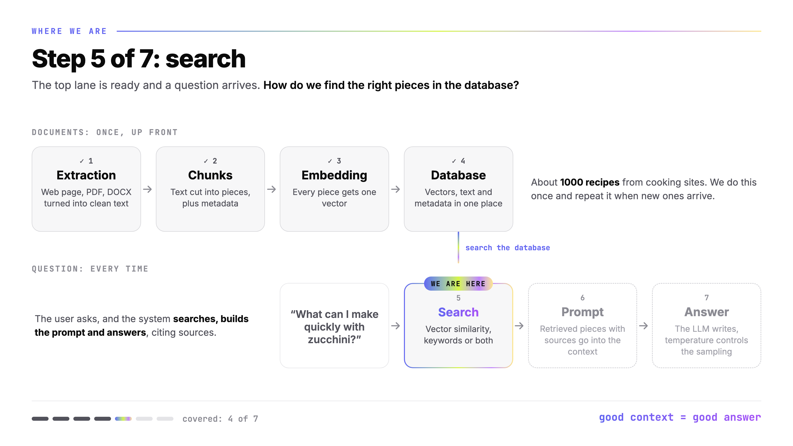

> _Notatka prowadzącego:_ A few seconds, no more. Point at what is behind us and what comes next.

---

## Step 5: search

### The question goes through the same model

1. The user's question: "What can I make quickly with zucchini?"
2. **The same embedding model** as in step 3, with the prefix from the model card
3. We compare the question's vector with the vectors in the database
4. We take the top k and pass their **text** on

Two questions remain: **how to compare** two vectors and **how to search fast**.

> _Notatka prowadzącego:_ Step 5 on the map. The most common mistake in a first RAG of your own: documents indexed with one model, questions embedded with another. Nothing crashes, the results are just random.

---

## Step 5: similarity, a recap


> _Notatka prowadzącego:_ The same slide as in step 3, now in the leading role: this is the measure we use to compare the question with every chunk in the database. A quick reminder: distance looks at the tips of the arrows, cosine only at direction, the dot product at angle and length at once. New for today: if the vectors have length 1 (hence `normalize_embeddings=True` in the code), all three measures give the same ranking. Which one to choose is stated in the model card, as with silver-retriever.

---

## Step 5: the dot product

### The sign tells the direction

- **Positive:** the vectors point in a similar direction
- **Zero:** they are perpendicular, nothing in common
- **Negative:** they point in opposite directions

The same **Q · K** as in attention in L9: a high product = the words fit each other.

<!-- columns -->

### The "plural" direction (3Blue1Brown)

| Word | plur · E(word) |
|---|---|
| four | 1.80 |
| three | 1.27 |
| two | 0.79 |
| one | **−2.80** |
| boys | 3.64 |
| boy | **−0.14** |

> _Notatka prowadzącego:_ An example from the 3Blue1Brown series on transformers (GPT-2). They took the "plural" direction in embedding space and computed the dot product with various words. The "more plural" the word, the higher the score, and one comes out negative. A direction in the space carries meaning, the king and queen idea from word2vec, only shown more honestly.

---

## Step 5: semantic search


> _Notatka prowadzącego:_ k nearest neighbours (kNN): we compute the similarity of the question to every chunk and take the top k. Two things to point at. Ratatouille says "courgette", not "zucchini", and still gets in, because meaning is what counts. Zucchini cake has the word from the question but loses, because it is a dessert. The ollie is junk from the loader in step 1: it lies far away, but it is in the database.

---

## Step 5: how to search fast?

### Comparing with every vector does not scale

- 1000 recipes: we compare with all of them, a fraction of a second
- 10 million chunks: too slow for every question
- **ANN, approximate search:** an index (e.g. HNSW) leads straight to the neighbourhood of the question
- The price: sometimes we miss one of the true nearest neighbours

Like in a library: we don't browse every shelf, we go to the "Cooking" section.

> _Notatka prowadzącego:_ HNSW (Hierarchical Navigable Small World) is a graph you walk from general "motorways" to local "side streets". The details are not needed. What matters: vector databases are fast precisely thanks to such indexes, and accuracy can be tuned with parameters at the cost of speed.

---

## Step 5: searching by words

### An inverted index, like the index at the back of a book

| Word | In which recipes? |
|---|---|
| zucchini | zucchini fritters, zucchini cake, cream of zucchini soup |
| courgette | courgette ratatouille |
| quick | quick bread, quick rolls |
| E330 | strawberry jam |

- **BM25** ranks the results: a rare word weighs more than a common one
- It knows nothing about meaning, and "zucchini" and "courgette" are **different words** to it

> _Notatka prowadzącego:_ Search engines have worked like this for decades, BM25 is over 30 years old and is still the reference point in search benchmarks. It is in Elasticsearch, OpenSearch, Postgres. In Polish inflection makes it a real problem ("cukinii", "cukinią" are different words), which lemmatisation, reducing words to their base form, softens. E330 is citric acid: an example of a code that vectors can't handle.

---

## Step 5: hybrid search

### Each method misses something different

| Query | Keywords (BM25) | Vectors |
|---|---|---|
| "what can I make quickly with zucchini?" | poor: misses courgette ratatouille | **good** |
| "recipe without E330" | **good**: exact code | poor: the code has no meaning |
| "a dish with summer squash" | poor: the word is not in the recipes | **good**: summer squash ≈ zucchini |
| equipment name, e.g. "Thermomix TM6" | **good** | it varies |

**Hybrid search:** run both searches and merge the rankings.

> _Notatka prowadzącego:_ Vector search computes a distance or an angle, word search uses an inverted index. Hybrid combines both worlds. Question for the room: which search will find "summer squash"? A source on merging results: weaviate.io/blog/hybrid-search-fusion-algorithms.

---

## Step 5: how to merge two rankings?

### Reciprocal Rank Fusion: the position counts, not the score

| Recipe | Position: vectors (top 4) | Position: BM25 (top 4) | Points × 1000 |
|---|---|---|---|
| Zucchini fritters | 1 | 2 | **32.5** |
| Cream of zucchini soup | 4 | 1 | **32.0** |
| Courgette ratatouille | 2 | 4 | **31.8** |
| Stuffed zucchini | 3 | none | 15.9 |
| Zucchini cake | none | 3 | 15.9 |

Points = 1 / (60 + position), summed over both lists.

> _Notatka prowadzącego:_ The scores of the two searches can't be compared directly: cosine runs from -1 to 1, and BM25 has no upper bound. So RRF (Cormack et al., 2009) looks only at positions. The fritters are high on both lists and win. A recipe from only one list gets roughly half the points. 60 is the constant from the original paper, it smooths out the differences between the top positions. Numbers computed from the formula for example rankings. Sometimes there is a third step, reranking: a separate model reads the question with each candidate and orders them again, more on that in semester 3.

---

## Step 5: hybrid and filter in code

### Weaviate, Python client v4

```python
import weaviate
from weaviate.classes.query import Filter

db = weaviate.connect_to_local()
recipes = db.collections.get("Recipe")

result = recipes.query.hybrid(
    query="What can I make quickly with zucchini?",
    alpha=0.5,                                   # 1 = vectors only, 0 = words only
    limit=3,
    filters=Filter.by_property("category").equal("dinner"))

for o in result.objects:
    print(o.properties["title"], o.properties["source"])
```

> _Notatka prowadzącego:_ All of step 5 in one call: the database turns the question into a vector itself (if it has a vectorizer attached), runs both searches, merges the rankings and applies the metadata filter. The alpha parameter is a slider between vectors and words. Illustrative code, the collection and field names are ours.

---

## Where we are

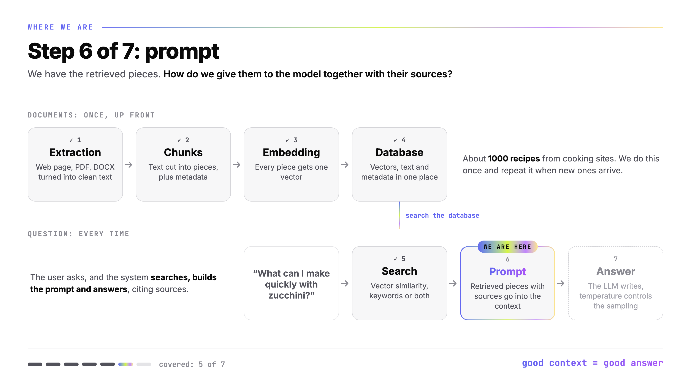

> _Notatka prowadzącego:_ A few seconds, no more. Point at what is behind us and what comes next.

---

## Step 6: prompt

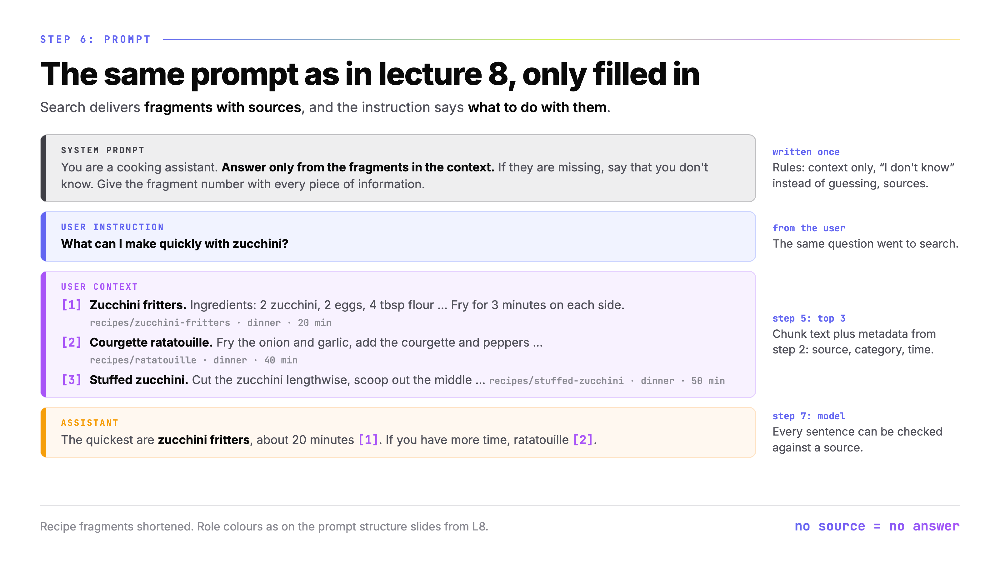

> _Notatka prowadzącego:_ We deliver on the promise from L8: the User context block is no longer pasted by hand, step 5 fills it. Three rules in the system prompt make a big difference: context only, "I don't know" instead of guessing, a source number with each piece of information. The fragment numbers let the application show links to the recipes below the answer, as in the screenshot of the finished product.

---

## Step 6: the prompt in code

### The application glues the prompt together from the search results

```python
context = "\n".join(
    f"[{i}] {o.properties['text']} ({o.properties['source']})"
    for i, o in enumerate(result.objects, start=1))

messages = [
    {"role": "system", "content": SYSTEM_PROMPT},
    {"role": "user", "content": f"{question}\n\n## Fragments\n\n{context}"},
]

answer = client_llm.chat.completions.create(
    model="bielik-11b", messages=messages, temperature=0.2)
```

> _Notatka prowadzącego:_ This is the whole "magic" of RAG: plain string concatenation. The instruction and the context go in one user message, just as in the diagram from L8. Temperature 0.2 is a preview of the next slide. The model name is illustrative, it depends on what we run on the server.

---

## Where we are

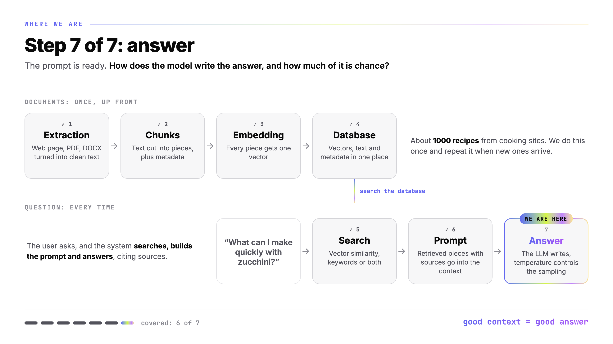

> _Notatka prowadzącego:_ A few seconds, no more. Point at what is behind us and what comes next.

---

## Step 7: the answer and temperature


> _Notatka prowadzącego:_ The distribution from L9: time 42%, midnight 19% and so on. Temperature T divides the logits before softmax, which is equivalent to raising the probabilities to the power 1/T and normalising again. Numbers computed assuming the rest of the vocabulary is 19 tokens at 1% each. The bottom row is the point: at T = 0.3 "time" comes up nine times out of ten, at T = 1 the fairy tale starts in several ways, and at T = 1.5 every third draw lands in the rest of the vocabulary, including "fridge" and "Excel". The model did not change, only the dice did. Once sampled, the token is appended to the text and the distribution is computed again, so one odd word drags the rest of the sentence along with it. This also answers the question from L8 of why 2+2 once gave 5.

---

## Step 7: what temperature for RAG?

### We want answers from the context, not from imagination

| Task | Temperature | Why |
|---|---|---|
| Extraction to JSON (step 1) | 0 | same recipe, same fields |
| Categorisation (step 1) | 0 | one correct label |
| Answer from fragments (step 7) | low, e.g. 0.2 | stick to the sources |
| Suggesting a weekly menu | higher | here variety is an advantage |

**A low temperature won't replace good context:** a bad fragment gives a confident, wrong answer.

> _Notatka prowadzącego:_ Temperature 0 in practice means "always the most probable token", so the same prompt almost always gives the same result. Some newer reasoning models don't let you change the temperature through the API. The values in the table are a starting point, not a rule.

---

## What can go wrong

### Every symptom has its step on the map

| Symptom | Likely cause | Step |
|---|---|---|
| Answer from the site menu | junk after extraction | 1 |
| "I don't know", although the recipe is in the database | bad chunk, different model, missing prefix | 2, 3, 5 |
| Ingredients from two recipes at once | chunk crossed a boundary, k too large | 2, 5 |
| An ingredient from outside the context | weak instruction, high temperature | 6, 7 |
| A recipe says "ignore the instructions" | someone put a command into a document | 1 |

> _Notatka prowadzącego:_ The lecture map is also for diagnosis: before you change the model, check which step failed. The last row is prompt injection: to the model a fragment from the database is just text in the prompt, and it can't tell a recipe from a command. If documents from outside go into the database, they have to be treated as untrusted content. More in semester 3.

---

## How do you check it works?

### Measure search separately, the answer separately

1. Prepare **20 to 50 questions** and for each write down which recipe is the right one
2. **Search:** in how many questions is the right recipe in the top k? (hit in top 3)
3. **Answer:** does it agree with the source and add nothing of its own?
4. Changing the chunks, the model or the hybrid alpha? **Run the same questions again**

> _Notatka prowadzącego:_ Without such a set every change is guesswork. The split matters: if search doesn't find the recipe, no LLM will answer well, and if it finds it but the answer is wrong, the problem is in steps 6 and 7. The questions are best collected from real users, not made up yourself. Evaluation comes back in more depth in semester 3.

---

## Where we are

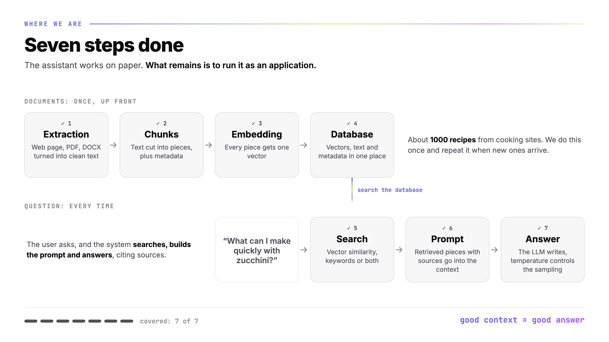

> _Notatka prowadzącego:_ A few seconds, no more. Point at what is behind us and what comes next.

---

## Running it: where do we get an LLM?

### An external provider's API or your own server

- **API:** fastest start, we pay for tokens, the data leaves the company
- **Own server:** the data stays with us, we pay for hardware (the memory calculation from L9)
- Model servers: **Ollama** (the simplest), **vLLM** and **llama.cpp** (more efficient)
- All three expose an **OpenAI-compatible** API

> _Notatka prowadzącego:_ The split from L8: 3rd party versus self-hosted. Compatibility with the OpenAI API is an important detail: the same `client.chat.completions.create` code from the previous slides works with the cloud and with your own server, only the address changes. Ollama is the most convenient on a laptop, but less suited to serving many users at once.

---

## Running it: Ollama

### A model on your own computer in three commands

```bash
curl -fsSL https://ollama.com/install.sh | sh
ollama pull SpeakLeash/bielik-11b-v2.2-instruct:Q8_0
OLLAMA_HOST=0.0.0.0 ollama serve
```

```python
from openai import OpenAI

client_llm = OpenAI(base_url="http://localhost:11434/v1", api_key="ollama")
```

> _Notatka prowadzącego:_ Q8_0 in the name is the quantization from L8 and L9: 8 bits per weight, so an 11B model takes about 11 GB. Ollama has a library of ready, quantized models and applies the prompt template from step 1 itself. The API key is required by the library, but Ollama doesn't check it.

---

## Running it: why containers?

### Each service in its own box

- **In the container:** the application, Python libraries, CUDA Toolkit, file system
- **On the server:** the card driver (CUDA Driver), the OS, Docker, the GPU
- The same image runs on a laptop, a server and in the cloud
- The four services from our diagram are **four containers**, talking over APIs

<!-- columns -->

```text
CONTAINER   application
            CUDA Toolkit
            system libraries
---------------------------------
SERVER      Docker Engine
            CUDA Driver
            server OS
            GPU
```

> _Notatka prowadzącego:_ Docker is the simplest way to do infrastructure as code: code packaged together with its dependencies. It works best when services talk over REST or other APIs, as in our diagram. The GPU driver has to be on the server, while the CUDA libraries live in the image, which is why one server can run containers with different library versions.

---

## Running it: more users

### Docker is one machine, scaling is many copies

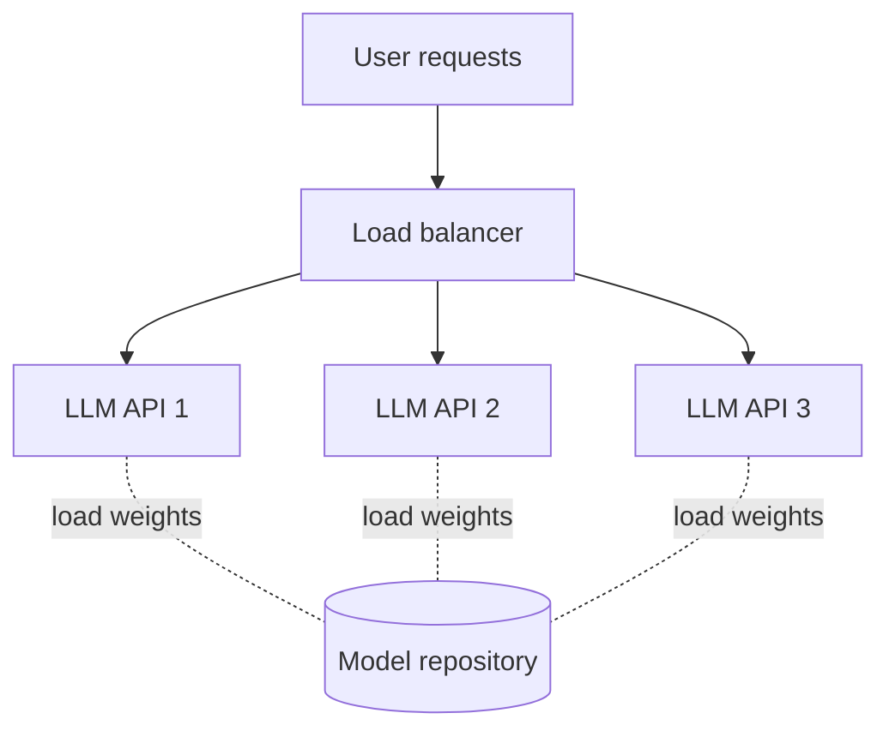

> _Notatka prowadzącego:_ In L9 we saw that one card serves a limited number of requests at once. When there are more users, we run several copies of the LLM API and a load balancer spreads the traffic. The model weights live in a shared repository so they don't have to be copied by hand. Docker alone doesn't handle multiple machines, that is what an orchestrator is for, e.g. Kubernetes.

---

## Running it: a model in a GPU cloud

### An example from our training course: Comtegra GPU Cloud

```bash
pip install cgcsdk
cgc register
cgc volume create -s 400 models
cgc compute create -n llm-server -c 4 -m 20 -g 1 -gt H100 -v models nvidia-pytorch
cgc compute port add -n api -p 11434 llm-server -ni
cgc compute list -d
```

> _Notatka prowadzącego:_ The same Ollama server as two slides earlier, only on an H100 card in the cloud. In order: a volume for the model weights (so they aren't downloaded on every restart), a container with 4 CPUs, 20 GB of RAM and one card, port 11434 available only in the private network (`-ni`), a list with the address and access token. This is an example from our materials, other GPU clouds work similarly.

---

## The whole system on one slide


> _Notatka prowadzącego:_ Back to the diagram from the beginning, now every block is filled in. The vectorizer is the model from step 3, the database is step 4, the application performs steps 5, 6 and 7, the LLM API is Ollama or vLLM in a container. Indexing, steps 1 to 4, is a separate script run when there are new documents. Question for the room: which block do we swap so the assistant works on documentation instead of recipes? Answer: none, it is enough to index different documents.

---

## A year later: what changed

| | December 2025 (in this lecture) | November 2026 |
|---|---|---|
| **Embeddings** | ada-002, gte-Qwen2, mmlw | Qwen3-Embedding, EmbeddingGemma |
| **Databases** | a separate vector database | more and more often a feature of an ordinary database |
| **Who searches** | the application, before calling the model | more and more often the model itself, as a tool |
| **Coding agents** | RAG over the repository | grep and reading files in a loop |

> _Notatka prowadzącego:_ Qwen3-Embedding (Alibaba, June 2025) and EmbeddingGemma (Google, September 2025, about 300M parameters, for running locally) are open models that reshuffled the MTEB ranking. The agents row: the Claude Code team has said that early versions used RAG with a vector database, and agentic search (glob, grep, read) did better. That is a report from internal tests and it concerns code, where exact names are an advantage. Check the MTEB table and model names before the lecture.

---

## A year later: what did NOT change

### The tools change, the problem stays

- The model knows only what we **give it in the context**
- Junk after extraction is **junk in the answer**
- Long text in one vector is **a blurry vector**
- The question and the document must be turned into vectors **by the same model**
- Vectors lose codes and names, words lose synonyms: hence **hybrid**

> _Notatka prowadzącego:_ Even when the search is done by an agent and not a ready RAG pipeline, these rules stay. An agent searching files will also get junk if the PDF was extracted badly.

---

## Summary

### Seven steps of the assistant

- **1. Extraction:** look at the loader's output; an LLM extracts data into JSON
- **2. Chunks:** sensible pieces with a title and metadata
- **3. Embedding:** one piece, one vector; read the model card
- **4. Database:** text, vector and metadata together
- **5. Search:** the same model, k nearest, hybrid with BM25
- **6. Prompt:** fragments with sources and the "context only" rule
- **7. Answer:** low temperature, and quality measured on your own questions

---

## What's next

### Today's concepts will come back

| Today | Where it returns | As what |
|---|---|---|
| Extraction to JSON | Semester 2 | Structured output and function calling |
| RAG, chunks, embedding | Semester 3, L3 | Where an agent gets its context |
| BM25 + vectors, RRF | Semester 3, L3 | Reranking and agentic search |
| A command in a document | Semester 3, L2 | A fragment from the database is untrusted content |

> _Notatka prowadzącego:_ We close the first part of the series: L8 said that RAG exists, L9 showed what a vector is, and L10 built a working system out of it. In semester 2 the model gets tools, and in semester 3 the same search becomes one of the agent's tools.

---

## Thank you

### Questions?

Jakub Zboina, MSc Eng.

Rafał Masłyk, MSc Eng.
