# Wstęp do uczenia maszynowego w kontekście przetwarzania zbiorów tekstów cz. 3

## Sztuczna Inteligencja i Data Science 1 - Wykład

### Wstęp do uczenia maszynowego w kontekście przetwarzania zbiorów tekstów cz. 3

mgr inż. Jakub Zboina

mgr inż. Rafał Masłyk

---

## Skąd jesteśmy

### Poprzednie wykłady

- W8: prompt, historia rozmowy, **RAG** jako jeden blok w prompcie
- W9: droga zdania przez model, **embeddingi**, okno kontekstowe
- W9: model losuje następny token z rozkładu

<!-- columns -->

### Dziś

- Jak zbudować asystenta, który zna **nasze** dokumenty?
- Krok po kroku: od strony WWW do odpowiedzi ze źródłem
- Jak to uruchomić jako działającą aplikację?

**Nie zrażajcie się, nie musicie pamiętać szczegółów. Kolejność kroków warto.**

---

## Problem

### Model nie zna naszych danych

- Wie tylko to, co było w danych treningowych, i to do pewnej daty
- Nie zna dokumentów firmy, regulaminu uczelni, naszej bazy przepisów
- Zapytany o nie, **i tak odpowie**: zgadnie najbardziej prawdopodobne tokeny

Pytanie: *„Ile mąki jest w naszym przepisie na placki z cukinii?”*

Odpowiedź modelu bez dokumentów: **jakaś liczba**, bez źródła i bez gwarancji.

> _Notatka prowadzącego:_ Nawiązanie do W9: model to maszyna do zgadywania następnego tokenu. Jeśli w kontekście nie ma przepisu, wylosuje typową ilość mąki z placków, które widział w treningu. To nie jest kłamstwo w ludzkim sensie, tylko statystyka. Pytanie do sali: jak sprawić, żeby odpowiedział z naszego przepisu?

---

## Trzy drogi

### Jak dać modelowi naszą wiedzę?

| | Wszystko do promptu | Finetuning | RAG |
|---|---|---|---|
| **Jak** | wklejamy całą bazę | douczamy wagi | wklejamy tylko pasujące fragmenty |
| **Nowy przepis** | od razu | trzeba trenować | od razu po zaindeksowaniu |
| **Koszt pytania** | cała baza w każdym pytaniu | niski | kilka fragmentów |
| **Źródło odpowiedzi** | da się wskazać | nie da się | da się wskazać |
| **Kiedy** | mała baza | zmiana stylu, zachowania | duża, zmienna baza wiedzy |

> _Notatka prowadzącego:_ Te trzy drogi były na W8 (RAG, finetuning) i W9 (okno kontekstowe, LoRA). Finetuning uczy raczej sposobu odpowiadania niż faktów, a fakty wtopione w wagi trudno potem zaktualizować i nie da się wskazać, skąd pochodzą. Dlatego do wiedzy firmowej zwykle wybiera się RAG.

---

## Dlaczego nie wkleić wszystkiego?

### Rachunek dla 1000 przepisów

- Jeden przepis to około **600 tokenów** (po polsku więcej niż po angielsku, W9)
- 1000 przepisów to około **600 tys. tokenów** w każdym pytaniu
- Każde pytanie płaci za całą bazę, a odpowiedź przychodzi później
- Im dłuższy kontekst, tym **gorzej model przypomina sobie szczegóły**

**RAG: z 1000 przepisów wybieramy 3 pasujące, czyli około 2 tys. tokenów.**

> _Notatka prowadzącego:_ Liczby szacunkowe, chodzi o rząd wielkości. Na W9 był rachunek pamięci: kontekst zajmuje VRAM, więc 600 tys. tokenów na każde pytanie to też mniej użytkowników naraz. Do tego context rot, czyli spadek jakości przy długim kontekście, szerzej na semestrze 3. Mała baza (kilkadziesiąt stron) bywa prościej wkleić w całości i to jest uczciwa opcja.

---

## Co dziś budujemy

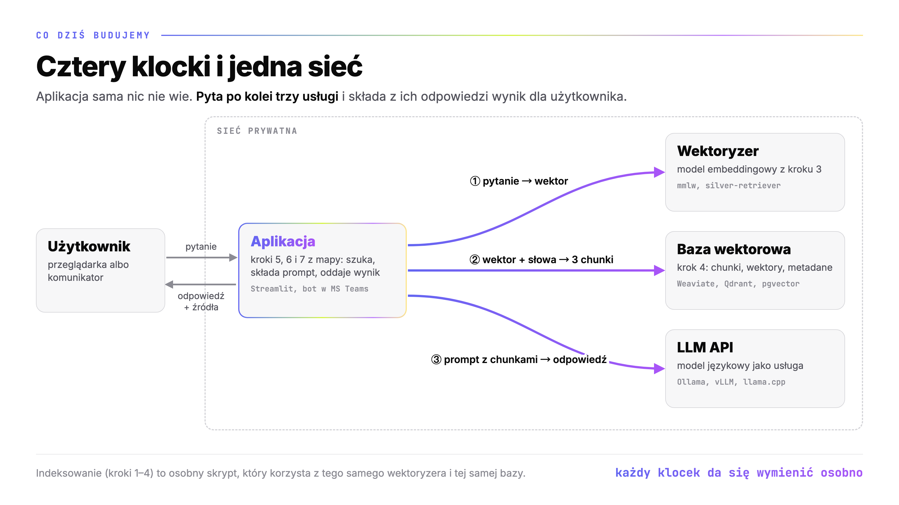

> _Notatka prowadzącego:_ To schemat z naszego szkolenia, uproszczony. Cztery usługi, każda w osobnym kontenerze, rozmawiają przez API w sieci prywatnej. Aplikacja (u nas Streamlit, może też być bot w MS Teams) jest dyrygentem: sama nie ma żadnej wiedzy. Do tego schematu wracamy na końcu, przy uruchamianiu.

---

## Tak to wygląda na końcu

### Przykład: asystent do dokumentacji, [github.com/Comtegra/llm-search](https://github.com/Comtegra/llm-search)

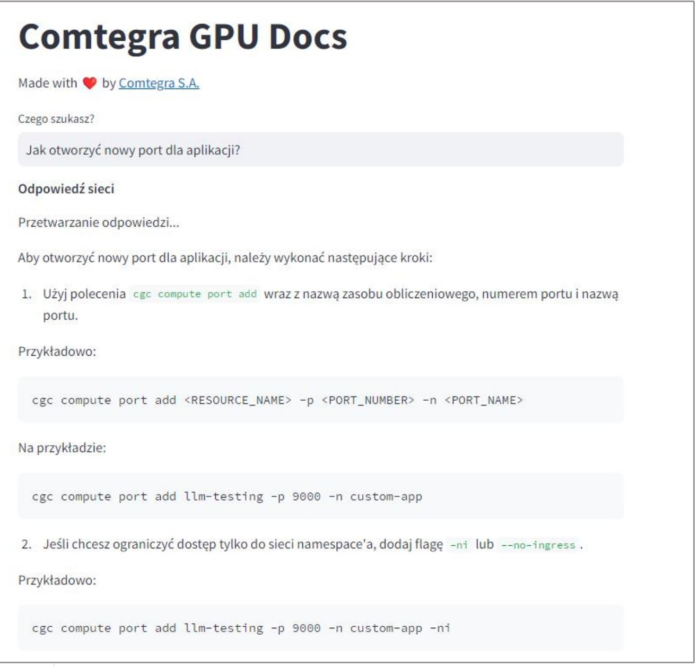

> _Notatka prowadzącego:_ Ta sama architektura, tylko zamiast przepisów dokumentacja produktu. Pod odpowiedzią aplikacja pokazuje powiązane dokumenty, z których wzięła fragmenty. Kod jest otwarty, można go przejrzeć po wykładzie. Polecenia w odpowiedzi nie są wymyślone przez model: zostały skopiowane z fragmentu dokumentacji, który trafił do promptu.

---

## Mapa wykładu

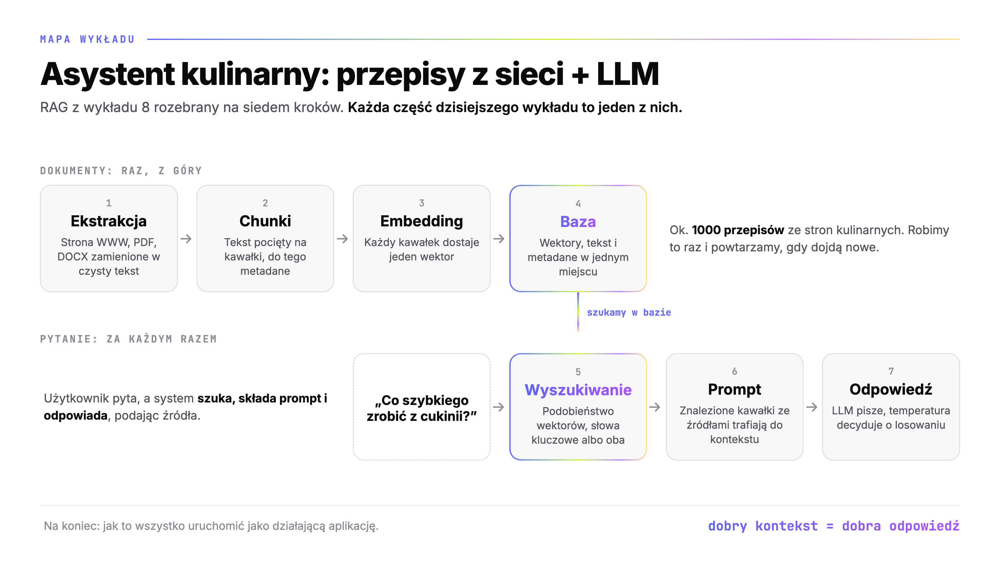

> _Notatka prowadzącego:_ Jedyny schemat, który warto zapamiętać z dzisiaj. Wracaj do niego przy przejściach: "jesteśmy na kroku 3". Górny tor robimy raz i powtarzamy, gdy dojdą dokumenty. Dolny przy każdym pytaniu. Kroki 3 i 5 muszą używać tego samego modelu embeddingowego, inaczej porównujemy punkty z dwóch różnych map.

---

## Powtórka: droga zdania

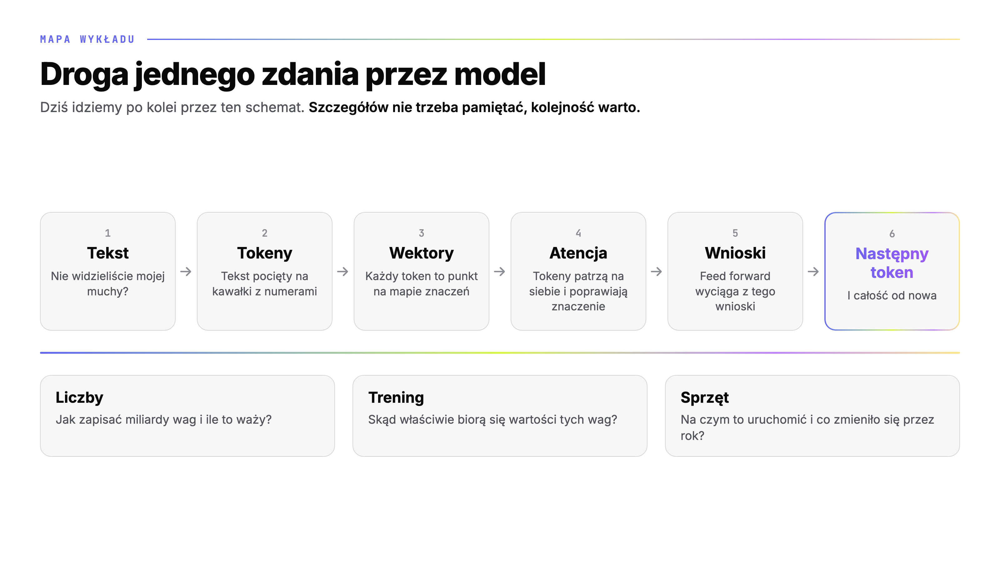

> _Notatka prowadzącego:_ Jedna minuta. Dziś przydadzą się dwa kroki z tego schematu: krok 3 (wektory), bo z nich zbudujemy wyszukiwarkę, i krok 6 (następny token), bo przy odpowiedzi dołożymy do niego temperaturę.

---

## Powtórka: mapa znaczeń

### Embedding to adres na mapie znaczeń

- Blisko na mapie = **podobne znaczenie**
- Mapa jest wyuczona z tekstów, nikt jej nie rysował
- Dziś zamienimy w punkt na mapie **cały fragment tekstu**, nie jedno słowo

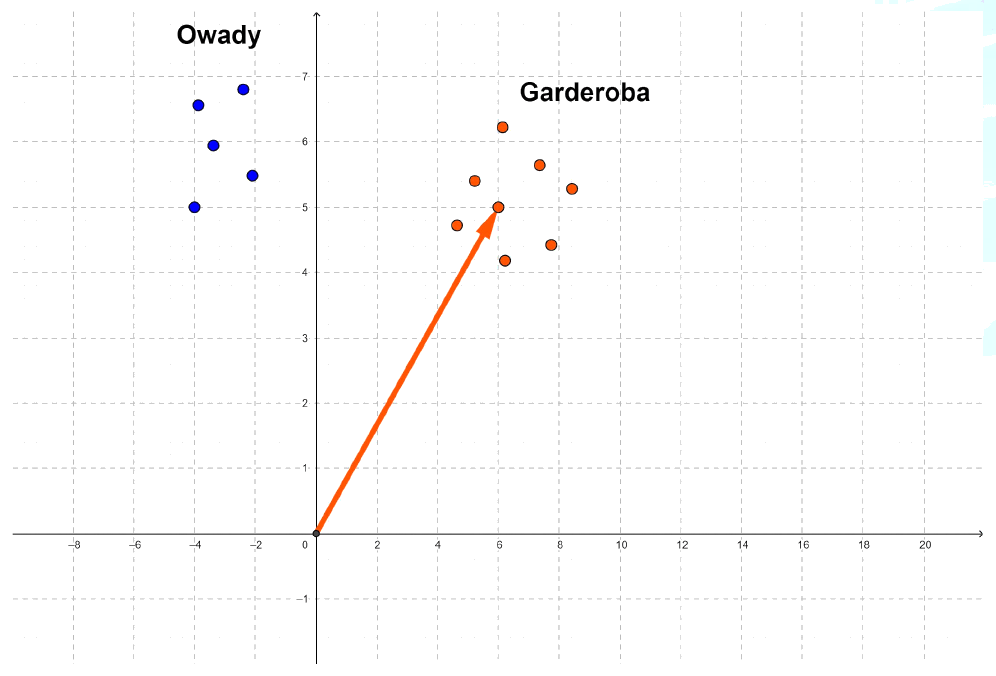

> _Notatka prowadzącego:_ Cały dzisiejszy wykład stoi na jednym pomyśle: jeśli pytanie i przepis lądują blisko na mapie, to przepis odpowiada na pytanie. "Oświetlenie" znajdzie "lampę", a "szybki obiad z cukinii" znajdzie "placki", choć słowa się nie pokrywają.

---

## Gdzie jesteśmy

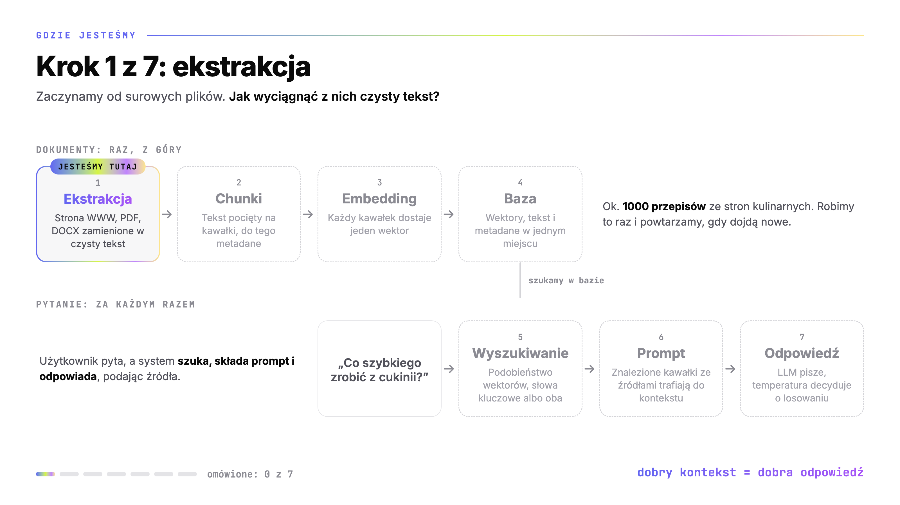

> _Notatka prowadzącego:_ Kilka sekund, nie więcej. Pokaż palcem, co już za nami i co dalej.

---

## Krok 1: ekstrakcja

### Skąd biorą się dokumenty?

- **Strony WWW:** treść przemieszana z menu, reklamami, stopką
- **DOCX:** ma strukturę: nagłówki, akapity, tabele
- **PDF:** tekst rozsypany po stronie, czasem tylko obrazek (skan)
- **Tabele i wykresy:** liczby bez opisu tracą sens

**Wszystko, co tu zepsujemy, model dostanie jako kontekst.**

> _Notatka prowadzącego:_ Ekstrakcja to najmniej efektowny i najczęściej zaniedbany krok. W praktyce większość problemów z jakością RAG zaczyna się tutaj, a nie w wyborze modelu.

---

## Krok 1: co jest w środku pliku?

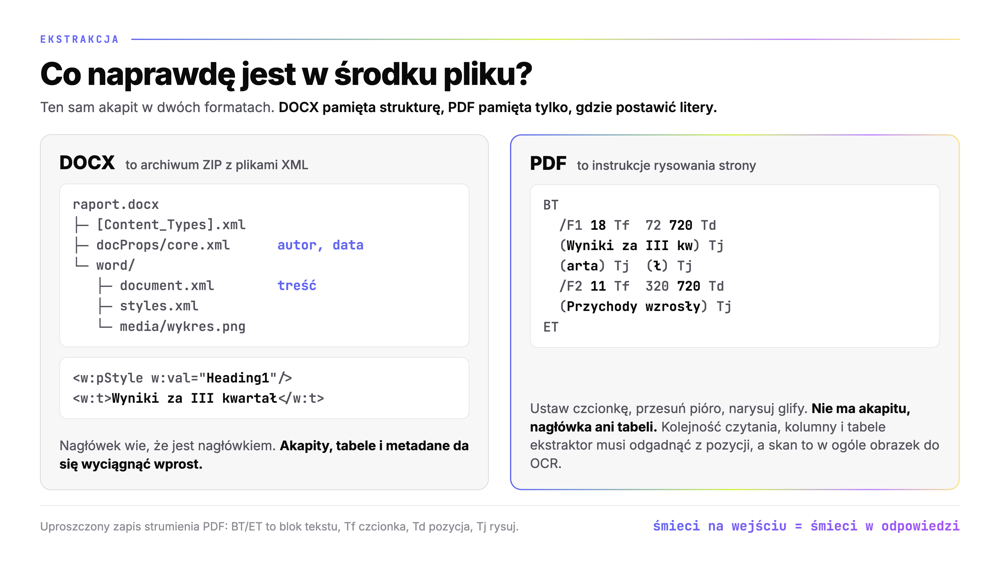

> _Notatka prowadzącego:_ Można na żywo zmienić rozszerzenie .docx na .zip i rozpakować. O PDF-ie dobrze mówi zdanie z naszego starego slajdu: rozpakowany PDF nie wygląda jak zdanie, tylko jak instrukcje dla ramienia robota rysującego po kartce.

---

## Krok 1: co psuje PDF?

| Problem | Co wychodzi | Co pomaga |
|---|---|---|
| Dwie kolumny | wiersze z obu kolumn przeplatają się | ekstraktor rozpoznający układ strony |
| Tabela | ciąg liczb bez nagłówków | osobna ekstrakcja tabel, zapis jako Markdown |
| Nagłówek i stopka | „Strona 7 z 42” w środku akapitu | usuwanie powtarzających się linii |
| Skan | pusty tekst | OCR albo model wizyjny |
| Dzielenie wyrazów | „przygo- towanie” | sklejanie po myślniku na końcu linii |

> _Notatka prowadzącego:_ Nie trzeba znać narzędzi, wystarczy wiedzieć, że problem istnieje i że trzeba popatrzeć na wynik. Dobra praktyka: weź 10 losowych dokumentów i przeczytaj, co z nich wyszło, zanim zbudujesz na tym bazę.

---

## Krok 1: data loadery

### Strona WWW to nie tylko treść

```python
from langchain_community.document_loaders import UnstructuredURLLoader

urls = ["https://aniagotuje.pl/przepis/blyskawiczne-buleczki-pszenne-z-sezamem",
        "https://www.wikihow.com/Ollie"]
loader = UnstructuredURLLoader(urls=urls)
data = loader.load()

data[1].page_content
```

```text
'Skip to Content\n\nQuizzes\n\nPRO\n\nCourses Hot Guides Tech Help Pro
Expert Videos About wikiHow Pro ArticleQuizzes\nRequest a New Article
Community Dashboard ...'
```

> _Notatka prowadzącego:_ Loader zamienił HTML w tekst, tylko że pierwsze, co wyciągnął, to menu strony. Te śmieci trafią do chunków, do wektorów i do promptu. Przy okazji: instrukcja ollie na deskorolce nie ma czego szukać w bazie przepisów, a trafi tam, jeśli nikt nie sprawdzi listy adresów. Zobaczycie ją jeszcze na mapie wyszukiwania.

---

## Krok 1: LLM jako ekstraktor

### Z przepisu zostaje lista zakupów

```python
def get_shopping_list(text):
    response = client.chat.completions.create(
        model="llama3-8b",
        messages=[{"role": "user",
                   "content": f"Z podanego poniżej przepisu wyciągnij listę produktów"
                              f"\n\n## Przepis\n\n{text}"}])
    return response.choices[0].message.content
```

```text
1. Drożdże   2. Cukier   3. Woda   4. Mąka   5. Sól
6. Olej (o ile nie jest oznaczone, że jest to oliwa)   7. Oliwa   8. Sezam
```

> _Notatka prowadzącego:_ Zamiast pisać parser pod każdą stronę z przepisami, prosimy model, który z W8 wiemy, że świetnie wyciąga informacje z podanego tekstu. Zwróć uwagę na punkt 6: model dopisał komentarz, o który nikt nie prosił. Z takim wynikiem trudno dalej pracować w kodzie. Następny slajd to naprawia.

---

## Krok 1: ekstrakcja do struktury

### Prosimy o JSON, nie o wypracowanie

```python
prompt = """Z przepisu wyciągnij dane. Odpowiedz wyłącznie JSON-em:
{"tytul": str, "skladniki": [str], "czas_min": int,
 "kategoria": "obiad" | "deser" | "pieczywo" | "inne"}"""

# ask_llm: to samo wywołanie modelu co na poprzednim slajdzie
dane = json.loads(ask_llm(prompt + "\n\n## Przepis\n\n" + text))
```
### JSON to uporządkowana struktura i wyglada tak

```json
{"tytul": "Błyskawiczne bułeczki pszenne z sezamem",
 "skladniki": ["drożdże", "cukier", "woda", "mąka", "sól", "olej", "sezam"],
 "czas_min": 45, "kategoria": "pieczywo"}
```
Jeśli chodzi o wymianę danych w Internecie to JSON jest (chyba) najważniejszą strukturą.

> _Notatka prowadzącego:_ Lista dozwolonych kategorii zamiast wolnego tekstu: wtedy w bazie nie będzie "Pieczywo", "pieczywo" i "Bread" jako trzech różnych wartości. Wiele serwerów modeli potrafi wymusić poprawny JSON (structured output), wraca to na semestrze 2. Liczby w przykładzie poglądowe. Te pola za chwilę staną się metadanymi chunków.

---

## Krok 1: kategoryzacja

### Gdy prosimy bez formatu

```python
def categorize(text):
    response = client.chat.completions.create(
        model="llama3-8b",
        messages=[{"role": "user",
                   "content": "Categorize given text to one of categories from list:"
                              "\nPolitics\nSport\nProgramming\nCooking\nSkateboarding"
                              f"\n\nTEXT: {text}"}])
    return response.choices[0].message.content
```
Bez formatu model ma swobodę przez co zazwyczaj da nam więcej niż byśmy chcieli
```text
The text can be categorized under the following category from the given list:
- Category: Cooking
```
Nie potrzebujemy wstępu, opisu tego co zostało wyplute. Szczególnie jeśli później mamy taki informacje dalej przetwarzać za pomocą komputera


> _Notatka prowadzącego:_ Przykład z naszych starych materiałów, specjalnie bez formatu. Do bazy chcemy samo "Cooking", a dostaliśmy zdanie. Zauważ też, że polski przepis dostał angielską kategorię, bo lista była po angielsku. To nie są wady modelu, tylko promptu: model robi dokładnie to, o co go poproszono.

---

## Krok 1: każdy model ma swój szablon

### To, co widzimy jako „role”, model widzi jako tokeny specjalne

```text
<|begin_of_text|><|start_header_id|>system<|end_header_id|>

Jesteś asystentem kulinarnym.<|eot_id|><|start_header_id|>user<|end_header_id|>

Wyciągnij listę produktów z przepisu: ...<|eot_id|><|start_header_id|>assistant<|end_header_id|>
```

- Llama 3 ma taki szablon, Mistral `[INST] ... [/INST]`, inne modele jeszcze inne
- Serwer modelu (Ollama, vLLM) zwykle **nakłada szablon sam**
- Zły szablon: model działa, ale **wyraźnie gorzej**, i nikt nas nie ostrzeże

Wszystko co trafia do modelu do wektory, pochądzce od tokenów, które znowu pochądzą ze słownika. Tak więc cała struktura informacji przekazywanej do modelu również będzie wektoro/tokeno/tekstem.


> _Notatka prowadzącego:_ To jest dokładnie struktura promptu z W8 (system, user, assistant), tylko zapisana tak, jak ją widzi model. Model instruct uczono na tekstach w tym formacie, więc inny format to dla niego obcy język. Szablon jest w karcie modelu na Hugging Face. Ta sama lekcja wróci przy modelach embeddingowych: czytajcie notatki twórców.

---

## Gdzie jesteśmy

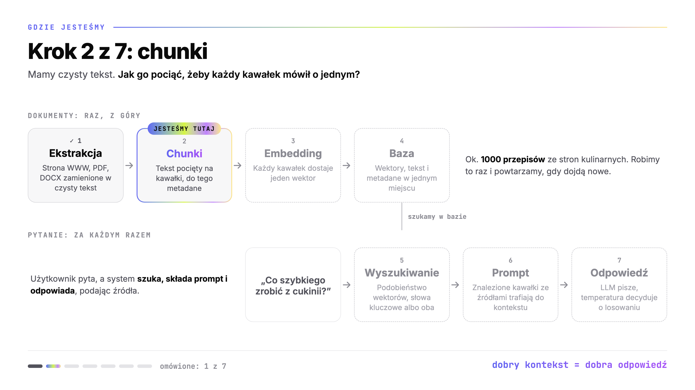

> _Notatka prowadzącego:_ Kilka sekund, nie więcej. Pokaż palcem, co już za nami i co dalej.

---

## Krok 2: chunki

### Dlaczego w ogóle tniemy?

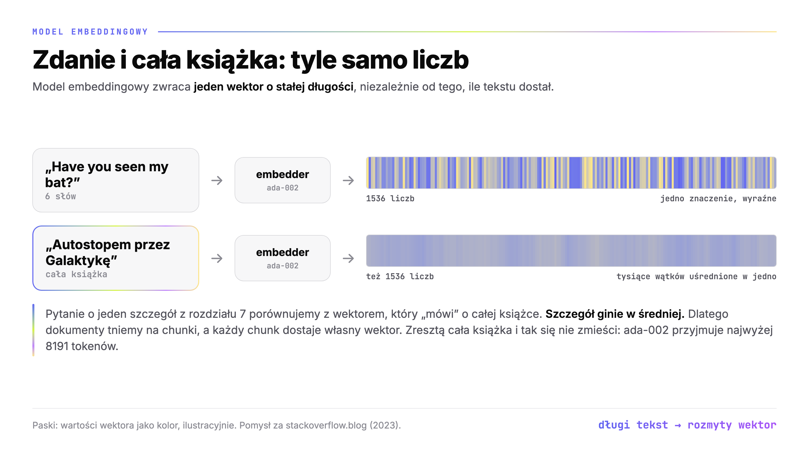

> _Notatka prowadzącego:_ Zapowiedź kroku 3: model embeddingowy zamienia cały tekst w jeden wektor o stałej długości, OpenAI text-embedding-ada-002 w 1536 liczb, a przyjmuje najwyżej 8191 tokenów. Wektor jednego akapitu jest wyraźny, wektor książki to średnia wszystkiego, więc pytanie o szczegół z rozdziału 7 do niego nie trafi. Z przepisami jest podobnie: jeśli w jednym kawałku jest pięć przepisów, wektor "mówi" o wszystkich naraz. Pomysł z porównaniem: stackoverflow.blog, "An intuitive introduction to text embeddings" (2023).

---

## Krok 2: jak ciąć?

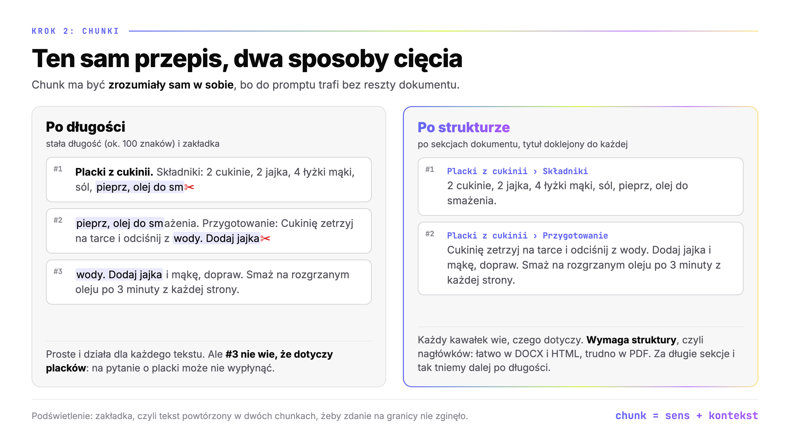

> _Notatka prowadzącego:_ To rozwinięcie slajdu "Dokumenty i chunki" z W8. Cięcie po długości zawsze działa, ale tnie w środku zdania, stąd zakładka. Cięcie po strukturze daje sensowne kawałki, ale wymaga nagłówków: tu wygrywa DOCX i HTML, przegrywa PDF z kroku 1. Doklejenie tytułu dokumentu do każdego chunka to prosty trik, który dużo daje.

---

## Krok 2: jaki rozmiar?

### Nie ma jednej dobrej odpowiedzi

| Za mały chunk | Za duży chunk |
|---|---|
| gubi kontekst: „Smaż po 3 minuty” nie wie, co smażyć | rozmywa wektor: kilka tematów naraz |
| więcej chunków w bazie | zjada okno kontekstowe przy k = 5 |
| trafienie, z którego model nie złoży odpowiedzi | trafienie z dużą ilością zbędnego tekstu |

- Punkt startu: **kilkaset tokenów** i zakładka, potem testy na własnych pytaniach
- Górna granica: maksymalna liczba tokenów modelu embeddingowego

> _Notatka prowadzącego:_ Przepis to wygodny przypadek, bo zwykle mieści się w jednym chunku albo dwóch. Regulamin czy umowa to sto stron i tam rozmiar chunka zaczyna mieć duże znaczenie. Testowanie pokażemy na slajdzie o ocenie jakości.

---

## Krok 2: metadane

### Każdy chunk to tekst i jego opis

```json
{"id": "placki-z-cukinii#2",
 "tekst": "Placki z cukinii › Przygotowanie: Cukinię zetrzyj na tarce ...",
 "zrodlo": "przepisy/placki-z-cukinii",
 "kategoria": "obiad",
 "czas_min": 20,
 "data_dodania": "2025-11-20"}
```

- **Źródło:** model poda je w odpowiedzi
- **Kategoria, czas:** pozwolą odfiltrować wyniki („tylko obiady do 30 minut”)
- Metadane mamy za darmo z ekstrakcji do JSON-a w kroku 1

> _Notatka prowadzącego:_ Tu spinają się kroki 1 i 2. Wektor zostanie dodany w kroku 3, a całość, czyli tekst, wektor i metadane, trafi do bazy w kroku 4. Filtrowanie po metadanych to często najtańsza poprawa jakości wyszukiwania.

---

## Gdzie jesteśmy

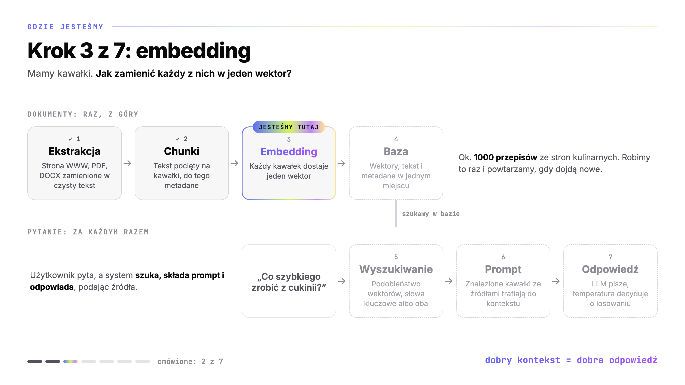

> _Notatka prowadzącego:_ Kilka sekund, nie więcej. Pokaż palcem, co już za nami i co dalej.

---

## Krok 3: embedding

### Jeden chunk, jeden wektor

- Z W9: każdy token zamienia się w **wektor**, czyli strzałkę na mapie znaczeń
- Chunk „Placki z cukinii › Przygotowanie: ...” to około 150 tokenów, czyli **150 strzałek**
- Baza potrzebuje **jednej strzałki na chunk**, zawsze tej samej długości (np. 768 liczb)
- Pytanie użytkownika też zamienimy w jedną strzałkę i porównamy z chunkami

**Na ten krok składają się dwa pytania:** jak słowo staje się strzałką i jak ze 150 strzałek zrobić jedną.

> _Notatka prowadzącego:_ Krok 3 na mapie. Tu jest cały sens kroku: model embeddingowy dostaje tekst dowolnej długości (do limitu), a oddaje jeden wektor o stałej długości. Najpierw krótko przypominamy, skąd wektor słowa, potem najważniejsze: jak z wielu słów zrobić jeden wektor.

---

## Krok 3: najpierw jedno słowo


> _Notatka prowadzącego:_ Powtórka z W9 w jednym obrazku. Label encoding to dokładnie to, co robi tokenizer: `_bat` to 1777 i 1777 nie jest "bliżej" 1778. One-hot naprawia fałszywy porządek, ale każde dwa słowa są równie dalekie. Embedding to mapa znaczeń. Kolumny "Warzywa, Owoce, Komputery" są dla nas: prawdziwy model ma setki wymiarów i żaden nie ma nazwy. Od teraz myślimy o wektorze jak o strzałce: kierunek to znaczenie.

---

## Krok 3: z wielu słów jeden wektor


> _Notatka prowadzącego:_ Najważniejszy slajd kroku. Dodawanie wektorów jak na fizyce: strzałki ustawiamy jedna za drugą, wypadkowa idzie od początku pierwszej do końca ostatniej. Word2vec robi dokładnie to (albo średnią, czyli sumę podzieloną przez liczbę słów: ten sam kierunek, krótsza strzałka). Dwie wady: słowo ma zawsze ten sam wektor, więc mucha z krawatem to nadal owad, a dodawanie jest przemienne, więc kolejność słów znika. Embedder transformerowy najpierw puszcza tokeny przez atencję, jak zdanie z muchą na W9, a dopiero potem uśrednia (`average_pool` z kodu na W9). Dlatego wynik nie jest już sumą słów ze słownika. Przykład z muchą zamiast "bat" z naszego starego slajdu, żeby nawiązać do W9.

---

## Krok 3: długi tekst, rozmyty wektor

### Wypadkowa wielu strzałek traci szczegóły

- Krótki fragment o jednej rzeczy: strzałki idą w **podobną stronę**, wypadkowa jest wyraźna
- Pięć przepisów w jednym chunku: strzałki idą **w różne strony** i znoszą się nawzajem
- Wypadkowa trafia „gdzieś pośrodku” i nie pasuje dobrze do **żadnego** pytania
- Dlatego w kroku 2 cięliśmy: **jeden temat, jeden chunk, jeden wektor**

> _Notatka prowadzącego:_ Domykamy obietnicę ze slajdu o książce "Autostopem przez Galaktykę" z kroku 2. Teraz widać, dlaczego jeden wektor dla całej książki jest rozmyty: to wypadkowa tysięcy strzałek w różne strony. Atencja trochę pomaga, bo słowa wiedzą o sobie nawzajem, ale na końcu i tak wszystko ląduje w jednym wektorze o stałej długości.

---

## Krok 3: embedder do wyszukiwania

### Uczony na parach: pytanie i fragment, który na nie odpowiada

| Pytanie | Fragment | Co robi trening |
|---|---|---|
| „Co szybkiego zrobić z cukinii?” | Placki z cukinii › Przygotowanie ... | **przyciąga** wektory do siebie |
| „Co szybkiego zrobić z cukinii?” | Sernik na zimno › Przygotowanie ... | **odpycha** wektory od siebie |

- Po milionach takich par pytanie ląduje **blisko fragmentu z odpowiedzią**
- Pytanie i odpowiedź wyglądają zupełnie inaczej, więc model musi wiedzieć, **co dostaje**
- Stąd przedrostki: „zapytanie: ...” przy pytaniu, sam tekst przy fragmencie

> _Notatka prowadzącego:_ Zwykły word2vec uczył się, które słowa występują obok siebie. Embedder do wyszukiwania (retriever) uczy się czegoś innego: pytanie ma trafić w fragment, który na nie odpowiada. Pytanie jest krótkie i pyta, fragment jest długi i opisuje, więc dosłownie są do siebie mało podobne. Przedrostek mówi modelowi, którą stronę pary właśnie zamienia w wektor. Ta informacja wróci za chwilę przy karcie modelu.

---

## Krok 3: który model wybrać?

### [huggingface.co/spaces/mteb/leaderboard](https://huggingface.co/spaces/mteb/leaderboard), stan z 2025

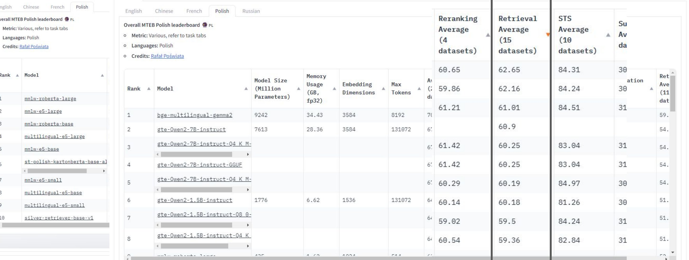

> _Notatka prowadzącego:_ MTEB to benchmark modeli embeddingowych, z osobną zakładką dla polskiego (autor: Rafał Poświata). Do RAG patrzymy na kolumnę Retrieval, bo to dokładnie zadanie z poprzedniego slajdu: pytanie ma znaleźć fragment. Obok koszty: rozmiar modelu, pamięć, liczba wymiarów (więcej wymiarów to większa baza) i maksymalna liczba tokenów (ogranicza długość chunka z kroku 2). Mały model bywa rozsądniejszy niż 7B z góry rankingu. Sprawdź ranking na żywo przed wykładem.

---

## Krok 3: skąd w rankingu duże LLM-y?

### [anthropic.com/news/mapping-mind-language-model](https://www.anthropic.com/news/mapping-mind-language-model)

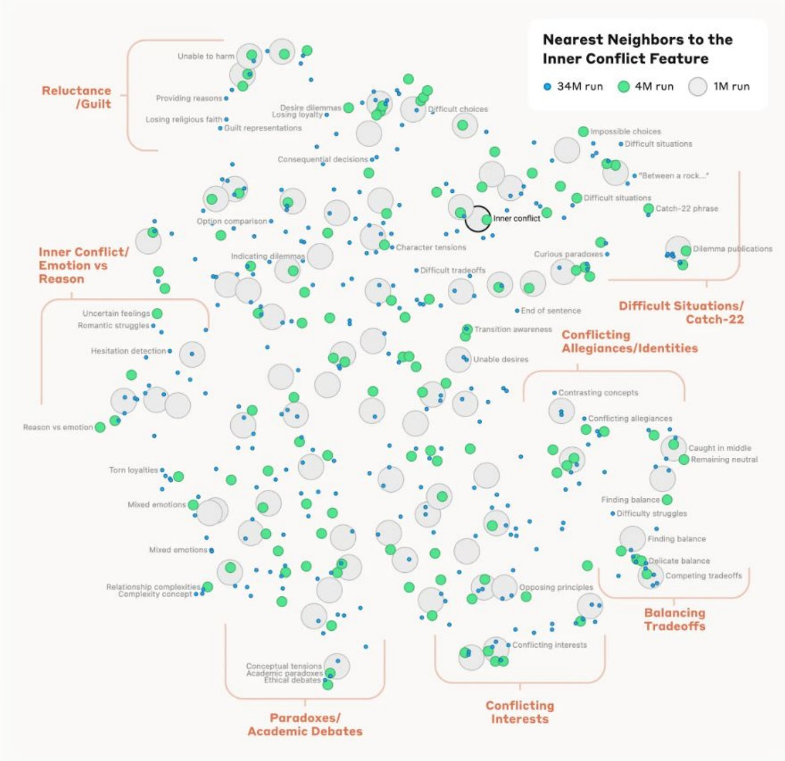

> _Notatka prowadzącego:_ Na górze MTEB są modele, które powstały z LLM-ów (np. gte-Qwen2, bge-multilingual-gemma2). Dlaczego to działa: we wnętrzu dużego modelu też jest mapa znaczeń, w której podobne pojęcia leżą blisko siebie. Badanie Anthropic z 2024 roku na Claude 3 Sonnet pokazuje najbliższych sąsiadów cechy "konflikt wewnętrzny". Ta sama intuicja co mapa z muchą, tylko odczytana z prawdziwego modelu. Taki LLM douczony na parach pytanie i fragment staje się embedderem: większym i wolniejszym, ale często lepszym.

---

## Krok 3: dlaczego polskie modele?

### Pytanie po polsku musi trafić w przepis po polsku

- **Tokeny:** polski tekst rozpada się na więcej kawałków (W9), więc drożej i gorzej
- **Embedder:** „cukinii”, „cukinią”, „cukinię” to jedna rzecz, model musi to wiedzieć
- **Pary treningowe:** model uczony na angielskich pytaniach słabiej trafia po polsku
- Polski model to nie tylko moc obliczeniowa, to przede wszystkim **dane wysokiej jakości**

> _Notatka prowadzącego:_ Polskie embeddery: mmlw (sdadas), silver-retriever (IPI PAN). Polskie LLM-y: Bielik (SpeakLeash), PLLuM. Modele wielojęzyczne radzą sobie z polskim coraz lepiej, więc to nie jest wybór zero-jedynkowy: porównujemy na polskiej zakładce MTEB i na własnych pytaniach.

---

## Krok 3: jak porównać dwa wektory?

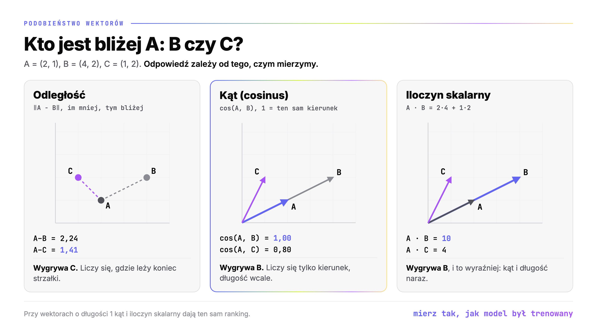

> _Notatka prowadzącego:_ Zanim przeczytamy kartę modelu, musimy znać trzy słowa, które w niej padają. Celowo dobrany przykład, w którym miary się nie zgadzają. Odległość euklidesowa patrzy, gdzie leżą końce strzałek. Cosinus patrzy tylko na kierunek: B to A pomnożone przez 2, więc kąt zero. Iloczyn skalarny to kąt i długość naraz. To ten sam obraz strzałek co przy wektorze wypadkowym: dwa teksty są podobne, gdy ich strzałki wskazują w podobną stronę. Ten slajd wróci w kroku 5, przy wyszukiwaniu.

---

## Krok 3: Jak wybrać odpowiednią metrykę? 

### [huggingface.co/ipipan/silver-retriever-base-v1.1](https://huggingface.co/ipipan/silver-retriever-base-v1.1)

Dobrym przykładem jest model, który został wytrenowany na dot produkcie ale lepiej działa z cosinusem
- Polski model do wyszukiwania (IPI PAN), uczony na parach **pytanie i fragment**
- Działa najlepiej, gdy dostaje dane **w tym samym formacie co w treningu**
- *„Although we used the dot product during training, the model usually works better with the cosine distance.”*

<!-- columns -->

```python
# pytanie: z przedrostkiem, jak w treningu
query = "Pytanie: Co szybkiego zrobić z cukinii?"

# fragment: tytuł i treść rozdzielone </s>
passage = "Placki z cukinii</s>Cukinię zetrzyj na tarce ..."
```

> _Notatka prowadzącego:_ Tu przydaje się slajd o parach treningowych: przedrostek "Pytanie: " i separator </s> to format, w jakim model widział dane w treningu. Ten sam model z innym formatem wejścia działa wyraźnie gorzej, a wyniki będą po prostu słabsze, bez żadnego błędu. Ta sama lekcja co z szablonem promptu w kroku 1. Każdy model ma inne przedrostki: mmlw chce "zapytanie: ", silver-retriever "Pytanie: ", modele e5 "query: " i "passage: ". Cytat o mierze czytamy z poprzednim slajdem przed oczami: model trenowano na iloczynie skalarnym, a autorzy zalecają cosinus, czyli sam kierunek strzałki.

---

## Krok 3: embedding w kodzie

### Model wybrany, karta przeczytana, liczymy

```python
from sentence_transformers import SentenceTransformer, util

model = SentenceTransformer("sdadas/mmlw-roberta-base")

przepisy = ["Placki z cukinii › Przygotowanie: Cukinię zetrzyj na tarce ...",
            "Sernik na zimno › Przygotowanie: Twaróg zmiksuj z cukrem ..."]
pytanie = "zapytanie: Co szybkiego zrobić z cukinii?"

v_przepisy = model.encode(przepisy, normalize_embeddings=True)   # 2 wektory po 768 liczb
v_pytanie = model.encode(pytanie, normalize_embeddings=True)     # 1 wektor, 768 liczb

print(util.cos_sim(v_pytanie, v_przepisy))   # wyższy wynik dla placków
```

> _Notatka prowadzącego:_ Cały krok 3 w dwóch wywołaniach `encode`: każdy chunk, niezależnie od długości, wraca jako jeden wektor o 768 liczbach, a pytanie dostaje przedrostek z karty modelu (mmlw chce "zapytanie: "). Kod poglądowy, bez wyników liczbowych. `normalize_embeddings=True` daje wektory o długości 1, co uprości nam miary podobieństwa w kroku 5. Te wektory, razem z tekstem i metadanymi, zapisujemy teraz w bazie.

---

## Gdzie jesteśmy

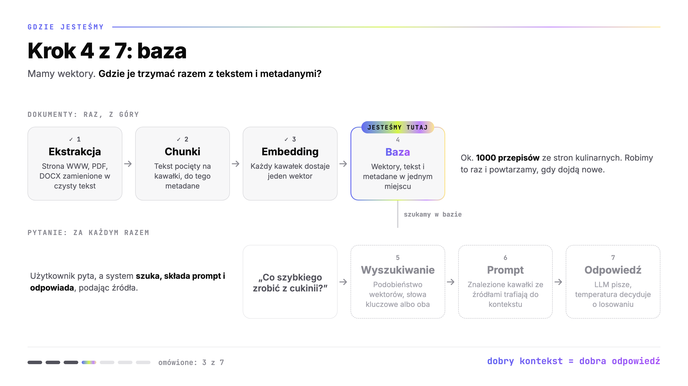

> _Notatka prowadzącego:_ Kilka sekund, nie więcej. Pokaż palcem, co już za nami i co dalej.

---

## Krok 4: baza

### Co właściwie zapisujemy?

| Pole | Przykład | Po co |
|---|---|---|
| id | `placki-z-cukinii#2` | aktualizacja i usuwanie |
| tekst | „Placki z cukinii › Przygotowanie: ...” | trafi do promptu |
| wektor | `[0.021, -0.113, ..., 0.087]` (768 liczb) | wyszukiwanie semantyczne |
| metadane | kategoria: obiad, czas: 20 min, źródło | filtrowanie i cytowanie |

**Baza przechowuje tekst i wektor razem.** Szukamy po wektorze, do promptu idzie tekst.

> _Notatka prowadzącego:_ Częste nieporozumienie: model językowy nigdy nie widzi wektorów z bazy. Wektory służą tylko do znalezienia kawałków, a do promptu trafia ich tekst. 768 to wymiar modeli wielkości base, np. mmlw-roberta-base. Wymiar zależy od modelu, a zmiana modelu oznacza przeliczenie całej bazy, bo wektory z dwóch modeli są nieporównywalne.

---

## Krok 4: bazy wektorowe

### [Źródło: blog.det.life](https://blog.det.life/why-you-shouldnt-invest-in-vector-databases-c0cd3f59d23c)


> _Notatka prowadzącego:_ Prawa połowa to sedno tytułu artykułu: wyszukiwanie wektorowe stało się funkcją zwykłych baz, np. PostgreSQL z rozszerzeniem pgvector. Jeśli firma ma już Postgresa albo Elasticsearcha, często nie potrzebuje osobnej bazy. Rynek zmienia się szybko: Rockset został w 2024 przejęty przez OpenAI i nie działa już jako osobny produkt.

---

## Krok 4: czego szukamy w bazie?

### Wektory to nie wszystko

- **Filtrowanie:** „tylko obiady”, „tylko do 30 minut” (metadane z kroku 2)
- **Hybryda w jednym miejscu:** wektory i słowa kluczowe bez sklejania dwóch systemów
- **Agregacje:** ile przepisów w kategorii, z jakiego źródła
- **Skala:** więcej niż jeden „komputer” obsługuje bazę (klastrowanie)
- **Aktualizacja:** nowy przepis ma być wyszukiwalny od razu

> _Notatka prowadzącego:_ Pytania do zadania przy wyborze bazy. Klastrowanie w znaczeniu bazodanowym, czyli kilka maszyn, nie klasteryzacja danych. Na szkoleniu używaliśmy Weaviate: natywna obsługa wektorów i hybrid searcha, wygodne podłączanie embedderów, dobre SDK. To nie jedyny dobry wybór.

---

## Gdzie jesteśmy

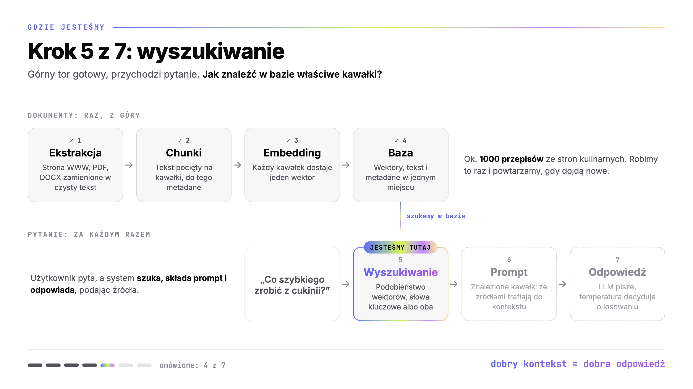

> _Notatka prowadzącego:_ Kilka sekund, nie więcej. Pokaż palcem, co już za nami i co dalej.

---

## Krok 5: wyszukiwanie

### Pytanie przechodzi przez ten sam model

1. Pytanie użytkownika: „Co szybkiego zrobić z cukinii?”
2. **Ten sam model embeddingowy** co w kroku 3, z przedrostkiem z karty modelu
3. Porównujemy wektor pytania z wektorami w bazie
4. Bierzemy k najlepszych i ich **tekst** przekazujemy dalej

Pozostają dwa pytania: **jak porównać** dwa wektory i **jak szukać szybko**.

> _Notatka prowadzącego:_ Krok 5 na mapie. Najczęstszy błąd w pierwszym własnym RAG-u: dokumenty zaindeksowane jednym modelem, pytania zamieniane innym. Nic się nie wywali, tylko wyniki będą przypadkowe.

---

## Krok 5: podobieństwo, powtórka


> _Notatka prowadzącego:_ Ten sam slajd co w kroku 3, teraz w roli głównej: tą miarą porównujemy pytanie z każdym chunkiem w bazie. Szybko przypomnieć: odległość patrzy na końce strzałek, cosinus tylko na kierunek, iloczyn skalarny na kąt i długość naraz. Nowa rzecz na dziś: jeśli wektory mają długość 1 (stąd `normalize_embeddings=True` w kodzie), wszystkie trzy miary dają ten sam ranking. Którą wybrać, mówi karta modelu, jak przy silver-retrieverze.

---

## Krok 5: iloczyn skalarny

### Znak mówi o kierunku

- **Dodatni:** wektory wskazują w podobną stronę
- **Zero:** są prostopadłe, nic wspólnego
- **Ujemny:** wskazują w przeciwne strony

To samo **Q · K** z atencji na W9: wysoki iloczyn = słowa do siebie pasują.

<!-- columns -->

### Kierunek „liczby mnogiej” (3Blue1Brown)

| Słowo | plur · E(słowo) |
|---|---|
| four | 1,80 |
| three | 1,27 |
| two | 0,79 |
| one | **−2,80** |
| boys | 3,64 |
| boy | **−0,14** |

> _Notatka prowadzącego:_ Przykład z serii 3Blue1Brown o transformerach (GPT-2). Wzięli kierunek "liczby mnogiej" w przestrzeni embeddingów i policzyli iloczyn skalarny z różnymi słowami. Im "bardziej mnogie" słowo, tym wyższy wynik, a one wychodzi ujemnie. Kierunek w przestrzeni niesie znaczenie, czyli idea króla i królowej z word2vec, tylko pokazana uczciwiej.

---

## Krok 5: wyszukiwanie semantyczne

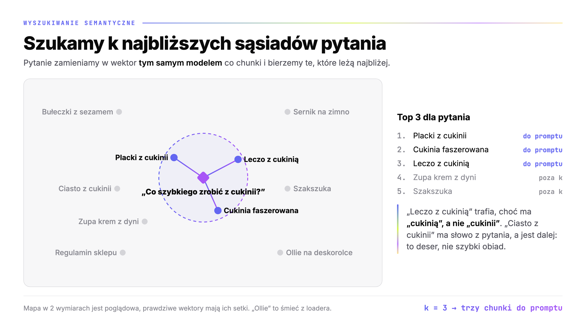

> _Notatka prowadzącego:_ k najbliższych sąsiadów (kNN): liczymy podobieństwo pytania do każdego chunka i bierzemy k najlepszych. Dwie rzeczy do pokazania palcem. Leczo ma słowo "cukinią", nie "cukinii", a i tak trafia, bo liczy się znaczenie. Ciasto z cukinii ma słowo z pytania, a przegrywa, bo to deser. Ollie to śmieć z loadera z kroku 1: leży daleko, ale w bazie siedzi.

---

## Krok 5: jak szukać szybko?

### Porównanie z każdym wektorem nie skaluje się

- 1000 przepisów: porównujemy ze wszystkimi, to ułamek sekundy
- 10 milionów chunków: za wolno przy każdym pytaniu
- **ANN, wyszukiwanie przybliżone:** indeks (np. HNSW) prowadzi od razu w okolice pytania
- Cena: czasem zgubimy jednego z prawdziwych najbliższych sąsiadów

Jak w bibliotece: nie przeglądamy każdej półki, idziemy do działu „Kuchnia”.

> _Notatka prowadzącego:_ HNSW (Hierarchical Navigable Small World) to graf, po którym idzie się od ogólnych "autostrad" do lokalnych "uliczek". Szczegóły nie są potrzebne. Ważne: bazy wektorowe są szybkie właśnie dzięki takim indeksom, a dokładność da się regulować parametrami kosztem szybkości.

---

## Krok 5: wyszukiwanie po słowach

### Indeks odwrócony, jak skorowidz na końcu książki

| Słowo | W których przepisach? |
|---|---|
| cukinii | placki z cukinii, ciasto z cukinii, zupa krem z cukinii |
| cukinią | leczo z cukinią |
| szybki | szybki chleb, szybkie bułeczki |
| E330 | dżem truskawkowy |

- **BM25** układa wyniki: rzadkie słowo waży więcej niż częste
- Nie wie nic o znaczeniu, a „cukinii” i „cukinią” to dla niego **różne słowa**

> _Notatka prowadzącego:_ Tak działają wyszukiwarki od dziesięcioleci, BM25 ma ponad 30 lat i nadal jest punktem odniesienia w benchmarkach wyszukiwania. Jest w Elasticsearchu, OpenSearchu, Postgresie. Polska fleksja to tu prawdziwy problem, łagodzi go lematyzacja, czyli sprowadzanie słów do formy podstawowej. E330 to kwas cytrynowy: przykład kodu, z którym wektory sobie nie radzą.

---

## Krok 5: hybrid search

### Każda metoda gubi co innego

| Zapytanie | Słowa kluczowe (BM25) | Wektory |
|---|---|---|
| „co szybkiego zrobić z cukinii?” | słabo: pomija leczo z cukinią | **dobrze** |
| „przepis bez E330” | **dobrze**: dokładny kod | słabo: kod nie ma znaczenia |
| „danie z kabaczka” | słabo: brak słowa w przepisach | **dobrze**: kabaczek ≈ cukinia |
| nazwa sprzętu, np. „Thermomix TM6” | **dobrze** | różnie |

**Hybrid search:** uruchom oba wyszukiwania i połącz rankingi.

> _Notatka prowadzącego:_ Wyszukiwanie wektorowe liczy odległość albo kąt, wyszukiwanie po słowach korzysta z indeksu odwróconego. Hybryda łączy oba światy. Pytanie do sali: które wyszukiwanie znajdzie "kabaczek"? Źródło o łączeniu wyników: weaviate.io/blog/hybrid-search-fusion-algorithms.

---

## Krok 5: jak połączyć dwa rankingi?

### Reciprocal Rank Fusion: liczy się miejsce, nie wynik

| Przepis | Miejsce: wektory (top 4) | Miejsce: BM25 (top 4) | Punkty × 1000 |
|---|---|---|---|
| Placki z cukinii | 1 | 2 | **32,5** |
| Zupa krem z cukinii | 4 | 1 | **32,0** |
| Leczo z cukinią | 2 | 4 | **31,8** |
| Cukinia faszerowana | 3 | brak | 15,9 |
| Ciasto z cukinii | brak | 3 | 15,9 |

Punkty = 1 / (60 + miejsce), zsumowane z obu list.

> _Notatka prowadzącego:_ Wyników obu wyszukiwań nie da się porównać wprost: cosinus jest od -1 do 1, a BM25 bez górnej granicy. RRF (Cormack i in., 2009) patrzy więc tylko na miejsca. Placki są wysoko na obu listach i wygrywają. Przepis z jednej listy dostaje mniej więcej połowę punktów. 60 to stała z oryginalnej pracy, wygładza różnice między pierwszymi miejscami. Liczby policzone ze wzoru dla przykładowych rankingów. Dalej bywa trzeci krok, reranking: osobny model czyta pytanie z każdym kandydatem i układa je od nowa, o tym na semestrze 3.

---

## Krok 5: hybryda i filtr w kodzie

### Weaviate, klient Python v4

```python
import weaviate
from weaviate.classes.query import Filter

db = weaviate.connect_to_local()
przepisy = db.collections.get("Przepis")

wynik = przepisy.query.hybrid(
    query="Co szybkiego zrobić z cukinii?",
    alpha=0.5,                                   # 1 = same wektory, 0 = same słowa
    limit=3,
    filters=Filter.by_property("kategoria").equal("obiad"))

for o in wynik.objects:
    print(o.properties["tytul"], o.properties["zrodlo"])
```

> _Notatka prowadzącego:_ Cały krok 5 w jednym wywołaniu: baza sama zamienia pytanie w wektor (jeśli ma podłączony wektoryzer), robi oba wyszukiwania, łączy rankingi i stosuje filtr z metadanych. Parametr alpha to suwak między wektorami a słowami. Kod poglądowy, nazwy kolekcji i pól są nasze.

---

## Gdzie jesteśmy

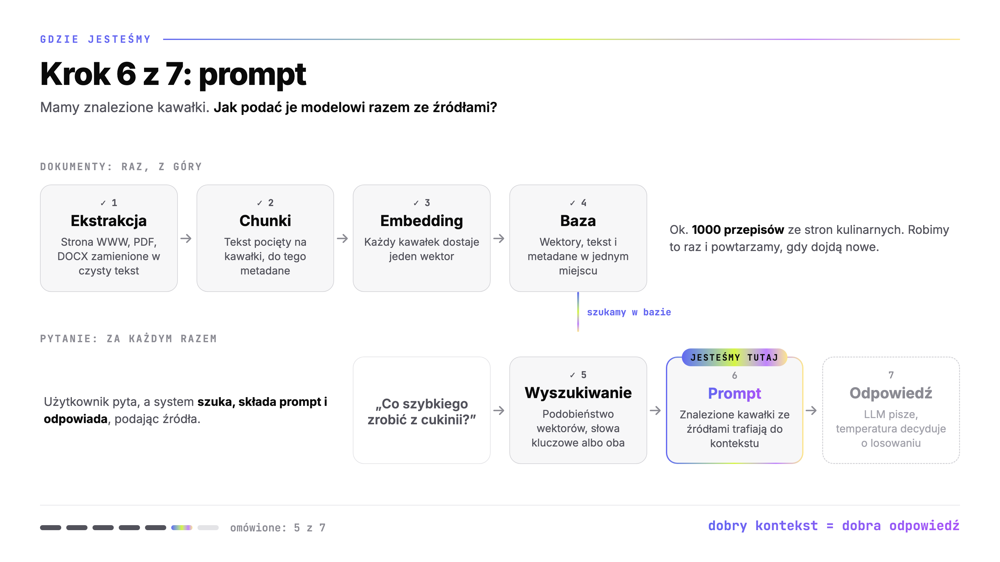

> _Notatka prowadzącego:_ Kilka sekund, nie więcej. Pokaż palcem, co już za nami i co dalej.

---

## Krok 6: prompt

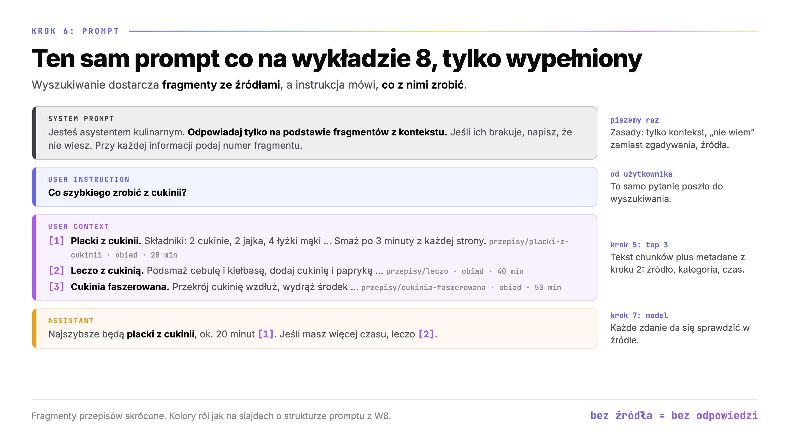

> _Notatka prowadzącego:_ Domykamy obietnicę z W8: blok User context nie jest już wklejany ręcznie, wypełnia go krok 5. Trzy zasady w system prompcie robią dużą różnicę: tylko z kontekstu, "nie wiem" zamiast zgadywania, numer źródła przy informacji. Numery fragmentów pozwalają aplikacji pokazać pod odpowiedzią linki do przepisów, jak na zrzucie z gotowego produktu.

---

## Krok 6: prompt w kodzie

### Aplikacja skleja prompt z wyników wyszukiwania

```python
kontekst = "\n".join(
    f"[{i}] {o.properties['tekst']} ({o.properties['zrodlo']})"
    for i, o in enumerate(wynik.objects, start=1))

messages = [
    {"role": "system", "content": SYSTEM_PROMPT},
    {"role": "user", "content": f"{pytanie}\n\n## Fragmenty\n\n{kontekst}"},
]

odpowiedz = client_llm.chat.completions.create(
    model="bielik-11b", messages=messages, temperature=0.2)
```

> _Notatka prowadzącego:_ To jest cała "magia" RAG: zwykłe sklejanie napisów. Instrukcja i kontekst idą w jednej wiadomości użytkownika, tak jak na schemacie z W8. Temperatura 0.2 to zapowiedź następnego slajdu. Nazwa modelu poglądowa, zależy od tego, co uruchomimy na serwerze.

---

## Gdzie jesteśmy

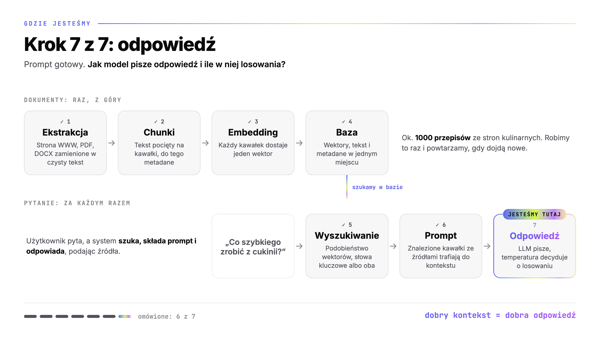

> _Notatka prowadzącego:_ Kilka sekund, nie więcej. Pokaż palcem, co już za nami i co dalej.

---

## Krok 7: odpowiedź i temperatura


> _Notatka prowadzącego:_ Rozkład z W9: temu 42%, raz 19% i tak dalej. Temperatura T dzieli logity przed softmaxem, co jest równoważne podniesieniu prawdopodobieństw do potęgi 1/T i ponownemu znormalizowaniu. Liczby policzone dla założenia, że reszta słownika to 19 tokenów po 1%. Dolny rząd to sedno: przy T = 0,3 dziewięć razy na dziesięć wypada "temu", przy T = 1 bajka zaczyna się na kilka sposobów, a przy T = 1,5 co trzecie losowanie trafia w resztę słownika, w tym "lodówka" i "Excel". Model się nie zmienił, zmieniła się tylko kostka. Po wylosowaniu token dokleja się do tekstu i rozkład liczy się od nowa, więc jedno dziwne słowo pociąga za sobą resztę zdania. To też odpowiedź na pytanie z W8, dlaczego 2+2 raz dało 5.

---

## Krok 7: jaka temperatura w RAG?

### Chcemy odpowiedzi z kontekstu, nie z wyobraźni

| Zadanie | Temperatura | Dlaczego |
|---|---|---|
| Ekstrakcja do JSON-a (krok 1) | 0 | ten sam przepis, te same pola |
| Kategoryzacja (krok 1) | 0 | jedna poprawna etykieta |
| Odpowiedź z fragmentów (krok 7) | niska, np. 0,2 | trzymać się źródeł |
| Propozycja menu na tydzień | wyższa | tu różnorodność jest zaletą |

**Niska temperatura nie zastąpi dobrego kontekstu:** zły fragment da pewną siebie, złą odpowiedź.

> _Notatka prowadzącego:_ Temperatura 0 oznacza w praktyce "zawsze najbardziej prawdopodobny token", więc ten sam prompt daje prawie zawsze ten sam wynik. Część nowszych modeli rozumujących nie pozwala zmieniać temperatury przez API. Wartości w tabeli to punkt startu, nie reguła.

---

## Co może pójść nie tak

### Każdy objaw ma swój krok na mapie

| Objaw | Prawdopodobna przyczyna | Krok |
|---|---|---|
| Odpowiedź z menu strony | śmieci po ekstrakcji | 1 |
| „Nie wiem”, choć przepis jest w bazie | zły chunk, inny model, brak przedrostka | 2, 3, 5 |
| Składniki z dwóch przepisów naraz | chunk przeciął granicę, za duże k | 2, 5 |
| Składnik spoza kontekstu | słaba instrukcja, wysoka temperatura | 6, 7 |
| Przepis każe „zignorować instrukcje” | ktoś wstawił polecenie do dokumentu | 1 |

> _Notatka prowadzącego:_ Mapa wykładu służy też do diagnozy: zanim zmienisz model, sprawdź, który krok zawiódł. Ostatni wiersz to prompt injection: dla modelu fragment z bazy to zwykły tekst w prompcie i nie odróżni przepisu od polecenia. Jeśli do bazy trafiają dokumenty z zewnątrz, trzeba to traktować jako niezaufaną treść. Szerzej na semestrze 3.

---

## Jak sprawdzić, czy działa?

### Mierz wyszukiwanie osobno, odpowiedź osobno

1. Przygotuj **20 do 50 pytań** i przy każdym zapisz, który przepis jest właściwy
2. **Wyszukiwanie:** w ilu pytaniach właściwy przepis jest w top k? (trafienie w top 3)
3. **Odpowiedź:** czy zgadza się ze źródłem i czy nie dodaje nic od siebie?
4. Zmieniasz chunki, model albo alfę hybrydy? **Puść te same pytania jeszcze raz**

> _Notatka prowadzącego:_ Bez takiego zestawu każda zmiana to zgadywanie. Rozdzielenie ma znaczenie: jeśli wyszukiwanie nie znajduje przepisu, żaden LLM nie odpowie dobrze, a jeśli znajduje, a odpowiedź jest zła, problem jest w krokach 6 i 7. Pytania najlepiej zebrać od prawdziwych użytkowników, nie wymyślać ich samemu. Ewaluacja wraca szerzej na semestrze 3.

---

## Gdzie jesteśmy

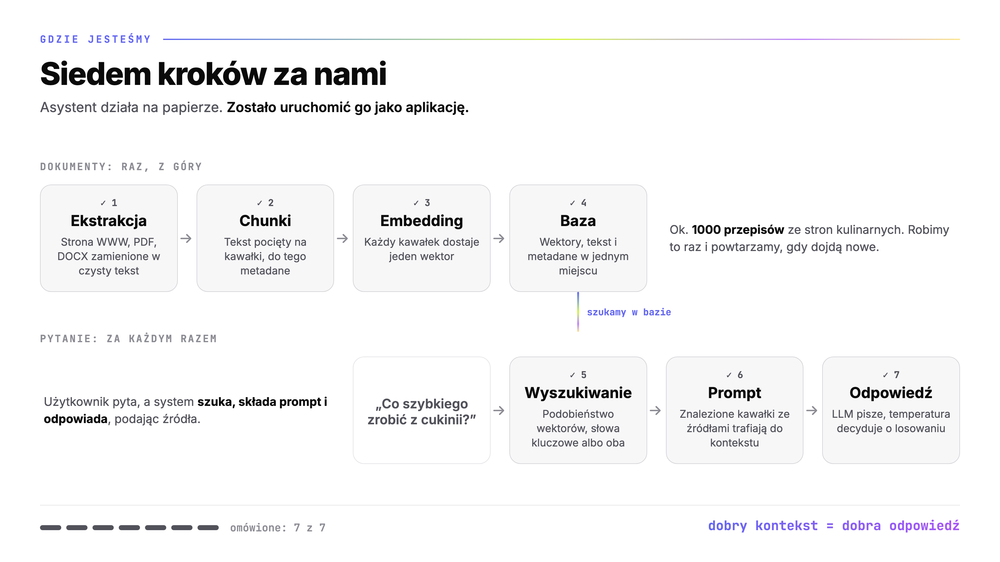

> _Notatka prowadzącego:_ Kilka sekund, nie więcej. Pokaż palcem, co już za nami i co dalej.

---

## Uruchomienie: skąd wziąć LLM-a?

### API zewnętrznego dostawcy albo własny serwer

- **API:** najszybszy start, płacimy za tokeny, dane wychodzą na zewnątrz
- **Własny serwer:** dane zostają u nas, płacimy za sprzęt (rachunek pamięci z W9)
- Serwery modeli: **Ollama** (najprostsza), **vLLM** i **llama.cpp** (wydajniejsze)
- Wszystkie trzy udostępniają API **zgodne z OpenAI**

> _Notatka prowadzącego:_ Podział z W8: 3rd party kontra self hosted. Zgodność z API OpenAI to ważny szczegół: ten sam kod `client.chat.completions.create` z poprzednich slajdów działa z chmurą i z własnym serwerem, zmienia się tylko adres. Ollama jest najwygodniejsza na laptopie, ale słabiej przystosowana do obsługi wielu użytkowników naraz.

---

## Uruchomienie: Ollama

### Model na własnym komputerze w trzech poleceniach

```bash
curl -fsSL https://ollama.com/install.sh | sh
ollama pull SpeakLeash/bielik-11b-v2.2-instruct:Q8_0
OLLAMA_HOST=0.0.0.0 ollama serve
```

```python
from openai import OpenAI

client_llm = OpenAI(base_url="http://localhost:11434/v1", api_key="ollama")
```

> _Notatka prowadzącego:_ Q8_0 w nazwie to kwantyzacja z W8 i W9: 8 bitów na wagę, więc model 11B zajmie ok. 11 GB. Ollama ma bibliotekę gotowych, skwantyzowanych modeli i sama nakłada szablon promptu z kroku 1. Klucz API jest wymagany przez bibliotekę, ale Ollama go nie sprawdza.

---

## Uruchomienie: dlaczego kontenery?

### Każda usługa w osobnym pudełku

- **W kontenerze:** aplikacja, biblioteki Pythona, CUDA Toolkit, system plików
- **Na serwerze:** sterownik karty (CUDA Driver), system, Docker, GPU
- Ten sam obraz działa na laptopie, serwerze i w chmurze
- Cztery usługi z naszego schematu to **cztery kontenery**, rozmawiają przez API

<!-- columns -->

```text
KONTENER    aplikacja
            CUDA Toolkit
            biblioteki systemu
---------------------------------
SERWER      Docker Engine
            CUDA Driver
            system serwera
            GPU
```

> _Notatka prowadzącego:_ Docker to najprostszy sposób na infrastrukturę jako kod: spakowany kod razem z zależnościami. Najlepiej działa, gdy usługi rozmawiają przez REST albo inne API, jak na naszym schemacie. Sterownik GPU musi być na serwerze, a biblioteki CUDA siedzą w obrazie, dlatego jeden serwer może uruchamiać kontenery z różnymi wersjami bibliotek.

---

## Uruchomienie: więcej użytkowników

### Docker to jedna maszyna, skalowanie to wiele kopii

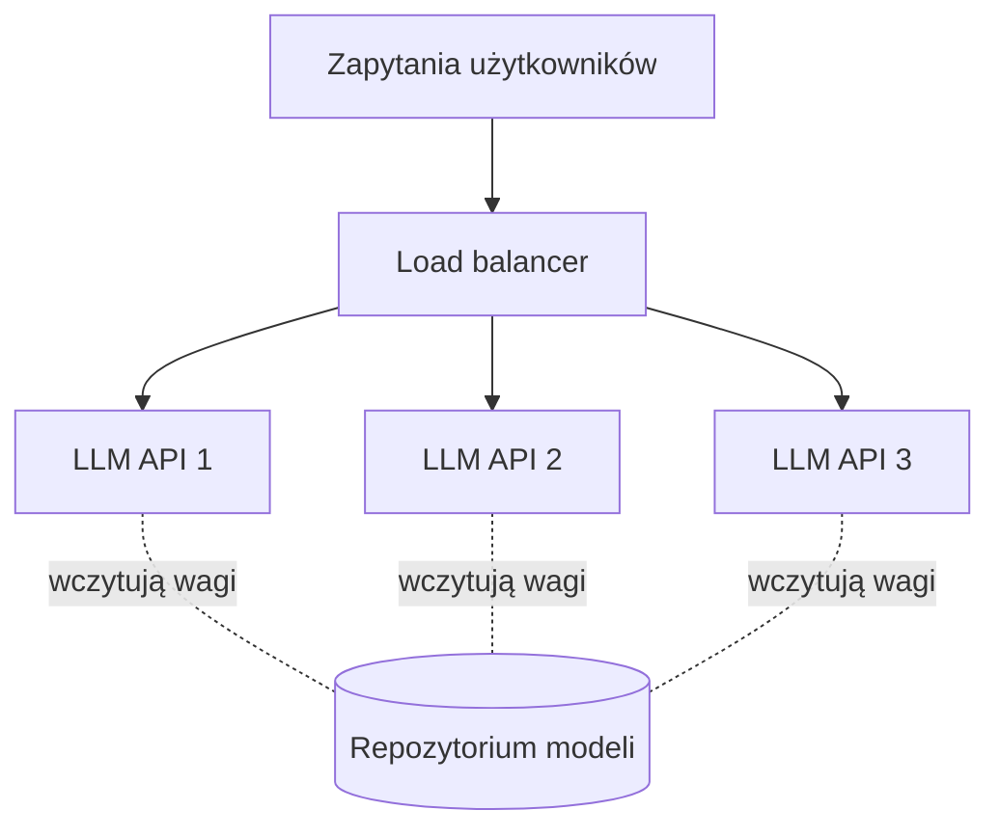

> _Notatka prowadzącego:_ Na W9 widzieliśmy, że jedna karta obsługuje ograniczoną liczbę zapytań naraz. Gdy użytkowników jest więcej, uruchamiamy kilka kopii LLM API, a load balancer rozdziela ruch. Wagi modelu leżą we wspólnym repozytorium, żeby nie kopiować ich ręcznie. Docker sam nie ogarnia wielu maszyn, do tego służy orkiestrator, np. Kubernetes.

---

## Uruchomienie: model w chmurze GPU

### Przykład z naszego szkolenia: Comtegra GPU Cloud

```bash
pip install cgcsdk
cgc register
cgc volume create -s 400 models
cgc compute create -n llm-server -c 4 -m 20 -g 1 -gt H100 -v models nvidia-pytorch
cgc compute port add -n api -p 11434 llm-server -ni
cgc compute list -d
```

> _Notatka prowadzącego:_ Ten sam serwer Ollama co dwa slajdy wcześniej, tylko na karcie H100 w chmurze. Kolejno: wolumen na wagi modeli (żeby nie pobierać ich przy każdym restarcie), kontener z 4 CPU, 20 GB RAM i jedną kartą, port 11434 dostępny tylko w sieci prywatnej (`-ni`), lista z adresem i tokenem dostępu. To przykład z naszych materiałów, inne chmury GPU działają podobnie.

---

## Cały system na jednym slajdzie


> _Notatka prowadzącego:_ Wracamy do schematu z początku, teraz każdy klocek jest wypełniony. Wektoryzer to model z kroku 3, baza to krok 4, aplikacja wykonuje kroki 5, 6 i 7, LLM API to Ollama albo vLLM w kontenerze. Indeksowanie, czyli kroki 1 do 4, to osobny skrypt uruchamiany przy nowych dokumentach. Pytanie do sali: który klocek wymienić, żeby asystent działał na dokumentacji zamiast przepisów? Odpowiedź: żaden, wystarczy zaindeksować inne dokumenty.

---

## Rok później: co się zmieniło

| | Grudzień 2025 (w tym wykładzie) | Listopad 2026 |
|---|---|---|
| **Embeddingi** | ada-002, gte-Qwen2, mmlw | Qwen3-Embedding, EmbeddingGemma |
| **Bazy** | osobna baza wektorowa | coraz częściej funkcja zwykłej bazy |
| **Kto szuka** | aplikacja przed wywołaniem modelu | coraz częściej sam model, jako narzędzie |
| **Agenci kodujący** | RAG po repozytorium | grep i czytanie plików w pętli |

> _Notatka prowadzącego:_ Qwen3-Embedding (Alibaba, czerwiec 2025) i EmbeddingGemma (Google, wrzesień 2025, ok. 300 mln parametrów, do uruchamiania lokalnie) to otwarte modele, które przesunęły ranking MTEB. Wiersz o agentach: zespół Claude Code opowiadał, że wczesne wersje używały RAG z bazą wektorową, a wyszukiwanie agentowe (glob, grep, read) wypadło lepiej. To relacja z wewnętrznych testów i dotyczy kodu, gdzie dokładne nazwy są zaletą. Do tabeli MTEB i nazw modeli zajrzyj przed wykładem.

---

## Rok później: co się NIE zmieniło

### Narzędzia się zmieniają, problem zostaje

- Model zna tylko to, co mu **podamy w kontekście**
- Śmieci po ekstrakcji to **śmieci w odpowiedzi**
- Długi tekst w jednym wektorze to **rozmyty wektor**
- Pytanie i dokument muszą trafić do wektora **tym samym modelem**
- Wektory gubią kody i nazwy, słowa gubią synonimy: stąd **hybryda**

> _Notatka prowadzącego:_ Nawet gdy wyszukiwanie robi agent, a nie gotowy potok RAG, te zasady zostają. Agent przeszukujący pliki też dostanie śmieci, jeśli PDF wyekstrahowano źle.

---

## Podsumowanie

### Siedem kroków asystenta

- **1. Ekstrakcja:** popatrz na wynik loadera; LLM wyciąga dane do JSON-a
- **2. Chunki:** sensowne kawałki z tytułem i metadanymi
- **3. Embedding:** jeden kawałek, jeden wektor; czytaj kartę modelu
- **4. Baza:** tekst, wektor i metadane razem
- **5. Wyszukiwanie:** ten sam model, k najbliższych, hybryda z BM25
- **6. Prompt:** fragmenty ze źródłami i zasada „tylko z kontekstu”
- **7. Odpowiedź:** niska temperatura, a jakość mierzona na własnych pytaniach

---

## Co dalej

### Dzisiejsze pojęcia wrócą

| Dziś | Gdzie wróci | Jako co |
|---|---|---|
| Ekstrakcja do JSON-a | Semestr 2 | Structured output i function calling |
| RAG, chunki, embedding | Semestr 3, W3 | Skąd agent bierze kontekst |
| BM25 + wektory, RRF | Semestr 3, W3 | Reranking i agentic search |
| Polecenie w dokumencie | Semestr 3, W2 | Fragment z bazy to niezaufana treść |

> _Notatka prowadzącego:_ Domykamy pierwszą część cyklu: W8 powiedział, że RAG istnieje, W9 pokazał, czym jest wektor, a W10 złożył z tego działający system. Na semestrze 2 model dostaje narzędzia, a na semestrze 3 to samo wyszukiwanie staje się jednym z narzędzi agenta.

---

## Dziękuję

### Pytania?

mgr inż. Jakub Zboina

mgr inż. Rafał Masłyk
