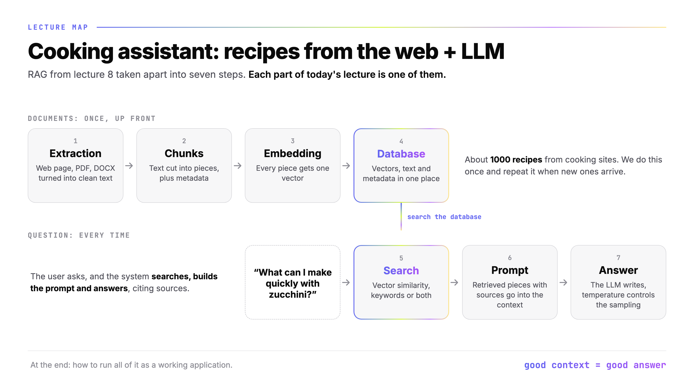
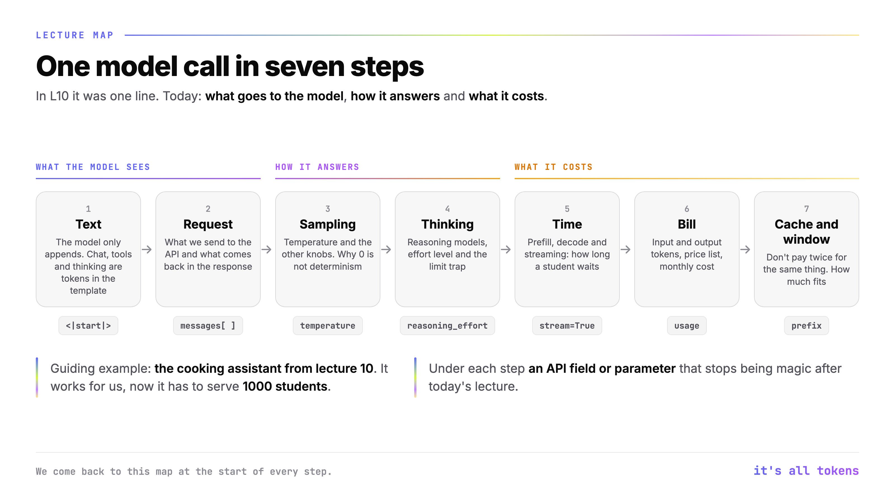
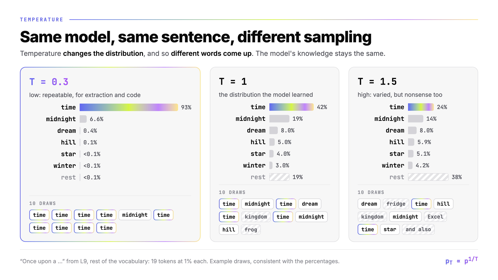
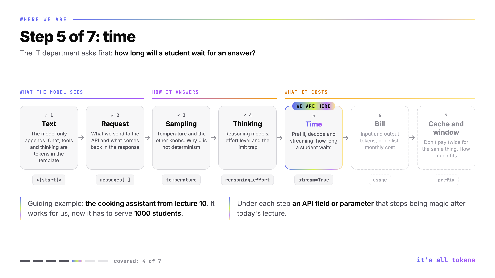

# Introduction to machine learning for processing text collections, part 4

## Artificial Intelligence and Data Science 1, Lecture

### Introduction to machine learning for processing text collections, part 4

Jakub Zboina, MSc Eng.

Rafał Masłyk, MSc Eng.

---

## Where we are

### Previous lectures

- L8: prompt, roles, conversation history, model rankings
- L9: a sentence's path through the model, **tokens**, the next token, GPU memory and speed
- L10: the cooking assistant in **seven steps**, from a web page to an answer with a source

<!-- columns -->

### Today

- We look inside **one model call**: what really goes over the wire and what comes back
- The L10 assistant has to serve **1000 students**: how long they wait, how much it costs
- No new theory: **everything we see today is the tokens from L9**

**After today's lecture no parameter in an API call will be magic.**

> _Notatka prowadzącego:_ L8–L10 covered what the model knows and where it gets it from. Today is engineering: how you talk to the model in code and what follows for time and money. Next week the second half: how to force the answer format and how to measure that it works (L12). The lecture is practical, almost every step has a piece of code you can run in the lab.

---

## Recap: seven steps



> _Notatka prowadzącego:_ One minute, this is the map from L10. In L10 step 7 (the answer) was a single line: client.chat.completions.create. Today we take that one line apart. Everything we say also applies to step 1 (extraction with an LLM) and to every other place where we call the model.

---

## The problem

### The assistant works for us. Now it has to work for everyone

The university wants to offer the cooking assistant to **1000 students** in the dorms. The IT department has four questions:

| Question | Why we can't answer it |
|---|---|
| **How much will it cost** per month? | we don't know what we are actually paying for |
| **How long will a student wait** for an answer? | "it was fast for me" is not a number |
| Why is **the answer sometimes empty**? | there is no error, `content` is `None` |
| Why does the same question give **different answers**? | we set temperature to 0 |

> _Notatka prowadzącego:_ The guiding example for the whole lecture. The four questions are four real tickets that arrive with the first deployment of any LLM application. Question for the room: who can answer any of them today? We will come back to this table at the end and each question will get an answer with a number or a concrete cause. Assumptions: 5 questions a day per student, 30 days, so 150 thousand questions a month.

---

## Lecture map



> _Notatka prowadzącego:_ The only diagram to remember. Steps 1 and 2 are the foundation: what really reaches the model. Steps 3 and 4: how the model picks an answer and how it "thinks". Steps 5–7: time and money, the answers for the IT department. Under each step there is a piece of code or a field in the API response that will make sense after today's lecture.

---

## Where we are


> _Notatka prowadzącego:_ A few seconds. We start with the simplest and most important truth about the model.

---

## Step 1: the model only appends

### The simplest API: give it text, get the continuation

```python
resp = client.completions.create(
    model="qwen35-122b",
    prompt="Neil Armstrong: a small step for",
    max_tokens=15, temperature=0)

print(resp.choices[0].text)
```

```text
 man, one giant leap for mankind.
```

No roles, no chat, no history. **Text goes in, tokens come out** (L9, step 6).

> _Notatka prowadzącego:_ This is the older /v1/completions endpoint, from before chats. It shows the essence well: the model is a function that appends the most likely continuation. In the lab try "def fibonacci(n):" or "SELECT name FROM users WHERE". Not every chat model behaves well without its template, more on that in two slides. The model name is from the CGC price list we use for the exercises.

---

## Step 1: the unit of everything

### Token: we pay for it, we wait for it, we measure the window with it

| | What it measures | Example |
|---|---|---|
| **Price** | input and output tokens | PLN per million tokens |
| **Time** | tokens per second | GPT-OSS approx. 115 tok/s on an H100 (L9) |
| **Window** | tokens in the context | 128k tokens in gpt-oss |

- Polish text is **more expensive** than English: more tokens for the same sentence (L9)
- "How many r's are in strawberry?" The model sees **one token**, not ten letters

> _Notatka prowadzącego:_ A short recap of L9, but with a new emphasis: a token is not only a unit of processing, it is an economic unit. Steps 5–7 of today's lecture are just counting tokens. gpt-oss has a vocabulary of about 200 thousand tokens. You can download the tokenizer without the model and without a GPU (the transformers library, AutoTokenizer), that is a lab exercise.

---

## Step 1: chat is appending too


> _Notatka prowadzącego:_ The real gpt-oss template (harmony format), rendered from the chat_template.jinja file on Hugging Face. In L10 it was the Llama 3 template, here a newer model, but the principle is the same. Three things to point at. First: the server added a system message on its own with the knowledge cutoff, today's date and the line "Reasoning: medium", we return to it in step 4. Second: our system prompt was renamed to developer. Third: the string ends at "<|start|>assistant" and the model just keeps writing. Chat is an illusion built from special tokens.

---

## Step 1: what the model appends

### The answer has its channels too

```text
<|start|>assistant<|channel|>analysis<|message|>The user has a zucchini.
The database has fritters and lecho. Fritters are faster, I'll suggest them.<|end|>
<|start|>assistant<|channel|>final<|message|>Make zucchini fritters:
grate the zucchini, add an egg and flour, fry 3 minutes on each side.<|return|>
```

- The **analysis** channel: reasoning, which we usually don't show the user
- The **final** channel: the answer that lands in `message.content`
- `<|return|>`: the model decided to stop. The server cuts the text at these markers

> _Notatka prowadzącego:_ This is the raw text the model generates token by token. The server (vLLM, Ollama) parses it and splits it into fields of the JSON response: analysis goes to a separate reasoning field, final goes to content. Illustrative content, real structure. The takeaway for step 4: the model's "thinking" is ordinary tokens in another channel, generated the same way and paid for the same way.

---

## Step 1: tools are text too

### A preview of semester 2

```text
<|start|>developer<|message|># Instructions
You are a cooking assistant. Answer briefly.

# Tools
namespace functions {
// Searches the recipe database
type search_recipes = (_: { query: string, }) => any;
}<|end|><|start|>user<|message|>What can I make with zucchini?<|end|>
<|start|>assistant to=functions.search_recipes<|channel|>commentary json
<|message|>{"query": "zucchini"}<|call|>
```

A tool description is **text in the prompt**. A call is **text from the model**. Our code executes it.

> _Notatka prowadzącego:_ Slightly shortened, but rendered from the real template. The tool description turns into a TypeScript-style signature inside the developer message, so it costs tokens in every request. A tool call is text addressed "to=functions.search_recipes" and ended with the <|call|> marker. The model runs nothing. In the first lecture of semester 2 we will build the agent loop on this. Today it is enough to remember: everything the model "does" is text.

---

## Step 1: what follows

### Everything is text, so everything costs

- Role, tool description, reasoning, search result: **all of it is tokens in one string**
- The server **adds its own text** (date, reasoning level) before the model sees it
- A wrong template gives no error, just **worse answers** (L10)
- Every token of this string has to be **read, paid for and fitted into the window**

**Steps 5–7 are the bill for this one string.**

> _Notatka prowadzącego:_ Closing step 1. Whoever understood that a chat is one long string understands why long conversations are expensive, why agents are expensive and why prompt caching works. The last line is a promise for the second half of the lecture.

---

## Where we are


> _Notatka prowadzącego:_ A few seconds. We know what the model sees. Now: what it looks like from our program's side.

---

## Step 2: one standard, many servers

### OpenAI-compatible API

- `/v1/chat/completions` became the **de facto standard**
- Spoken by: vLLM, SGLang, llama.cpp, Ollama and most cloud providers
- The same Python client, only the **address and key** change

```python
import os
from openai import OpenAI

client = OpenAI(base_url="https://llm.comtegra.cloud/v1",
                api_key=os.environ["LLM_API_KEY"])     # key from .env, never in code
```

Other dialects: **Responses API** (OpenAI), **Messages API** (Anthropic). Same concepts.

> _Notatka prowadzącego:_ That is why in L10 we could switch between Ollama on a laptop and a cloud server by changing one line. The address is the CGC API we use in the lab. The key goes in an environment variable or in a .env file listed in .gitignore: keys pushed to GitHub are picked up by bots within minutes. The Responses API and the Messages API differ in details (e.g. Responses can keep conversation state on the server side), but messages, tools, reasoning and token counters are everywhere.

---

## Step 2: the request

### What we send

```python
resp = client.chat.completions.create(
    model="gpt-oss-120b",                     # which model on the server
    messages=[                                 # the whole conversation, every time
        {"role": "system", "content": SYSTEM_PROMPT},
        {"role": "user", "content": f"{question}\n\n## Chunks\n\n{context}"},
    ],
    temperature=0.2,                           # step 3
    reasoning_effort="low",                    # step 4
    max_tokens=2000,                           # step 4: the trap
    stream=False,                              # step 5
)
```

> _Notatka prowadzącego:_ This is the call from step 6 in L10, extended with the parameters we cover today. Every comment is a step number from the map. messages is the list from L8: system, user, assistant. Under the hood the server turns it into the string from step 1.

---

## Step 2: the response

### What comes back

```json
{
  "model": "gpt-oss-120b",
  "choices": [{
    "message": {
      "role": "assistant",
      "content": "Make zucchini fritters: ...",
      "reasoning_content": "The user has a zucchini. The database has ..."
    },
    "finish_reason": "stop"
  }],
  "usage": {"prompt_tokens": 4012, "completion_tokens": 987, "total_tokens": 4999}
}
```

> _Notatka prowadzącego:_ Three fields always worth reading. content: the answer the user sees. finish_reason: why the model stopped (step 4). usage: how many tokens went in and out, i.e. the bill (step 6). The reasoning field is non-standard: vLLM calls it reasoning or reasoning_content depending on the version, other providers call it something else or don't return it at all. Illustrative numbers, but this is the order of magnitude of an assistant request with RAG chunks. Models answer in markdown by default, because that is what most text on the internet looks like: in an application you have to render it or ask for plain text.

---

## Step 2: the API has no memory

### The conversation history travels in every request

```python
history = [{"role": "system", "content": SYSTEM_PROMPT}]

def ask(text):
    history.append({"role": "user", "content": text})
    resp = client.chat.completions.create(model=MODEL, messages=history)
    history.append({"role": "assistant", "content": resp.choices[0].message.content})
    return resp.choices[0].message.content
```

- The model **does not remember** the previous request: memory is a list on our side
- The second message sends **the whole first conversation again**. So does the third, and the hundredth

> _Notatka prowadzącego:_ Chat history from L8, just in code. We will count the consequences in step 6: every turn is longer than the previous one. More on statelessness, persona and user profile in the first lecture of semester 2. Today it is enough to know that we send the history and we pay for it.

---

## Where we are


> _Notatka prowadzącego:_ A few seconds. We know what we send. Now: how the model picks what to reply.

---

## Step 3: temperature, a recap from L10



> _Notatka prowadzącego:_ A slide from L10, one minute. The model gives a distribution, temperature flattens or sharpens it, then we sample. Today the remaining knobs and two surprises: temperature does not turn the model into a random number generator, and temperature 0 does not guarantee repeatability.

---

## Step 3: the other knobs

### Sampling parameters in five minutes

| Parameter | What it does | When to touch it |
|---|---|---|
| `temperature` | flattens or sharpens the distribution | extraction 0, RAG answer approx. 0.2, brainstorming higher |
| `top_p` | samples only from tokens covering p of the mass | usually leave it, either this or temperature |
| `max_tokens` | hard limit on generated tokens | always, but with headroom (step 4) |
| `stop` | strings at which generation ends | rarely today, replaced by structured output (L12) |
| `seed` | sampling seed | tests, but it is only "best effort" |

> _Notatka prowadzącego:_ In 2023 tuning these parameters was a big part of working with models. Today models follow instructions well and the weight has moved to the prompt, structured output (L12) and the reasoning level (step 4). top_p = 0.9 means: sort the tokens from most likely and sample only from those that together make up 90%. frequency_penalty and presence_penalty penalise repetition; almost unused today. Documentation: platform.openai.com/docs/api-reference/chat/create.

---

## Step 3: "give me a random number"

### Temperature changes the distribution. It doesn't make the model a die

```python
for t in [0, 1.0, 1.5]:
    results = [ask("Give me a random number from 1 to 100. Just the number.",
                   temperature=t) for _ in range(15)]
    print(t, Counter(results).most_common(3))
```

- Typical result: **at every temperature** 42, 37 or 73 dominates
- The model is **very sure** that a "random number" is 42: flattening changes little
- For a task with many good answers ("invent a creature name") the differences are clear

**Randomness in an application? `random.randint`, not an LLM.**

> _Notatka prowadzącego:_ A well-known experiment, worth doing live, results differ between models. The explanation from the distribution: if "42" has 70% probability, even temperature 1.5 leaves it most of the mass. In the training data people asked for a random number also pick 7, 37, 42 and 73, and 42 is also "The Hitchhiker's Guide to the Galaxy". Practical takeaway: if the assistant has to draw a recipe of the day, the code draws it and the model only describes it.

---

## Step 3: temperature 0 is not determinism

### Why the same question gives different answers

- The server computes **many requests at once** (a batch): the order of additions depends on the load
- Floating point numbers: `(a + b) + c` is **not always** equal to `a + (b + c)` (L9, FP16)
- A small difference in logits changes **the winning token**, and then the whole sentence
- `seed` helps, but providers only promise **"best effort"**

**Temperature 0 gives the same answer much more often. Not always.**

> _Notatka prowadzącego:_ The answer to the IT department's fourth question. In L9 we covered number precision: in FP16 we have a few significant digits, so the order of summation matters. GPU kernels pick the order of computation based on the batch size, and the batch size depends on how many other people are querying the server at that moment. When two tokens have almost equal probabilities, such a difference is enough for the second one to win, and every next token is computed from a different text. Thinking Machines Lab described this in detail in 2025 ("Defeating Nondeterminism in LLM Inference"). Takeaway for tests: we don't compare answers character by character, we evaluate them, that is L12.

---

## Step 3: the knobs lose importance

### What has changed since 2023

| Then | Now |
|---|---|
| Tuning `temperature` and `top_p` | A precise instruction in the prompt |
| `stop` and "answer only X" | **Structured output**, format enforced by the server (L12) |
| Asking "think step by step" | A **reasoning model** and `reasoning_effort` (step 4) |
| All parameters work | Some reasoning models **reject** temperature |

> _Notatka prowadzącego:_ OpenAI reasoning models (the o series) and Claude with thinking enabled ignore or reject temperature and top_p. Don't build applications around these parameters. "Think step by step" (chain of thought, Wei et al., 2022) was a prompt trick; reasoning models have it built in through training. This leads into step 4.

---

## Where we are


> _Notatka prowadzącego:_ A few seconds. We know how the model samples. Now: what it does before it starts answering.

---

## Step 4: reasoning models

### First it thinks, then it answers

- The model generates **a hidden chain of reasoning**, only then the answer (the analysis channel from step 1)
- Examples: gpt-oss, Qwen 3.5, GLM, DeepSeek-R1, OpenAI o-series, Claude with thinking
- Further trained with reinforcement learning on tasks that **can be checked**: maths, code

> **A bat and a ball cost $1.10 in total. The bat costs $1 more than the ball. How much does the ball cost?**

Intuitive answer: 10 cents. Correct: **5 cents**. A reasoning model usually finds it, because it **has room to calculate**.

> _Notatka prowadzącego:_ A classic task from the cognitive reflection test (Frederick, 2005) that most people get wrong. Bat $1.05, ball 5 cents, $1.10 in total. Models without reasoning often answered 10 cents. Reasoning is not magic, just more tokens: the model has room to write out the equation before it writes the result. Every reasoning token is generated like any other, so it affects the time (step 5) and the bill (step 6). Training: RL with a verifiable reward, the same idea as in DeepSeek-R1 (2025).

---

## Step 4: reasoning in code

### Two fields in one message

```python
resp = client.chat.completions.create(
    model="gpt-oss-120b",
    messages=[{"role": "user", "content": BAT_AND_BALL_PUZZLE}])

msg = resp.choices[0].message
print(msg.reasoning_content)    # "Let the ball = x. Bat = x + 1. Total 2x + 1 = 1.10 ..."
print(msg.content)              # "The ball costs 5 cents."
print(resp.usage.completion_tokens)   # reasoning + answer
```

**We pay for reasoning like for the answer**: they are output tokens.

> _Notatka prowadzącego:_ One field with the reasoning, the other with the answer. The field name depends on the server (reasoning or reasoning_content in vLLM), the lab library has a get_reasoning function that checks both. Reasoning is worth logging for debugging, but usually it is not shown to the user. The last line: completion_tokens counts both channels. A model that thinks for 2000 tokens before answering "yes" pays for 2001 output tokens.

---

## Step 4: how long should it think?

### `reasoning_effort` instead of temperature

| Level | Reasoning tokens | Time | When |
|---|---|---|---|
| `low` | tens to a few hundred | seconds | classification, simple questions, chat |
| `medium` | a few hundred to a thousand | several seconds | default |
| `high` | thousands | tens of seconds | maths, code, hard inference |

- Remember the line `Reasoning: medium` in the template from step 1? **This is that parameter**
- More thinking means **more tokens, time and money**. Not always a better answer

**We pick the lowest level that passes our tests (L12).**

> _Notatka prowadzącego:_ Rough values for gpt-oss, they depend on the question. The server writes the reasoning_effort parameter into the system message of the template, so again: it is just text the model learned to respect. Coding agents let you change this level per task. Question for the room: which level for the cooking assistant? Probably low: the questions are simple and the answer is based on chunks from the database anyway. But "probably" is not a number: in L12 we will measure whether low hurts quality.

---

## Step 4: the `max_tokens` trap


> _Notatka prowadzącego:_ The answer to the IT department's third question: an empty answer without an error. max_tokens counts all generated tokens, reasoning too. The old trick "set max_tokens=2 to get just yes or no" ends with an empty content in a reasoning model: the model did not even finish thinking. The same effect with a limit that is too tight and long reasoning at the high level. The fix: a limit with plenty of headroom and checking finish_reason. The numbers in the lower bar are illustrative.

---

## Step 4: always read `finish_reason`

### Why the model stopped writing

| Value | What happened | What to do |
|---|---|---|
| `stop` | the model finished on its own | all good |
| `length` | `max_tokens` or the window ran out | **answer cut off or empty**: bigger limit, shorter prompt |
| `tool_calls` | the model asks for a tool | run it and send back the result (semester 2) |
| `content_filter` | the provider blocked the content | handle it in the interface |

```python
if resp.choices[0].finish_reason == "length":
    raise RuntimeError("Answer cut off, increase max_tokens")
```

> _Notatka prowadzącego:_ In production code a truncated answer is an error, not an answer. Without this line the application will show the student half a recipe or an empty bubble and nobody will know why. tool_calls comes back in the first lecture of semester 2. Value names from the OpenAI-compatible API, other APIs have equivalents (e.g. stop_reason in Anthropic).

---

## Where we are



> _Notatka prowadzącego:_ A few seconds. We know what the model generates and how. Now the IT department's questions: time first.

---

## Step 5: two phases of one request


> _Notatka prowadzącego:_ The most important slide of this part. Prefill: the model reads the whole prompt at once, all tokens in parallel, the GPU is fully busy computing. Decode: every next token needs a pass through the whole model and reading all the weights from GPU memory (the calculation from L9), and the tokens can't be computed in parallel, because each depends on the previous one. That is why reading is fast and writing is slow. The same will explain in step 6 why output tokens are more expensive. Illustrative times, order of magnitude from the L9 measurements.

---

## Step 5: streaming

### The answer in pieces, before it is ready

```python
stream = client.chat.completions.create(
    model=MODEL, messages=messages, stream=True)

for chunk in stream:
    delta = chunk.choices[0].delta if chunk.choices else None
    if delta and delta.content:
        print(delta.content, end="", flush=True)
```

- Total time **the same**. Perceived: **much shorter**
- That is why every chat in the browser writes "live"
- But: with a reasoning model **nothing is visible** for several seconds, because the analysis channel is streaming

> _Notatka prowadzącego:_ The server sends each token right after it is generated (server-sent events). For the user what matters is the time to the first visible word. The reasoning model trap: the first tokens are reasoning, so the interface shows "thinking..." or a summary of the reasoning, as ChatGPT and Claude do. Streaming complicates the code (e.g. structured output has to be assembled from pieces), so for batch jobs, like the extraction in L10, we stay with stream=False.

---

## Step 5: how long a student waits

### The time budget for one question

| Phase | Tokens | Time (approx. 115 tok/s, L9) |
|---|---|---|
| Queue and prefill | 4000 input | 1–3 s, grows with the number of concurrent users |
| Reasoning (`medium`) | approx. 700 | approx. 6 s, **nothing on screen** |
| Answer | approx. 300 | approx. 2.6 s, text appears live |
| **Total** | | **approx. 10–12 s**, of which approx. 8 s waiting for the first word |

**With `reasoning_effort="low"` (approx. 150 tokens) the first word appears after approx. 3 s.**

> _Notatka prowadzącego:_ The answer to the IT department's second question, with numbers from L9: GPT-OSS approx. 115 tokens per second on an H100, time to first token up to approx. 3 s with 8 concurrent requests. On a shared server at lunchtime it will be slower. Takeaway: for a cooking chat the reasoning level has a bigger impact on perceived speed than the choice of graphics card. 150 tokens is approx. 1.3 s, plus 1–2 s of prefill.

---

## Where we are


> _Notatka prowadzącego:_ A few seconds. Time is counted. Now money.

---

## Step 6: a counter in every response

### `usage` is the receipt

```python
print(resp.usage)
# CompletionUsage(prompt_tokens=4012, completion_tokens=987, total_tokens=4999)

PRICES = {"gpt-oss-120b": {"input": 0.2731, "output": 32.7778}}  # PLN per 1M tokens

def cost(model, usage):
    p = PRICES[model]
    return (usage.prompt_tokens * p["input"]
            + usage.completion_tokens * p["output"]) / 1_000_000

print(f"{cost('gpt-oss-120b', resp.usage):.4f} PLN")    # 0.0335 PLN
```

> _Notatka prowadzącego:_ Every response says how many tokens it used, so the cost can be calculated to the grosz without waiting for the invoice. Prices from the public CGC price list (cgc.comtegra.cloud/pricing), as of November 2026, check before the lecture. In the lab there is a cost_pln function that fetches the price list live. 4012 × 0.2731 + 987 × 32.7778, divided by a million, gives approx. 0.0335 PLN. Note which component dominates.

---

## Step 6: the price list

### PLN per million tokens

| Model | Input | Output | Output / input |
|---|---|---|---|
| `gpt-oss-120b` | 0.27 PLN | 32.78 PLN | approx. 120× |
| `gemma-4-26b-a4b` | 0.41 PLN | 10.93 PLN | approx. 27× |
| `glm-53-nvfp4` | 1.70 PLN | 40.12 PLN | approx. 24× |
| `gte-qwen2-7b` (embedder) | 0.30 PLN | not applicable | |

- Output tokens are **always more expensive**: decode from step 5, one token at a time
- With cloud providers output is usually **several times** more expensive than input
- The embedder from L10 pays **only for input**: it generates nothing

> _Notatka prowadzącego:_ CGC price list from November 2026, check before the lecture. The ratios differ between providers, but the direction is always the same, and it follows directly from step 5: prefill computes thousands of tokens at once, decode occupies the GPU for every token separately. With cloud providers (OpenAI, Anthropic, Google) output is usually 4–8 times more expensive than input, so there the conversation history weighs more in the bill than with us. gemma-4-26b-a4b is a Mixture of Experts with approx. 4 billion active parameters, hence cheaper (L9, GPT-OSS and MoE).

---

## Step 6: the canteen bill


> _Notatka prowadzącego:_ The answer to the IT department's first question. Assumptions: 150 thousand questions a month, 4000 input tokens (system prompt, RAG chunks, question), 300 answer tokens and an illustrative number of reasoning tokens: 150, 700 or 2500. Input costs approx. 164 PLN a month regardless of the level. All the rest is output, and within it mostly reasoning. One parameter change makes a 6× difference in the bill. The last bar: a small model without reasoning is several times cheaper, but is it good enough? Without tests we don't know, and that is the starting point of L12.

---

## Step 6: the conversation gets pricier every turn


> _Notatka prowadzącego:_ A consequence of step 2: the API has no memory, so each turn sends the whole history. Assumptions: system prompt approx. 1000 tokens, each turn adds approx. 1000 (question with chunks approx. 700 and answer approx. 300). The input of a single turn grows linearly, and the sum over the whole conversation quadratically. With us input is cheap, so it is mostly time (longer prefill) and GPU memory (context in VRAM, L9). With cloud providers and in agents, which make dozens of rounds in one task and read whole files, it is most of the bill. Hence step 7.

---

## Where we are


> _Notatka prowadzącego:_ A few seconds. We know what each token costs. The last step: how not to pay twice for the same thing and how much fits in the window at all.

---

## Step 7: prompt caching


> _Notatka prowadzącego:_ Attention from L8 and L9: for each token we compute key and value vectors (K and V). For the same beginning of a text they always come out the same, so the server can store them and reuse them. vLLM does it automatically (automatic prefix caching): our price doesn't change, but the time to first token drops noticeably. Cloud providers charge cached tokens at approx. 10% of the normal input price. The condition: the prefix must be identical down to the token. One changed token at the start invalidates everything after it, because every next token "looks" at the previous ones.

---

## Step 7: the stable prefix rule

### What changes goes at the end

```python
# bad: a different beginning in every request, the cache never hits
system = f"It is now {datetime.now()}.\n{RULES}\n{DB_DESCRIPTION}"
```

<!-- columns -->

```python
# good: stable beginning, variables at the end
system = f"{RULES}\n{DB_DESCRIPTION}"
question = f"Today is {date.today()}.\n{student_question}"
```

- Stable things at the top: rules, tool descriptions, long instructions
- Variable things at the bottom: date, name, RAG chunks, question
- History only **appended**, never rewritten from the middle

> _Notatka prowadzącego:_ A classic mistake: a timestamp with seconds or a request ID in the first line of the system prompt. Everything works, only every request is computed from scratch. A date with day precision can stay in the system prompt, because it changes once a day. The same rule explains why coding agents don't edit old messages in the history, they only append new ones. In the lab there is a measurement of time to first token with and without the cache.

---

## Step 7: the context window

### How much fits, and how much is worth it

- gpt-oss: **128k** tokens. The largest providers: **1M and more**
- Prompt and answer **together** have to fit (step 4: reasoning too)
- Context takes **GPU memory** next to the weights (L9): servers often cut the window to serve more users
- **Context rot**: the fuller the window, the worse the model keeps track of details and instructions from the start

**The advertised window is an upper limit, not a recommended size.**

> _Notatka prowadzącego:_ A recap of L9 (context window and GPU memory) with a new emphasis. Context rot is the name from a Chroma report (2025): models given the same task do worse when there is more irrelevant text around it. For the cooking assistant the L10 takeaway is confirmed: better 5 good chunks than 50 mediocre ones. More in the AI Agents series, lecture 3.

---

## Step 7: context engineering

### Deciding what goes into the window

| Technique | What it does | Example in the assistant |
|---|---|---|
| Search | puts in only the matching chunks | RAG from L10 instead of the whole database |
| History trimming | keeps the last N turns | the dinner conversation from a week ago drops out |
| Summary | turns old turns into a short description | "the student looks for cheap zucchini dishes" |
| Short results | tools return only what is needed | title and ingredients instead of the whole page |
| Instruction file | fixed rules in one place | `AGENTS.md`, `CLAUDE.md` |

> _Notatka prowadzącego:_ Context engineering is the name that caught on in 2025 for what used to be called prompt engineering, only broader: not how to phrase the instruction, but what should be in the window at all. Coding agents do all five at once: they summarise the history (compaction), shorten command output and read instruction files instead of the whole repository. Note the conflict with step 7: trimming and summarising from the middle breaks the cache. It is a trade-off, not a mistake.

---

## Answers for the IT department

### Four questions, four steps

| Question | Answer | Step |
|---|---|---|
| How much does it cost? | approx. **2.4k PLN** a month at `low`, mostly for output | 4, 6 |
| How long does a student wait? | approx. **3 s** to the first word at `low`, approx. 8 s at `medium` | 4, 5 |
| Why an empty answer? | reasoning ate `max_tokens`, `finish_reason = "length"` | 4 |
| Why different answers? | batching and floating point, temperature 0 is not enough | 3 |

**Every answer is counting tokens from step 1.**

> _Notatka prowadzącego:_ We close the problem from the start of the lecture. All four answers follow from one fact: the model appends tokens, one at a time, and each one has to be paid for in time and money. A question for the room that opens L12: how do we know the answers are still good at low and with a small model? For now we don't.

---

## What can go wrong

### Every symptom has its step

| Symptom | Likely cause | Step |
|---|---|---|
| The model "can't" answer, though it should | wrong chat template | 1 |
| The model doesn't remember the previous question | history didn't make it into `messages` | 2 |
| Empty or truncated answer | `max_tokens` too small, reasoning | 4 |
| The bill is several times higher than planned | `reasoning_effort="high"`, long conversations | 4, 6 |
| Slow answers despite the cache | variable beginning of the system prompt | 7 |

> _Notatka prowadzącego:_ The same diagnostic table as in L10, only for the model call layer. Before you switch to a more expensive model, check finish_reason, usage and the beginning of the prompt. Most problems from the first deployment are one of these five rows.

---

## To do

### Price your own assistant

1. Render the chat template of any model from Hugging Face (`apply_chat_template`) and find what the server added
2. Ask **the same question** with `reasoning_effort` `low` and `high`: compare `usage`, time and the answer
3. Set `max_tokens=20` and get `finish_reason = "length"`
4. Calculate the monthly cost of **your own** assistant from the RAG project for 1000 people
5. Measure time to first token with the date at the **beginning** and at the **end** of the system prompt

**Assessment: can you predict the bill from `usage` and the price list before the invoice arrives?**

> _Notatka prowadzącego:_ All points can be done with the lab notebooks (API basics and request parameters). Point 4 ties in with the RAG project from L10: just add print(resp.usage) and multiply by the price list. Whoever does point 5 will see prompt caching in numbers. On a shared server the measurements are noisy, it is worth repeating them a few times.

---

## Summary

### Seven steps of one call

- **1. Text:** the model only appends; roles, tools and thinking are tokens in the template
- **2. Request:** one API standard; `content`, `finish_reason`, `usage`; history sent every time
- **3. Sampling:** temperature changes the distribution, but doesn't make a die; 0 is not determinism
- **4. Thinking:** `reasoning_effort` is the main knob; reasoning eats `max_tokens`
- **5. Time:** prefill is fast, decode one token at a time; streaming shortens the perceived wait
- **6. Bill:** output is much more expensive than input; reasoning is output
- **7. Cache and window:** stable prefix; the window is a limit, not a goal

---

## What's next

### Today's concepts will come back

| Today | Where it returns | As what |
|---|---|---|
| `stop`, "answer only X" | L12 | Structured output: format enforced by the server |
| "Are `low` and a small model enough?" | L12 | Test set, comparing quality and cost |
| Tools in the template | Semester 2, L1 | Tool calls and the agent loop |
| History, cache, window | AI Agents, L3 | Agent memory: context, compaction, cache |

> _Notatka prowadzącego:_ L11 and L12 are a pair. Today: how to talk to the model and what it costs. Next week: how to force the answer to have exactly the shape our code needs, and how to measure whether a cheaper configuration is good enough. With this set we enter semester 2, where the model gets tools.

---

## Thank you

### Questions?

Jakub Zboina, MSc Eng.

Rafał Masłyk, MSc Eng.
