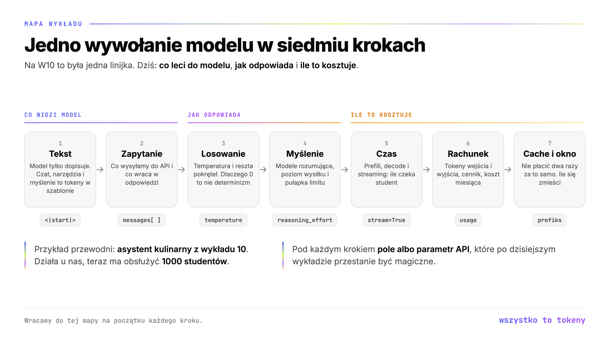
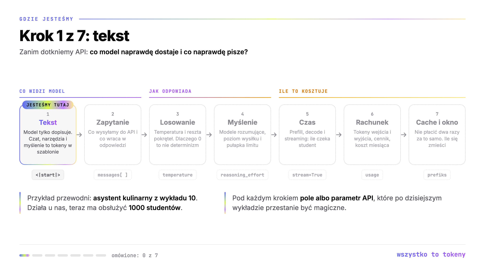
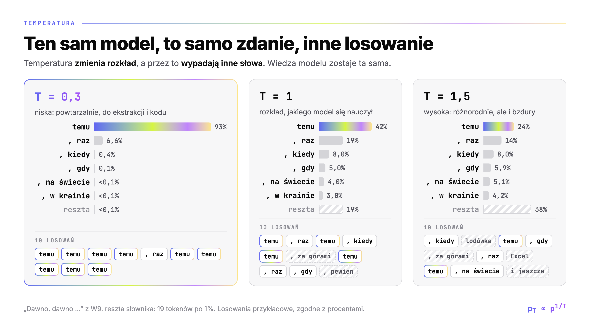
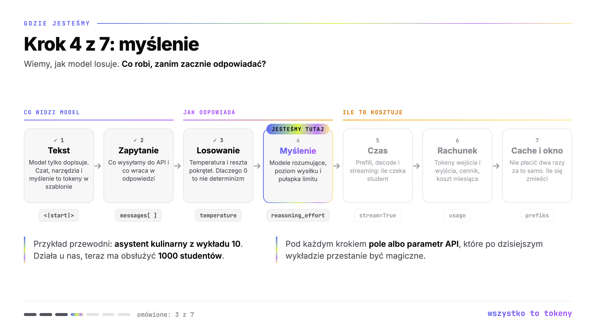
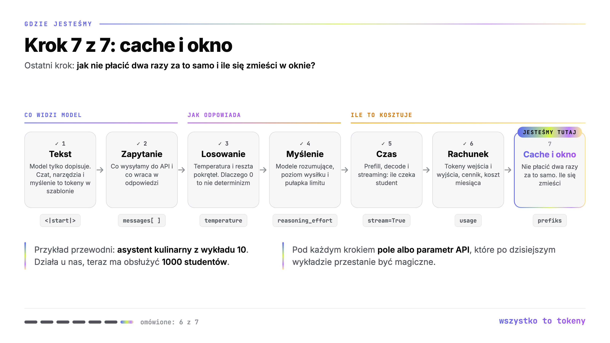

# Wstęp do uczenia maszynowego w kontekście przetwarzania zbiorów tekstów cz. 4

## Sztuczna Inteligencja i Data Science 1 - Wykład

### Wstęp do uczenia maszynowego w kontekście przetwarzania zbiorów tekstów cz. 4

mgr inż. Jakub Zboina

mgr inż. Rafał Masłyk

---

## Skąd jesteśmy

### Poprzednie wykłady

- W8: prompt, role, historia rozmowy, rankingi modeli
- W9: droga zdania przez model, **tokeny**, następny token, pamięć GPU i szybkość
- W10: asystent kulinarny w **siedmiu krokach**, od strony WWW do odpowiedzi ze źródłem

<!-- columns -->

### Dziś

- Zaglądamy w **jedno wywołanie modelu**: co naprawdę leci po kablu i co wraca
- Asystent z W10 ma obsłużyć **1000 studentów**: ile czekają, ile to kosztuje
- Bez nowej teorii: **wszystko, co dziś zobaczymy, to tokeny z W9**

**Po dzisiejszym wykładzie żaden parametr w wywołaniu API nie będzie magiczny.**

> _Notatka prowadzącego:_ W8–W10 mówiły, co model wie i skąd to bierze. Dziś inżynieria: jak się z modelem rozmawia w kodzie i co z tego wynika dla czasu i pieniędzy. Za tydzień druga połowa: jak wymusić format odpowiedzi i jak zmierzyć, że działa (W12). Wykład jest praktyczny, prawie każdy krok ma kawałek kodu, który da się uruchomić na laboratorium.

---

## Powtórka: siedem kroków


> _Notatka prowadzącego:_ Jedna minuta, to mapa z W10. Na W10 krok 7 (odpowiedź) był jedną linijką: client.chat.completions.create. Dziś rozkładamy tę jedną linijkę na części. Wszystko, co powiemy, dotyczy też kroku 1 (ekstrakcja LLM-em) i każdego innego miejsca, w którym wołamy model.

---

## Problem

### Asystent działa u nas. Teraz ma działać dla wszystkich

Uczelnia chce udostępnić asystenta kulinarnego **1000 studentom** w akademikach. Dział IT ma cztery pytania:

| Pytanie | Dlaczego nie umiemy odpowiedzieć |
|---|---|
| **Ile to będzie kosztować** miesięcznie? | nie wiemy, za co właściwie płacimy |
| **Ile student poczeka** na odpowiedź? | „u mnie działało szybko” to nie liczba |
| Dlaczego **czasem odpowiedź jest pusta**? | błędu nie ma, `content` jest `None` |
| Dlaczego to samo pytanie daje **różne odpowiedzi**? | ustawiliśmy temperaturę 0 |

> _Notatka prowadzącego:_ Przykład przewodni na cały wykład. Cztery pytania to cztery realne zgłoszenia, które przychodzą przy pierwszym wdrożeniu każdej aplikacji z LLM-em. Pytanie do sali: kto z was umie dziś odpowiedzieć na którekolwiek? Wrócimy do tej tabeli na końcu i każde pytanie dostanie odpowiedź z liczbą albo konkretną przyczyną. Przyjmijmy założenia: 5 pytań dziennie na studenta, 30 dni, czyli 150 tysięcy pytań miesięcznie.

---

## Mapa wykładu



> _Notatka prowadzącego:_ Jedyny schemat do zapamiętania. Kroki 1 i 2 to fundament: co naprawdę trafia do modelu. Kroki 3 i 4: jak model wybiera odpowiedź i jak "myśli". Kroki 5–7: czas i pieniądze, czyli odpowiedzi dla działu IT. Pod każdym krokiem jest kawałek kodu albo pole w odpowiedzi API, które po dzisiejszym wykładzie będzie zrozumiałe.

---

## Gdzie jesteśmy



> _Notatka prowadzącego:_ Kilka sekund. Zaczynamy od najprostszej i najważniejszej prawdy o modelu.

---

## Krok 1: model tylko dopisuje

### Najprostsze API: daj tekst, dostaniesz ciąg dalszy

```python
odp = client.completions.create(
    model="qwen35-122b",
    prompt="Neil Armstrong: a small step for",
    max_tokens=15, temperature=0)

print(odp.choices[0].text)
```

```text
 man, one giant leap for mankind.
```

Bez ról, bez czatu, bez historii. **Tekst wchodzi, tokeny wychodzą** (W9, krok 6).

> _Notatka prowadzącego:_ To starszy endpoint /v1/completions, z czasów sprzed czatów. Dobrze pokazuje istotę: model to funkcja, która dopisuje najbardziej prawdopodobny ciąg dalszy. Na laboratorium spróbujcie z "def fibonacci(n):" albo "SELECT name FROM users WHERE". Nie każdy model czatowy dobrze się zachowuje bez swojego szablonu, o tym za dwa slajdy. Nazwa modelu z cennika CGC, na którym robimy ćwiczenia.

---

## Krok 1: jednostka wszystkiego

### Token: za to płacimy, na to czekamy, tym mierzymy okno

| | Co mierzy | Przykład |
|---|---|---|
| **Cena** | tokeny wejścia i wyjścia | złotówki za milion tokenów |
| **Czas** | tokeny na sekundę | GPT-OSS ok. 115 tok/s na H100 (W9) |
| **Okno** | tokeny w kontekście | 128 tys. tokenów w gpt-oss |

- Polski tekst jest **droższy** niż angielski: więcej tokenów na to samo zdanie (W9)
- „Ile jest r w strawberry?” Model widzi **jeden token**, nie dziesięć liter

> _Notatka prowadzącego:_ Krótka powtórka z W9, ale z nowym akcentem: token to nie tylko jednostka przetwarzania, to jednostka ekonomiczna. Kroki 5–7 dzisiejszego wykładu to po prostu liczenie tokenów. gpt-oss ma słownik ok. 200 tysięcy tokenów. Tokenizer da się pobrać bez modelu i bez GPU (biblioteka transformers, AutoTokenizer), to ćwiczenie z laboratorium.

---

## Krok 1: czat to też dopisywanie


> _Notatka prowadzącego:_ Prawdziwy szablon gpt-oss (format harmony), wyrenderowany z pliku chat_template.jinja z Hugging Face. Na W10 był szablon Llamy 3, tu nowszy model, ale zasada ta sama. Trzy rzeczy do pokazania palcem. Pierwsza: serwer sam dopisał wiadomość systemową z datą odcięcia wiedzy, dzisiejszą datą i linią "Reasoning: medium", wrócimy do niej w kroku 4. Druga: nasz system prompt został przemianowany na developer. Trzecia: napis kończy się na "<|start|>assistant" i model po prostu pisze dalej. Czat to iluzja zbudowana z tokenów specjalnych.

---

## Krok 1: co model dopisuje

### Odpowiedź też ma swoje kanały

```text
<|start|>assistant<|channel|>analysis<|message|>Użytkownik ma cukinię.
W bazie są placki i leczo. Placki są szybsze, zaproponuję je.<|end|>
<|start|>assistant<|channel|>final<|message|>Zrób placki z cukinii:
zetrzyj cukinię, dodaj jajko i mąkę, smaż po 3 minuty z każdej strony.<|return|>
```

- Kanał **analysis**: rozumowanie, którego zwykle nie pokazujemy użytkownikowi
- Kanał **final**: odpowiedź, która trafia do `message.content`
- `<|return|>`: model sam postanowił skończyć. Serwer tnie tekst po tych znacznikach

> _Notatka prowadzącego:_ To jest surowy tekst, który model generuje token po tokenie. Serwer (vLLM, Ollama) parsuje go i rozkłada na pola odpowiedzi JSON: analysis trafia do osobnego pola z rozumowaniem, final do content. Treść poglądowa, struktura prawdziwa. Wniosek na krok 4: "myślenie" modelu to zwykłe tokeny w innym kanale, generowane tak samo i tak samo płatne.

---

## Krok 1: narzędzia też są tekstem

### Zapowiedź semestru 2

```text
<|start|>developer<|message|># Instructions
Jesteś asystentem kulinarnym. Odpowiadaj krótko.

# Tools
namespace functions {
// Szuka przepisów w bazie
type szukaj_przepisow = (_: { zapytanie: string, }) => any;
}<|end|><|start|>user<|message|>Co zrobić z cukinii?<|end|>
<|start|>assistant to=functions.szukaj_przepisow<|channel|>commentary json
<|message|>{"zapytanie": "cukinia"}<|call|>
```

Opis narzędzia to **tekst w prompcie**. Wywołanie to **tekst od modelu**. Wykonuje je nasz kod.

> _Notatka prowadzącego:_ Lekko skrócone, ale wyrenderowane z prawdziwego szablonu. Opis narzędzia zamienia się w sygnaturę w stylu TypeScriptu wewnątrz wiadomości developer, więc kosztuje tokeny w każdym zapytaniu. Wywołanie narzędzia to tekst zaadresowany "to=functions.szukaj_przepisow" i zakończony znacznikiem <|call|>. Model niczego nie uruchamia. Na pierwszym wykładzie semestru 2 zbudujemy na tym pętlę agenta. Dziś wystarczy zapamiętać: wszystko, co model "robi", to tekst.

---

## Krok 1: co z tego wynika

### Wszystko jest tekstem, więc wszystko kosztuje

- Rola, opis narzędzia, rozumowanie, wynik wyszukiwania: **wszystko to tokeny w jednym napisie**
- Serwer **dokleja własny tekst** (data, poziom rozumowania), zanim zobaczy go model
- Zły szablon nie daje błędu, tylko **gorsze odpowiedzi** (W10)
- Każdy token z tego napisu trzeba **przeczytać, policzyć i zmieścić w oknie**

**Kroki 5–7 to rachunek za ten jeden napis.**

> _Notatka prowadzącego:_ Domknięcie kroku 1. Kto zrozumiał, że czat to jeden długi napis, ten rozumie, dlaczego długie rozmowy są drogie, dlaczego agenci są drodzy i dlaczego prompt caching działa. Ostatnia linia to obietnica na drugą połowę wykładu.

---

## Gdzie jesteśmy


> _Notatka prowadzącego:_ Kilka sekund. Wiemy, co widzi model. Teraz: jak to wygląda z perspektywy naszego programu.

---

## Krok 2: jeden standard, wiele serwerów

### API zgodne z OpenAI

- `/v1/chat/completions` stało się **standardem de facto**
- Mówią nim: vLLM, SGLang, llama.cpp, Ollama i większość dostawców chmurowych
- Ten sam klient w Pythonie, zmienia się **adres i klucz**

```python
import os
from openai import OpenAI

client = OpenAI(base_url="https://llm.comtegra.cloud/v1",
                api_key=os.environ["LLM_API_KEY"])     # klucz z .env, nigdy w kodzie
```

Inne dialekty: **Responses API** (OpenAI), **Messages API** (Anthropic). Pojęcia te same.

> _Notatka prowadzącego:_ Dlatego na W10 mogliśmy przełączać się między Ollamą na laptopie a serwerem w chmurze, zmieniając jedną linijkę. Adres to API CGC, na którym robimy laboratorium. Klucz w zmiennej środowiskowej albo w pliku .env, który jest w .gitignore: klucze wrzucone na GitHuba są wyłapywane przez boty w ciągu minut. Responses API i Messages API różnią się szczegółami (np. Responses potrafi trzymać stan rozmowy po stronie serwera), ale wiadomości, narzędzia, rozumowanie i liczniki tokenów są wszędzie.

---

## Krok 2: zapytanie

### Co wysyłamy

```python
odp = client.chat.completions.create(
    model="gpt-oss-120b",                     # który model na serwerze
    messages=[                                 # cała rozmowa, za każdym razem
        {"role": "system", "content": SYSTEM_PROMPT},
        {"role": "user", "content": f"{pytanie}\n\n## Fragmenty\n\n{kontekst}"},
    ],
    temperature=0.2,                           # krok 3
    reasoning_effort="low",                    # krok 4
    max_tokens=2000,                           # krok 4: pułapka
    stream=False,                              # krok 5
)
```

> _Notatka prowadzącego:_ To jest wywołanie z kroku 6 na W10, rozbudowane o parametry, które dziś omówimy. Każdy komentarz to numer kroku z mapy. messages to lista z W8: system, user, assistant. Pod spodem serwer zamieni ją w napis z kroku 1.

---

## Krok 2: odpowiedź

### Co wraca

```json
{
  "model": "gpt-oss-120b",
  "choices": [{
    "message": {
      "role": "assistant",
      "content": "Zrób placki z cukinii: ...",
      "reasoning_content": "Użytkownik ma cukinię. W bazie są ..."
    },
    "finish_reason": "stop"
  }],
  "usage": {"prompt_tokens": 4012, "completion_tokens": 987, "total_tokens": 4999}
}
```

> _Notatka prowadzącego:_ Trzy pola, które warto czytać zawsze. content: odpowiedź, którą widzi użytkownik. finish_reason: dlaczego model skończył (krok 4). usage: ile tokenów weszło i wyszło, czyli rachunek (krok 6). Pole z rozumowaniem jest niestandardowe: vLLM nazywa je reasoning albo reasoning_content zależnie od wersji, inni dostawcy jeszcze inaczej albo wcale go nie zwracają. Liczby poglądowe, ale tego rzędu będzie zapytanie asystenta z fragmentami z RAG. Modele domyślnie odpowiadają w markdownie, bo tak wygląda większość tekstów z internetu: w aplikacji trzeba go wyrenderować albo poprosić o zwykły tekst.

---

## Krok 2: API nie ma pamięci

### Historia rozmowy jedzie w każdym zapytaniu

```python
historia = [{"role": "system", "content": SYSTEM_PROMPT}]

def zapytaj(tekst):
    historia.append({"role": "user", "content": tekst})
    odp = client.chat.completions.create(model=MODEL, messages=historia)
    historia.append({"role": "assistant", "content": odp.choices[0].message.content})
    return odp.choices[0].message.content
```

- Model **nie pamięta** poprzedniego zapytania: pamięć to lista po naszej stronie
- Druga wiadomość wysyła **całą pierwszą rozmowę jeszcze raz**. I trzecia, i setna

> _Notatka prowadzącego:_ Chat history z W8, tylko w kodzie. Konsekwencje policzymy w kroku 6: każda kolejna tura jest dłuższa od poprzedniej. Szerzej o bezstanowości, personie i profilu użytkownika na pierwszym wykładzie semestru 2. Dziś wystarczy wiedzieć, że to my wysyłamy historię i to my za nią płacimy.

---

## Gdzie jesteśmy


> _Notatka prowadzącego:_ Kilka sekund. Wiemy, co wysyłamy. Teraz: jak model wybiera, co odpisać.

---

## Krok 3: temperatura, powtórka z W10



> _Notatka prowadzącego:_ Slajd z W10, jedna minuta. Model daje rozkład, temperatura go spłaszcza albo wyostrza, potem losujemy. Dziś pozostałe pokrętła i dwie niespodzianki: temperatura nie robi z modelu generatora liczb losowych, a temperatura 0 nie daje gwarancji powtarzalności.

---

## Krok 3: pozostałe pokrętła

### Parametry losowania w pięć minut

| Parametr | Co robi | Kiedy ruszać |
|---|---|---|
| `temperature` | spłaszcza albo wyostrza rozkład | ekstrakcja 0, odpowiedź z RAG ok. 0,2, burza mózgów wyżej |
| `top_p` | losuje tylko z tokenów pokrywających p masy | zwykle zostawić, albo to, albo temperatura |
| `max_tokens` | twardy limit wygenerowanych tokenów | zawsze, ale z zapasem (krok 4) |
| `stop` | napisy, na których generowanie się kończy | dziś rzadko, wypiera je structured output (W12) |
| `seed` | ziarno losowania | testy, ale to tylko „najlepsza próba” |

> _Notatka prowadzącego:_ W 2023 roku strojenie tych parametrów było sporą częścią pracy z modelami. Dziś modele dobrze wykonują polecenia i ciężar przeszedł na prompt, structured output (W12) i poziom rozumowania (krok 4). top_p = 0,9 znaczy: posortuj tokeny od najbardziej prawdopodobnego i losuj tylko z tych, które razem dają 90%. frequency_penalty i presence_penalty karzą za powtórzenia; dziś prawie nieużywane. Dokumentacja: platform.openai.com/docs/api-reference/chat/create.

---

## Krok 3: „podaj losową liczbę”

### Temperatura zmienia rozkład. Nie robi z modelu kostki

```python
for t in [0, 1.0, 1.5]:
    wyniki = [zapytaj("Podaj losową liczbę od 1 do 100. Tylko liczbę.",
                      temperature=t) for _ in range(15)]
    print(t, Counter(wyniki).most_common(3))
```

- Typowy wynik: **przy każdej temperaturze** dominuje 42, 37 albo 73
- Model jest **bardzo pewny**, że „losowa liczba” to 42: spłaszczanie niewiele zmienia
- Przy zadaniu z wieloma dobrymi odpowiedziami („wymyśl nazwę stwora”) różnice są wyraźne

**Losowość w aplikacji? `random.randint`, nie LLM.**

> _Notatka prowadzącego:_ Znany eksperyment, warto zrobić go na żywo, wyniki różnią się między modelami. Wyjaśnienie z rozkładu: jeśli "42" ma 70% prawdopodobieństwa, to nawet temperatura 1,5 zostawia mu większość masy. W danych treningowych ludzie, proszeni o losową liczbę, też wybierają 7, 37, 42 i 73, a 42 to dodatkowo "Autostopem przez galaktykę". Wniosek praktyczny: jeśli asystent ma wylosować przepis dnia, losuje kod, a model tylko go opisuje.

---

## Krok 3: temperatura 0 to nie determinizm

### Dlaczego to samo pytanie daje różne odpowiedzi

- Serwer liczy **wiele zapytań naraz** (batch): kolejność dodawania liczb zależy od obciążenia
- Liczby zmiennoprzecinkowe: `(a + b) + c` **nie zawsze** równa się `a + (b + c)` (W9, FP16)
- Mała różnica w logitach zmienia **zwycięski token**, a potem całe zdanie
- `seed` pomaga, ale dostawcy obiecują tylko **„best effort”**

**Temperatura 0 daje tę samą odpowiedź znacznie częściej. Nie zawsze.**

> _Notatka prowadzącego:_ Odpowiedź na czwarte pytanie działu IT. Na W9 była precyzja liczb: w FP16 mamy kilka cyfr znaczących, więc kolejność sumowania ma znaczenie. Kernele GPU dobierają kolejność obliczeń do rozmiaru batcha, a rozmiar batcha zależy od tego, ile innych osób akurat pyta serwer. Gdy dwa tokeny mają prawie równe prawdopodobieństwa, taka różnica wystarcza, żeby wygrał drugi, a każdy następny token liczy się już od innego tekstu. Thinking Machines Lab opisało to szczegółowo w 2025 ("Defeating Nondeterminism in LLM Inference"). Wniosek dla testów: nie porównujemy odpowiedzi znak po znaku, tylko oceniamy je, o tym W12.

---

## Krok 3: pokrętła tracą znaczenie

### Co zmieniło się od 2023 roku

| Wtedy | Dziś |
|---|---|
| Strojenie `temperature` i `top_p` | Precyzyjne polecenie w prompcie |
| `stop` i „odpowiedz tylko X” | **Structured output**, format wymuszony przez serwer (W12) |
| Prośba „myśl krok po kroku” | **Model rozumujący** i `reasoning_effort` (krok 4) |
| Wszystkie parametry działają | Część modeli rozumujących **odrzuca** temperaturę |

> _Notatka prowadzącego:_ Modele rozumujące OpenAI (seria o) i Claude z włączonym myśleniem ignorują albo odrzucają temperaturę i top_p. Nie budujcie aplikacji wokół tych parametrów. "Myśl krok po kroku" (chain of thought, Wei i in., 2022) to był trik w prompcie; modele rozumujące mają go wbudowanego przez trening. To przejście do kroku 4.

---

## Gdzie jesteśmy



> _Notatka prowadzącego:_ Kilka sekund. Wiemy, jak model losuje. Teraz: co robi, zanim zacznie odpowiadać.

---

## Krok 4: modele rozumujące

### Najpierw myśli, potem odpowiada

- Model generuje **ukryty tok rozumowania**, dopiero potem odpowiedź (kanał analysis z kroku 1)
- Przykłady: gpt-oss, Qwen 3.5, GLM, DeepSeek-R1, OpenAI o-series, Claude z myśleniem
- Douczane uczeniem ze wzmocnieniem na zadaniach, które **da się sprawdzić**: matematyka, kod

> **Kij i piłka kosztują razem 1,10 zł. Kij jest o 1 zł droższy od piłki. Ile kosztuje piłka?**

Odpowiedź z intuicji: 10 gr. Poprawna: **5 gr**. Model rozumujący zwykle ją znajduje, bo **zdąży policzyć**.

> _Notatka prowadzącego:_ Klasyczne zadanie z testu refleksji poznawczej (Frederick, 2005), z którym myli się większość ludzi. Kij za 1,05 zł, piłka 5 gr, razem 1,10 zł. Modele bez rozumowania często odpowiadały 10 gr. Rozumowanie to nie magia, tylko więcej tokenów: model ma miejsce, żeby rozpisać równanie, zanim napisze wynik. Każdy token rozumowania jest generowany jak każdy inny, więc wpływa na czas (krok 5) i na rachunek (krok 6). Trening: RL z weryfikowalną nagrodą, ten sam pomysł co w DeepSeek-R1 (2025).

---

## Krok 4: rozumowanie w kodzie

### Dwa pola w jednej wiadomości

```python
odp = client.chat.completions.create(
    model="gpt-oss-120b",
    messages=[{"role": "user", "content": ZAGADKA_KIJ_I_PILKA}])

msg = odp.choices[0].message
print(msg.reasoning_content)    # "Niech piłka = x. Kij = x + 1. Razem 2x + 1 = 1,10 ..."
print(msg.content)              # "Piłka kosztuje 5 groszy."
print(odp.usage.completion_tokens)   # rozumowanie + odpowiedź
```

**Za rozumowanie płacimy jak za odpowiedź**: to tokeny wyjściowe.

> _Notatka prowadzącego:_ Jedno pole z rozumowaniem, drugie z odpowiedzią. Nazwa pola zależy od serwera (reasoning albo reasoning_content w vLLM), w bibliotece z laboratorium jest funkcja get_reasoning, która sprawdza oba. Rozumowanie warto logować do debugowania, ale zwykle nie pokazuje się go użytkownikowi. Ostatnia linia: completion_tokens liczy oba kanały. Model, który myśli 2000 tokenów, zanim odpowie "tak", płaci za 2001 tokenów wyjściowych.

---

## Krok 4: jak długo ma myśleć?

### `reasoning_effort` zamiast temperatury

| Poziom | Tokeny rozumowania | Czas | Kiedy |
|---|---|---|---|
| `low` | dziesiątki do kilkuset | sekundy | klasyfikacja, proste pytania, czat |
| `medium` | kilkaset do tysiąca | kilka sekund | domyślnie |
| `high` | tysiące | dziesiątki sekund | matematyka, kod, trudne wnioskowanie |

- Pamiętacie linię `Reasoning: medium` w szablonie z kroku 1? **To jest ten parametr**
- Więcej myślenia to **więcej tokenów, czasu i pieniędzy**. Nie zawsze lepsza odpowiedź

**Wybieramy najniższy poziom, który przechodzi nasze testy (W12).**

> _Notatka prowadzącego:_ Wartości orientacyjne dla gpt-oss, zależą od pytania. Parametr reasoning_effort serwer wpisuje do wiadomości systemowej w szablonie, czyli znowu: to tylko tekst, który model nauczył się respektować. Agenci kodujący pozwalają zmieniać ten poziom per zadanie. Pytanie do sali: jaki poziom dla asystenta kulinarnego? Raczej low: pytania są proste, a odpowiedź i tak opiera się na fragmentach z bazy. Ale "raczej" to nie liczba: na W12 zmierzymy, czy low nie psuje jakości.

---

## Krok 4: pułapka `max_tokens`


> _Notatka prowadzącego:_ Odpowiedź na trzecie pytanie działu IT: pusta odpowiedź bez błędu. max_tokens liczy wszystkie wygenerowane tokeny, rozumowanie też. Stary trik "ustaw max_tokens=2, żeby dostać samo tak albo nie" w modelu rozumującym kończy się pustym content: model nie zdążył nawet skończyć myśleć. Ten sam efekt przy zbyt ciasnym limicie i długim rozumowaniu na poziomie high. Rozwiązanie: limit z dużym zapasem i sprawdzanie finish_reason. Liczby w dolnym pasku poglądowe.

---

## Krok 4: zawsze czytaj `finish_reason`

### Dlaczego model przestał pisać

| Wartość | Co się stało | Co zrobić |
|---|---|---|
| `stop` | model sam skończył | wszystko w porządku |
| `length` | skończył się `max_tokens` albo okno | **odpowiedź ucięta albo pusta**: większy limit, krótszy prompt |
| `tool_calls` | model prosi o narzędzie | wykonać i odesłać wynik (semestr 2) |
| `content_filter` | dostawca zablokował treść | obsłużyć w interfejsie |

```python
if odp.choices[0].finish_reason == "length":
    raise RuntimeError("Odpowiedź ucięta, zwiększ max_tokens")
```

> _Notatka prowadzącego:_ W kodzie produkcyjnym ucięta odpowiedź to błąd, a nie odpowiedź. Bez tej linijki aplikacja pokaże studentowi pół przepisu albo pusty dymek i nikt się nie dowie dlaczego. tool_calls wróci na pierwszym wykładzie semestru 2. Nazwy wartości z API zgodnego z OpenAI, inne API mają odpowiedniki (np. stop_reason w Anthropic).

---

## Gdzie jesteśmy


> _Notatka prowadzącego:_ Kilka sekund. Wiemy, co i jak model generuje. Teraz pytania działu IT: najpierw czas.

---

## Krok 5: dwie fazy jednego zapytania


> _Notatka prowadzącego:_ Najważniejszy slajd tej części. Prefill: model czyta cały prompt naraz, wszystkie tokeny równolegle, GPU jest w pełni zajęte liczeniem. Decode: każdy kolejny token wymaga przejścia przez cały model i odczytania wszystkich wag z pamięci GPU (rachunek z W9), a tokenów nie da się liczyć równolegle, bo każdy zależy od poprzedniego. Dlatego czytanie jest szybkie, a pisanie wolne. To samo wyjaśni w kroku 6, dlaczego tokeny wyjściowe są droższe. Czasy poglądowe, rząd wielkości z pomiarów z W9.

---

## Krok 5: streaming

### Odpowiedź po kawałku, zanim będzie gotowa

```python
strumien = client.chat.completions.create(
    model=MODEL, messages=messages, stream=True)

for kawalek in strumien:
    delta = kawalek.choices[0].delta if kawalek.choices else None
    if delta and delta.content:
        print(delta.content, end="", flush=True)
```

- Całkowity czas **ten sam**. Odczuwany: **dużo krótszy**
- Dlatego każdy czat w przeglądarce pisze „na żywo”
- Ale: z modelem rozumującym przez kilka sekund **nic nie widać**, bo leci kanał analysis

> _Notatka prowadzącego:_ Serwer wysyła każdy token zaraz po wygenerowaniu (server-sent events). Dla użytkownika liczy się czas do pierwszego widocznego słowa. Pułapka modeli rozumujących: pierwsze tokeny to rozumowanie, więc interfejs pokazuje "myślę..." albo streszczenie rozumowania, jak robią ChatGPT i Claude. Streaming komplikuje kod (np. structured output trzeba złożyć z kawałków), dlatego w zadaniach wsadowych, jak ekstrakcja z W10, zostajemy przy stream=False.

---

## Krok 5: ile poczeka student

### Rachunek czasu dla jednego pytania

| Faza | Tokeny | Czas (ok. 115 tok/s, W9) |
|---|---|---|
| Kolejka i prefill | 4000 wejścia | 1–3 s, rośnie z liczbą osób naraz |
| Rozumowanie (`medium`) | ok. 700 | ok. 6 s, **na ekranie nic** |
| Odpowiedź | ok. 300 | ok. 2,6 s, tekst pojawia się na żywo |
| **Razem** | | **ok. 10–12 s**, z czego ok. 8 s czekania na pierwsze słowo |

**Z `reasoning_effort="low"` (ok. 150 tokenów) pierwsze słowo po ok. 3 s.**

> _Notatka prowadzącego:_ Odpowiedź na drugie pytanie działu IT, z liczbami z W9: GPT-OSS ok. 115 tokenów na sekundę na H100, czas do pierwszego tokena do ok. 3 s przy 8 zapytaniach naraz. Na współdzielonym serwerze w godzinach obiadowych będzie wolniej. Wniosek: dla czatu kulinarnego poziom rozumowania ma większy wpływ na odczuwaną szybkość niż wybór karty graficznej. 150 tokenów to ok. 1,3 s, plus 1–2 s prefillu.

---

## Gdzie jesteśmy


> _Notatka prowadzącego:_ Kilka sekund. Czas policzony. Teraz pieniądze.

---

## Krok 6: licznik w każdej odpowiedzi

### `usage` to paragon

```python
print(odp.usage)
# CompletionUsage(prompt_tokens=4012, completion_tokens=987, total_tokens=4999)

CENNIK = {"gpt-oss-120b": {"wejscie": 0.2731, "wyjscie": 32.7778}}  # zł za 1 mln tokenów

def koszt(model, usage):
    c = CENNIK[model]
    return (usage.prompt_tokens * c["wejscie"]
            + usage.completion_tokens * c["wyjscie"]) / 1_000_000

print(f"{koszt('gpt-oss-120b', odp.usage):.4f} zł")    # 0.0335 zł
```

> _Notatka prowadzącego:_ Każda odpowiedź mówi, ile tokenów zużyła, więc koszt da się policzyć co do grosza bez czekania na fakturę. Ceny z publicznego cennika CGC (cgc.comtegra.cloud/pricing), stan z listopada 2026, sprawdź przed wykładem. Na laboratorium jest funkcja cost_pln, która pobiera cennik na żywo. 4012 × 0,2731 + 987 × 32,7778, podzielone przez milion, daje ok. 0,0335 zł. Zwróć uwagę, który składnik dominuje.

---

## Krok 6: cennik

### Złotówki za milion tokenów

| Model | Wejście | Wyjście | Wyjście / wejście |
|---|---|---|---|
| `gpt-oss-120b` | 0,27 zł | 32,78 zł | ok. 120× |
| `gemma-4-26b-a4b` | 0,41 zł | 10,93 zł | ok. 27× |
| `glm-53-nvfp4` | 1,70 zł | 40,12 zł | ok. 24× |
| `gte-qwen2-7b` (embedder) | 0,30 zł | nie dotyczy | |

- Tokeny wyjściowe są **zawsze droższe**: decode z kroku 5, po jednym tokenie
- U dostawców chmurowych wyjście jest zwykle **kilka razy** droższe od wejścia
- Embedder z W10 płaci **tylko za wejście**: nic nie generuje

> _Notatka prowadzącego:_ Cennik CGC z listopada 2026, sprawdź przed wykładem. Proporcje różnią się między dostawcami, ale kierunek zawsze ten sam, i wynika wprost z kroku 5: prefill liczy tysiące tokenów naraz, decode zajmuje GPU na każdy token z osobna. Przy dostawcach chmurowych (OpenAI, Anthropic, Google) wyjście jest zwykle 4–8 razy droższe od wejścia, więc tam historia rozmowy waży w rachunku więcej niż u nas. gemma-4-26b-a4b to Mixture of Experts z ok. 4 mld aktywnych parametrów, stąd taniej (W9, GPT-OSS i MoE).

---

## Krok 6: rachunek za stołówkę


> _Notatka prowadzącego:_ Odpowiedź na pierwsze pytanie działu IT. Założenia: 150 tys. pytań miesięcznie, 4000 tokenów wejścia (system prompt, fragmenty z RAG, pytanie), 300 tokenów odpowiedzi i poglądowa liczba tokenów rozumowania: 150, 700 albo 2500. Wejście kosztuje ok. 164 zł miesięcznie niezależnie od poziomu. Cała reszta to wyjście, a w nim głównie rozumowanie. Jedna zmiana parametru to różnica 6 razy w rachunku. Ostatni pasek: mały model bez rozumowania jest kilka razy tańszy, ale czy jest wystarczająco dobry? Bez testów nie wiadomo, i to jest punkt wyjścia W12.

---

## Krok 6: rozmowa drożeje z każdą turą


> _Notatka prowadzącego:_ Konsekwencja kroku 2: API nie ma pamięci, więc każda tura wysyła całą historię. Założenia: system prompt ok. 1000 tokenów, każda tura dokłada ok. 1000 (pytanie z fragmentami ok. 700 i odpowiedź ok. 300). Wejście w pojedynczej turze rośnie liniowo, a suma po całej rozmowie kwadratowo. U nas wejście jest tanie, więc to głównie czas (dłuższy prefill) i pamięć GPU (kontekst w VRAM, W9). U dostawców chmurowych i w agentach, które w jednym zadaniu robią dziesiątki obrotów i czytają całe pliki, to większość rachunku. Stąd krok 7.

---

## Gdzie jesteśmy



> _Notatka prowadzącego:_ Kilka sekund. Wiemy, ile kosztuje każdy token. Ostatni krok: jak nie płacić dwa razy za to samo i ile w ogóle zmieści się w oknie.

---

## Krok 7: prompt caching


> _Notatka prowadzącego:_ Atencja z W8 i W9: dla każdego tokenu liczymy wektory klucza i wartości (K i V). Dla tego samego początku tekstu wychodzą zawsze te same, więc serwer może je zapamiętać i użyć ponownie. vLLM robi to automatycznie (automatic prefix caching): cena u nas się nie zmienia, ale czas do pierwszego tokena wyraźnie spada. Dostawcy chmurowi liczą tokeny z cache za ok. 10% normalnej ceny wejścia. Warunek: prefiks musi być identyczny co do tokena. Jeden zmieniony token na początku unieważnia wszystko, co po nim, bo każdy następny token "patrzy" na poprzednie.

---

## Krok 7: zasada stałego prefiksu

### Co się zmienia, idzie na koniec

```python
# źle: inny początek w każdym zapytaniu, cache nigdy nie trafia
system = f"Teraz jest {datetime.now()}.\n{RAMY}\n{OPIS_BAZY}"
```

<!-- columns -->

```python
# dobrze: stały początek, zmienne na końcu
system = f"{RAMY}\n{OPIS_BAZY}"
pytanie = f"Dziś jest {date.today()}.\n{pytanie_studenta}"
```

- Stałe na górze: ramy, opis narzędzi, długie instrukcje
- Zmienne na dole: data, imię, fragmenty z RAG, pytanie
- Historia tylko **dopisywana**, nigdy przepisywana od środka

> _Notatka prowadzącego:_ Klasyczny błąd: znacznik czasu z sekundami albo identyfikator zapytania w pierwszej linii system promptu. Wszystko działa, tylko każde zapytanie liczy się od zera. Datę z dokładnością do dnia można zostawić w system prompcie, bo zmienia się raz na dobę. Ta sama zasada tłumaczy, dlaczego agenci kodujący nie edytują starych wiadomości w historii, tylko dopisują nowe. Na laboratorium jest pomiar czasu do pierwszego tokena z cache i bez.

---

## Krok 7: okno kontekstowe

### Ile się zmieści, a ile się opłaca

- gpt-oss: **128 tys.** tokenów. Najwięksi dostawcy: **1 mln i więcej**
- Prompt i odpowiedź **razem** muszą się zmieścić (krok 4: rozumowanie też)
- Kontekst zajmuje **pamięć GPU** obok wag (W9): serwer często tnie okno, żeby obsłużyć więcej osób
- **Context rot**: im pełniejsze okno, tym słabiej model pilnuje szczegółów i instrukcji z początku

**Reklamowane okno to górna granica, nie zalecany rozmiar.**

> _Notatka prowadzącego:_ Powtórka z W9 (okno kontekstowe i pamięć GPU) z nowym akcentem. Context rot to nazwa z raportu Chroma (2025): modele z tym samym zadaniem wypadają gorzej, gdy wokół jest więcej nieistotnego tekstu. Dla asystenta kulinarnego wniosek z W10 się potwierdza: lepiej 5 dobrych fragmentów niż 50 przeciętnych. Szerzej w cyklu Agenci AI, wykład 3.

---

## Krok 7: context engineering

### Decyzja, co trafia do okna

| Technika | Co robi | Przykład w asystencie |
|---|---|---|
| Wyszukiwanie | wkłada tylko pasujące fragmenty | RAG z W10 zamiast całej bazy |
| Przycinanie historii | zostawia ostatnie N tur | rozmowa o obiedzie sprzed tygodnia odpada |
| Streszczenie | stare tury zamienia na krótki opis | „student szuka tanich dań z cukinii” |
| Krótkie wyniki | z narzędzi wraca to, co potrzebne | tytuł i składniki zamiast całej strony |
| Plik instrukcji | stałe zasady w jednym miejscu | `AGENTS.md`, `CLAUDE.md` |

> _Notatka prowadzącego:_ Context engineering to nazwa, która przyjęła się w 2025 roku na to, co dawniej nazywano prompt engineeringiem, tylko szerzej: nie jak sformułować polecenie, ale co w ogóle ma się znaleźć w oknie. Agenci kodujący robią wszystkie pięć rzeczy naraz: streszczają historię (kompakcja), skracają wyniki poleceń i czytają pliki instrukcji zamiast całego repozytorium. Uwaga na konflikt z krokiem 7: przycinanie i streszczanie od środka psuje cache. To kompromis, a nie błąd.

---

## Odpowiedzi dla działu IT

### Cztery pytania, cztery kroki

| Pytanie | Odpowiedź | Krok |
|---|---|---|
| Ile to kosztuje? | ok. **2,4 tys. zł** miesięcznie przy `low`, głównie za wyjście | 4, 6 |
| Ile czeka student? | ok. **3 s** do pierwszego słowa przy `low`, ok. 8 s przy `medium` | 4, 5 |
| Czemu pusta odpowiedź? | rozumowanie zjadło `max_tokens`, `finish_reason = "length"` | 4 |
| Czemu różne odpowiedzi? | batch i liczby zmiennoprzecinkowe, temperatura 0 nie wystarczy | 3 |

**Każda odpowiedź to liczenie tokenów z kroku 1.**

> _Notatka prowadzącego:_ Domykamy problem z początku wykładu. Wszystkie cztery odpowiedzi wynikają z jednego faktu: model dopisuje tokeny, po jednym, i za każdy trzeba zapłacić czasem i pieniędzmi. Pytanie do sali, które otwiera W12: skąd wiemy, że przy low i małym modelu odpowiedzi są nadal dobre? Na razie nie wiemy.

---

## Co może pójść nie tak

### Każdy objaw ma swój krok

| Objaw | Prawdopodobna przyczyna | Krok |
|---|---|---|
| Model „nie umie” odpowiadać, choć powinien | zły szablon czatu | 1 |
| Model nie pamięta poprzedniego pytania | historia nie trafiła do `messages` | 2 |
| Pusta albo ucięta odpowiedź | `max_tokens` za mały, rozumowanie | 4 |
| Rachunek kilka razy wyższy niż plan | `reasoning_effort="high"`, długie rozmowy | 4, 6 |
| Wolne odpowiedzi mimo cache | zmienny początek system promptu | 7 |

> _Notatka prowadzącego:_ Ta sama tabela diagnostyczna co na W10, tylko dla warstwy wywołania modelu. Zanim zmienisz model na droższy, sprawdź finish_reason, usage i początek promptu. Większość problemów z pierwszego wdrożenia to jeden z tych pięciu wierszy.

---

## Do zrobienia

### Policz swojego asystenta

1. Wyrenderuj szablon czatu dowolnego modelu z Hugging Face (`apply_chat_template`) i znajdź, co dopisał serwer
2. Zadaj **to samo pytanie** z `reasoning_effort` `low` i `high`: porównaj `usage`, czas i odpowiedź
3. Ustaw `max_tokens=20` i doprowadź do `finish_reason = "length"`
4. Policz miesięczny koszt **swojego** asystenta z projektu RAG dla 1000 osób
5. Zmierz czas do pierwszego tokena z datą na **początku** i na **końcu** system promptu

**Ocena: czy potrafisz z `usage` i cennika przewidzieć rachunek, zanim przyjdzie faktura?**

> _Notatka prowadzącego:_ Wszystkie punkty da się zrobić z notebookami z laboratorium (podstawy API i parametry zapytań). Punkt 4 łączy się z projektem RAG z W10: wystarczy dodać print(odp.usage) i przemnożyć przez cennik. Kto zrobi punkt 5, sam zobaczy prompt caching w liczbach. Na współdzielonym serwerze pomiary są zaszumione, warto powtórzyć kilka razy.

---

## Podsumowanie

### Siedem kroków jednego wywołania

- **1. Tekst:** model tylko dopisuje; role, narzędzia i myślenie to tokeny w szablonie
- **2. Zapytanie:** jeden standard API; `content`, `finish_reason`, `usage`; historia wysyłana za każdym razem
- **3. Losowanie:** temperatura zmienia rozkład, ale nie robi kostki; 0 to nie determinizm
- **4. Myślenie:** `reasoning_effort` to główne pokrętło; rozumowanie zjada `max_tokens`
- **5. Czas:** prefill szybki, decode po jednym tokenie; streaming skraca czekanie odczuwane
- **6. Rachunek:** wyjście dużo droższe od wejścia; rozumowanie to wyjście
- **7. Cache i okno:** stały prefiks; okno to granica, nie cel

---

## Co dalej

### Dzisiejsze pojęcia wrócą

| Dziś | Gdzie wróci | Jako co |
|---|---|---|
| `stop`, „odpowiedz tylko X” | W12 | Structured output: format wymuszony przez serwer |
| „Czy `low` i mały model wystarczą?” | W12 | Zbiór testowy, porównanie jakości i kosztu |
| Narzędzia w szablonie | Semestr 2, W1 | Wywołanie narzędzia i pętla agenta |
| Historia, cache, okno | Agenci AI, W3 | Pamięć agenta: kontekst, kompakcja, cache |

> _Notatka prowadzącego:_ W11 i W12 to para. Dziś: jak rozmawiać z modelem i ile to kosztuje. Za tydzień: jak wymusić, żeby odpowiedź miała dokładnie taki kształt, jakiego potrzebuje nasz kod, i jak zmierzyć, czy tańsza konfiguracja jest wystarczająco dobra. Z tym kompletem wchodzimy w semestr 2, gdzie model dostanie narzędzia.

---

## Dziękuję

### Pytania?

mgr inż. Jakub Zboina

mgr inż. Rafał Masłyk
