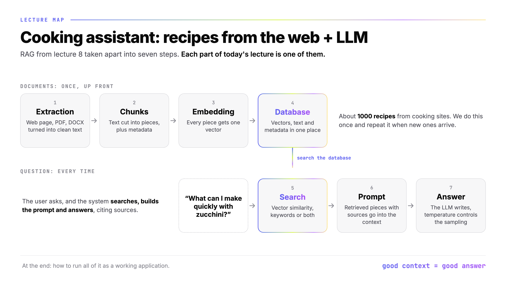
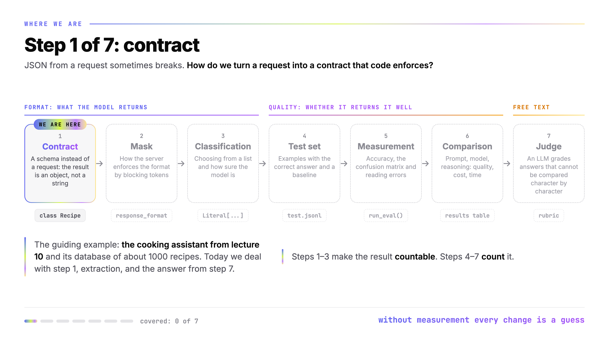
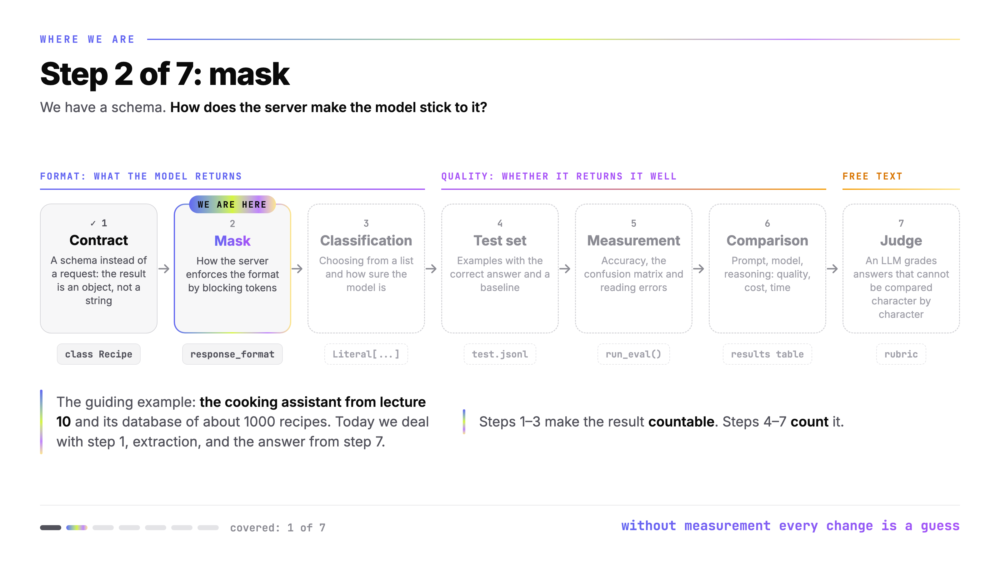
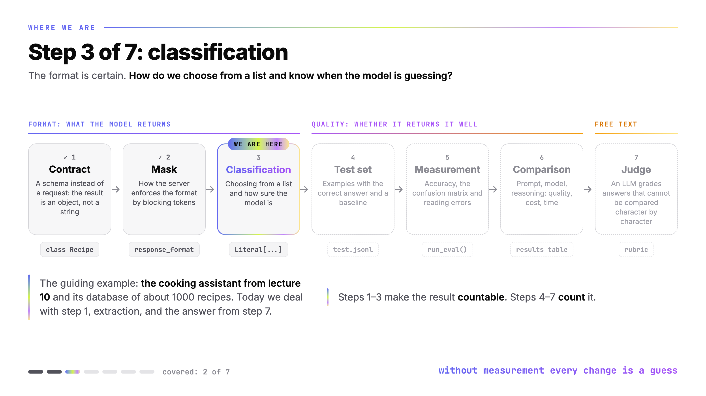
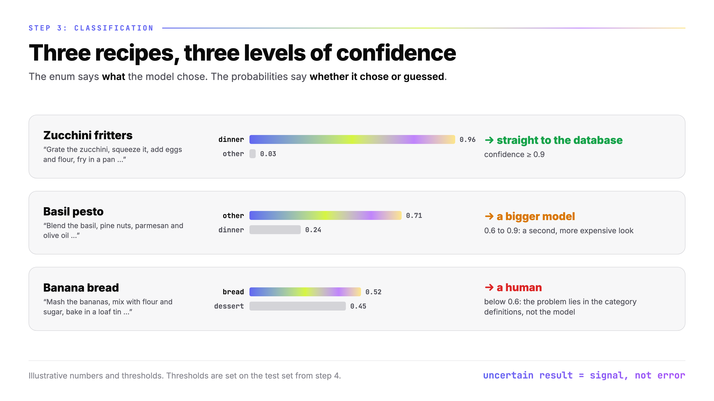
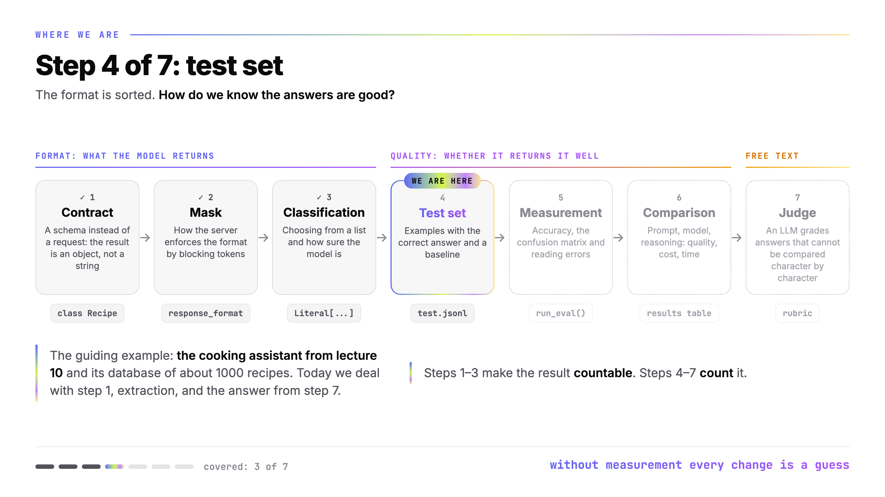
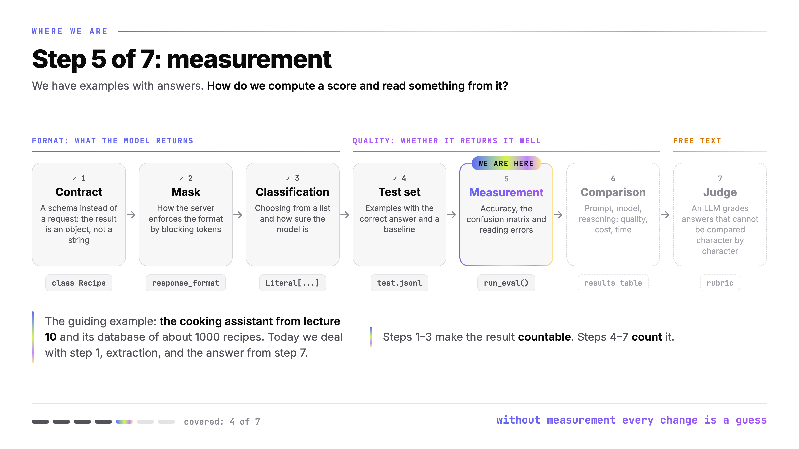
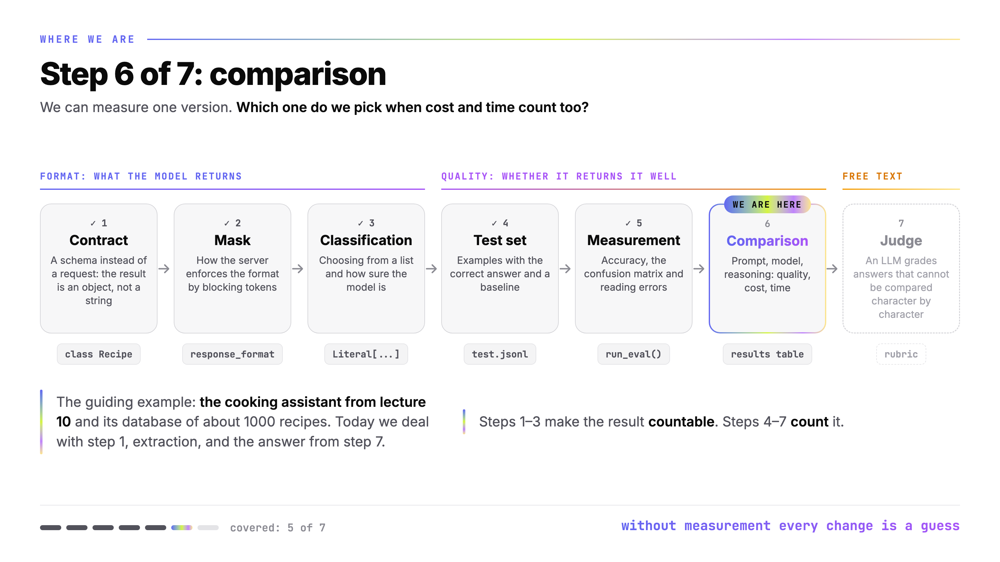
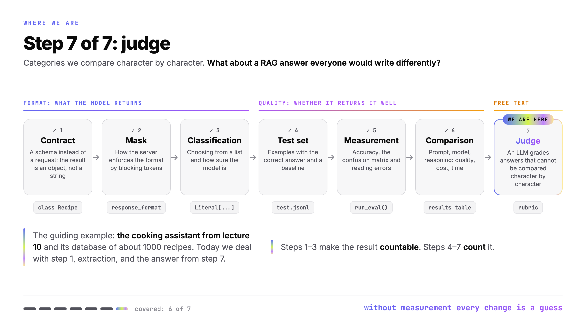

# Introduction to machine learning for processing text collections, part 5

## Artificial Intelligence and Data Science 1, Lecture

### Introduction to machine learning for processing text collections, part 5

Jakub Zboina, MSc Eng.

Rafał Masłyk, MSc Eng.

---

## Where we come from

### Previous lectures

- L8: the prompt, roles, **RAG** and model rankings
- L9: a sentence's path through the model, the **next token** and softmax, LoRA
- L10: the cooking assistant in **seven steps**, from a web page to an answer with a source
- L11: talking to the model in code: parameters, reasoning, **cost**

<!-- columns -->

### Today

- The assistant works, but **by eye**: "I tried three recipes, looks fine"
- The result needs a **format that code can trust**
- Every change needs a **number** that says whether it got better

**The last lecture of the semester: we turn a demo into a system you can maintain.**

> _Notatka prowadzącego:_ Closing the semester. L10 built the assistant, L11 showed how to talk to the model in code and what it costs. Today two things that separate a prototype from a product: a result in a fixed format (steps 1–3) and measuring quality (steps 4–7). We promised both in L10: structured output in the note to step 1, evaluation on the slide "How do we check that it works?". The material is based on module 2 of the LLM workshop (notebooks 3, 7 and 8).

---

## Recap: seven steps



> _Notatka prowadzącego:_ One minute, this is the map from L10. Today we care about two places. Step 1, extraction: there the model pulled the title, ingredients, time and category from a recipe into JSON, and the category became metadata for filtering in step 5. Step 7, the answer: there we left open the question of how to check whether answers are good. The first half of the lecture fixes step 1, the second measures both.

---

## The problem


> _Notatka prowadzącego:_ This is the code from L10, step 1: the prompt "Reply with JSON only" and json.loads. On a few recipes it works. On a thousand, sooner or later we hit each of these three cases. The first two are loud, the program throws an exception. The third is the most dangerous, because nothing happens: the category = "bread" filter from step 5 in L10 silently loses half of the loaves. Question for the room: how would you fix it? The usual answers: regular expressions, lowercase, a synonym dictionary. Each patches one case. Today we fix the cause.

---

## The other half of the problem

### "I improved the prompt. I think it's better?"

- We add **category definitions** to the prompt. Three recipes look fine
- A colleague switches to a cheaper model. **Also looks fine**
- A month later someone notices desserts landing in bread. **Since when? After which change?**

**Without measurement every change is a guess, and every fix may break something elsewhere.**

> _Notatka prowadzącego:_ In ordinary code we have unit tests for this: you change a function, run the tests, see what broke. In code with an LLM the function is the prompt plus the model plus the settings, and the result is random (temperature from L10, L11). Tests are still needed, they just look different: not "does the result equal X", but "in what percentage of cases". That is the topic of the second half of the lecture. At the workshop we call it the one thing to remember from the whole day.

---

## Lecture map


> _Notatka prowadzącego:_ The only diagram to remember. Steps 1–3 make the result countable: instead of a string we get an object with fields from a closed list. Steps 4–6 count it: a set of examples with the correct answer, measurement, comparing versions. Step 7 extends measurement to answers that have no single correct form, that is the RAG answers from L10. Under each step is an artifact: a piece of code or a file that stays in the project.

---

## Where we are



> _Notatka prowadzącego:_ A few seconds. We start with the format.

---

## Step 1: a request or a contract?

### Two ways to get JSON

| | A request in the prompt (L10) | A contract: structured output |
|---|---|---|
| How? | "Reply with JSON only: ..." | a schema sent in `response_format` |
| Who enforces it? | the model, if it listens | **the server**, at every token |
| Field types | however the model understands them | `int` is `int`, a list is a list |
| Result | a string to parse | **a Python object** |
| Category off the list | possible | **impossible** |

> _Notatka prowadzącego:_ Every serious server supports structured output today: vLLM, SGLang, llama.cpp, Ollama, and among the clouds OpenAI, Anthropic, Google. The names differ (JSON mode, structured outputs, guided decoding), the idea is the same. An important distinction: the old "JSON mode" only guaranteed valid JSON, not conformance to a schema. We mean the full schema: fields, types, allowed values. How the server enforces it is step 2.

---

## Step 1: a schema in Pydantic

### A Python class instead of a description in the prompt

```python
from typing import Literal
from pydantic import BaseModel, Field

class Recipe(BaseModel):
    title: str
    ingredients: list[str]
    time_min: int = Field(ge=1, le=1440)
    servings: int | None                 # not every recipe says
    category: Literal["dinner", "soup", "dessert", "bread", "other"]
```

- `Literal[...]` is a closed list: no more "Bread", "loaf" and "baked goods"
- `int | None` is an **escape hatch**: the model can say "I don't know"

> _Notatka prowadzącego:_ Pydantic is the standard data validation library in Python, used among others by FastAPI. It generates JSON Schema from the class, the format a model server understands. The same fields as in the JSON from L10, plus servings. We added soup to the categories, because the database has plenty of them. The servings field is optional on purpose: many recipes from the internet do not give the number of servings and we do not want the model to guess it. We come back to this in step 2. Field(ge=1, le=1440) is a value constraint: from a minute to a day.

---

## Step 1: the call

### The same client, a different method

```python
resp = client.chat.completions.parse(
    model="gpt-oss-120b",
    messages=[
        {"role": "system", "content": "Extract data from the recipe."},
        {"role": "user", "content": f"<recipe>\n{text}\n</recipe>"},
    ],
    response_format=Recipe,
)
recipe = resp.choices[0].message.parsed     # a Recipe object, not a string

recipe.category          # 'dinner'
recipe.time_min + 15     # 45: this is a number, you can do maths with it
```

> _Notatka prowadzącego:_ An OpenAI-compatible client, the same as in L10 and L11. Two things change: the parse method instead of create, and the response_format parameter with our class. The library turns the class into JSON Schema, sends it to the server and parses the response back into an object. Note the <recipe> tags: they separate data from instructions, more on that in step 2. The system prompt is short, because the format is described by the schema, not by text.

---

## Step 1: what actually goes to the server

### The class turns into JSON Schema

```json
{"properties": {
   "title":       {"type": "string"},
   "ingredients": {"type": "array", "items": {"type": "string"}},
   "time_min":    {"type": "integer", "minimum": 1, "maximum": 1440},
   "servings":    {"anyOf": [{"type": "integer"}, {"type": "null"}]},
   "category":    {"enum": ["dinner", "soup", "dessert", "bread", "other"]}},
 "required": ["title", "ingredients", "time_min", "servings", "category"],
 "type": "object"}
```

**JSON Schema is a standard, not one company's invention.** The same format describes tools in semester 2.

> _Notatka prowadzącego:_ The output of Recipe.model_json_schema(), slightly shortened (no field titles). It is worth seeing once, to know there is no magic here: it is an ordinary dictionary. A preview of semester 2: a tool description for the model (tool calling) is exactly the same kind of schema, it just describes function arguments instead of recipe fields. Whoever understands structured output today will understand tools in five minutes.

---

## Where we are



> _Notatka prowadzącego:_ A few seconds. We have the schema. Now: how does the server force the model to stick to it?

---

## Step 2: the mask


> _Notatka prowadzącego:_ The most important slide of the first half. Back to L9, step 6: the model returns a probability distribution over the next token and we sample from it. Structured output changes neither the model nor the prompt. At every generation step the server checks which tokens can still be completed into text that matches the schema, and sets the probability of the rest to zero (in practice a logit of minus infinity before softmax). We sample from what is left. That is why the result always parses. The technical name: constrained decoding or guided decoding; in vLLM it is done by the xgrammar or outlines libraries. Illustrative numbers, and in reality the mask works on tokens, not words: "dinner" may be two tokens and the mask guards each of them.

---

## Step 2: a grammar, not a request

### What the server knows at every step

- The schema turns into an **automaton**: it knows what may be written at a given point
- After `{` only `"` and a field name are allowed. After `"time_min": ` only **digits**
- After `"category": "` only the beginnings of the **five words** on the list
- Cost: a bit of computation per token, **zero extra requests**

**The model still chooses. Just from a smaller menu.**

> _Notatka prowadzącego:_ An analogy: a government form with boxes to tick instead of free text. The clerk does not have to ask you to write legibly. It works the same way for the time_min field: "about an hour" from the problem slide cannot appear at all, because after the colon only digits are allowed. That is also why regular expressions are not needed: we do not fix the result after the fact, we prevent a bad result. The overhead on the server is small, especially compared with retrying a request after a parse error.

---

## Step 2: the schema beats the question

### We ask for the capital of France, the schema only allows a banana

```python
resp = client.chat.completions.create(
    model="gpt-oss-120b",
    messages=[{"role": "user", "content": "What is the capital of France?"}],
    response_format={"type": "json_schema", "json_schema": {
        "name": "answer", "strict": True,
        "schema": {"type": "object", "required": ["fruit"],
                   "properties": {"fruit": {"enum": ["banana"]}}}}})

print(resp.choices[0].message.content)    # {"fruit": "banana"}
```

**A schema guarantees the format, not the truth.**

> _Notatka prowadzącego:_ A demo from notebook 3 of the workshop, worth running live. The model knows it is Paris, but no token leading to "Paris" gets through the mask. The practical conclusion: if the correct answer cannot be written in the schema, we get a confident, perfectly formatted, wrong answer. The next slide shows what that looks like in our kitchen.

---

## Step 2: give the model a way out

### What happens to a text that is not a recipe?

- A **"Shop terms and conditions"** page lands in the database. The schema requires ingredients and a time
- The model **has to** fill something in: it will invent ingredients, 30 minutes, category "dinner"
- Perfect format, made-up content. Nobody will notice

<!-- columns -->

### Escape hatches in the schema

- `servings: int | None`: "not given" is a valid answer
- `category` with the value **"other"**
- an `is_recipe: bool` field **at the start** of the schema
- in code: `if not r.is_recipe: skip()`

> _Notatka prowadzącego:_ In L10, step 1 we talked about junk after extraction: site menus, footers, terms and conditions. Structured output will not solve this, it will only hide the problem under a nice format. Good schemas always have a way out: null, "other", "don't know" or a boolean field that lets the input be rejected. The is_recipe field comes first, because the model generates fields in order: it first decides whether this is a recipe and then fills in the rest, knowing what it decided. More on order in two slides.

---

## Step 2: does the model read the schema?

### On vLLM it does not: the schema is used only for the mask

```python
class Recipe(BaseModel):
    title: str = Field(description="Title in CAPITAL LETTERS")
    ...

# the field description does NOT reach the model: the title comes out in normal case

def schema_prompt(cls) -> str:
    schema = json.dumps(cls.model_json_schema(), ensure_ascii=False)
    return f"Reply with JSON matching the schema (follow the field descriptions):\n{schema}"

messages = [{"role": "system", "content": schema_prompt(Recipe)}, ...]
```

> _Notatka prowadzącego:_ A trap we verified at the workshop: on our server (vLLM) the schema goes only to the mask, the model never sees it. Field names help, because they are ordinary text the model generates itself, but the descriptions in Field(description=...) are silently ignored, and the prompt token count does not change. Some clouds inject the schema into the prompt for us, some do not. The rule: if field descriptions matter, add the schema to the prompt yourself (the schema_prompt function from the workshop) and check on a few examples.

---

## Step 2: field order matters

### The model writes fields from top to bottom

```python
class RecipeCategory(BaseModel):
    reasoning: str         # think first, then choose
    category: Literal["dinner", "soup", "dessert", "bread", "other"]
```

- `reasoning` **before** `category`: the model first writes why, then decides
- `reasoning` **after** `category`: the model decides right away, then **justifies itself**

**Every token depends only on the tokens before it (L9).**

> _Notatka prowadzącego:_ A simple trick that often improves quality on hard cases: a kind of mini chain of thought inside the schema. It works for the same reason as reasoning in the reasoning models from L11: tokens generated earlier are context for later ones. Reasoning after the category does not affect the decision, but it is good for showing to the user or for debugging. It costs output tokens, and those are expensive (L11). Whether it pays off we check in step 6.

---

## Where we are



> _Notatka prowadzącego:_ A few seconds. The format is certain. Now the most common task with a format: choosing from a list.

---

## Step 3: classification is choosing from a list

### A thousand recipes, five categories

```python
class RecipeCategory(BaseModel):
    category: Literal["dinner", "soup", "dessert", "bread", "other"]

def categorise(text: str) -> str:
    resp = client.chat.completions.parse(
        model="gemma-4-26b-a4b",
        messages=[{"role": "system", "content": "Assign the recipe to a category."},
                  {"role": "user", "content": f"<recipe>\n{text}\n</recipe>"}],
        response_format=RecipeCategory, temperature=0)
    return resp.choices[0].message.parsed.category
```

> _Notatka prowadzącego:_ This is the categorisation from L10, step 1, rewritten with structured output. In L10 the model answered "The text can be categorized under the following category from the given list: Category: Cooking", here it can answer only with one of five words. A small model (gemma-4-26b-a4b, an MoE with about 4 billion active parameters) is enough, because the task is simple and there are many recipes. Temperature 0 as in the table from L10. This is our function, which we will measure in steps 4–6.

---

## Step 3: how sure is the model?



> _Notatka prowadzącego:_ The enum returns one label, but underneath is the distribution from L9, the same as on the mask slide. If the server returns it, we get confidence information for free. High confidence: write to the database. Medium: ask a bigger, more expensive model, but only for those few percent of cases. Low: usually does not mean the model is weak, but that the categories are not well defined. Banana bread really is both bread and a dessert. This will show up in the confusion matrix in step 5. Illustrative numbers and thresholds.

---

## Step 3: confidence in code

### Logprobs: probabilities of the generated tokens

```python
resp = client.chat.completions.create(
    model="gemma-4-26b-a4b", messages=messages, temperature=0,
    response_format={"type": "json_schema", "json_schema": {...}},
    logprobs=True, top_logprobs=5)

for t in resp.choices[0].logprobs.content:          # token by token
    if t.token.strip('"') in ("din", "sou", "des", "bre", "oth"):   # start of a category
        print({a.token: round(math.exp(a.logprob), 2) for a in t.top_logprobs})
        break
# {'din': 0.96, 'oth': 0.03, ...}
```

> _Notatka prowadzącego:_ logprobs are logarithms of probabilities, so exp turns them back into numbers from 0 to 1. We look for the token where the model chooses the category and look at the alternatives. Illustrative code: the split into tokens depends on the tokenizer (L9), so in practice it is worth choosing categories that differ in their first token. Not every server returns logprobs together with the mask, and reasoning models generate reasoning first, so you have to look for the right place. An example of a product solution: at the workshop we use the /v1/decisions endpoint on the CGC platform (a Comtegra extension, outside the OpenAI standard), which for a classification task returns the probabilities of all options at once, without generating tokens. Code written for such an API will not work on another server.

---

## Step 3: an LLM at all?

### Classification can be done in several ways

| Method | When | Cost per 1000 recipes |
|---|---|---|
| Rules, keywords | "soup" in the title | almost zero |
| Embedding + a small classifier (L9, L10) | many labelled examples | pennies |
| Small LLM + enum | few examples, a category description | about 0.50 PLN |
| Large LLM with reasoning | hard, ambiguous cases | a few to a few dozen PLN |

**The answer to "which one?" is not in a ranking. It is in measurement: steps 4–6.**

> _Notatka prowadzącego:_ An honest remark: an LLM is not always the best tool. The vectors from L10 can be fed into an ordinary logistic regression, and for five categories with hundreds of examples that is often enough. An LLM wins when there are few examples, the categories are easier to describe in words than to show, or the cases require reading comprehension. Illustrative costs, computed from the CGC price list for about 800 tokens per recipe. How do you know which option is enough? Only by measuring on your own data.

---

## Where we are



> _Notatka prowadzącego:_ A few seconds. The format is sorted. The second half begins: are the answers good?

---

## Step 4: a test on three examples

### How we usually check a prompt

1. We change the prompt
2. We run **three** recipes that happen to be at hand
3. We look and conclude: **looks fine**

<!-- columns -->

### What is wrong with that

- Three recipes are **always the same, easy** cases
- The result is random: a second run may differ
- We do not see what **broke elsewhere**
- We cannot compare **two versions**

> _Notatka prowadzącego:_ This is how most LLM features are built, and that is why they break. An evaluation (eval) is simply a test suite for model behaviour: inputs with expected outputs, a way of scoring and a number that can be compared across prompt versions, models and settings. It sounds obvious, yet only a minority of teams do it. At the workshop we build such a set on medical questions (PubMedQA), here on recipes.

---

## Step 4: the test set

### Examples with the correct answer, one per line

```json
{"id": 17, "text": "Zucchini fritters. Grate the zucchini...", "category": "dinner"}
{"id": 18, "text": "Banana bread. Mash the bananas...", "category": "dessert"}
{"id": 19, "text": "Basil pesto. Blend the basil...", "category": "other"}
{"id": 20, "text": "Pumpkin cream soup. Fry the onion...", "category": "soup"}
```

- **JSONL** format: one line = one example, easy to append to
- Labels are assigned by **a human**, ideally two independently
- **50 to 100** examples are enough to start

> _Notatka prowadzącego:_ The test.jsonl file, the artifact of step 4. The most expensive part of the whole evaluation is not the code, it is the labels: someone has to read 60 recipes and assign a category. Two people independently is good practice, because you immediately see where people disagree. If people disagree, the model will not hit it either, and that is information about the categories, not the model. Banana bread as a dessert is a decision that has to be made and written down, not something obvious.

---

## Step 4: where do examples come from?

### The set should look like real data

- **From the real database**, not invented: sample 60 recipes out of a thousand
- **Add hard cases on purpose:** banana bread, sauces, preserves, "shop terms and conditions"
- **Every error from production** is a new test example
- **Do not test on what you tune on:** examples from the prompt do not go into the test

**The test set grows with the project. It is never finished.**

> _Notatka prowadzącego:_ The last point is the most important and the most often broken. If we paste three recipes from the test into the prompt as examples (few-shot), the test score goes up, but it says nothing about the remaining 940 recipes. It is the same principle as the split into training and test sets when training models in L9, only now we are "training" the prompt. In practice you keep two sets: a working one for looking at errors and improving the prompt, and a test one that we look at only when making a decision.

---

## Step 4: a baseline

### The dumbest possible model

| Category | Examples | Share |
|---|---|---|
| dinner | 27 | 45% |
| dessert | 12 | 20% |
| soup | 9 | 15% |
| bread | 7 | 12% |
| other | 5 | 8% |

**"Always answer: dinner" has 45% accuracy. That is the floor, not zero.**

> _Notatka prowadzącego:_ Before we start measuring the model, we check the label distribution. A model that always says "dinner" is right in 45% of cases without reading anything. If our LLM scores 50%, it is not "half good", it is almost useless. Same at the workshop: in PubMedQA more than half of the answers are "yes", so "always yes" scores over 50%. Illustrative numbers for our set of 60 recipes, but the proportions are typical for a recipe database: dinners are the most common.

---

## Step 4: how much is 60 examples?

### One recipe is 1.7 percentage points

- 80% versus 82% on 60 examples is **one recipe of difference**
- The same prompt run twice can give **different results**
- A difference of **2–3 points** on such a set is often noise

**A small difference? Run it again or add examples. Do not announce success.**

> _Notatka prowadzącego:_ Simple arithmetic: 1/60 is about 1.7 percentage points. Randomness from temperature (L10) and from the server (L11: temperature 0 is no guarantee of determinism on a shared GPU) means the same prompt gives slightly different results on every run. Proper statistics uses confidence intervals, but to start with the rule is enough: we treat differences of a few points on a small set with suspicion, differences of a dozen or more points are usually real.

---

## Where we are



> _Notatka prowadzącego:_ A few seconds. We have examples with answers. Now we count.

---

## Step 5: naive measurement

### Comparing strings measures formatting, not cooking

```python
for r in test[:4]:
    answer = ask(f"Give the category in one word.\n<recipe>{r['text']}</recipe>")
    print(repr(answer), r["category"], answer == r["category"])
```

```text
'Dinner.'       dinner    False
'dessert'       dessert   True
'Soup (cream)'  soup      False
'bread'         dessert   False
```

**Fix the output, not the comparison. Structured output from step 1 does it for free.**

> _Notatka prowadzącego:_ A classic mistake from notebook 8 of the workshop (there "Maybe." versus "maybe"). It is tempting to add lower() and strip("."), but that is patching symptoms, like the regular expressions from the problem slide. With the enum from step 3 the model can return only one of five words, so comparing strings is fair. Only now does the number say something about categorisation. That is why steps 1–3 come before steps 4–7: without a format there is nothing to measure. Illustrative results.

---

## Step 5: the harness

### One function per call, with time and cost

```python
def evaluate(example, system, model, **settings) -> dict:
    start = time.perf_counter()
    try:
        resp = client.chat.completions.parse(model=model, response_format=RecipeCategory,
            messages=[{"role": "system", "content": system},
                      {"role": "user", "content": example["text"]}], **settings)
        result, cost = resp.choices[0].message.parsed.category, cost_pln(model, resp.usage)
    except Exception as e:                  # an API error is not a wrong answer
        result, cost = f"ERROR: {type(e).__name__}", 0.0
    return {"expected": example["category"], "result": result,
            "time": time.perf_counter() - start, "cost": cost}
```

> _Notatka prowadzącego:_ A harness: code that runs the model over the set and collects the results. Three design decisions. First, we measure time and cost right away, because in step 6 they will be as important as accuracy. The cost_pln function computes the price from usage and the price list, as in L11. Second, API errors (a timeout, an overloaded server) are caught and counted separately, instead of crashing the whole run or counting them as wrong answers. Third, everything we change between versions (system, model, settings) is a parameter.

---

## Step 5: running it

### In parallel, but in moderation

```python
def run_eval(name, n=60, threads=8, **config) -> pd.DataFrame:
    with ThreadPoolExecutor(max_workers=threads) as pool:
        rows = list(pool.map(lambda r: evaluate(r, **config), test[:n]))
    df = pd.DataFrame(rows)
    df["error"] = df.result.str.startswith("ERROR")
    df["correct"] = df.result == df.expected
    print(f"{name:<20} accuracy={df.correct.mean():.0%}  errors={df.error.sum()}  "
          f"cost={df.cost.sum():.2f} PLN  time p50={df.time.median():.1f} s")
    return df
```

```text
small, prompt v1     accuracy=80%  errors=0  cost=0.03 PLN  time p50=0.4 s
```

> _Notatka prowadzącego:_ 60 requests one after another take a minute or longer, so we run them in parallel. Eight threads is a sensible limit on a shared server: with twenty people in the room, each with eight threads, the server will start rejecting requests (L9: time to first token grows with the number of concurrent requests). The median time (p50) instead of the mean, because one hung request inflates the mean. Illustrative result: 80% is 48 out of 60. For 0.03 PLN we measured the prompt on 60 recipes.

---

## Step 5: the confusion matrix


> _Notatka prowadzącego:_ How to read it: the row is the correct category, the column is the model's answer. The diagonal is hits, everything off it is errors, and every error has an address. 80% only says "it is wrong in one case out of five". The matrix says where: the dessert versus bread boundary and the "other" category that nobody defined. Soups labelled as dinner (cream soups served as a main course) are a similar story. This is a question about definitions, not about the model. Illustrative numbers. In pandas: pd.crosstab(df.expected, df.result).

---

## Step 5: read the errors, not just the score

### Five errors, three different causes

| Recipe | Label | Model | Who is right? |
|---|---|---|---|
| Banana bread | dessert | bread | **nobody**: the boundary is not defined |
| Yeast bundt cake | dessert | bread | **nobody**: the boundary is not defined |
| Béchamel sauce | other | dinner | **nobody**: "other" has no definition |
| Pumpkin cream soup | soup | dinner | the model was wrong |
| Potato and cheese pierogi | **soup** | dinner | **the model**: the label was wrong |

**Always read a few errors. Sometimes the human was wrong.**

> _Notatka prowadzącego:_ These are the most valuable five minutes of the whole evaluation. Three kinds of causes: an unclear definition (fixed in the prompt and in the instructions for the people labelling), a genuine model error (fixed with a better prompt or model) and a wrong label (fixed in the test set). The last row happens more often than you would think: with manual labelling a few percent of labels tend to be wrong. Same at the workshop with PubMedQA, where "maybe" is notoriously fuzzy. Illustrative examples.

---

## Step 5: from errors to a fix

### Prompt v2: a one-sentence definition per category

```python
SYSTEM_V1 = "Assign the recipe to a category."

SYSTEM_V2 = """Assign the recipe to a category:
- dinner: a main course, including pasta, pierogi, savoury fritters
- soup: served in a soup bowl, including cream soups
- dessert: sweet dishes, including sweet bakes: banana bread, bundt cakes, sweet buns
- bread: savoury bakes for sandwiches and to go with a meal
- other: sauces, pesto, preserves, drinks and anything that is not a dish"""
```

> _Notatka prowadzącego:_ Each line corresponds to a specific cell of the matrix: sweet buns and banana bread to dessert, sauces and pesto to "other", cream soups to soup. This is the cheapest possible fix: a few dozen prompt tokens, the same model. The same definitions go into the instructions for the people labelling the test set, otherwise the model and the human play by different rules. Is v2 better? We do not guess: step 6.

---

## Where we are



> _Notatka prowadzącego:_ A few seconds. We can measure one version. Now we choose between several.

---

## Step 6: what we compare

### The same set, one change at a time

```python
results = {
    "small, prompt v1":  run_eval("small, prompt v1", system=SYSTEM_V1, model=SMALL),
    "small, prompt v2":  run_eval("small, prompt v2", system=SYSTEM_V2, model=SMALL),
    "large, effort low": run_eval("large, effort low", system=SYSTEM_V2, model=LARGE,
                                  reasoning_effort="low"),
    "large, effort high": run_eval("large, effort high", system=SYSTEM_V2, model=LARGE,
                                   reasoning_effort="high"),
}
```

- Prompt: **v1 versus v2** on the same model
- Model: **small versus large** on the same prompt
- Reasoning: **low versus high** (L11)

> _Notatka prowadzącego:_ SMALL is gemma-4-26b-a4b, LARGE is gpt-oss-120b, both from the CGC price list. The one-change rule: if both the prompt and the model change between two rows, you do not know what helped. That is why we test v2 on the small model first, and only then change the model. reasoning_effort from L11: the more the model thinks, the more output tokens, and those are the most expensive.

---

## Step 6: results


> _Notatka prowadzącego:_ Three conclusions, all typical of real projects. Prompt v2 gave seven points for free: the definitions from the confusion matrix did more than changing the model. The large model is better, but ten times more expensive. Effort high versus low is two points, that is one recipe out of 60: it may be noise, and it costs ten times more and is six times slower. Illustrative numbers; costs computed from the CGC price list (gpt-oss-120b: about 0.27 PLN per million input tokens and about 32.78 PLN per million output; gemma: about 0.41 and 10.93 PLN) assuming about 800 input tokens per recipe and about 150 reasoning tokens at low, 1500 at high. That is why a reasoning model costs so much more: we pay for the thinking (L11).

---

## Step 6: the decision

### There is no single best configuration

| Use | Choice | Why |
|---|---|---|
| Categorising the whole database | small, prompt v2 | 87% for pennies, 0.4 s |
| Low-confidence cases (step 3) | large, effort low | a few percent of recipes, +3 points |
| Effort high | **nowhere** | +2 points within the noise, 10 times the price |

**The question "which model is best?" only makes sense with "for what and at what price".**

> _Notatka prowadzącego:_ This is what a mature architecture looks like: a cheap model for most of the traffic, a more expensive one for the hard cases flagged by confidence from step 3. That way we pay for the large model only where it makes a difference. Note: the result applies to this task and this data. For a different task, e.g. answering hard cooking questions, effort high may be worth its price. That is exactly why you have to measure on your own data.

---

## Step 6: your own test versus a ranking

### The L8 rankings talk about the average. Your test talks about your task

| | Ranking (LMArena, benchmarks) | Your own test set |
|---|---|---|
| Tasks | thousands of other people's | one, yours |
| Language, domain | mostly English, general | Polish recipes |
| Cost and time | usually ignored | measured for every row |
| A prompt change | impossible to check | one run |

**A ranking picks the candidates. Your test makes the decision.**

> _Notatka prowadzącego:_ A link back to the rankings from L8: LMArena, benchmarks, MT-Bench-PL. They are useful for narrowing the list down to a few models. But the model in first place does not have to be the best at categorising Polish recipes, and certainly not the cheapest. The same workflow works for every decision: does a change to a coding agent's AGENTS.md help, should we switch to a new model, which effort to pick.

---

## Where we are



> _Notatka prowadzącego:_ A few seconds. Categories we compare character by character. And the answers from step 7 in L10?

---

## Step 7: answers without a key

### "What can replace eggs in zucchini fritters?"

- A good answer can be written **in a hundred ways**
- Comparing with a reference character by character: **always false**
- Vector similarity from L10: **"flaxseed" and "aquafaba" are close**, although only one is in the source
- A human grades well, but **60 answers after every change** is an hour of work

**The idea: let a model grade. But against a list of questions, not "how many points".**

> _Notatka prowadzącego:_ Back to the slide "How do we check that it works?" from L10. There we separated measuring search (is the right recipe in the top 3, which can be counted like today's category) from measuring the answer (does it agree with the source). The second cannot be done by comparing strings or with embeddings: two different pieces of cooking advice can have very similar vectors. The solution the industry has adopted is LLM as a judge (LLM-as-a-judge).

---

## Step 7: a judge with a rubric


> _Notatka prowadzącego:_ Point at answer B. Aquafaba is a real egg substitute and the advice may be good, but it does not come from the database. In the RAG from L10 that is exactly the error we are looking for: the model added something of its own. A rubric of yes or no questions works better than a 1 to 10 scale: both people and models agree on "yes" much more often than on "7". Each criterion checks one thing, so you immediately know what to fix.

---

## Step 7: the judge in code

### Structured output as a grading form

```python
class Grade(BaseModel):
    reasoning: str                     # think first (step 2)
    answers_question: bool
    only_from_chunks: bool
    cites_source: bool
    concise: bool

def judge(question, chunks, answer) -> Grade:
    return client.chat.completions.parse(model="gpt-oss-120b", response_format=Grade,
        messages=[{"role": "system", "content": "You grade an assistant's answers. Be strict."},
                  {"role": "user", "content": f"<question>{question}</question>\n"
                   f"<chunks>{chunks}</chunks>\n<answer>{answer}</answer>"}],
    ).choices[0].message.parsed
```

> _Notatka prowadzącego:_ Everything from the first half of the lecture is at work here: the schema from step 1, reasoning before the grades from step 2, bool fields as the simplest enum from step 3. The judge is the large model, because grading is harder than answering, and there are fewer grades than answers. The result is four numbers, 0 or 1, per answer, which can be averaged over the set: e.g. "only from chunks: 93%". The workshop counterpart (notebook 8) grades Brobert's e-mail replies, the same pattern.

---

## Step 7: the judge needs checking too

### A grading model has its own biases

- **Length:** longer answers get better grades
- **Position:** when comparing A with B, the first one wins more often
- **Self-preference:** the model prefers answers in its own style
- **Sycophancy** after RLHF (L8): "looks reasonable, so yes"

<!-- columns -->

### What we do

- Grade **20–30 answers** by hand and compare with the judge
- Low agreement? **Fix the rubric**, not the answers
- Criteria **narrow and binary**
- When comparing: **swap the order** and grade twice

> _Notatka prowadzącego:_ The judge is also a model, so it has all the flaws of models. These biases are well documented in the LLM-as-a-judge papers (among others Zheng et al., 2023, the paper that introduced MT-Bench, the same benchmark as MT-Bench-PL from L8). The key is checking agreement with a human: the judge is a measuring instrument, and a measuring instrument is calibrated before you trust it. When the judge and a human agree in e.g. 90% of cases, you can run the judge after every change, and a human only checks a sample.

---

## Step 7: what happened inside?

### Tracing: a record of every model call

| Concept (Langfuse) | What it is | In our case |
|---|---|---|
| **Trace** | one user request | "What can replace eggs?" |
| **Generation** | one model call inside it | extraction, answer, judge |
| **Session** | the traces of one conversation | the whole conversation about fritters |
| **Score** | a grade attached to a trace | the judge's result, a user's thumbs up |

`from langfuse.openai import OpenAI`: **one line** and every call is recorded.

> _Notatka prowadzącego:_ Once an LLM sits inside an application, print is no longer enough. Langfuse is an open-source tracing and evaluation platform built on OpenTelemetry; at the workshop we have our own instance (notebook 7). Swapping the client import records every call: messages, model, parameters, tokens, time. Two things matter for us here. First, traces from production are a goldmine of examples for the test set: every odd case goes into test.jsonl. Second, the judge's results can be saved as scores and quality can be watched over time. With the agents from semester 2 this is essential: one request then means a dozen or so model calls.

---

## Step 7: from evaluation to finetuning

### The same data, a different purpose

```python
with open("train.jsonl", "w") as f:
    for r in train:                         # NOT the test set
        f.write(json.dumps({"messages": [
            {"role": "system", "content": SYSTEM_V2},
            {"role": "user", "content": r["text"]},
            {"role": "assistant", "content": json.dumps({"category": r["category"]})},
        ]}, ensure_ascii=False) + "\n")
```

**The prompt and a bigger model are not enough? Labelled examples are ready-made data for LoRA from L9.**

> _Notatka prowadzącego:_ Good test sets and good training sets are built the same way: real examples, correct labels, hard cases. The messages format is today's standard for finetuning data for chat models, one conversation per line. The order of decisions: first the prompt (step 5), then the model (step 6), and only when that is not enough, finetuning, e.g. LoRA from L9 on a small model. The test set stays untouched, because we keep measuring on it whether finetuning helped. Module 3 of the workshop does this on Comtegra documents.

---

## The whole loop


> _Notatka prowadzącego:_ The whole lecture in one picture. In the industry it is called eval-driven development, by analogy with test-driven development. First the test set, then the changes. Every change to the prompt, model or settings goes through the loop before it reaches users. The loop is also the answer to the question from the start of the lecture: "since when have desserts been landing in bread?". Since the change that lowered the score in that cell of the matrix, and that would not have gone in if someone had run the test.

---

## To do

### Measure your own RAG project

1. Rewrite the extraction from the RAG project as **structured output** with a Pydantic schema
2. Label **at least 30 documents** by hand, including 5 hard ones
3. Compute the **baseline** and the accuracy of two prompt versions
4. Show the **confusion matrix** and describe three errors: whose fault is it?
5. Bonus: a judge with a rubric for 10 answers, compared with **your own grading**

**Grading: did the number in the table change your decision?**

> _Notatka prowadzącego:_ The assignment ties in with the RAG project on skateboard tricks: the categories can be e.g. the trick type (flip, grind, manual, other) or the difficulty level. 30 documents is little for statistics, but enough to go through the whole loop and see the first errors. The grading criterion is deliberately practical: if the measurement did not change any decision, either the task was too easy or the set too small.

---

## Summary

### Seven steps to an assistant you can measure

- **1. Contract:** a Pydantic schema instead of a request; the result is an object
- **2. Mask:** the server zeroes tokens outside the schema; format is not truth, give a way out
- **3. Classification:** an enum closes the list, probabilities tell you when the model guesses
- **4. Test set:** real examples, a baseline, do not test on what you tune on
- **5. Measurement:** a harness with cost and time, the confusion matrix, reading errors
- **6. Comparison:** one change at a time, quality together with cost and time
- **7. Judge:** a yes or no rubric, checked against humans; tracing and finetuning data

---

## The semester in one table

### From a token to a system you can maintain

| Lecture | Question | Answer |
|---|---|---|
| L8 | What is a prompt and where do you get a model? | roles, RAG, rankings, quantisation, attention |
| L9 | How does a model read text? | tokens, vectors, the next token, LoRA, GPU |
| L10 | How do you give a model knowledge? | RAG in seven steps |
| L11 | How do you talk to a model in code? | parameters, reasoning, cost, cache |
| L12 | How do you know it works? | structured output and evaluation |

> _Notatka prowadzącego:_ We close the semester. Each row built on the previous ones: the mask from today's step 2 is the softmax from L9, the category from step 3 is the metadata from L10, the cost in step 6 is the price list from L11, and the finetuning at the end is LoRA from L9. After this semester students can build an assistant with knowledge and measure whether it works. In semester 2 the assistant gets a character, knowledge of who it is talking to, and hands.

---

## What's next

### Today's concepts will come back

| Today | Where it comes back | As what |
|---|---|---|
| JSON Schema, structured output | AI2, lecture 1 | Tools: the schema describes function arguments |
| Confidence and handing over to a human | AI2, lecture 1 | "Read or change?": confirmation before acting |
| Tracing, one request = many calls | AI Agents, lecture 1 | The anatomy of the harness and the agent loop |
| Test set, judge, evaluation loop | AI Agents, lecture 4 | Evaluating agents |

> _Notatka prowadzącego:_ The most important link: in semester 2 the model gets tools, and a tool call is structured output in which the fields are function arguments. The model returns JSON with the function name and arguments matching the schema, and our code executes it. Whoever understood the mask and the schema today will understand function calling in five minutes. Evaluation comes back in the AI Agents series: an agent is harder to measure, because the result is a whole sequence of actions, but the loop is the same.

---

## Thank you

### Questions?

Jakub Zboina, MSc Eng.

Rafał Masłyk, MSc Eng.
