# Wstęp do uczenia maszynowego w kontekście przetwarzania zbiorów tekstów cz. 5

## Sztuczna Inteligencja i Data Science 1 - Wykład

### Wstęp do uczenia maszynowego w kontekście przetwarzania zbiorów tekstów cz. 5

mgr inż. Jakub Zboina

mgr inż. Rafał Masłyk

---

## Skąd jesteśmy

### Poprzednie wykłady

- W8: prompt, role, **RAG** i rankingi modeli
- W9: droga zdania przez model, **następny token** i softmax, LoRA
- W10: asystent kulinarny w **siedmiu krokach**, od strony WWW do odpowiedzi ze źródłem
- W11: rozmowa z modelem w kodzie: parametry, rozumowanie, **koszt**

<!-- columns -->

### Dziś

- Asystent działa, ale **na oko**: „sprawdziłem na trzech przepisach, wygląda dobrze”
- Wynik ma mieć **format, któremu ufa kod**
- Każda zmiana ma mieć **liczbę**, która mówi, czy jest lepiej

**Ostatni wykład semestru: zamieniamy demo w system, który da się utrzymać.**

> _Notatka prowadzącego:_ Domknięcie semestru. W10 zbudował asystenta, W11 pokazał, jak z modelem rozmawiać w kodzie i ile to kosztuje. Dziś dwie rzeczy, które odróżniają prototyp od produktu: wynik w ustalonym formacie (kroki 1–3) i pomiar jakości (kroki 4–7). Obie obiecaliśmy na W10: structured output w notatce do kroku 1, ewaluację na slajdzie "Jak sprawdzić, czy działa?". Materiał opiera się na module 2 warsztatów LLM (notebooki 3, 7 i 8).

---

## Powtórka: siedem kroków

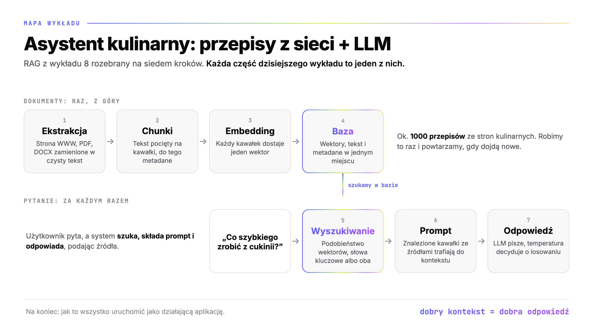

> _Notatka prowadzącego:_ Jedna minuta, mapa z W10. Dziś interesują nas dwa miejsca. Krok 1, ekstrakcja: tam model wyciągał z przepisu tytuł, składniki, czas i kategorię do JSON-a, a kategoria stała się metadanymi do filtrowania w kroku 5. Krok 7, odpowiedź: tam zostawiliśmy pytanie, jak sprawdzić, czy odpowiedzi są dobre. Pierwsza połowa wykładu naprawia krok 1, druga mierzy oba.

---

## Problem

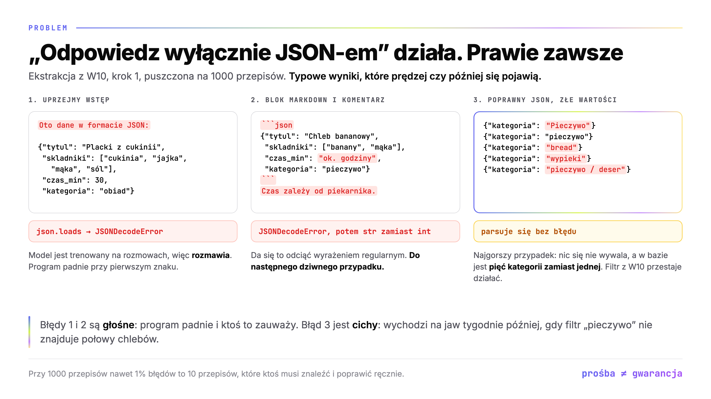

> _Notatka prowadzącego:_ To jest kod z W10, krok 1: prompt "Odpowiedz wyłącznie JSON-em" i json.loads. Na kilku przepisach działa. Na tysiącu prędzej czy później trafimy na każdy z tych trzech przypadków. Pierwsze dwa są głośne, program rzuci wyjątek. Trzeci jest najgroźniejszy, bo nic się nie dzieje: filtr kategoria = "pieczywo" z kroku 5 na W10 po cichu gubi połowę chlebów. Pytanie do sali: jak byście to naprawili? Zwykle padają odpowiedzi: wyrażenia regularne, lowercase, słownik synonimów. Każda łata jeden przypadek. Dziś naprawimy przyczynę.

---

## Druga połowa problemu

### „Poprawiłem prompt. Chyba jest lepiej?”

- Dopisujemy do promptu **definicje kategorii**. Trzy przepisy wyglądają dobrze
- Kolega zmienia model na tańszy. **Też wygląda dobrze**
- Po miesiącu ktoś zauważa, że desery lądują w pieczywie. **Od kiedy? Po której zmianie?**

**Bez pomiaru każda zmiana to zgadywanie, a każda poprawka może coś zepsuć w innym miejscu.**

> _Notatka prowadzącego:_ W zwykłym kodzie mamy na to testy jednostkowe: zmieniasz funkcję, puszczasz testy, widzisz, co się zepsuło. W kodzie z LLM-em funkcja to prompt plus model plus ustawienia, a wynik jest losowy (temperatura z W10, W11). Testy nadal są potrzebne, tylko wyglądają inaczej: nie "czy wynik równa się X", ale "w ilu procentach przypadków". To jest temat drugiej połowy wykładu. Na warsztatach nazywamy to jedną rzeczą do zapamiętania z całego dnia.

---

## Mapa wykładu


> _Notatka prowadzącego:_ Jedyny schemat do zapamiętania. Kroki 1–3 sprawiają, że wynik da się policzyć: zamiast napisu dostajemy obiekt z polami z zamkniętej listy. Kroki 4–6 go liczą: zbiór przykładów z poprawną odpowiedzią, pomiar, porównanie wersji. Krok 7 rozszerza pomiar na odpowiedzi, które nie mają jednej poprawnej formy, czyli odpowiedzi RAG z W10. Pod każdym krokiem jest artefakt: kawałek kodu albo plik, który zostaje w projekcie.

---

## Gdzie jesteśmy

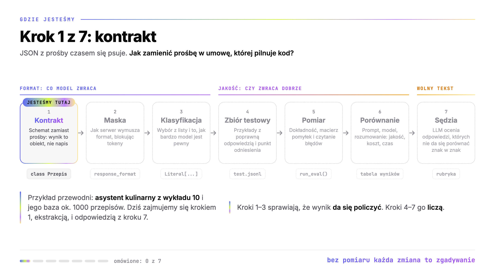

> _Notatka prowadzącego:_ Kilka sekund. Zaczynamy od formatu.

---

## Krok 1: prośba czy kontrakt?

### Dwa sposoby, żeby dostać JSON

| | Prośba w prompcie (W10) | Kontrakt: structured output |
|---|---|---|
| Jak? | „Odpowiedz wyłącznie JSON-em: ...” | schemat wysłany w `response_format` |
| Kto pilnuje? | model, jeśli posłucha | **serwer**, przy każdym tokenie |
| Typy pól | jak model zrozumie | `int` to `int`, lista to lista |
| Wynik | napis do sparsowania | **obiekt w Pythonie** |
| Kategoria spoza listy | możliwa | **niemożliwa** |

> _Notatka prowadzącego:_ Structured output potrafią dziś wszystkie poważne serwery: vLLM, SGLang, llama.cpp, Ollama, a z chmur OpenAI, Anthropic, Google. Nazwy się różnią (JSON mode, structured outputs, guided decoding), idea jest ta sama. Ważne rozróżnienie: stary "JSON mode" gwarantował tylko poprawny JSON, a nie zgodność ze schematem. My mówimy o pełnym schemacie: pola, typy, dozwolone wartości. Jak serwer tego pilnuje, to krok 2.

---

## Krok 1: schemat w Pydantic

### Klasa w Pythonie zamiast opisu w prompcie

```python
from typing import Literal
from pydantic import BaseModel, Field

class Przepis(BaseModel):
    tytul: str
    skladniki: list[str]
    czas_min: int = Field(ge=1, le=1440)
    porcje: int | None                   # nie każdy przepis podaje
    kategoria: Literal["obiad", "zupa", "deser", "pieczywo", "inne"]
```

- `Literal[...]` to zamknięta lista: koniec z „Pieczywo”, „bread” i „wypieki”
- `int | None` to **wyjście awaryjne**: model może powiedzieć „nie wiem”

> _Notatka prowadzącego:_ Pydantic to standardowa biblioteka do walidacji danych w Pythonie, używana m.in. przez FastAPI. Z klasy generuje JSON Schema, czyli format, który rozumie serwer modelu. Te same pola co w JSON-ie z W10, plus porcje. Kategorie rozszerzyliśmy o zupę, bo baza ma ich sporo. Pole porcje jest opcjonalne celowo: wiele przepisów z internetu nie podaje liczby porcji i nie chcemy, żeby model ją zgadywał. Do tego wrócimy w kroku 2. Field(ge=1, le=1440) to ograniczenie wartości: od minuty do doby.

---

## Krok 1: wywołanie

### Ten sam klient, inna metoda

```python
odp = client.chat.completions.parse(
    model="gpt-oss-120b",
    messages=[
        {"role": "system", "content": "Wyciągnij dane z przepisu."},
        {"role": "user", "content": f"<przepis>\n{tekst}\n</przepis>"},
    ],
    response_format=Przepis,
)
przepis = odp.choices[0].message.parsed     # obiekt klasy Przepis, nie napis

przepis.kategoria        # 'obiad'
przepis.czas_min + 15    # 45: to jest liczba, można liczyć
```

> _Notatka prowadzącego:_ Klient zgodny z OpenAI, ten sam co na W10 i W11. Zmieniają się dwie rzeczy: metoda parse zamiast create i parametr response_format z naszą klasą. Biblioteka sama zamienia klasę na JSON Schema, wysyła ją do serwera, a odpowiedź parsuje z powrotem do obiektu. Zwróć uwagę na tagi <przepis>: oddzielają dane od instrukcji, o tym jeszcze w kroku 2. Prompt systemowy jest krótki, bo format opisuje schemat, a nie tekst.

---

## Krok 1: co naprawdę leci do serwera

### Klasa zamienia się w JSON Schema

```json
{"properties": {
   "tytul":     {"type": "string"},
   "skladniki": {"type": "array", "items": {"type": "string"}},
   "czas_min":  {"type": "integer", "minimum": 1, "maximum": 1440},
   "porcje":    {"anyOf": [{"type": "integer"}, {"type": "null"}]},
   "kategoria": {"enum": ["obiad", "zupa", "deser", "pieczywo", "inne"]}},
 "required": ["tytul", "skladniki", "czas_min", "porcje", "kategoria"],
 "type": "object"}
```

**JSON Schema to standard, nie wynalazek jednej firmy.** Ten sam format opisuje narzędzia na semestrze 2.

> _Notatka prowadzącego:_ Wynik Przepis.model_json_schema(), lekko skrócony (bez tytułów pól). Warto to zobaczyć raz, żeby wiedzieć, że nie ma tu magii: to zwykły słownik. Zapowiedź na semestr 2: opis narzędzia dla modelu (tool calling) to dokładnie taki sam schemat, tylko opisuje argumenty funkcji, a nie pola przepisu. Kto dziś zrozumie structured output, zrozumie narzędzia w pięć minut.

---

## Gdzie jesteśmy

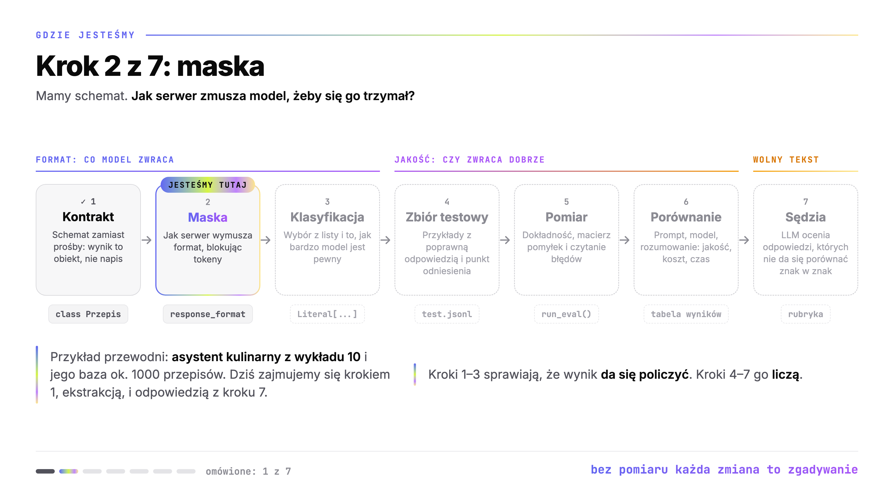

> _Notatka prowadzącego:_ Kilka sekund. Schemat mamy. Teraz: jak serwer zmusza model, żeby się go trzymał?

---

## Krok 2: maska


> _Notatka prowadzącego:_ Najważniejszy slajd pierwszej połowy. Wracamy do W9, krok 6: model zwraca rozkład prawdopodobieństwa na następny token i z niego losujemy. Structured output nie zmienia modelu ani promptu. Serwer w każdym kroku generowania sprawdza, które tokeny dają się jeszcze dokończyć do tekstu zgodnego ze schematem, a pozostałym ustawia prawdopodobieństwo zero (w praktyce logit minus nieskończoność przed softmaxem). Losujemy z tego, co zostało. Dlatego wynik zawsze się sparsuje. Nazwa techniczna: constrained decoding albo guided decoding; w vLLM robią to biblioteki xgrammar albo outlines. Liczby poglądowe, a w rzeczywistości maska działa na tokenach, nie na słowach: "obiad" może być dwoma tokenami i maska pilnuje każdego z nich.

---

## Krok 2: gramatyka, nie prośba

### Co serwer wie w każdym kroku

- Schemat zamienia się w **automat**: wie, co wolno napisać w danym miejscu
- Po `{` wolno tylko `"` i nazwę pola. Po `"czas_min": ` wolno tylko **cyfry**
- Po `"kategoria": "` wolno tylko początki **pięciu słów** z listy
- Koszt: trochę obliczeń na token, **zero dodatkowych zapytań**

**Model dalej wybiera. Tylko z mniejszego menu.**

> _Notatka prowadzącego:_ Analogia: formularz w urzędzie z polami do zaznaczenia zamiast wolnego tekstu. Urzędnik nie musi prosić, żeby pisać czytelnie. Tak samo działa to dla pola czas_min: "ok. godziny" z problemu w ogóle nie może się pojawić, bo po dwukropku dozwolone są tylko cyfry. To też powód, dla którego wyrażenia regularne nie są potrzebne: nie poprawiamy wyniku po fakcie, tylko nie dopuszczamy do złego wyniku. Narzut na serwerze jest mały, zwłaszcza w porównaniu z ponawianiem zapytania po błędzie parsowania.

---

## Krok 2: schemat wygrywa z pytaniem

### Pytamy o stolicę Francji, schemat pozwala tylko na banana

```python
odp = client.chat.completions.create(
    model="gpt-oss-120b",
    messages=[{"role": "user", "content": "Jaka jest stolica Francji?"}],
    response_format={"type": "json_schema", "json_schema": {
        "name": "odpowiedz", "strict": True,
        "schema": {"type": "object", "required": ["owoc"],
                   "properties": {"owoc": {"enum": ["banan"]}}}}})

print(odp.choices[0].message.content)    # {"owoc": "banan"}
```

**Schemat gwarantuje format, nie prawdę.**

> _Notatka prowadzącego:_ Demo z notebooka 3 warsztatów, warto puścić na żywo. Model wie, że to Paryż, ale żaden token prowadzący do "Paryż" nie przejdzie przez maskę. Wniosek praktyczny: jeśli poprawna odpowiedź nie da się zapisać w schemacie, dostaniemy pewną siebie, idealnie sformatowaną, złą odpowiedź. Następny slajd pokazuje, jak to wygląda w naszej kuchni.

---

## Krok 2: daj modelowi wyjście

### Co się stanie z tekstem, który nie jest przepisem?

- Do bazy trafia strona **„Regulamin sklepu”**. Schemat wymaga składników i czasu
- Model **musi** coś wpisać: wymyśli składniki, czas 30 minut, kategorię „obiad”
- Format idealny, treść zmyślona. Nikt tego nie zauważy

<!-- columns -->

### Furtki w schemacie

- `porcje: int | None`: „nie podano” to poprawna odpowiedź
- `kategoria` z wartością **„inne”**
- pole `czy_przepis: bool` **na początku** schematu
- w kodzie: `if not p.czy_przepis: pomin()`

> _Notatka prowadzącego:_ W W10, krok 1 mówiliśmy o śmieciach po ekstrakcji: menu strony, stopki, regulaminy. Structured output tego nie rozwiąże, tylko ukryje problem pod ładnym formatem. Dobre schematy zawsze mają drogę ucieczki: null, "inne", "nie wiem" albo pole logiczne, które pozwala odrzucić wejście. Pole czy_przepis stoi na początku, bo model generuje pola po kolei: najpierw decyduje, czy to przepis, a potem wypełnia resztę, wiedząc, co zdecydował. O kolejności za dwa slajdy.

---

## Krok 2: czy model czyta schemat?

### Na vLLM nie: schemat służy tylko do maski

```python
class Przepis(BaseModel):
    tytul: str = Field(description="Tytuł WIELKIMI LITERAMI")
    ...

# opis pola NIE trafia do modelu: tytuł wyjdzie zwykłymi literami

def schema_prompt(klasa) -> str:
    schemat = json.dumps(klasa.model_json_schema(), ensure_ascii=False)
    return f"Odpowiedz JSON-em zgodnym ze schematem (przestrzegaj opisów pól):\n{schemat}"

messages = [{"role": "system", "content": schema_prompt(Przepis)}, ...]
```

> _Notatka prowadzącego:_ Pułapka sprawdzona na warsztatach: na naszym serwerze (vLLM) schemat idzie tylko do maski, model nigdy go nie widzi. Nazwy pól pomagają, bo to zwykły tekst, który model sam generuje, ale opisy w Field(description=...) są po cichu ignorowane, a liczba tokenów promptu się nie zmienia. Część chmur wstrzykuje schemat do promptu za nas, część nie. Zasada: jeśli opisy pól są ważne, dołóż schemat do promptu samodzielnie (funkcja schema_prompt z warsztatów) i sprawdź na kilku przykładach.

---

## Krok 2: kolejność pól ma znaczenie

### Model pisze pola od góry do dołu

```python
class KategoriaPrzepisu(BaseModel):
    uzasadnienie: str      # najpierw myśli, potem wybiera
    kategoria: Literal["obiad", "zupa", "deser", "pieczywo", "inne"]
```

- `uzasadnienie` **przed** `kategoria`: model najpierw pisze, dlaczego, potem decyduje
- `uzasadnienie` **po** `kategoria`: model decyduje od razu, a potem **tłumaczy się**

**Każdy token zależy tylko od tokenów przed nim (W9).**

> _Notatka prowadzącego:_ Prosty trik, który często podnosi jakość na trudnych przypadkach: to taki mini chain of thought w środku schematu. Działa z tego samego powodu co rozumowanie w modelach rozumujących z W11: tokeny wygenerowane wcześniej są kontekstem dla późniejszych. Uzasadnienie po kategorii nie wpływa na decyzję, za to dobrze nadaje się do pokazania użytkownikowi albo do debugowania. Kosztuje tokeny wyjściowe, a te są drogie (W11). Czy się opłaca, sprawdzimy w kroku 6.

---

## Gdzie jesteśmy

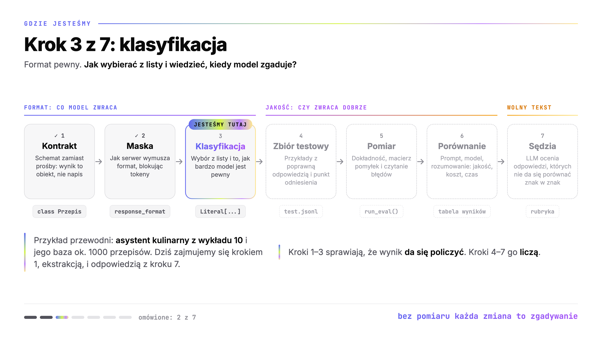

> _Notatka prowadzącego:_ Kilka sekund. Format pewny. Teraz najczęstsze zadanie z formatem: wybór z listy.

---

## Krok 3: klasyfikacja to wybór z listy

### Tysiąc przepisów, pięć kategorii

```python
class KategoriaPrzepisu(BaseModel):
    kategoria: Literal["obiad", "zupa", "deser", "pieczywo", "inne"]

def kategoryzuj(tekst: str) -> str:
    odp = client.chat.completions.parse(
        model="gemma-4-26b-a4b",
        messages=[{"role": "system", "content": "Przypisz przepis do kategorii."},
                  {"role": "user", "content": f"<przepis>\n{tekst}\n</przepis>"}],
        response_format=KategoriaPrzepisu, temperature=0)
    return odp.choices[0].message.parsed.kategoria
```

> _Notatka prowadzącego:_ To kategoryzacja z W10, krok 1, przepisana na structured output. W W10 model odpowiadał "The text can be categorized under the following category from the given list: Category: Cooking", tutaj może odpowiedzieć tylko jednym z pięciu słów. Mały model (gemma-4-26b-a4b, MoE z ok. 4 mld aktywnych parametrów) wystarczy, bo zadanie jest proste, a przepisów jest dużo. Temperatura 0 jak w tabeli z W10. To jest nasza funkcja, którą w krokach 4–6 będziemy mierzyć.

---

## Krok 3: ile model jest pewny?

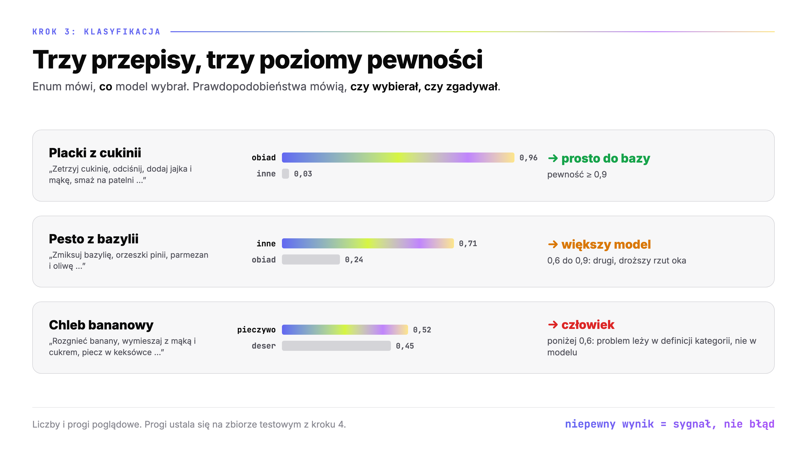

> _Notatka prowadzącego:_ Enum zwraca jedną etykietę, ale pod spodem jest rozkład z W9, ten sam co na slajdzie z maską. Jeśli serwer go zwraca, mamy darmową informację o pewności. Wysoka pewność: wpisujemy do bazy. Średnia: pytamy większy, droższy model, ale tylko dla tych kilku procent przypadków. Niska: zwykle nie oznacza, że model jest słaby, tylko że kategorie nie są dobrze zdefiniowane. Chleb bananowy naprawdę jest i pieczywem, i deserem. To będzie widać w macierzy pomyłek w kroku 5. Liczby i progi poglądowe.

---

## Krok 3: pewność w kodzie

### Logprobs: prawdopodobieństwa wygenerowanych tokenów

```python
odp = client.chat.completions.create(
    model="gemma-4-26b-a4b", messages=messages, temperature=0,
    response_format={"type": "json_schema", "json_schema": {...}},
    logprobs=True, top_logprobs=5)

for t in odp.choices[0].logprobs.content:          # token po tokenie
    if t.token.strip('"') in ("ob", "zu", "des", "pie", "in"):   # początek kategorii
        print({a.token: round(math.exp(a.logprob), 2) for a in t.top_logprobs})
        break
# {'ob': 0.96, 'in': 0.03, ...}
```

> _Notatka prowadzącego:_ logprobs to logarytmy prawdopodobieństw, więc exp zamienia je z powrotem na liczby od 0 do 1. Szukamy tokenu, w którym model wybiera kategorię, i patrzymy na alternatywy. Kod poglądowy: podział na tokeny zależy od tokenizera (W9), więc w praktyce warto dobrać kategorie tak, żeby różniły się pierwszym tokenem. Nie każdy serwer zwraca logprobs razem z maską, a modele rozumujące najpierw generują rozumowanie, więc trzeba szukać właściwego miejsca. Przykład rozwiązania produktowego: na warsztatach używamy endpointu /v1/decisions na platformie CGC (rozszerzenie Comtegra, poza standardem OpenAI), który dla zadania klasyfikacji zwraca od razu prawdopodobieństwa wszystkich opcji bez generowania tokenów. Kod pod takie API nie zadziała na innym serwerze.

---

## Krok 3: czy w ogóle LLM?

### Klasyfikację da się zrobić na kilka sposobów

| Sposób | Kiedy | Koszt na 1000 przepisów |
|---|---|---|
| Reguły, słowa kluczowe | „zupa” w tytule | prawie zero |
| Embedding + mały klasyfikator (W9, W10) | dużo oznaczonych przykładów | grosze |
| Mały LLM + enum | mało przykładów, opis kategorii | ok. 0,50 zł |
| Duży LLM z rozumowaniem | trudne, niejednoznaczne przypadki | kilka do kilkudziesięciu zł |

**Odpowiedź na „który?” nie leży w rankingu. Leży w pomiarze: kroki 4–6.**

> _Notatka prowadzącego:_ Uczciwa uwaga: LLM nie zawsze jest najlepszym narzędziem. Wektory z W10 da się wrzucić do zwykłej regresji logistycznej i dla pięciu kategorii z setkami przykładów to często wystarcza. LLM wygrywa, gdy przykładów jest mało, kategorie łatwiej opisać słowami niż pokazać, albo przypadki wymagają czytania ze zrozumieniem. Koszty poglądowe, policzone z cennika CGC dla ok. 800 tokenów na przepis. Skąd wiadomo, która opcja wystarczy? Tylko z pomiaru na własnych danych.

---

## Gdzie jesteśmy

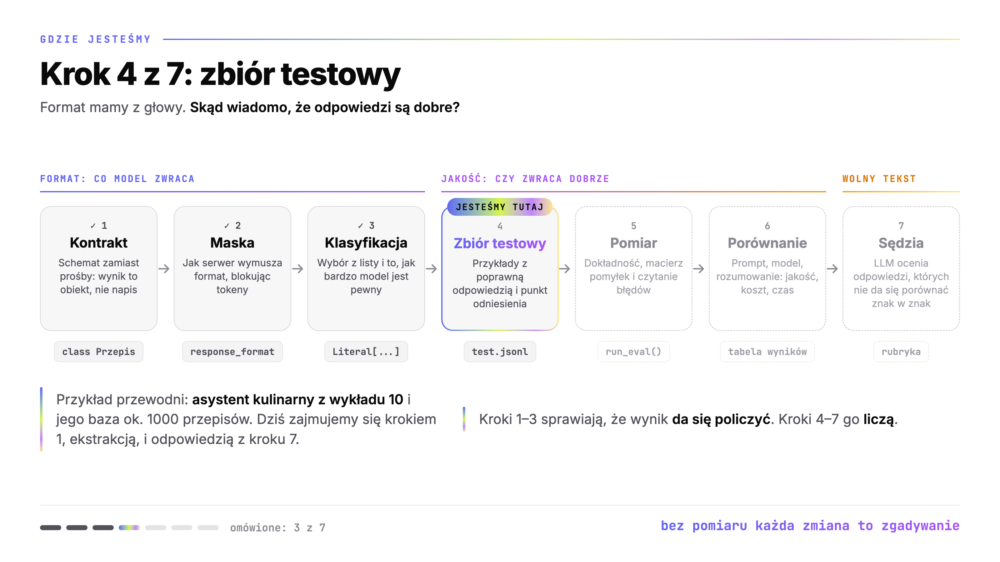

> _Notatka prowadzącego:_ Kilka sekund. Format mamy z głowy. Zaczyna się druga połowa: czy odpowiedzi są dobre?

---

## Krok 4: test na trzech przykładach

### Jak zwykle sprawdzamy prompt

1. Zmieniamy prompt
2. Puszczamy **trzy** przepisy, które akurat mamy pod ręką
3. Patrzymy i stwierdzamy: **wygląda dobrze**

<!-- columns -->

### Co jest nie tak

- Trzy przepisy to **zawsze te same, łatwe** przypadki
- Wynik jest losowy: drugi raz może wyjść inaczej
- Nie widzimy, co **zepsuło się gdzie indziej**
- Nie da się porównać **dwóch wersji**

> _Notatka prowadzącego:_ Tak powstaje większość funkcji z LLM-em i dlatego się psują. Ewaluacja (eval) to po prostu zestaw testów dla zachowania modelu: wejścia z oczekiwanymi wyjściami, sposób oceny i liczba, którą da się porównać między wersjami promptu, modelami i ustawieniami. Brzmi oczywiście, a robi to mniejszość zespołów. Na warsztatach budujemy taki zestaw na pytaniach medycznych (PubMedQA), tu na przepisach.

---

## Krok 4: zbiór testowy

### Przykłady z poprawną odpowiedzią, jeden na linię

```json
{"id": 17, "tekst": "Placki z cukinii. Zetrzyj cukinię...", "kategoria": "obiad"}
{"id": 18, "tekst": "Chleb bananowy. Rozgnieć banany...", "kategoria": "deser"}
{"id": 19, "tekst": "Pesto z bazylii. Zmiksuj bazylię...", "kategoria": "inne"}
{"id": 20, "tekst": "Krem z dyni. Podsmaż cebulę...", "kategoria": "zupa"}
```

- Format **JSONL**: jedna linia = jeden przykład, łatwo dopisywać
- Etykiety nadaje **człowiek**, najlepiej dwóch niezależnie
- Na start wystarczy **50 do 100** przykładów

> _Notatka prowadzącego:_ Plik test.jsonl, artefakt kroku 4. Najdroższa część całej ewaluacji to nie kod, tylko etykiety: ktoś musi przeczytać 60 przepisów i przypisać kategorię. Dwie osoby niezależnie to dobra praktyka, bo od razu widać, gdzie ludzie się nie zgadzają. Jeśli nie zgadzają się ludzie, model też nie będzie trafiał, i to jest informacja o kategoriach, a nie o modelu. Chleb bananowy jako deser to decyzja, którą trzeba podjąć i zapisać, a nie oczywistość.

---

## Krok 4: skąd brać przykłady?

### Zbiór ma wyglądać jak prawdziwe dane

- **Z prawdziwej bazy**, nie wymyślone: wylosuj 60 przepisów z tysiąca
- **Trudne przypadki dopisz celowo:** chleb bananowy, sosy, przetwory, „regulamin sklepu”
- **Każdy błąd z produkcji** to nowy przykład testowy
- **Nie testuj na tym, na czym stroisz:** przykłady z promptu nie trafiają do testu

**Zbiór testowy rośnie razem z projektem. Nigdy nie jest skończony.**

> _Notatka prowadzącego:_ Ostatni punkt jest najważniejszy i najczęściej łamany. Jeśli trzy przepisy z testu wkleimy do promptu jako przykłady (few-shot), wynik na teście wzrośnie, ale nic nie powie o pozostałych 940 przepisach. To ta sama zasada co podział na zbiór treningowy i testowy przy uczeniu modeli z W9, tylko teraz "trenujemy" prompt. W praktyce trzyma się dwa zbiory: roboczy do oglądania błędów i poprawiania promptu oraz testowy, na który patrzymy tylko przy decyzji.

---

## Krok 4: punkt odniesienia

### Najgłupszy możliwy model

| Kategoria | Przykładów | Udział |
|---|---|---|
| obiad | 27 | 45% |
| deser | 12 | 20% |
| zupa | 9 | 15% |
| pieczywo | 7 | 12% |
| inne | 5 | 8% |

**„Zawsze odpowiadaj: obiad” ma 45% dokładności. To jest dno, nie zero.**

> _Notatka prowadzącego:_ Zanim zaczniemy mierzyć model, sprawdzamy rozkład etykiet. Model, który zawsze mówi "obiad", trafia w 45% przypadków bez czytania czegokolwiek. Jeśli nasz LLM ma 50%, nie jest "w połowie dobry", tylko prawie bezużyteczny. Na warsztatach to samo: w PubMedQA ponad połowa odpowiedzi to "yes", więc "zawsze yes" ma ponad 50%. Liczby poglądowe dla naszego zbioru 60 przepisów, ale proporcje są typowe dla bazy przepisów: obiadów jest najwięcej.

---

## Krok 4: ile to jest 60 przykładów?

### Jeden przepis to 1,7 punktu procentowego

- 80% kontra 82% na 60 przykładach to **jeden przepis różnicy**
- Ten sam prompt puszczony dwa razy potrafi dać **różne wyniki**
- Różnica **2–3 punktów** przy takim zbiorze to często szum

**Mała różnica? Puść jeszcze raz albo dołóż przykładów. Nie ogłaszaj sukcesu.**

> _Notatka prowadzącego:_ Prosta arytmetyka: 1/60 to ok. 1,7 punktu procentowego. Losowość z temperatury (W10) i z serwera (W11: temperatura 0 to nie gwarancja determinizmu na współdzielonym GPU) sprawia, że ten sam prompt daje trochę inne wyniki przy każdym uruchomieniu. Dla porządnej statystyki liczy się przedziały ufności, ale na start wystarczy zasada: różnice kilku punktów na małym zbiorze traktujemy podejrzliwie, różnice kilkunastu punktów zwykle są prawdziwe.

---

## Gdzie jesteśmy

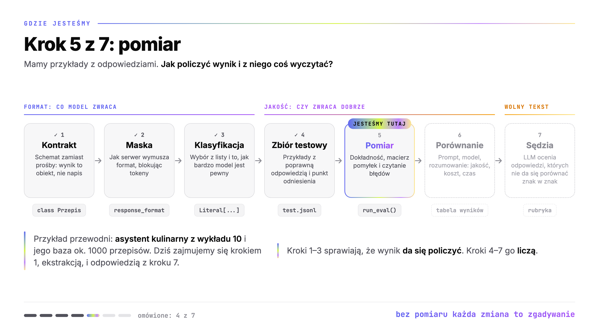

> _Notatka prowadzącego:_ Kilka sekund. Mamy przykłady z odpowiedziami. Teraz liczymy.

---

## Krok 5: naiwny pomiar

### Porównanie napisów mierzy formatowanie, nie kuchnię

```python
for p in test[:4]:
    odp = zapytaj(f"Podaj kategorię jednym słowem.\n<przepis>{p['tekst']}</przepis>")
    print(repr(odp), p["kategoria"], odp == p["kategoria"])
```

```text
'Obiad.'        obiad     False
'deser'         deser     True
'Zupa (krem)'   zupa      False
'pieczywo'      deser     False
```

**Napraw wyjście, nie porównanie. Structured output z kroku 1 robi to za darmo.**

> _Notatka prowadzącego:_ Klasyczny błąd z notebooka 8 warsztatów (tam "Maybe." kontra "maybe"). Kusi, żeby dopisać lower() i strip("."), ale to łatanie objawów jak przy wyrażeniach regularnych z problemu. Z enumem z kroku 3 model może zwrócić tylko jedno z pięciu słów, więc porównanie napisów jest uczciwe. Dopiero teraz liczba mówi coś o kategoryzacji. To dlatego kroki 1–3 są przed krokami 4–7: bez formatu nie ma czego mierzyć. Wyniki poglądowe.

---

## Krok 5: harness

### Jedna funkcja na jedno wywołanie, z czasem i kosztem

```python
def ocen(przyklad, system, model, **ustawienia) -> dict:
    start = time.perf_counter()
    try:
        odp = client.chat.completions.parse(model=model, response_format=KategoriaPrzepisu,
            messages=[{"role": "system", "content": system},
                      {"role": "user", "content": przyklad["tekst"]}], **ustawienia)
        wynik, koszt = odp.choices[0].message.parsed.kategoria, koszt_pln(model, odp.usage)
    except Exception as e:                  # błąd API to nie zła odpowiedź
        wynik, koszt = f"BŁĄD: {type(e).__name__}", 0.0
    return {"oczekiwane": przyklad["kategoria"], "wynik": wynik,
            "czas": time.perf_counter() - start, "koszt": koszt}
```

> _Notatka prowadzącego:_ Harness, czyli uprząż testowa: kod, który puszcza model na zbiorze i zbiera wyniki. Trzy decyzje projektowe. Po pierwsze, mierzymy od razu czas i koszt, bo w kroku 6 będą tak samo ważne jak dokładność. Funkcja koszt_pln liczy cenę z usage i cennika, jak na W11. Po drugie, błędy API (timeout, przeciążony serwer) łapiemy i liczymy osobno, zamiast wywalać cały przebieg albo liczyć je jako złą odpowiedź. Po trzecie, wszystko, co zmieniamy między wersjami (system, model, ustawienia), jest parametrem.

---

## Krok 5: uruchomienie

### Równolegle, ale z umiarem

```python
def run_eval(nazwa, n=60, watki=8, **konfig) -> pd.DataFrame:
    with ThreadPoolExecutor(max_workers=watki) as pula:
        wiersze = list(pula.map(lambda p: ocen(p, **konfig), test[:n]))
    df = pd.DataFrame(wiersze)
    df["blad"] = df.wynik.str.startswith("BŁĄD")
    df["trafione"] = df.wynik == df.oczekiwane
    print(f"{nazwa:<20} dokładność={df.trafione.mean():.0%}  błędy={df.blad.sum()}  "
          f"koszt={df.koszt.sum():.2f} zł  czas p50={df.czas.median():.1f} s")
    return df
```

```text
mały, prompt v1      dokładność=80%  błędy=0  koszt=0.03 zł  czas p50=0.4 s
```

> _Notatka prowadzącego:_ 60 zapytań po kolei to minuta albo dłużej, więc puszczamy je równolegle. Osiem wątków to rozsądny limit na współdzielonym serwerze: przy dwudziestu osobach na sali, każda z ośmioma wątkami, serwer zacznie odrzucać zapytania (W9: czas do pierwszego tokena rośnie z liczbą jednoczesnych zapytań). Mediana czasu (p50) zamiast średniej, bo jedno zawieszone zapytanie zawyża średnią. Wynik poglądowy: 80% to 48 z 60. Za 0,03 zł zmierzyliśmy prompt na 60 przepisach.

---

## Krok 5: macierz pomyłek

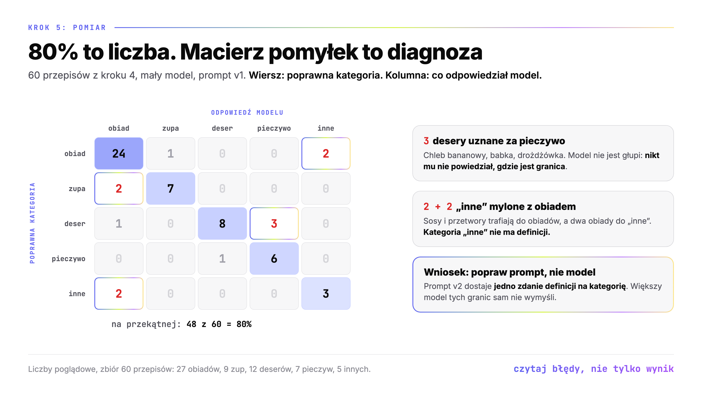

> _Notatka prowadzącego:_ Jak czytać: wiersz to poprawna kategoria, kolumna to odpowiedź modelu. Przekątna to trafienia, wszystko poza nią to błędy, i każdy błąd ma swój adres. 80% mówi tylko "jest źle w co piątym przypadku". Macierz mówi gdzie: granica deser kontra pieczywo i kategoria "inne", której nikt nie zdefiniował. Zupy uznane za obiad (kremy podawane jako danie główne) to podobna historia. To pytanie o definicję, a nie o model. Liczby poglądowe. W pandas: pd.crosstab(df.oczekiwane, df.wynik).

---

## Krok 5: czytaj błędy, nie tylko wynik

### Pięć błędów, trzy różne przyczyny

| Przepis | Etykieta | Model | Kto ma rację? |
|---|---|---|---|
| Chleb bananowy | deser | pieczywo | **nikt**: brak definicji granicy |
| Babka drożdżowa | deser | pieczywo | **nikt**: brak definicji granicy |
| Sos beszamelowy | inne | obiad | **nikt**: „inne” bez definicji |
| Krem z dyni | zupa | obiad | model się pomylił |
| Pierogi ruskie | **zupa** | obiad | **model**: etykieta była zła |

**Zawsze przeczytaj kilka błędów. Czasem pomylił się człowiek.**

> _Notatka prowadzącego:_ To jest najcenniejsze pięć minut całej ewaluacji. Trzy rodzaje przyczyn: niejasna definicja (naprawia się w prompcie i w instrukcji dla osób etykietujących), prawdziwy błąd modelu (naprawia się lepszym promptem albo modelem) i zła etykieta (naprawia się w zbiorze testowym). Ostatni wiersz zdarza się częściej, niż się wydaje: przy etykietowaniu ręcznym kilka procent etykiet bywa błędnych. Na warsztatach to samo w PubMedQA, gdzie "maybe" jest notorycznie nieostre. Przykłady poglądowe.

---

## Krok 5: z błędów do poprawki

### Prompt v2: definicja w jednym zdaniu na kategorię

```python
SYSTEM_V1 = "Przypisz przepis do kategorii."

SYSTEM_V2 = """Przypisz przepis do kategorii:
- obiad: danie główne, także makarony, pierogi, placki wytrawne
- zupa: podawana w talerzu głębokim, także kremy
- deser: słodkie, także słodkie wypieki: chleb bananowy, babki, drożdżówki
- pieczywo: wytrawne wypieki do kanapek i do obiadu
- inne: sosy, pesto, przetwory, napoje i wszystko, co nie jest daniem"""
```

> _Notatka prowadzącego:_ Każda linia odpowiada konkretnej komórce macierzy: drożdżówki i chleb bananowy do deseru, sosy i pesto do "inne", kremy do zup. To najtańsza możliwa poprawka: kilkadziesiąt tokenów promptu, ten sam model. Te same definicje trafiają do instrukcji dla osób, które etykietują zbiór testowy, inaczej model i człowiek będą grali według innych reguł. Czy v2 jest lepsza? Nie zgadujemy: krok 6.

---

## Gdzie jesteśmy

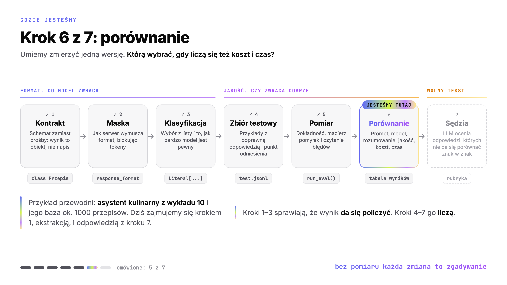

> _Notatka prowadzącego:_ Kilka sekund. Umiemy zmierzyć jedną wersję. Teraz wybieramy między kilkoma.

---

## Krok 6: co porównujemy

### Ten sam zbiór, jedna zmiana naraz

```python
wyniki = {
    "mały, prompt v1":  run_eval("mały, prompt v1", system=SYSTEM_V1, model=MALY),
    "mały, prompt v2":  run_eval("mały, prompt v2", system=SYSTEM_V2, model=MALY),
    "duży, effort low": run_eval("duży, effort low", system=SYSTEM_V2, model=DUZY,
                                 reasoning_effort="low"),
    "duży, effort high": run_eval("duży, effort high", system=SYSTEM_V2, model=DUZY,
                                  reasoning_effort="high"),
}
```

- Prompt: **v1 kontra v2** na tym samym modelu
- Model: **mały kontra duży** na tym samym prompcie
- Rozumowanie: **low kontra high** (W11)

> _Notatka prowadzącego:_ MALY to gemma-4-26b-a4b, DUZY to gpt-oss-120b, oba z cennika CGC. Zasada jednej zmiany: jeśli między dwoma wierszami zmienia się i prompt, i model, nie wiadomo, co pomogło. Dlatego v2 testujemy najpierw na małym modelu, a dopiero potem zmieniamy model. reasoning_effort z W11: im więcej model myśli, tym więcej tokenów wyjściowych, a te są najdroższe.

---

## Krok 6: wyniki

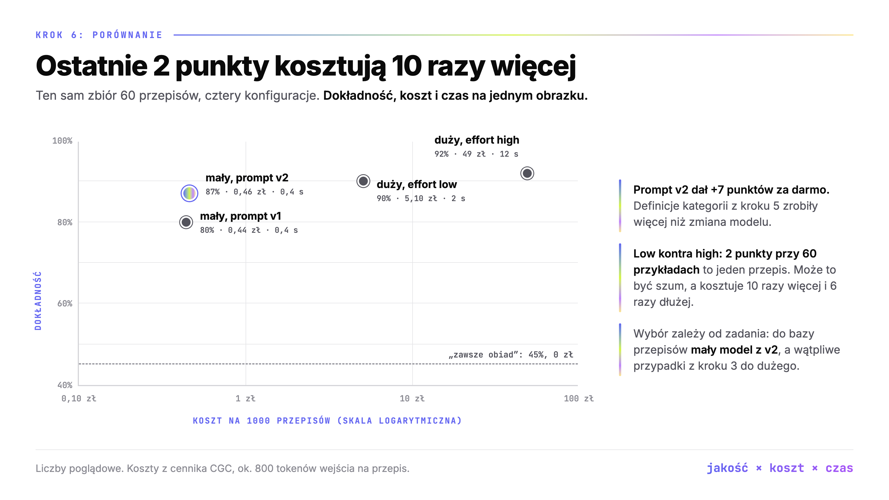

> _Notatka prowadzącego:_ Trzy wnioski, wszystkie typowe dla prawdziwych projektów. Prompt v2 dał siedem punktów za darmo: definicje z macierzy pomyłek zrobiły więcej niż zmiana modelu. Duży model jest lepszy, ale dziesięć razy droższy. Effort high kontra low to dwa punkty, czyli jeden przepis na 60: to może być szum, a kosztuje dziesięć razy więcej i jest sześć razy wolniejsze. Liczby poglądowe; koszty policzone z cennika CGC (gpt-oss-120b: ok. 0,27 zł za milion tokenów wejścia i ok. 32,78 zł za milion wyjścia; gemma: ok. 0,41 i 10,93 zł) przy założeniu ok. 800 tokenów wejścia na przepis i ok. 150 tokenów rozumowania przy low, 1500 przy high. To dlatego model rozumujący kosztuje tyle więcej: płacimy za myślenie (W11).

---

## Krok 6: decyzja

### Nie ma jednej najlepszej konfiguracji

| Zastosowanie | Wybór | Dlaczego |
|---|---|---|
| Kategoryzacja całej bazy | mały, prompt v2 | 87% za grosze, 0,4 s |
| Przypadki z niską pewnością (krok 3) | duży, effort low | kilka procent przepisów, +3 pkt |
| Effort high | **nigdzie** | +2 pkt w granicach szumu, 10 razy drożej |

**Pytanie „który model jest najlepszy?” ma sens tylko z dopiskiem „do czego i za ile”.**

> _Notatka prowadzącego:_ Tak wygląda dojrzała architektura: tani model na większość ruchu, droższy na trudne przypadki wskazane przez pewność z kroku 3. W ten sposób płacimy za duży model tylko tam, gdzie daje różnicę. Uwaga: wynik dotyczy tego zadania i tych danych. Przy innym zadaniu, np. odpowiedziach na trudne pytania kulinarne, effort high może być wart swojej ceny. Właśnie dlatego trzeba mierzyć u siebie.

---

## Krok 6: własny test kontra ranking

### Rankingi z W8 mówią o średniej. Twój test mówi o Twoim zadaniu

| | Ranking (LMArena, benchmarki) | Własny zbiór testowy |
|---|---|---|
| Zadania | tysiące cudzych | jedno, Twoje |
| Język, dziedzina | głównie angielski, ogólne | polskie przepisy |
| Koszt i czas | zwykle pomijane | mierzone przy każdym wierszu |
| Zmiana promptu | nie do sprawdzenia | jedno uruchomienie |

**Ranking wybiera kandydatów. Decyzję podejmuje Twój test.**

> _Notatka prowadzącego:_ Nawiązanie do rankingów z W8: LMArena, benchmarki, MT-Bench-PL. Są przydatne, żeby zawęzić listę do kilku modeli. Ale model z pierwszego miejsca nie musi być najlepszy do kategoryzacji polskich przepisów, a już na pewno nie najtańszy. Ten sam przepływ pracy działa dla każdej decyzji: czy zmiana w AGENTS.md agenta kodującego pomaga, czy przejść na nowy model, jaki effort wybrać.

---

## Gdzie jesteśmy

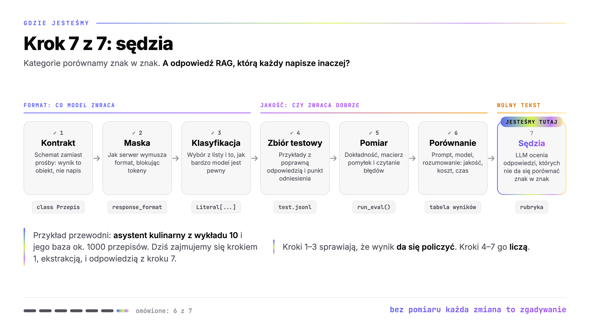

> _Notatka prowadzącego:_ Kilka sekund. Kategorie porównujemy znak w znak. A odpowiedzi z kroku 7 w W10?

---

## Krok 7: odpowiedzi bez klucza

### „Czym zastąpić jajka w plackach z cukinii?”

- Dobra odpowiedź da się napisać **na sto sposobów**
- Porównanie z wzorcem znak w znak: **zawsze fałsz**
- Podobieństwo wektorów z W10: **„siemię lniane” i „aquafaba” są blisko**, choć tylko jedno jest w źródle
- Człowiek oceni dobrze, ale **60 odpowiedzi po każdej zmianie** to godzina pracy

**Pomysł: niech oceni model. Ale według listy pytań, nie „na ile punktów”.**

> _Notatka prowadzącego:_ Wracamy do slajdu "Jak sprawdzić, czy działa?" z W10. Tam rozdzieliliśmy pomiar wyszukiwania (czy właściwy przepis jest w top 3, to da się policzyć jak dziś kategorię) od pomiaru odpowiedzi (czy zgadza się ze źródłem). Drugiego nie da się zrobić porównaniem napisów ani embeddingami: dwie różne rady kuchenne mogą mieć bardzo podobne wektory. Rozwiązanie, które przyjęło się w branży, to LLM jako sędzia (LLM-as-a-judge).

---

## Krok 7: sędzia z rubryką


> _Notatka prowadzącego:_ Pokaż palcem odpowiedź B. Aquafaba to prawdziwy zamiennik jajek i rada może być dobra, ale nie pochodzi z bazy. W RAG z W10 to jest dokładnie ten błąd, którego szukamy: model dodał coś od siebie. Rubryka z pytaniami tak lub nie działa lepiej niż skala od 1 do 10: zarówno ludzie, jak i modele zgadzają się co do "tak" znacznie częściej niż co do "7". Każde kryterium sprawdza jedną rzecz, więc od razu wiadomo, co poprawić.

---

## Krok 7: sędzia w kodzie

### Structured output w roli formularza oceny

```python
class Ocena(BaseModel):
    uzasadnienie: str                  # najpierw myśli (krok 2)
    odpowiada_na_pytanie: bool
    tylko_z_fragmentow: bool
    podaje_zrodlo: bool
    zwiezle: bool

def sedzia(pytanie, fragmenty, odpowiedz) -> Ocena:
    return client.chat.completions.parse(model="gpt-oss-120b", response_format=Ocena,
        messages=[{"role": "system", "content": "Oceniasz odpowiedzi asystenta. Bądź surowy."},
                  {"role": "user", "content": f"<pytanie>{pytanie}</pytanie>\n"
                   f"<fragmenty>{fragmenty}</fragmenty>\n<odpowiedz>{odpowiedz}</odpowiedz>"}],
    ).choices[0].message.parsed
```

> _Notatka prowadzącego:_ Wszystko z pierwszej połowy wykładu pracuje tutaj: schemat z kroku 1, uzasadnienie przed ocenami z kroku 2, pola bool jako najprostszy enum z kroku 3. Sędzią jest duży model, bo ocena jest trudniejsza niż odpowiedź, a ocen jest mniej niż odpowiedzi. Wynik to cztery liczby 0 lub 1 na odpowiedź, które da się uśrednić po zbiorze: np. "tylko z fragmentów: 93%". Odpowiednik z warsztatów (notebook 8) ocenia odpowiedzi e-mailowe Broberta, ten sam wzorzec.

---

## Krok 7: sędziego też trzeba sprawdzić

### Model oceniający ma własne skrzywienia

- **Długość:** dłuższe odpowiedzi dostają lepsze oceny
- **Kolejność:** przy porównaniu A z B wygrywa częściej pierwsza
- **Swój do swego:** model woli odpowiedzi w swoim stylu
- **Przytakiwanie** po RLHF (W8): „wygląda rozsądnie, więc tak”

<!-- columns -->

### Co robimy

- Ręcznie oceń **20–30 odpowiedzi** i porównaj z sędzią
- Zgodność niska? **Popraw rubrykę**, nie odpowiedzi
- Kryteria **wąskie i binarne**
- Przy porównaniach: **zamień kolejność** i oceń dwa razy

> _Notatka prowadzącego:_ Sędzia to też model, więc ma wszystkie wady modeli. Te skrzywienia są dobrze udokumentowane w pracach o LLM-as-a-judge (m.in. Zheng i in., 2023, praca wprowadzająca MT-Bench, ten sam benchmark co MT-Bench-PL z W8). Kluczowe jest sprawdzenie zgodności z człowiekiem: sędzia jest narzędziem pomiarowym, a narzędzie pomiarowe kalibruje się zanim się mu zaufa. Gdy sędzia i człowiek zgadzają się w np. 90% przypadków, można puszczać sędziego po każdej zmianie, a człowiek sprawdza tylko próbkę.

---

## Krok 7: co się działo w środku?

### Tracing: zapis każdego wywołania modelu

| Pojęcie (Langfuse) | Co to jest | U nas |
|---|---|---|
| **Trace** | jedno zapytanie użytkownika | „Czym zastąpić jajka?” |
| **Generation** | jedno wywołanie modelu w środku | ekstrakcja, odpowiedź, sędzia |
| **Session** | ślady jednej rozmowy | cała rozmowa o plackach |
| **Score** | ocena przypięta do śladu | wynik sędziego, kciuk w górę od użytkownika |

`from langfuse.openai import OpenAI`: **jedna linijka** i każde wywołanie jest zapisane.

> _Notatka prowadzącego:_ Gdy LLM siedzi w aplikacji, print przestaje wystarczać. Langfuse to otwartoźródłowa platforma do śledzenia i ewaluacji, zbudowana na OpenTelemetry; na warsztatach mamy własną instancję (notebook 7). Podmiana importu klienta zapisuje każde wywołanie: wiadomości, model, parametry, tokeny, czas. Dla nas są tu dwie rzeczy. Po pierwsze, ślady z produkcji to kopalnia przykładów do zbioru testowego: każdy dziwny przypadek trafia do test.jsonl. Po drugie, wyniki sędziego można zapisywać jako score i oglądać jakość w czasie. Przy agentach z semestru 2 to niezbędne: jedno zapytanie to wtedy kilkanaście wywołań modelu.

---

## Krok 7: od ewaluacji do finetuningu

### Te same dane, inny cel

```python
with open("trening.jsonl", "w") as f:
    for p in trening:                       # NIE zbiór testowy
        f.write(json.dumps({"messages": [
            {"role": "system", "content": SYSTEM_V2},
            {"role": "user", "content": p["tekst"]},
            {"role": "assistant", "content": json.dumps({"kategoria": p["kategoria"]})},
        ]}, ensure_ascii=False) + "\n")
```

**Prompt i większy model nie wystarczają? Oznaczone przykłady to gotowe dane do LoRA z W9.**

> _Notatka prowadzącego:_ Dobre zbiory testowe i dobre zbiory treningowe buduje się tak samo: prawdziwe przykłady, poprawne etykiety, trudne przypadki. Format messages to dziś standard danych do finetuningu modeli czatowych, jedna rozmowa na linię. Kolejność decyzji: najpierw prompt (krok 5), potem model (krok 6), a dopiero gdy to nie wystarczy, finetuning, np. LoRA z W9 na małym modelu. Zbiór testowy pozostaje nietknięty, bo dalej mierzymy na nim, czy finetuning pomógł. Moduł 3 warsztatów robi to na dokumentach Comtegra.

---

## Cała pętla


> _Notatka prowadzącego:_ Cały wykład na jednym obrazku. W branży nazywa się to eval-driven development, rozwój sterowany ewaluacją, analogicznie do test-driven development. Najpierw zbiór testowy, potem zmiany. Każda zmiana promptu, modelu albo ustawień przechodzi pętlę, zanim trafi do użytkowników. Pętla jest też odpowiedzią na pytanie z początku wykładu: "od kiedy desery lądują w pieczywie?". Od zmiany, która obniżyła wynik w tej komórce macierzy, i nie weszłaby, gdyby ktoś puścił test.

---

## Do zrobienia

### Zmierz własny projekt RAG

1. Ekstrakcję z projektu RAG przepisz na **structured output** ze schematem w Pydantic
2. Oznacz ręcznie **co najmniej 30 dokumentów**, w tym 5 trudnych
3. Policz **punkt odniesienia** i dokładność dwóch wersji promptu
4. Pokaż **macierz pomyłek** i opisz trzy błędy: czyja to wina?
5. Bonus: sędzia z rubryką dla 10 odpowiedzi, porównany z **własną oceną**

**Ocena: czy liczba w tabeli zmieniła Twoją decyzję?**

> _Notatka prowadzącego:_ Zadanie łączy się z projektem RAG o trikach na deskorolce: kategorie mogą być np. typ triku (flip, grind, manual, inne) albo poziom trudności. 30 dokumentów to mało do statystyki, ale wystarczająco, żeby przejść całą pętlę i zobaczyć pierwsze błędy. Kryterium oceny jest celowo praktyczne: jeśli pomiar nie zmienił żadnej decyzji, albo zadanie było za łatwe, albo zbiór za mały.

---

## Podsumowanie

### Siedem kroków asystenta, którego da się zmierzyć

- **1. Kontrakt:** schemat w Pydantic zamiast prośby; wynik to obiekt
- **2. Maska:** serwer zeruje tokeny spoza schematu; format to nie prawda, daj wyjście
- **3. Klasyfikacja:** enum zamyka listę, prawdopodobieństwa mówią, kiedy model zgaduje
- **4. Zbiór testowy:** prawdziwe przykłady, punkt odniesienia, nie testuj na tym, na czym stroisz
- **5. Pomiar:** harness z kosztem i czasem, macierz pomyłek, czytanie błędów
- **6. Porównanie:** jedna zmiana naraz, jakość razem z kosztem i czasem
- **7. Sędzia:** rubryka tak lub nie, sprawdzona na ludziach; tracing i dane do finetuningu

---

## Semestr w jednej tabeli

### Od tokenu do systemu, który da się utrzymać

| Wykład | Pytanie | Odpowiedź |
|---|---|---|
| W8 | Czym jest prompt i skąd wziąć model? | role, RAG, rankingi, kwantyzacja, atencja |
| W9 | Jak model czyta tekst? | tokeny, wektory, następny token, LoRA, GPU |
| W10 | Jak dać modelowi wiedzę? | RAG w siedmiu krokach |
| W11 | Jak z modelem rozmawiać w kodzie? | parametry, rozumowanie, koszt, cache |
| W12 | Skąd wiadomo, że działa? | structured output i ewaluacja |

> _Notatka prowadzącego:_ Domykamy semestr. Każdy wiersz korzystał z poprzednich: maska z dzisiejszego kroku 2 to softmax z W9, kategoria z kroku 3 to metadana z W10, koszt w kroku 6 to cennik z W11, a finetuning na końcu to LoRA z W9. Po tym semestrze studenci umieją zbudować asystenta z wiedzą i zmierzyć, czy działa. Na semestrze 2 asystent dostaje charakter, wiedzę o rozmówcy i ręce.

---

## Co dalej

### Dzisiejsze pojęcia wrócą

| Dziś | Gdzie wróci | Jako co |
|---|---|---|
| JSON Schema, structured output | Semestr 2, W1 | Narzędzia: schemat opisuje argumenty funkcji |
| Pewność i przekazanie człowiekowi | Semestr 2, W1 | „Czyta czy zmienia?”: potwierdzenie przed działaniem |
| Tracing, jedno zapytanie = wiele wywołań | Agenci AI, W1 | Anatomia harnessu i pętli agenta |
| Zbiór testowy, sędzia, pętla ewaluacji | Agenci AI, W4 | Ewaluacja agentów |

> _Notatka prowadzącego:_ Najważniejsze połączenie: na semestrze 2 model dostaje narzędzia, a wywołanie narzędzia to structured output, w którym pola są argumentami funkcji. Model zwraca JSON z nazwą funkcji i argumentami zgodnymi ze schematem, a nasz kod ją wykonuje. Kto dziś zrozumiał maskę i schemat, zrozumie function calling w pięć minut. Ewaluacja wraca w cyklu Agenci AI: agenta mierzy się trudniej, bo wynik to cała sekwencja działań, ale pętla jest ta sama.

---

## Dziękuję

### Pytania?

mgr inż. Jakub Zboina

mgr inż. Rafał Masłyk
